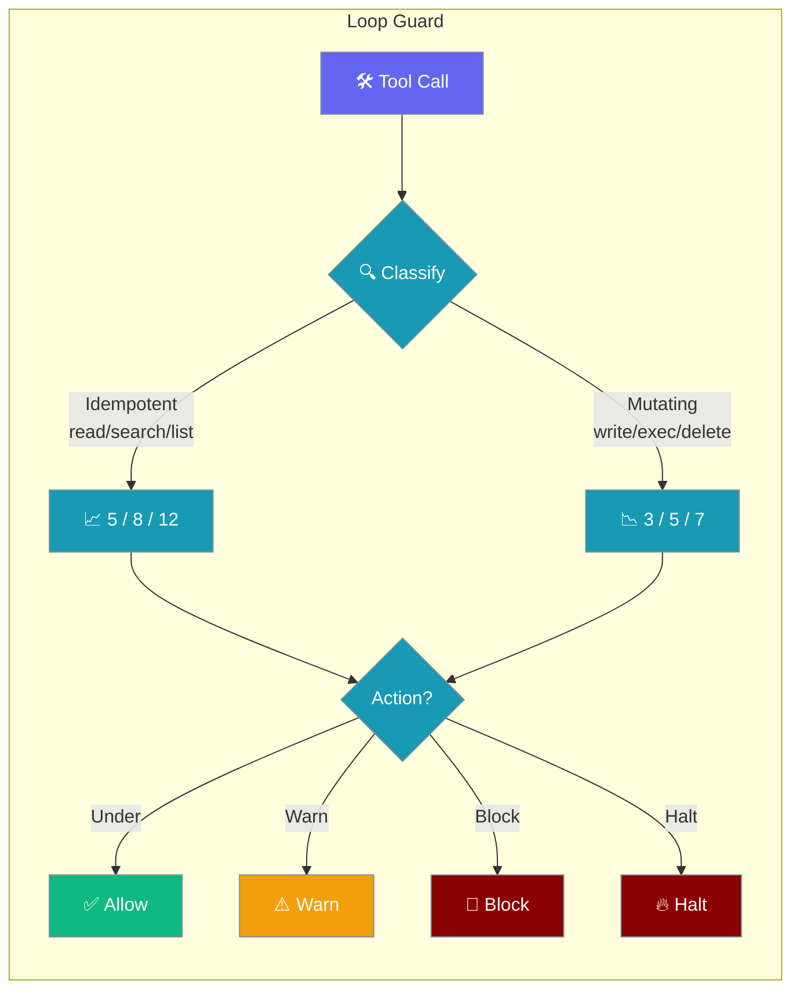
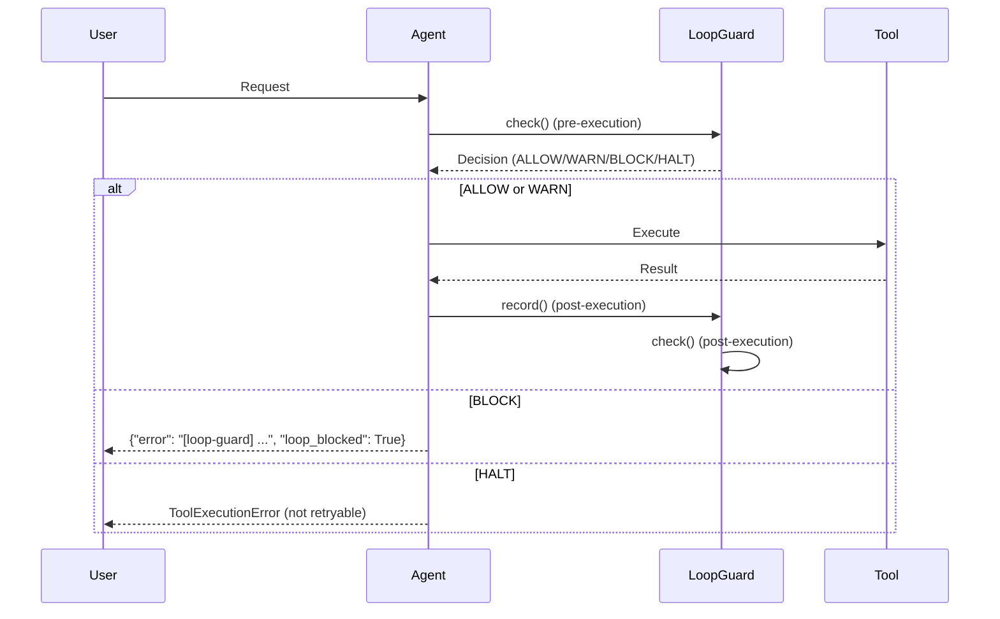
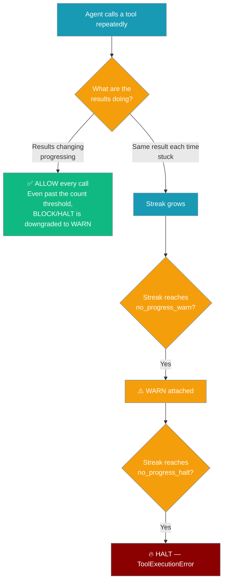
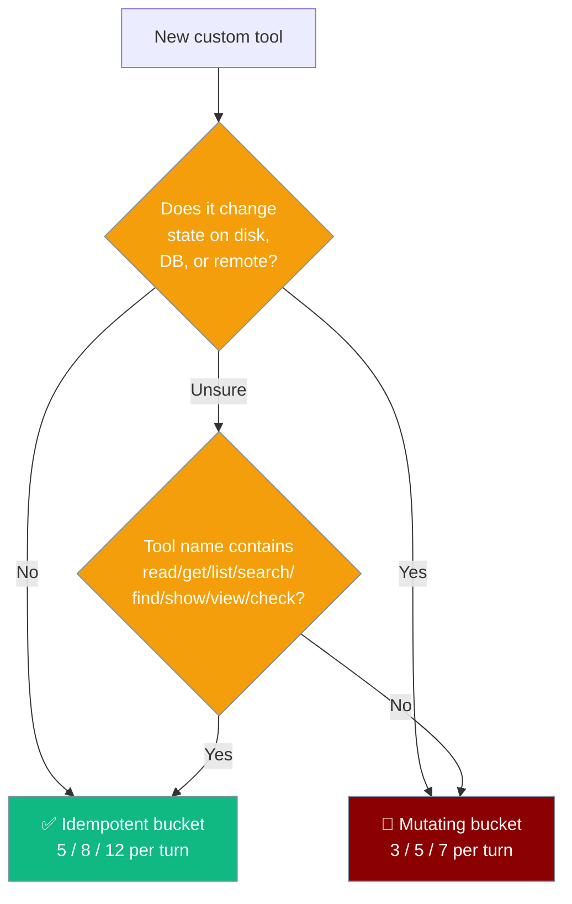
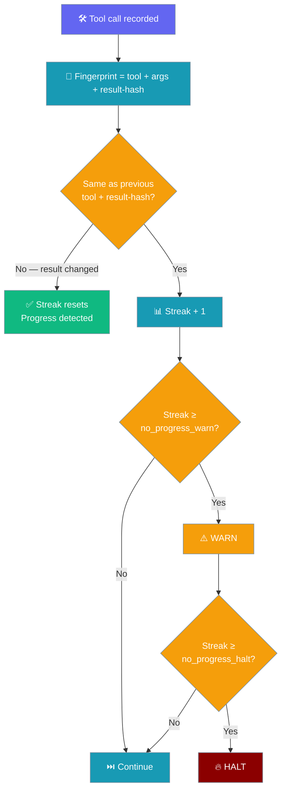
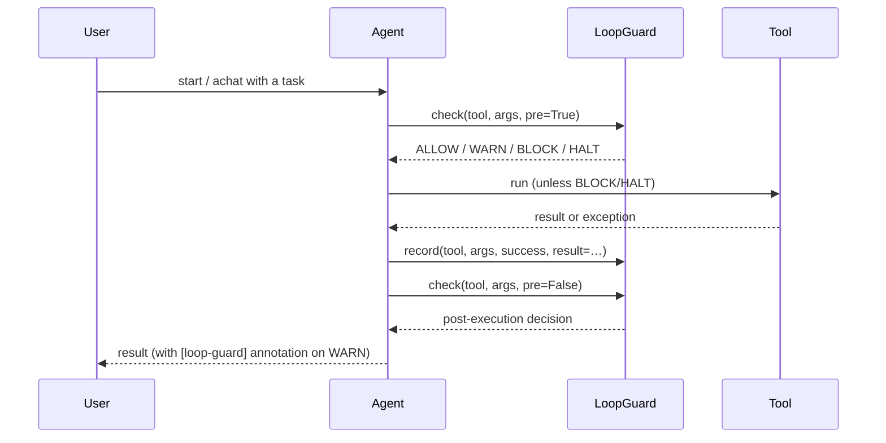
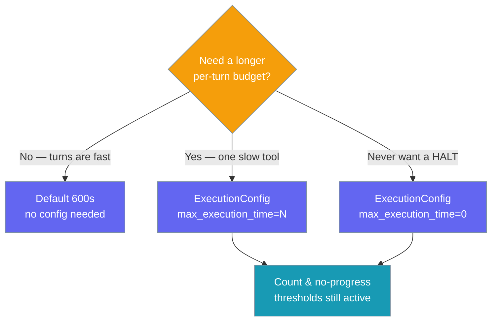

Loop Guard stops broken or misconfigured tools from burning tokens by counting per-turn calls and reacting differently to safe-to-repeat vs state-changing tools.

<Note>
Looking for **bot-to-bot** reply-loop protection? See [Bot-to-Bot Loop Protection](/features/bot-loop-protection) — a separate gateway-layer primitive that caps how many exchanges a pair of bots can trade.
</Note>

<Note>
**Sync and async parity (as of 2026-08-17).** Loop Guard runs on both the sync tool-execution path (`agent.chat()`, `agent.start()`) and the async one (`agent.achat()`, `agent.astart()`, async workflows). The async path gained the same pre/post `check()` and `record()` wiring in [PR #4005](https://github.com/MervinPraison/PraisonAI/pull/4005) — before that, async runs had no loop-guard protection. No config change is required to pick this up; every `Agent` already gets it.
</Note>

<Note>
Loop Guard now resets its per-turn state at the start of every `chat()` / `achat()` turn as of [PR #5764](https://github.com/MervinPraison/PraisonAI/pull/5764) (merged 2026-10-12, fixes [#5763](https://github.com/MervinPraison/PraisonAI/issues/5763)). Before this PR, `max_time_per_turn` and the per-turn tool-count thresholds accumulated for the life of the Agent — a long-lived bot, gateway, or chat UI could silently halt with `ToolExecutionError: [loop-guard] Turn time limit exceeded` after ~2 minutes of agent life. No config change is required to pick this up; every `Agent` already gets it.
</Note>

<Note>
**Overlapping turns on a shared Agent now each get their own per-turn `LoopGuard`** as of [PR #5861](https://github.com/MervinPraison/PraisonAI/pull/5861) (merged 2026-10-26, fixes [#5860](https://github.com/MervinPraison/PraisonAI/issues/5860)). Each turn's guard shares the agent-level `LoopGuardConfig` but has its own tool counts, no-progress streak, and turn clock, bound to the turn via a `ContextVar` that is copied into tool worker threads. Before this PR, a gateway or bot serving overlapping requests on one `Agent` could HALT a later request with `No progress detected` because the shared guard had already crossed the threshold on another caller's traffic. `chat()` / `achat()` / `start()` / `astart()` and streaming all get this behaviour. `agent.execute_tool(...)` called outside a chat turn still uses the agent-level guard. No config change is required to pick this up.

**The per-turn wall-clock budget is now user-configurable** as of [PR #6057](https://github.com/MervinPraison/PraisonAI/pull/6057) (merged 2026-10-26, fixes [#6026](https://github.com/MervinPraison/PraisonAI/issues/6026)). `ExecutionConfig.max_execution_time` (Python, or `max_execution_time:` on a YAML agent) now sets `LoopGuardConfig.max_time_per_turn` for every per-turn guard the agent creates — `None` keeps the new 600 s default, a positive int sets the limit in seconds, and `0` disables the wall-clock HALT entirely. The built-in default also rose from **120 s → 600 s**, so a single slow tool call (a long test suite, a build, a slow MCP call) no longer HALTs the next tool call in a healthy turn. The count and no-progress thresholds still catch real loops. Both the sync (`agent.chat()` / `agent.start()`) and async (`agent.achat()` / `agent.astart()`) paths pick this up. No API surface was added.
</Note>

```python
from praisonaiagents import Agent

agent = Agent(
    name="Safe Coder",
    instructions="Use tools carefully.",
)
agent.start("Fix the failing unit test in src/utils.py")
```

The user sends a task; Loop Guard tracks tool calls per turn and blocks runaway loops automatically.



<Note>
No-progress detection became **result-aware** in [PR #3080](https://github.com/MervinPraison/PraisonAI/pull/3080) (release after 2026-07-16, fixes [#3073](https://github.com/MervinPraison/PraisonAI/issues/3073)). Async / long-running tool workflows that return **changing** results (polling a job `IN_PROGRESS → COMPLETE`, pacing with a `wait` tool) are no longer falsely halted at 8 tool calls. Only a genuinely stuck loop of identical results still trips `no_progress_halt`. No config changes required to pick this up.
</Note>

<Note>
Loop Guard now covers the **async tool-execution path** as of [PR #4005](https://github.com/MervinPraison/PraisonAI/pull/4005) (merged 2026-08-17, fixes [#4000](https://github.com/MervinPraison/PraisonAI/issues/4000)). Tool calls made via `agent.achat()` and async workflows are checked pre-execution, recorded post-execution, and can escalate through `WARN → BLOCK → HALT` the same way sync calls always did. Async tool timeouts and raised exceptions also count as failures now, so identical repeats accumulate toward the thresholds. No config changes required to pick this up.
</Note>

## Quick Start

<Steps>
<Step title="It's already on">

```python
from praisonaiagents import Agent

agent = Agent(
    instructions="You are a helpful assistant."
)

# Loop Guard is initialised automatically.
# No flag needed — every Agent gets one.
agent.start("Summarise the README")
```

</Step>

<Step title="Tune the thresholds">

For power users, you can customize thresholds after agent creation:

```python
from praisonaiagents import Agent
from praisonaiagents.escalation.loop_guard import LoopGuard, LoopGuardConfig

agent = Agent(instructions="Polls a slow status endpoint")

agent._loop_guard = LoopGuard(LoopGuardConfig(
    idempotent_warn_threshold=10,
    idempotent_block_threshold=20,
    idempotent_halt_threshold=30,
    max_time_per_turn=300.0,
))
```

Per-turn guards reuse this guard's config (created lazily on the turn's first tool call), so one `agent._loop_guard = ...` reconfiguration applies to every subsequent turn, streaming or non-streaming, sync or async.

For the per-turn time limit specifically, prefer `Agent(execution=ExecutionConfig(max_execution_time=...))` — it reaches the same place, and it also works from YAML (`max_execution_time:` on the agent). Set `LoopGuardConfig(max_time_per_turn=...)` directly only when you want to override the time budget alongside count thresholds in one block — a custom `_loop_guard` takes its own value and ignores `max_execution_time`.

</Step>

<Step title="Turn it off">

<Warning>
Disabling Loop Guard removes the safety net for misbehaving tools.
</Warning>

```python
from praisonaiagents import Agent
from praisonaiagents.escalation.loop_guard import LoopGuard, LoopGuardConfig

agent = Agent(instructions="Agent without safety guard")

agent._loop_guard = LoopGuard(LoopGuardConfig(enabled=False))
```

</Step>
</Steps>

---

## How It Works



| Decision | Effect | User sees |
|----------|--------|-----------|
| `ALLOW` | Tool runs normally | Normal result |
| `WARN` | Tool runs; warning logged | Result + `_loop_guard` warning metadata |
| `BLOCK` | Tool execution replaced | `{"error": "[loop-guard] ...", "loop_blocked": True}` |
| `HALT` | Non-retryable exception raised | `ToolExecutionError` propagates out |

`check()` is bracketed by a `reset_turn()` at `_chat_impl` / `_achat_impl` entry, so every turn starts with fresh counts and a fresh time budget. Overlapping concurrent turns on the same Agent each get their own `LoopGuard` (same config, independent counters), so one caller's traffic can no longer exhaust another caller's per-turn limits. `agent.execute_tool(...)` called outside a chat turn still uses the agent-level guard. Agents with no tools never get a Loop Guard force-created.

---

## User Interaction Flow

Here's what happens when an agent repeatedly calls the same tool:



Two signals now drive the outcome: how many times the tool has been called this turn, and whether the results are still changing. A busy-but-progressing tool sees at most a `WARN`; a stuck-with-identical-results tool escalates through `WARN` to `HALT`.

---

## Tool Classification

Loop Guard categorizes tools into two buckets with different thresholds:



**Idempotent tools** (safe to repeat): `read_file`, `list_files`, `search_files`, `web_search`, `get_memory`, `git_status`, `git_log`, `db_query`, etc.

**Mutating tools** (state-changing): `write_file`, `edit_file`, `delete_file`, `execute_code`, `shell`, `git_commit`, `git_push`, `sql_insert`, `install_package`, etc.

<Tip>
If you can't move your tool into the explicit set, **name it well** — Loop Guard's heuristic looks for substrings like `read`, `get`, `list`, `search`, `find`, `show`, `view`, `check` (case-insensitive) to classify tools as idempotent.
</Tip>

---

## Configuration Options

| Option | Type | Default | Description |
|--------|------|---------|-------------|
| `enabled` | `bool` | `True` | Enable/disable Loop Guard entirely |
| `idempotent_warn_threshold` | `int` | `5` | Warning threshold for idempotent tools |
| `idempotent_block_threshold` | `int` | `8` | Block threshold for idempotent tools |
| `idempotent_halt_threshold` | `int` | `12` | Halt threshold for idempotent tools |
| `mutating_warn_threshold` | `int` | `3` | Warning threshold for mutating tools |
| `mutating_block_threshold` | `int` | `5` | Block threshold for mutating tools |
| `mutating_halt_threshold` | `int` | `7` | Halt threshold for mutating tools |
| `max_time_per_turn` | `float` | `600.0` | Maximum seconds per turn before timeout. For most users, don't set this directly — set `ExecutionConfig.max_execution_time` on the Agent instead, and the loop guard reads it (`0` disables the wall-clock halt). If you assign a custom `agent._loop_guard`, its `max_time_per_turn` is used as-is and `ExecutionConfig.max_execution_time` is ignored. |
| `no_progress_warn` | `int` | `4` | Warn once the trailing run of *identical* tool-result fingerprints reaches this length. Changing results reset the streak. |
| `no_progress_halt` | `int` | `8` | Halt once the trailing run of *identical* tool-result fingerprints reaches this length. Changing results reset the streak. |

**GuardAction values**: `ALLOW`, `WARN`, `BLOCK`, `HALT`

**LoopGuardDecision fields**: `action`, `code`, `message`, `metadata`

---

## No-Progress Detection

No-progress detection watches for *identical repeated results*, not raw tool-call counts.



**What counts as progress (resets the streak):**

- The **result changes** for the same tool + same args (e.g. `check_status(job=42)` returning `"IN_PROGRESS"` then `"COMPLETE"`).
- A **different tool** is called (streaks require the same tool, not just the same result value).
- `agent._loop_guard.mark_progress("...")` is called — marks the current position so only later tool calls can contribute to a future streak.

**What does NOT reset the streak:**

- The same tool returning the same result over and over — that *is* the "stuck" pattern the guard exists to catch.
- Falsy repeated results (`""`, `[]`, `{}`, `0`, `False`) — these are wrapped internally so they still fingerprint, closing a loophole that used to disable no-progress detection.

**Count thresholds are also stuck-aware.** The idempotent (`5 / 8 / 12`) and mutating (`3 / 5 / 7`) thresholds still count tool calls, but a `BLOCK` or `HALT` from those thresholds is downgraded to a `WARN` when the trailing identical-result run is below `no_progress_warn`. So a legitimately busy but *progressing* tool (many calls, changing output) will not be blocked purely on frequency.

### Example: polling that used to be halted, now allowed

```python
from praisonaiagents import Agent

agent = Agent(
    name="Deployment Watcher",
    instructions="Poll the deployment status until it finishes.",
)

# check_deploy(job='X') returns 'IN_PROGRESS', 'IN_PROGRESS', 'RUNNING', 'COMPLETE'.
# Each transition changes the result-hash, so the no-progress streak stays at 1.
agent.start("Watch deploy-42 until it is done.")
```

### Example: genuine stall, still halted

```python
from praisonaiagents import Agent

agent = Agent(
    name="Config Reader",
    instructions="Read a config file that never appears.",
)

# read_file('missing.yaml') returns the same error result every time.
# The streak grows to no_progress_halt=8 and the tool is halted with
# ToolExecutionError.
agent.start("Read missing.yaml.")
```

### Manually marking progress

If your agent completes a logical sub-step (a checkpoint, a milestone), call `mark_progress()` so any future no-progress streak starts fresh from that point:

```python
from praisonaiagents import Agent

agent = Agent(instructions="Multi-step data pipeline")

# ... run some tools ...
agent._loop_guard.mark_progress("stage-1-complete")
# Only tool calls made AFTER this marker can contribute to a future streak.
```

---

## What happens at each threshold

| Decision | Pre-execution effect | Post-execution effect | User sees |
|----------|---------------------|----------------------|-----------|
| `ALLOW` | Tool runs normally | Counter incremented | Normal result |
| `WARN` | Tool runs; warning logged | Warning appended/attached to result | `_loop_guard` key in dict result, or `[loop-guard] ...` suffix on string result |
| `BLOCK` | Tool **not** executed | Counter still incremented | Tool result replaced with `{"error": "[loop-guard] ...", "loop_blocked": True}` |
| `HALT` | `ToolExecutionError` raised, `is_retryable=False` | N/A | Exception propagates out of `agent.chat()`, `agent.start()`, `agent.achat()`, `agent.astart()`, or the async workflow that scheduled the tool |

---

## Sync and Async coverage

Loop Guard applies identically to both execution paths — sync (`agent.start()` / `agent.chat()`) and async (`agent.achat()` / async workflows).



**What triggers Loop Guard on the async path:**

- Repeated identical async tool calls whose results do not change (`no_progress_*` streak grows).
- Repeated async tool timeouts — each `asyncio.wait_for` timeout is now recorded as a failure and counts toward the streak.
- Repeated raised exceptions inside an async tool — each raised call is recorded as a failure the next pre-execution check can act on.

```python
from praisonaiagents import Agent

agent = Agent(instructions="Poll a flaky endpoint.")

# Async path: identical failing calls escalate WARN → HALT and the run stops.
result = await agent.achat("Fetch /status until it returns COMPLETE.")
```

The sync and async paths share the same `LoopGuard` instance per `Agent`, so a mixed workload (sync then async on the same agent) accumulates counts against one turn's thresholds.

---

## Common Patterns

### Async polling with changing results

Polling tools whose output actually transitions state (e.g. `pending → running → done`) do **not** need any config change — the no-progress guard sees each transition as progress and never trips. Only the count-based idempotent thresholds (`5 / 8 / 12`) could otherwise fire on high call volume, and those are now downgraded to `WARN` while results keep changing.

```python
from praisonaiagents import Agent

agent = Agent(
    name="Job Poller",
    instructions="Call check_job_status until it returns COMPLETE.",
)

# Default LoopGuardConfig is fine — no tuning required.
agent.start("Wait for job-42 to complete.")
```

If your polling tool paces itself with a `wait` / `sleep` tool that returns the same value each call, wrap the pair (`check_job_status` + `wait`) with an explicit progress marker between transitions so `wait`'s identical returns do not build a stuck streak:

```python
from praisonaiagents import Agent

agent = Agent(instructions="Poll and pace")
# ... after each observed status change ...
agent._loop_guard.mark_progress("status-transition")
```

### Polling a slow status endpoint

```python
from praisonaiagents import Agent
from praisonaiagents.escalation.loop_guard import LoopGuard, LoopGuardConfig

agent = Agent(instructions="Monitor deployment status")

# Increase idempotent thresholds for polling scenarios
agent._loop_guard = LoopGuard(LoopGuardConfig(
    idempotent_warn_threshold=15,
    idempotent_block_threshold=25,
    idempotent_halt_threshold=40,
    max_time_per_turn=300.0,  # 5 minute timeout
))
```

### Strict mode for production database agents

```python
from praisonaiagents import Agent
from praisonaiagents.escalation.loop_guard import LoopGuard, LoopGuardConfig

agent = Agent(instructions="Manage user database")

# Lower mutating thresholds for safety
agent._loop_guard = LoopGuard(LoopGuardConfig(
    mutating_warn_threshold=2,
    mutating_block_threshold=3,
    mutating_halt_threshold=4,
))
```

### Shared agent on a web server / gateway

```python
import threading
from praisonaiagents import Agent

def write_file(path: str) -> str:
    """Write a file (distinct path each call)."""
    return f"wrote {path}"

# One Agent, reused across many overlapping requests
agent = Agent(name="svc", instructions="Write the requested file.", tools=[write_file])

def handle_request(i: int) -> str:
    # Each chat() call is one turn, and each turn gets its own LoopGuard
    return agent.chat(f"Write /tmp/out_{i}.txt")

threads = [threading.Thread(target=handle_request, args=(i,)) for i in range(20)]
for t in threads: t.start()
for t in threads: t.join()
```

Each `chat()` / `achat()` turn, and each streaming generator, binds its own `LoopGuard` on a `ContextVar` that is copied into tool worker threads — so twenty overlapping writes to twenty different paths neither warn nor HALT each other.

### Set the per-turn time limit through ExecutionConfig

```python
from praisonaiagents import Agent, ExecutionConfig

def run_tests(suite: str) -> str:
    """Run a (slow) test suite."""
    ...

# One slow tool call used to HALT the next one at 120 s.
# The new 600 s default handles this; raise it further for very long tool calls.
agent = Agent(
    name="coder",
    instructions="Run the tests, then summarise.",
    tools=[run_tests],
    execution=ExecutionConfig(max_execution_time=1800),  # 30 min per turn
)

agent.start("Run unit and integration suites, then summarise")
```

`max_execution_time=0` disables the per-turn wall-clock halt entirely — count and no-progress thresholds still catch real loops. The same setting works from YAML:

```yaml
agents:
  coder:
    instructions: Run the tests, then summarise.
    max_execution_time: 1800
```



### Long-lived agents

```python
from praisonaiagents import Agent

def lookup_order(q: str) -> str:
    """Look up an order status."""
    return f"order-status-for-{q}"

agent = Agent(
    name="Support Bot",
    instructions="Answer order-status questions.",
    tools=[lookup_order],
)

# Each turn starts clean: no loop-guard warnings from earlier turns,
# and no Turn time limit error after minutes of agent life.
for i in range(16):
    print(agent.chat(f"q{i}"))
```

### Observability with stats

```python
agent = Agent(instructions="Data processing agent")

# Get statistics for dashboards
stats = agent._loop_guard.get_stats()
print(f"Turn elapsed: {stats['turn_elapsed']}s")
print(f"Tool counts: {stats['tool_counts']}")
```

`stats["turn_elapsed"]` is the current turn's elapsed time, not an agent-lifetime value.

---

## Relationship to Loop Detection

Loop Detection is **also always-on** as of PR #3005 — every `Agent` runs result-aware `name + args + result-hash` detection in the same tool-execution path. The two are complementary: Loop Guard counts per-turn tool calls with idempotent-vs-mutating thresholds, while Loop Detection catches repeated identical fingerprints at any frequency and back-fills result hashes so polling with progress is not flagged. Both fire through the same `blocked_result` path, so trace spans, stream events, and `AFTER_TOOL` hooks stay consistent regardless of which one triggers.

---

## Best Practices

<AccordionGroup>

<Accordion title="Long-lived agents are safe to reuse">
Reuse one `Agent` across many turns of a bot, gateway, or chat UI. The per-turn tool counts and the 600 s `max_time_per_turn` budget reset at the start of every `chat()` / `achat()` call, so an idle session that wakes up 10 minutes later still gets a full fresh turn. Only the current turn's work counts.
</Accordion>

<Accordion title="Trust the defaults">
The default thresholds (5/8/12 for idempotent, 3/5/7 for mutating) work well for most agents. Only customize when you have specific use cases like status polling or strict production environments.
</Accordion>

<Accordion title="Tune thresholds, not the on/off switch">
Resist the urge to disable Loop Guard entirely. Instead, adjust thresholds to match your agent's workflow. A monitoring agent might need higher idempotent thresholds, but even monitoring agents can benefit from mutating tool limits.
</Accordion>

<Accordion title="Name custom tools so the heuristic works">
If your custom tool isn't in the explicit `IDEMPOTENT_TOOLS` or `MUTATING_TOOLS` sets, name it descriptively. Tools named `check_status`, `read_config`, or `search_logs` will be classified as idempotent automatically.
</Accordion>

<Accordion title="Use get_stats() for observability">
Monitor your agents' tool usage patterns with `agent._loop_guard.get_stats()`. High tool counts might indicate the agent is struggling with a task and needs different instructions or tools.
</Accordion>

<Accordion title="Reach for mark_progress() only at real checkpoints">
No-progress detection is result-aware, so a tool that keeps producing new output is trusted even past the count thresholds. Reach for `mark_progress()` only when your workflow has a natural checkpoint (a sub-step completed, a milestone reached) that the result-hash on its own would not reflect.
</Accordion>

<Accordion title="Drop manual retry caps around async polling">
Since PR #4005, `agent.achat()` and async workflows route tool calls through the same Loop Guard as `agent.start()`. If you were adding manual retry caps around async polling, you can drop them — the default idempotent thresholds (5 / 8 / 12) and the result-aware no-progress streak apply on both paths.
</Accordion>

</AccordionGroup>

---

## Related

<CardGroup cols={2}>
<Card icon="triangle-exclamation" href="/features/doom-loop-detection">
  Loop Detection
</Card>
<Card icon="robot" href="/features/escalation-pipeline">
  Agent Autonomy
</Card>
</CardGroup>