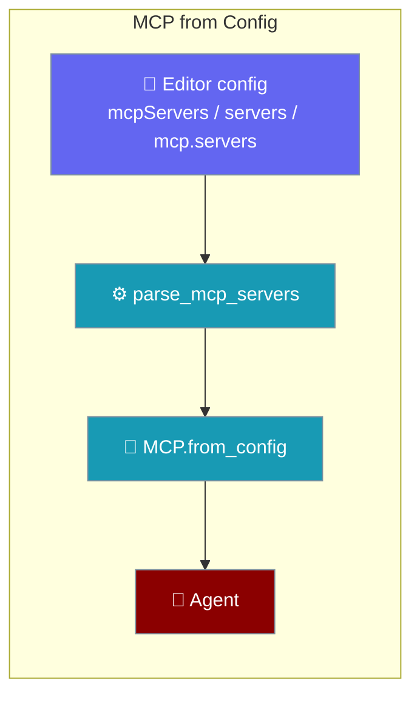
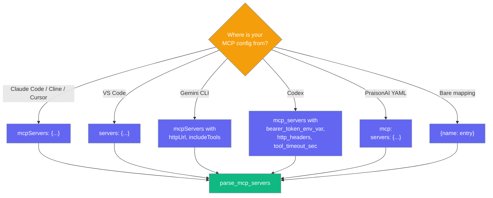
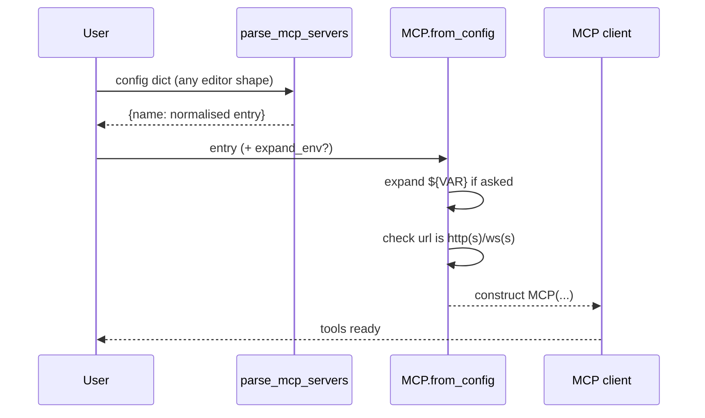

Paste the `mcpServers` block you already have in Claude Code, Cursor, VS Code, Gemini CLI, Codex, or PraisonAI YAML, and give its tools to an agent. You don't need to rewrite it as `MCP(command=..., args=...)`.

```python
from praisonaiagents import Agent, MCP
from praisonaiagents.mcp import parse_mcp_servers

# The same mcpServers block you would paste from Claude Code / Cursor
config = {
    "mcpServers": {
        "filesystem": {
            "command": "npx",
            "args": ["-y", "@modelcontextprotocol/server-filesystem", "/tmp"],
        }
    }
}

servers = parse_mcp_servers(config)
fs = MCP.from_config(servers["filesystem"], name="filesystem")

agent = Agent(
    name="FileAgent",
    instructions="You can read and write files.",
    tools=fs,
)
agent.start("List files in /tmp.")
```



<Note>
Import `parse_mcp_servers` from `praisonaiagents.mcp`. The top-level `praisonaiagents` package does not export it.
</Note>

## Which config shapes are accepted?



`parse_mcp_servers` looks for the servers under `mcpServers`, `servers`, `mcp_servers`, or `mcp.servers`, in that order. If none of these keys holds a mapping, it treats the whole dict as `{name: entry}`. An entry can also be a plain command string, such as `{"fs": "npx -y @modelcontextprotocol/server-filesystem /tmp"}`.

## Quick Start

<Steps>
<Step title="Paste an editor config">
```python
from praisonaiagents import Agent, MCP
from praisonaiagents.mcp import parse_mcp_servers

servers = parse_mcp_servers({
    "mcpServers": {
        "fs": {"command": "npx", "args": ["-y", "@modelcontextprotocol/server-filesystem", "/tmp"]}
    }
})
agent = Agent(tools=MCP.from_config(servers["fs"], name="fs"))
agent.start("List files in /tmp.")
```
</Step>

<Step title="Load every server at once">
```python
from praisonaiagents import Agent, MCP
from praisonaiagents.mcp import parse_mcp_servers

servers = parse_mcp_servers(config)
agent = Agent(tools=[MCP.from_config(entry, name=name) for name, entry in servers.items()])
```
</Step>

<Step title="Expand ${VAR} from the environment">
```python
from praisonaiagents import MCP

mcp = MCP.from_config(
    {"url": "https://api.example.com/mcp", "headers": {"Authorization": "Bearer ${GITHUB_TOKEN}"}},
    name="github",
    expand_env=True,  # expands ${VAR}, ${env:VAR}, ${VAR:-default}
)
```
</Step>

<Step title="Codex-style bearer token">
```python
from praisonaiagents import MCP
from praisonaiagents.mcp import parse_mcp_servers

servers = parse_mcp_servers({
    "mcp_servers": {
        "sentry": {
            "url": "https://sentry.io/mcp",
            "bearer_token_env_var": "SENTRY_TOKEN",  # → Authorization: Bearer ${SENTRY_TOKEN}
            "tool_timeout_sec": 45,
        }
    }
})
mcp = MCP.from_config(servers["sentry"], name="sentry", expand_env=True)
```
</Step>
</Steps>

## How It Works



`parse_mcp_servers` only changes the shape of the config. It leaves `${VAR}` exactly as written. `MCP.from_config` builds the client, and it also accepts a raw editor entry, so you can skip `parse_mcp_servers` when you only have one server.

## Field mapping

| Editor field | Normalised to |
|---|---|
| `httpUrl`, `server_url` | `url` |
| `http_headers` | `headers` |
| `bearer_token_env_var: VAR` | adds `Authorization: Bearer ${VAR}` to `headers` |
| `includeTools`, `enabled_tools`, `include_tools`, `tool_filter` | `allowed_tools` |
| `excludeTools`, `exclude_tools` | `disabled_tools` |
| `auth`, `oauth` (`client_id` / `clientId` / `CLIENT_ID`, `scopes`) | `oauth: {client_id, scopes}` |
| `transport` | `type` |
| `tool_timeout_sec` | `timeout` |
| `disabled: true` | `enabled: false` |

| `type` value | Normalised to |
|---|---|
| `local` | `stdio` |
| `remote`, `streamable-http`, `streamable_http`, `streamableHttp` | `http` |
| `websocket` | `ws` |
| *(missing)* | `stdio` without a `url`, `ws` for `ws://`/`wss://`, `sse` for URLs ending in `/sse`, otherwise `http` |

The fields `name`, `description`, `trust`, `alwaysAllow`, `autoApprove`, and `startup_timeout_sec` are dropped without a warning. Any other unknown field is dropped and a warning is logged.

## Normalised entry

| Field | Type | Notes |
|---|---|---|
| `type` | `str` | `stdio`, `http`, `sse`, or `ws` |
| `command` | `str` or `list` | stdio only. In a list such as `["npx", "-y", "pkg"]`, the first item is the command and the rest go before `args` |
| `args` | `list[str]` | stdio only |
| `env` | `dict[str, str]` | stdio only |
| `cwd` | `str` | stdio only |
| `url` | `str` | Must be `http(s)://` or `ws(s)://` |
| `headers` | `dict[str, str]` | Remote servers only |
| `oauth` | `dict` | Parsed, but the client does not use it yet. A warning is logged |
| `allowed_tools` | `list[str]` | Only these tools are exposed |
| `disabled_tools` | `list[str]` | These tools are hidden |
| `timeout` | `float` | Seconds. Values of 1000 or more are treated as milliseconds |
| `enabled` | `bool` | If `False`, `MCP.from_config` raises an error |

## `MCP.from_config` parameters

| Parameter | Type | Default | Description |
|---|---|---|---|
| `entry` | `dict` or `str` | — | One server entry, either normalised or raw from an editor |
| `name` | `str` | `"server"` | Server name used in errors and logs |
| `expand_env` | `bool` | `False` | Expand `${VAR}`, `${env:VAR}`, and `${VAR:-default}`. A missing variable with no default raises `ValueError` |

## Safety behaviour

<Warning>
**A `url` never runs as a command.** If the `url` is not `http(s)` or `ws(s)`, `MCP.from_config` raises `ValueError`.
</Warning>

<Warning>
**Legacy SSE URLs cannot send headers.** If a URL ends in `/sse` and has an `Authorization` header, a `ValueError` is raised. Other headers are dropped and a warning is logged. To keep headers on an `/sse` path, set `"type": "streamable-http"`.
</Warning>

<Note>
- Disabled servers (`"disabled": true` or `"enabled": false`) raise `ValueError` when you build them.
- `expand_env=True` does not modify your original dict.
- Leave `expand_env` off for entries that a loader has already interpolated, so nothing is expanded twice.
- `parse_mcp_servers` does not check whether a server is trusted. If you read a project file that someone else wrote, filter it with `drop_untrusted_mcp_servers` from `praisonaiagents.mcp.trust` first.
</Note>

## Common Patterns

<AccordionGroup>
<Accordion title="Import a Claude Code project config">
```python
import json
from praisonaiagents import Agent, MCP
from praisonaiagents.mcp import parse_mcp_servers

with open(".mcp.json") as f:
    servers = parse_mcp_servers(json.load(f))

agent = Agent(
    name="Assistant",
    tools=[MCP.from_config(entry, name=name) for name, entry in servers.items() if entry.get("enabled", True)],
)
```
</Accordion>

<Accordion title="PraisonAI YAML mcp.servers block">
```python
import yaml
from praisonaiagents import Agent, MCP
from praisonaiagents.mcp import parse_mcp_servers

config = yaml.safe_load("""
mcp:
  servers:
    time:
      command: uvx
      args: [mcp-server-time]
""")

servers = parse_mcp_servers(config)
agent = Agent(tools=MCP.from_config(servers["time"], name="time"))
agent.start("What time is it in Tokyo?")
```
</Accordion>

<Accordion title="Filter tools with Gemini CLI fields">
```python
from praisonaiagents import Agent, MCP

mcp = MCP.from_config(
    {"httpUrl": "https://api.example.com/mcp", "includeTools": ["search"]},
    name="search",
)
agent = Agent(tools=mcp)
```
</Accordion>
</AccordionGroup>

## Best Practices

<AccordionGroup>
<Accordion title="Keep secrets as ${VAR}">
Write tokens as `${VAR}` in your config and pass `expand_env=True`. That way the secret stays out of the config file.
</Accordion>
<Accordion title="Prefer streamable HTTP for authenticated servers">
Legacy SSE cannot send headers. Use a Streamable HTTP URL, or set `"type": "streamable-http"`.
</Accordion>
<Accordion title="Name each server">
Pass `name=` so that errors and warnings tell you which server failed.
</Accordion>
</AccordionGroup>

## Related

<CardGroup cols={2}>
<Card title="MCP" icon="plug" href="/features/mcp">
  The base MCP client and its construction forms
</Card>
<Card title="MCP YAML Configuration" icon="file-code" href="/features/mcp-yaml-config">
  Declare MCP servers in YAML workflows
</Card>
</CardGroup>
