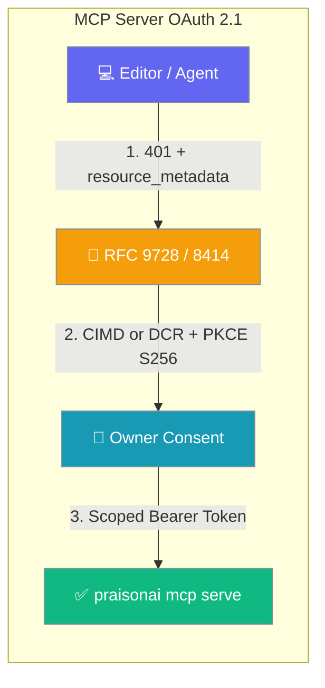
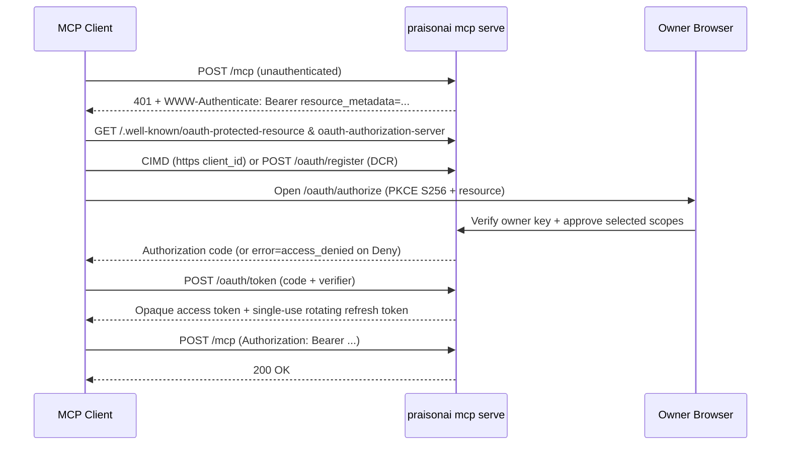
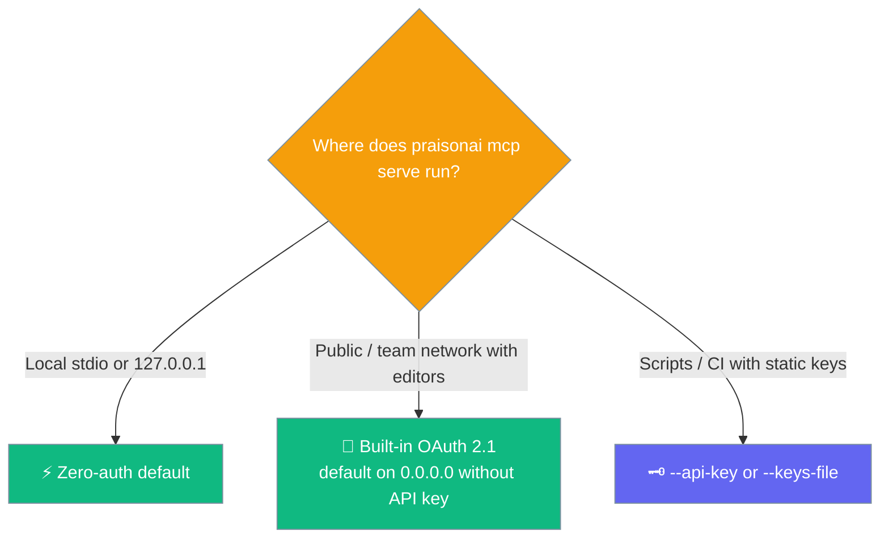

`praisonai mcp serve --transport http-stream` includes a built-in **OAuth 2.1 authorization server** so editors and coding agents sign in to your remote PraisonAI MCP server automatically — no static API keys to distribute.

```python
from praisonaiagents import Agent

agent = Agent(name="RemoteHelper", instructions="Serve authorised MCP tool calls.")
agent.start("List available capabilities")
```

Start the HTTP-stream host on a network address (or with `--oauth` locally) and editors like Cursor, VS Code, Claude Code, Zed, Antigravity, Kiro, Codex, Goose, and OpenCode discover the login flow automatically.

<Note>
This page covers the **server side** — PraisonAI acting as the OAuth 2.1 authorization server for incoming MCP clients. For a PraisonAI agent connecting as a **client** to an external OAuth-protected MCP server, see [MCP OAuth Authentication](/mcp/mcp-oauth).
</Note>



## Quick Start

<Steps>
<Step title="Install with server and auth extras">
```bash
pip install "praisonai-mcp[all]"
# or via the umbrella package:
pip install "praisonai[mcp]"
```
</Step>

<Step title="Start an OAuth-protected remote MCP server">
Local `stdio` and `--host 127.0.0.1` remain zero-auth. Binding to a non-loopback address without `--api-key` or `--keys-file` turns OAuth 2.1 on automatically (or pass `--oauth` to enable it on localhost too):

```bash
PRAISONAI_MCP_OWNER_KEY="choose-a-strong-owner-key" \
praisonai mcp serve --transport http-stream \
  --host 0.0.0.0 \
  --issuer https://agents.example.com
```

If `PRAISONAI_MCP_OWNER_KEY` is unset, a one-time owner key is generated and printed at startup.
</Step>

<Step title="Approve on the consent page">
When an editor connects, it opens your browser to the consent page. Enter the owner key once, review whether the client is **Verified** or **On this device**, untick any scopes you want to withhold (or click **Allow read-only**), pick a lifetime, and approve.
</Step>
</Steps>

---

## How It Works



| Standard / Feature | Behaviour |
|---|---|
| **Discovery** | Returns `401` + `WWW-Authenticate: Bearer resource_metadata=...` with Protected Resource Metadata (RFC 9728) and Authorization Server Metadata (RFC 8414). |
| **PKCE + Audience** | Authorization code with **PKCE S256 only** (RFC 7636) for public clients; tokens are audience-bound to the requested `resource` (RFC 8707). |
| **Client verification (CIMD + DCR)** | Supports Dynamic Client Registration (RFC 7591) and Client ID Metadata Documents (https `client_id`, 64 KiB cap, 1 h cache). Known editors (VS Code, Zed, Kiro, Antigravity, Claude Code, ChatGPT/Codex, Goose, OpenCode, Cursor, Claude) display as **Verified**; loopback redirects display as **On this device** (RFC 8252); unknown apps display an explicit warning. |
| **Rotating refresh tokens** | Refresh tokens are single-use and rotate on every refresh. Replaying an already-used refresh token revokes the entire grant. |
| **Headless / SSH device flow** | RFC 8628 device flow: `POST /oauth/device`, then open `/oauth/device/verify` and enter the user code (e.g. `ABCD-EFGH`). |
| **Manage & revoke apps** | `GET /oauth/apps` and `POST /oauth/apps/<id>/revoke` (with the owner key as Bearer), plus RFC 7009 client-initiated revocation. |
| **Hashed storage** | Tokens are opaque; only SHA-256 hashes are stored in `oauth.json` (`0600`) inside the PraisonAI MCP data folder. |

---

## Choosing an Auth Mode



---

## Best Practices

<AccordionGroup>
<Accordion title="Set --issuer to your public HTTPS URL">
Always pass `--issuer https://your-domain.example` behind TLS so OAuth discovery metadata and token audiences match the URL clients connect to.
</Accordion>

<Accordion title="Use Allow read-only for untrusted or exploratory clients">
The consent page lets you untick `tools:call` or click **Allow read-only** so a client can inspect tools and resources without executing actions.
</Accordion>

<Accordion title="Use the device flow over SSH or containers">
For headless terminals where opening a local browser callback is awkward, use the built-in RFC 8628 device flow (`/oauth/device` → `/oauth/device/verify`).
</Accordion>
</AccordionGroup>

---

## Related

<CardGroup cols={2}>
  <Card title="praisonai connect" icon="plug" href="/features/praisonai-connect">
    One-command MCP client installation across 22 editors
  </Card>
  <Card title="MCP OAuth Authentication (Client)" icon="key" href="/mcp/mcp-oauth">
    Connect a PraisonAI agent to an external OAuth-protected MCP server
  </Card>
  <Card title="praisonai-mcp Package" icon="server" href="/features/praisonai-mcp-package">
    Full praisonai-mcp installation and host CLI reference
  </Card>
  <Card title="Scoped API Keys" icon="shield" href="/features/mcp-scoped-api-keys">
    Static scoped bearer keys for scripts and service accounts
  </Card>
</CardGroup>
