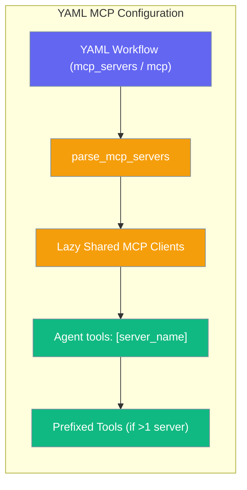
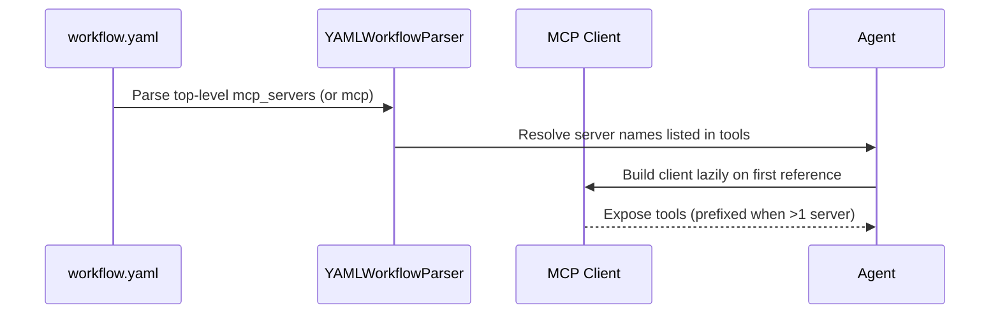

Define local and remote MCP servers directly in YAML workflows and attach them to agents by name in `tools:`.

> `MCP(...)` also accepts three equivalent Python construction forms — see [Three equivalent forms](/features/mcp#three-equivalent-forms) and [MCP from Config](/features/mcp-from-config).

```yaml
# workflow.yaml
name: Support Triage

mcp_servers:
  linear:
    url: https://mcp.linear.app/mcp
    oauth: true
    allowed_tools: [list_issues, get_issue]
  filesystem:
    command: npx
    args: ["-y", "@modelcontextprotocol/server-filesystem", "."]

agents:
  triage:
    instructions: Inspect recent issues and summarize relevant local files.
    llm: gpt-4o-mini
    tools: [linear, filesystem]

steps:
  - agent: triage
    action: Summarize open P1 issues and related docs in this repo.
```

Run it from Python or the CLI:

```python
from praisonaiagents.workflows import Workflow

workflow = Workflow.from_yaml("workflow.yaml")
result = workflow.start()
```

```bash
praisonai workflow run --file workflow.yaml
```



## How It Works



- **Top-level key:** Declare servers under `mcp_servers:` (preferred). The `mcp:` alias is also accepted in either direct (`mcp: { name: ... }`) or nested (`mcp: { servers: { name: ... } }`) form.
- **Agent attachment:** Reference any declared server by name inside an agent's `tools:` list (supported in both `agents:` and legacy `roles:` YAML schemas).
- **Lazy initialization:** An MCP client is created only when at least one agent references it in `tools:`. Unreferenced servers and entries with `enabled: false` are skipped.
- **Shared per workflow:** When multiple agents list the same server name in `tools:`, they share one initialized `MCP` client instance for that workflow parse.
- **Automatic tool prefixing:** When a workflow declares **more than one** MCP server, each client's tools are prefixed with its server name (`with_tool_prefix(name)`) to prevent tool name collisions.

---

## Configuration Schema

### Local Stdio Server

```yaml
mcp_servers:
  filesystem:
    command: npx
    args:
      - "-y"
      - "@modelcontextprotocol/server-filesystem"
      - "."
    env:
      NODE_ENV: production
    cwd: "."
    allowed_tools:
      - read_file
      - list_directory
    disabled_tools:
      - delete_file
    timeout: 30
    enabled: true
```

### Remote Streamable HTTP Server

```yaml
mcp_servers:
  linear:
    url: https://mcp.linear.app/mcp
    oauth: true
    allowed_tools:
      - list_issues
      - create_issue
    timeout: 60

  internal_api:
    url: https://mcp.example.com/mcp
    headers:
      X-Team: platform
    disabled_tools:
      - drop_index
```

### Using the `mcp:` Alias

Both forms below are equivalent to top-level `mcp_servers:`:

```yaml
# Nested alias
mcp:
  servers:
    time:
      command: uvx
      args: ["mcp-server-time"]
```

```yaml
# Direct alias
mcp:
  time:
    command: uvx
    args: ["mcp-server-time"]
```

### Supported Fields

| Field | Applies To | Description |
| --- | --- | --- |
| `command` | Local (stdio) | Executable to launch (for example `npx`, `uvx`, `python`). |
| `args` | Local (stdio) | List of command arguments. |
| `env` | Local (stdio) | Mapping of environment variables passed to the server process. |
| `cwd` | Local (stdio) | Working directory for the local server process. |
| `url` | Remote | Remote MCP endpoint (`http://`, `https://`, `ws://`, or `wss://`). |
| `headers` | Remote | HTTP headers sent on Streamable HTTP requests. |
| `oauth` | Remote | `true` or `{ client_id, scopes }` to enable OAuth 2.1 + PKCE sign-in. |
| `allowed_tools` | Both | Allow-list of tool names exposed from this server. |
| `disabled_tools` | Both | Deny-list of tool names hidden from this server. |
| `timeout` | Both | Request timeout in seconds (values > 1000 are converted from milliseconds). |
| `enabled` | Both | Set `false` to keep a server defined without starting it (default `true`). |

---

## Multi-Agent Sharing & Prefixing Example

```yaml
name: Release Assistant

mcp_servers:
  github:
    url: https://api.githubcopilot.com/mcp/
    oauth: true
    allowed_tools: [get_pull_request, list_commits]

  filesystem:
    command: npx
    args: ["-y", "@modelcontextprotocol/server-filesystem", "."]
    allowed_tools: [read_file, list_directory]

  optional_metrics:
    url: https://metrics.example.com/mcp
    enabled: false  # Skipped cleanly

agents:
  reviewer:
    instructions: Review open PR changes against repository conventions.
    llm: gpt-4o-mini
    tools: [github, filesystem]

  writer:
    instructions: Draft release notes from recent commits.
    llm: gpt-4o-mini
    tools: [github]  # Shares the same github client as reviewer

steps:
  - agent: reviewer
    action: Inspect the latest PR and local changelog.
  - agent: writer
    action: Draft concise release notes.
```

Because two active servers (`github` and `filesystem`) are declared in this workflow, tools are automatically prefixed with `github_` and `filesystem_`.

---

## Managing MCP Servers with the CLI

You can also configure, import, and verify MCP servers in your user config from the command line:

```bash
# Add a remote Streamable HTTP server with headers, OAuth, and tool allow-list
praisonai mcp add linear \
  --url https://mcp.linear.app/mcp \
  --oauth \
  --allow list_issues,create_issue

# Add a remote server with custom headers
praisonai mcp add internal \
  --url https://mcp.example.com/mcp \
  --header X-Team=platform

# Add a local stdio server
praisonai mcp add filesystem npx --args "-y @modelcontextprotocol/server-filesystem ."

# Import existing servers read-only from an editor (cursor, claude-desktop, claude-code, vscode, codex, zed, ...)
praisonai mcp import cursor --dry-run
praisonai mcp import cursor

# Verify connectivity with a real MCP initialize + tools/list handshake
praisonai mcp test linear
```

---

## Known Pitfalls

<AccordionGroup>
<Accordion title="Authorization header on a legacy /sse URL is refused">
MCP servers declared with a `url` ending in `/sse` cannot forward custom headers on the legacy SSE client. When `headers.Authorization` is present on an `/sse` URL, PraisonAI refuses to start the server instead of silently connecting without the token. Use a Streamable HTTP endpoint (`/mcp`) or set `type: streamable-http` when you need `Authorization`. See [MCP from Config](/features/mcp-from-config).
</Accordion>
<Accordion title="Workflow YAML does not re-expand ${VAR} placeholders">
`YAMLWorkflowParser` builds MCP clients without expanding `${VAR}` placeholders a second time. For authenticated remote servers, prefer `oauth: true` (with `praisonai mcp auth <name>`) or store credentials in your user config rather than embedding raw tokens in workflow files.
</Accordion>
<Accordion title="Per-server timeout in CLI config is in milliseconds">
Per-server `timeout` in `.praisonai/config.yaml` is specified in milliseconds and converted to seconds with a 1-second floor (`500` becomes `1` second) before being passed to `MCP(timeout=...)`. In workflow YAML you can specify seconds directly (for example `timeout: 60`).
</Accordion>
</AccordionGroup>

---

## Related

<CardGroup cols={2}>
<Card title="Load MCP Tools" icon="plug" href="/features/load-mcp-tools">
  Wire configured MCP servers into agents with one line
</Card>
<Card title="MCP CLI" icon="terminal" href="/cli/mcp">
  Configure, import, and test MCP servers from the command line
</Card>
<Card title="MCP from Config" icon="plug" href="/features/mcp-from-config">
  Reuse an editor's mcpServers config in Python
</Card>
<Card title="MCP Overview" icon="book-open" href="/features/mcp">
  Core MCP client transports and Python usage
</Card>
</CardGroup>
