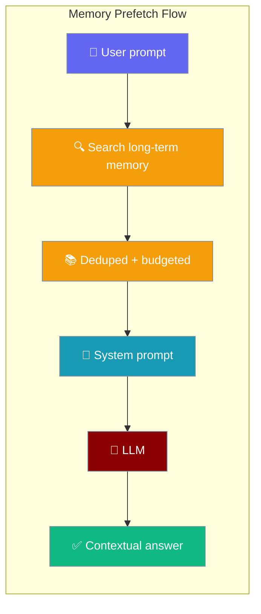
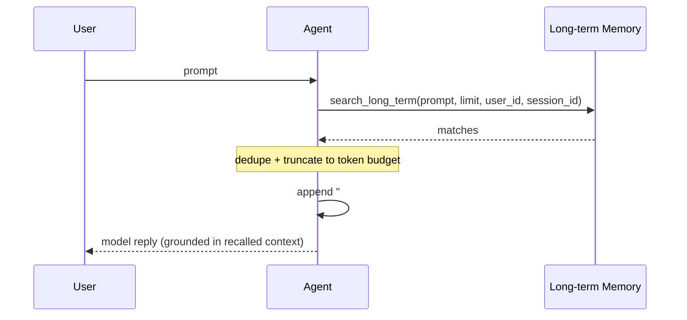
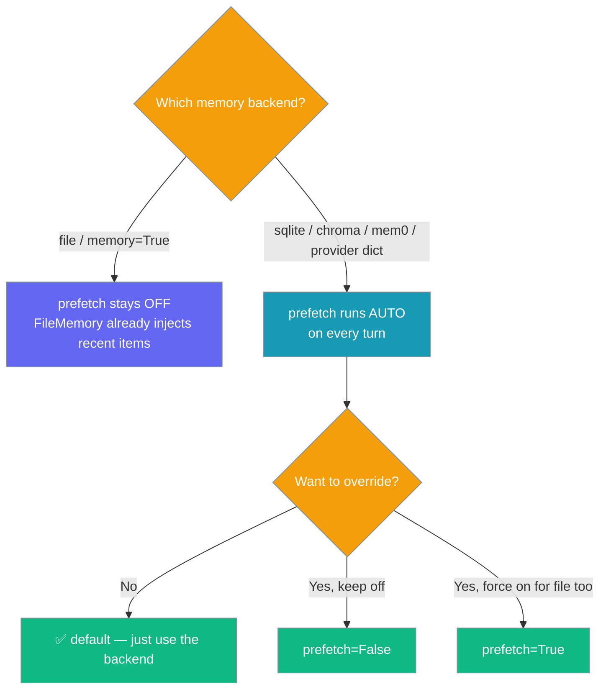

Prefetch pulls relevant long-term memories into the system prompt at the start of every turn — the agent answers with context it never had to ask for.

**Prefetch is "auto" by default.** On query-based backends (`sqlite`, `chroma`, `mem0`, `{"provider": ...}`) it runs automatically — facts saved with `agent.store_memory(..., memory_type="long_term")` reach the model with no `prefetch=True` and no `recall()` call. On the file backend it stays off because file memory already injects recent items into the system prompt itself. Pass `prefetch=True` or `prefetch=False` to override.



## Quick Start

<Steps>
<Step title="Simple Usage">

Pick a query-based backend and stored facts reach the model automatically.

```python
from praisonaiagents import Agent

agent = Agent(
    name="assistant",
    instructions="Answer using recalled memories when relevant.",
    memory="sqlite",   # query-based backend → prefetch is automatic
)
agent.store_memory(
    "The project codename is BLUEHERON.",
    memory_type="long_term",
)
print(agent.start("What is the project codename?"))   # answers "BLUEHERON"
```
</Step>

<Step title="Scope per user (optional but recommended)">

Set `user_id` so recalled memories persist across runs and stay private to one user.

```python
from praisonaiagents import Agent, MemoryConfig

agent = Agent(
    name="assistant",
    instructions="Answer using recalled memories when relevant.",
    memory=MemoryConfig(backend="sqlite", user_id="alice"),
)
agent.store_memory("Alice prefers metric units.", memory_type="long_term")
print(agent.start("How should I format my dashboard?"))
```
</Step>

<Step title="Tune the budget">

Cap how many memories are injected and how large the block can grow.

```python
from praisonaiagents import Agent, MemoryConfig

agent = Agent(
    name="assistant",
    instructions="Answer using recalled memories when relevant.",
    memory=MemoryConfig(
        backend="sqlite",
        user_id="alice",
        prefetch_limit=3,           # inject at most 3 memories
        prefetch_token_budget=200,  # estimated-token cap; truncates with "…"
    ),
)

agent.start("What are my UI preferences?")
```
</Step>

<Step title="Force prefetch on or off">

Override the auto default when you need to.

```python
from praisonaiagents import MemoryConfig

# Force on even for the file backend
MemoryConfig(user_id="alice", prefetch=True)

# Force off even for sqlite / chroma / mem0
MemoryConfig(backend="sqlite", user_id="alice", prefetch=False)
```
</Step>

<Step title="Automatic cross-instance recall with auto_memory">

Set `auto_memory=True` on a shared `user_id` and the first agent persists each turn durably — a second agent on the same backend recalls it with no explicit store call.

```python
from praisonaiagents import Agent, MemoryConfig

shared = dict(backend="sqlite", user_id="alice", auto_memory=True)

Agent(
    name="writer",
    instructions="You help the user.",
    memory=MemoryConfig(**shared),
).start("Remember launch date is Nov 15.")

reader = Agent(
    name="reader",
    instructions="Answer using recalled context.",
    memory=MemoryConfig(**shared),
)
print(reader.start("When do we launch?"))   # answers from recalled context
```


</Step>

<Step title="Cross-agent recall with an explicit store">

Use `store_memory(..., memory_type="long_term")` when you want to control exactly what is stored, instead of persisting the whole turn.

```python
from praisonaiagents import Agent, MemoryConfig

shared_kwargs = dict(backend="sqlite", user_id="alice")

writer = Agent(
    name="writer",
    instructions="Store facts.",
    memory=MemoryConfig(**shared_kwargs),
)
writer.store_memory("Launch date is Nov 15.", memory_type="long_term")

reader = Agent(
    name="reader",
    instructions="Answer using recalled context.",
    memory=MemoryConfig(**shared_kwargs),
)
print(reader.start("When do we launch?"))
```
</Step>
</Steps>

---

## How It Works

Prefetch searches long-term memory with the user prompt, dedupes and budgets the matches, then appends them to the system prompt before the first LLM call.



| Phase | What happens |
|---|---|
| 1. Query | The user prompt drives a `search_long_term` call, scoped by `user_id` / `session_id` — a `metadata.user_id` (and `metadata.session_id`) post-filter. Turns persisted by `auto_memory` are stamped with the same keys so they match on recall. See [Memory → Always set user_id](/features/memory#best-practices). |
| 2. Shape | Matches are deduplicated by text, then truncated to the token budget with a trailing `…` |
| 3. Inject | The result is appended under `## Recalled memories` in the system prompt |

Multimodal prompts (a list of `{type: "text", text: ...}` blocks) also drive the search — non-text parts are ignored for the query.



<Note>
Prefetch defaults to auto, not `True`. On FileMemory it never queries the backend (recent items are already in the system prompt). On sqlite/chroma/mem0 the backend is queried once per turn, scoped by `user_id` / `session_id`. Backend errors are swallowed at debug level — the turn continues without recalled context.
</Note>

---

## Configuration Options

<Card icon="code" href="/sdk/reference/praisonaiagents/modules/feature_configs">
  Full list of options, types, and defaults — `MemoryConfig`
</Card>

| Option | Type | Default | Description |
|---|---|---|---|
| `prefetch` | `Optional[bool]` | `None` (auto) | `None` = on for query-based backends (sqlite, chroma, mem0, `{"provider": ...}`), off for FileMemory. `True` / `False` force it on/off. |
| `prefetch_limit` | `int` | `5` | Max memories injected per turn. |
| `prefetch_token_budget` | `int` | `512` | Estimated-token cap for the injected block. Overflow is truncated with `…`. |

Identity scoping (`user_id`, `session_id`) is inherited from the same `MemoryConfig`.

Backends: `file` (default), `sqlite`, `chroma`, `mongodb`, `mem0`, `dakera`, `in_memory` — see [Memory](/features/memory).

---

## Common Patterns

### Pattern 1 — Personal assistant with recalled preferences
```python
from praisonaiagents import Agent, MemoryConfig

agent = Agent(
    name="assistant",
    instructions="Answer using recalled preferences.",
    memory=MemoryConfig(backend="sqlite", user_id="alice"),
)
agent.store_memory(
    "Alice prefers metric units and dark mode.",
    memory_type="long_term",
)
print(agent.start("How should I format my dashboard?"))
```

### Pattern 2 — Tight budget for cost control
```python
from praisonaiagents import Agent, MemoryConfig

agent = Agent(
    name="assistant",
    instructions="Answer concisely using recalled context.",
    memory=MemoryConfig(
        backend="sqlite",
        user_id="alice",
        prefetch_limit=2,
        prefetch_token_budget=128,
    ),
)
print(agent.start("Remind me what I asked for last time."))
```

---

## Best Practices

<AccordionGroup>
<Accordion title="Default is auto — you rarely need `prefetch=True`">
With a query-based backend (`sqlite`, `chroma`, `mem0`, `{"provider": ...}`), stored facts reach the model with no extra flags. Only pass `prefetch=True` when you want it on for FileMemory, or `prefetch=False` to force it off for cost reasons.
</Accordion>

<Accordion title="Pair with user_id">
Without `user_id`, prefetch searches the per-instance store — a fresh `agent-<uuid>` on every process. Set `user_id` so recalled memories persist across runs.
</Accordion>

<Accordion title="Keep the token budget small">
`prefetch_token_budget=512` is the ceiling, not the target. Large recalled blocks push out user context — start small and raise only when needed.
</Accordion>

<Accordion title="Async works out of the box">
The async path awaits async backends; sync backends are offloaded off the event loop. No extra configuration required.
</Accordion>

<Accordion title="Backend failures never break the turn">
Any backend error is logged at debug level and the agent proceeds without recalled context — prefetch never fails a turn.
</Accordion>

<Accordion title="No system prompt = no prefetch">
Prefetch appends to the system prompt, so an agent with `use_system_prompt=False` returns an empty prefetch and never queries the backend — even when prefetch is auto or `True`. Keep the system prompt enabled for recalled context to appear.
</Accordion>
</AccordionGroup>

---

## Related

<CardGroup cols={2}>
<Card title="Memory" icon="brain" href="/features/memory">
  Memory backends and the remember/recall API
</Card>
<Card title="Knowledge" icon="book" href="/features/knowledge">
  Add documents and URLs as agent knowledge
</Card>
</CardGroup>
