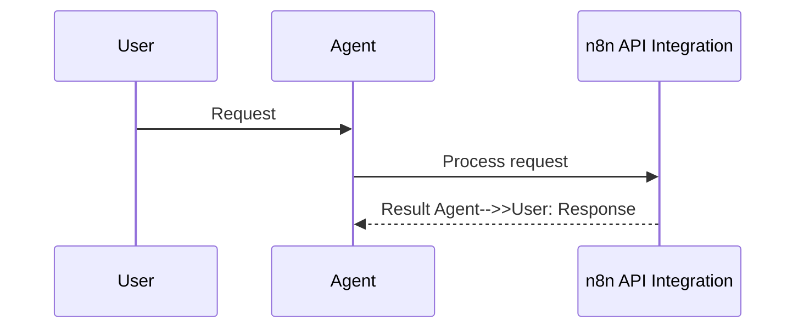
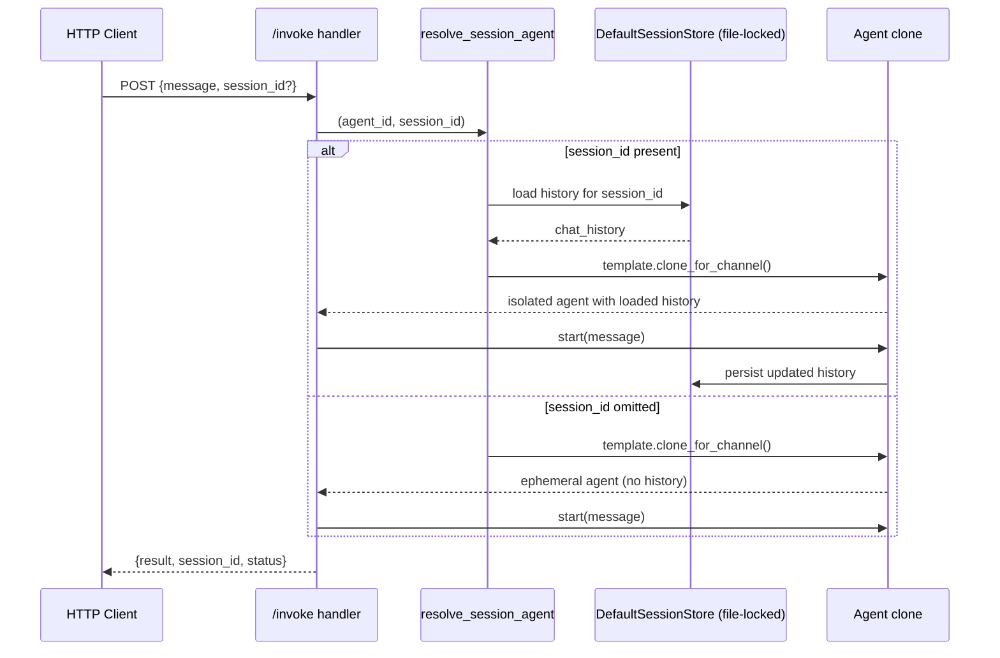
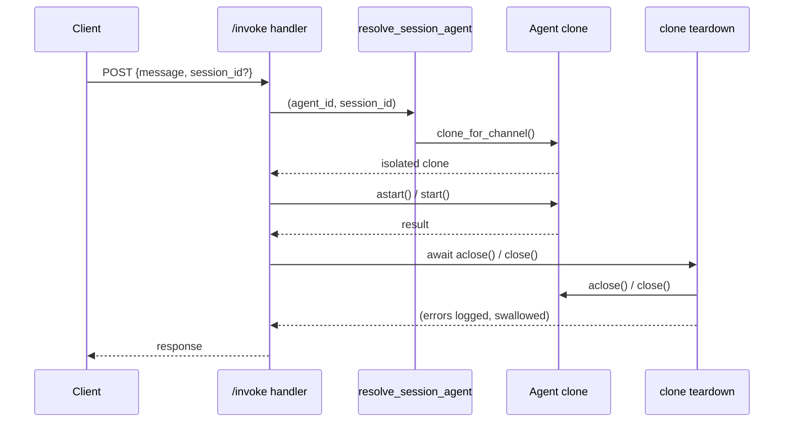
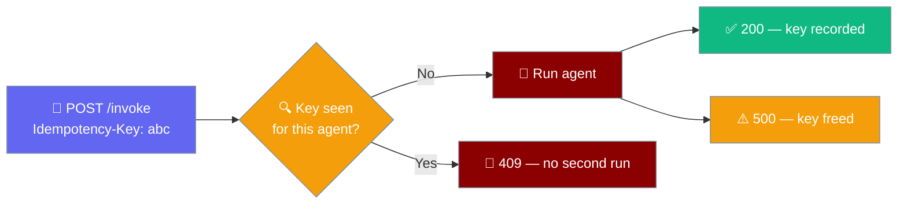
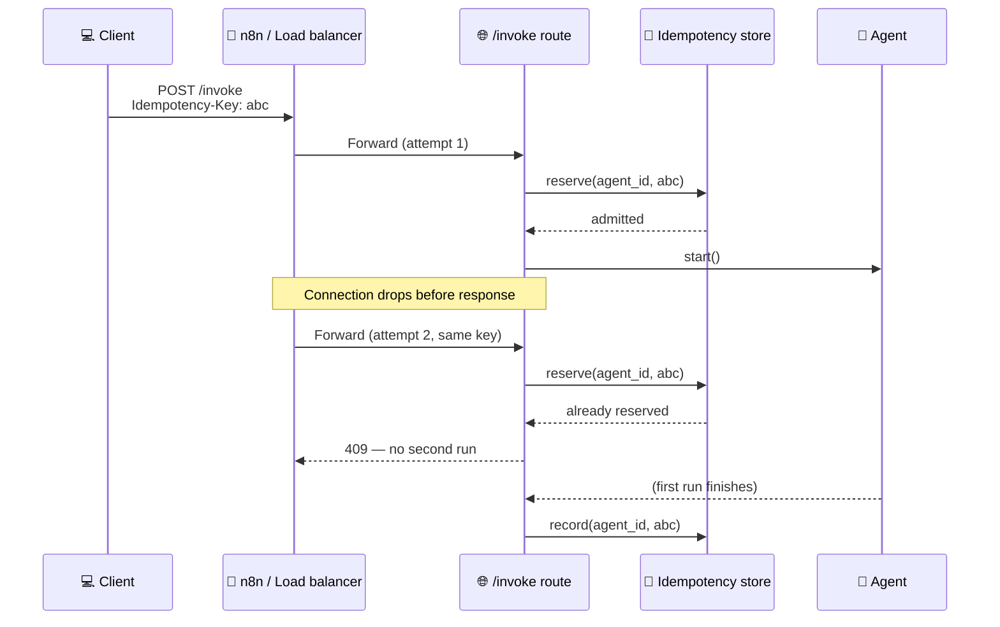
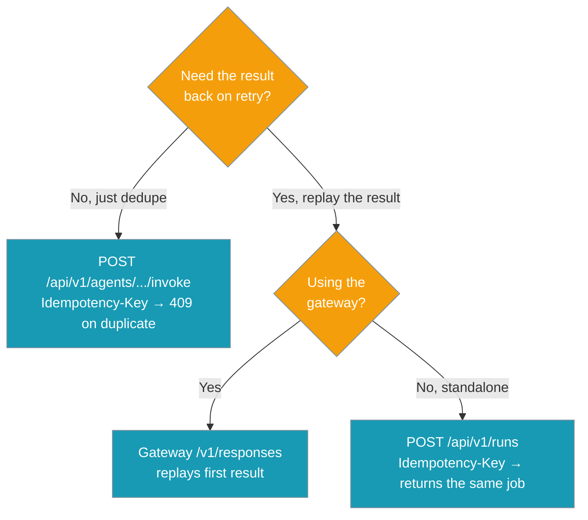

```python
from praisonaiagents import Agent

agent = Agent(name="n8n-agent", instructions="Trigger and manage n8n workflows via API.")
agent.start("Trigger the n8n lead-processing workflow for this new contact.")
```


The n8n API integration enables n8n workflows to invoke PraisonAI agents via HTTP endpoints, allowing bidirectional automation between the platforms.

The user triggers an n8n workflow; HTTP nodes call PraisonAI agents and return structured responses.

```mermaid
graph LR
    subgraph "n8n → PraisonAI API Flow"
        A[🌐 n8n Workflow] --> B[📤 HTTP Request Node]
        B --> C[🔗 /agents/{id}/invoke]
        C --> D[🤖 PraisonAI Agent]
        D --> E[📊 Agent Response]
        E --> F[🔙 HTTP Response]
        F --> G[📋 n8n Processing]
    end
    
    classDef n8n fill:#8B0000,stroke:#7C90A0,color:#fff
    classDef api fill:#189AB4,stroke:#7C90A0,color:#fff
    classDef agent fill:#10B981,stroke:#7C90A0,color:#fff
    
    class A,G n8n
    class B,C,F api
    class D,E agent
```

## How It Works




## Quick Start

<Steps>
<Step title="Start PraisonAI API Server">
```bash
# Start the API server with your agents (localhost default)
praisonai serve agents.yaml --port 8005
```

For a containerised n8n, the API must be reachable from another container — bind to `0.0.0.0` and set an API key:

```bash
# Public bind — REQUIRES an api key (or SystemExit at startup)
export PRAISONAI_SERVE_API_KEY="$(openssl rand -hex 32)"
praisonai serve agents.yaml --port 8005 --host 0.0.0.0
```

<Note>
`--auth` (with `CALL_SERVER_TOKEN`) is the legacy `praisonai/jobs/server.py` call-server flag — **not** the `serve agents` auth. For `praisonai serve agents`, use `--api-key` / `PRAISONAI_SERVE_API_KEY` instead — see [Agents Server → Security](/docs/deploy/servers/agents#security).
</Note>
</Step>

<Step title="Configure n8n HTTP Request Node">
```json
{
  "method": "POST",
  "url": "http://localhost:8005/api/v1/agents/researcher/invoke",
  "sendBody": true,
  "specifyBody": "json",
  "jsonBody": "{\"message\": \"{{ $json.query }}\"}"
}
```
</Step>

<Step title="Test the Integration">
```bash
# Trigger n8n workflow via webhook
curl -X POST "http://localhost:5678/webhook/research-workflow" \
  -H "Content-Type: application/json" \
  -d '{"query": "Research AI trends in 2026"}'
```
</Step>
</Steps>

---

## API Endpoints

### POST /api/v1/agents/{agent_id}/invoke

Invoke a specific PraisonAI agent with input data.

**URL Parameters:**

| Parameter | Type | Description |
|-----------|------|-------------|
| `agent_id` | `string` | The ID/name of the agent to invoke |

**Request Body:**

```json
{
  "message": "Your message to the agent",
  "session_id": "optional-session-id",
  "agent_config": {
    "llm": "gpt-4o-mini",
    "verbose": true
  },
  "context": {
    "user_id": "user123",
    "timestamp": "2026-04-16T12:00:00Z"
  }
}
```

**Required Fields:**

| Field | Type | Description |
|-------|------|-------------|
| `message` | `string` | The input message for the agent |

**Optional Fields:**

| Field | Type | Description |
|-------|------|-------------|
| `session_id` | `string` | Optional. Pass a stable per-user or per-conversation id to persist and resume that conversation across requests. Isolation across different `session_id`s is enforced — each request gets an isolated clone of the registered agent. Omit the field to get an ephemeral per-request agent (no history load, no persistence). |
| `agent_config` | `object` | Optional per-request overrides applied to the isolated agent clone. Keys are validated against a whitelist; an unknown or unsettable key returns **HTTP 400**. See _Supported `agent_config` keys_ below. |
| `context` | `object` | Additional context data |

<Note>
`Idempotency-Key` is a request **header** (not a body field). See [Safe Retries](#safe-retries-idempotency-key) below.
</Note>

### Supported `agent_config` keys

`agent_config` overrides only the whitelisted attributes below on the request's isolated clone. Any other key returns a `400`.

| Key | Type | Description |
|-----|------|-------------|
| `instructions` | `string` | System instructions for the agent |
| `goal` | `string` | Agent goal |
| `role` | `string` | Agent role |
| `backstory` | `string` | Agent backstory |
| `llm` | `string` | Model to use (e.g. `"gpt-4o-mini"`) |
| `max_iter` | `int` | Maximum agent iterations |
| `verbose` | `bool` | Verbose logging |
| `markdown` | `bool` | Render output as markdown |

<Note>
Behavior changed in **v4.6.162**. Before then, unknown keys were logged and silently ignored.
</Note>

<Note>
The `llm` override now takes effect on the request it is sent with. Prior to this release (PR #4400), the wrapper set `agent.llm` but did not invalidate the cached LLM instance, so the request continued to run on the previously cached model while the response metadata reported the new one. If you rely on per-request model switching (A/B tests, cost tiering by caller), verify against your provider's billing dashboard that the actual model matches the requested one.
</Note>

<Warning>
`temperature` is **not** on the whitelist — it is not a settable attribute on the resolved `Agent` in the wrapper, so passing it returns a `400`. Set model parameters like temperature through `agents.yaml` instead.
</Warning>

Rejected requests return a FastAPI error with a `400` status:

```json
{
  "detail": "Unsupported agent_config override(s): ['temperature']. Allowed: ['backstory', 'goal', 'instructions', 'llm', 'markdown', 'max_iter', 'role', 'verbose']"
}
```

<Note>
The non-FastAPI standalone path (`invoke_agent_standalone`) returns the same rejection as `{"error": "...", "status": "error", "agent_id": "..."}` instead of raising an HTTP `400`.
</Note>

### Session semantics

`session_id` isolates conversations per id, resumes history within an id, and runs ephemerally when omitted.

```python
# Serve the agent
# agents.yaml is loaded and mounted on http://localhost:8005
```

```bash
praisonai serve agents.yaml --port 8005
```

```bash
# Same session_id → continuous conversation for one user
curl -s http://localhost:8005/api/v1/agents/researcher/invoke \
  -X POST -H "content-type: application/json" \
  -d '{"message": "my name is Sam", "session_id": "user-42"}'

curl -s http://localhost:8005/api/v1/agents/researcher/invoke \
  -X POST -H "content-type: application/json" \
  -d '{"message": "what is my name?", "session_id": "user-42"}'
# → "Sam"

# Different session_id → isolated; never sees user-42's history
curl -s http://localhost:8005/api/v1/agents/researcher/invoke \
  -X POST -H "content-type: application/json" \
  -d '{"message": "what is my name?", "session_id": "user-99"}'
# → no idea

# No session_id at all → ephemeral; nothing is persisted
curl -s http://localhost:8005/api/v1/agents/researcher/invoke \
  -X POST -H "content-type: application/json" \
  -d '{"message": "hello"}'
```



| Request has `session_id`? | Behaviour |
|---------------------------|-----------|
| Yes, unseen value | Fresh conversation is created and persisted under that id |
| Yes, previously used value | That conversation resumes — full history is loaded, appended to, and re-persisted |
| No `session_id` | Ephemeral per-request clone — history is neither loaded nor persisted |
| Two concurrent requests, different `session_id`s | Fully isolated — history never interleaves |
| Two concurrent requests, same `session_id` | Serialized against a shared file lock — safe, not interleaved |

<Warning>
Do NOT pass a hard-coded fallback like `session_id || "default"` — that single bucket becomes one continuous conversation shared by every caller who lacks a real id, silently defeating the isolation this endpoint provides. Either pass a **per-user / per-conversation** id, or omit the field entirely to get the ephemeral (isolated, non-persistent) mode.
</Warning>

### Per-request cleanup

`/invoke` releases the per-request clone deterministically. After every response — success **or** error — the wrapper calls `await agent.aclose()` (or `agent.close()` in a worker thread when the clone only exposes the sync form). Only clones are closed; when the resolved agent is the shared registry template (plain mocks / non-isolatable agents) it is left untouched, so subsequent requests don't hit a torn-down instance.

This means:

- **MCP stdio subprocesses** started by a clone's tools are terminated before the response returns — no `node.exe` / `uvx …` accumulation in long-lived n8n polling loops.
- **LLM HTTP client pools** and **tool-executor threads** owned by the clone are released.
- **Cleanup failures never mask the response** — they are caught and logged (`logger.exception("Agent cleanup failed")`).

No API change: `AgentInvokeRequest` / `AgentInvokeResponse` are unchanged. This is a wrapper-internal fix delivered in [PR #5083](https://github.com/MervinPraison/PraisonAI/pull/5083).



<Note>
Every deployment that serves `praisonai serve agents.yaml` (or embeds `router` from `praisonai.api.agent_invoke`) gets this cleanup automatically — including every n8n workflow that hits the endpoint. See [Agent Lifecycle Cleanup](/features/agent-lifecycle-cleanup) and [Agent Invoke Registry](/features/agent-invoke-registry).
</Note>

### Safe Retries (`Idempotency-Key`)

Send the same `Idempotency-Key` header on a retry and the invoke endpoint returns `409` instead of starting a second agent run — no duplicate tool actions, no doubled LLM spend.



Opt-in, backward-compatible: **no header → unchanged behaviour** (every POST runs the agent). The request body is unchanged.

```python
import os
import uvicorn
from fastapi import FastAPI
from praisonaiagents import Agent
from praisonai.api.agent_invoke import register_agent, router

os.environ.setdefault("CALL_SERVER_TOKEN", "my-secret-token")

agent = Agent(name="support", instructions="Handle refund requests.")
register_agent("support", agent)

app = FastAPI()
app.include_router(router)
uvicorn.run(app, host="127.0.0.1", port=8005)
```

```bash
curl -X POST http://127.0.0.1:8005/api/v1/agents/support/invoke \
  -H "Authorization: Bearer my-secret-token" \
  -H "Content-Type: application/json" \
  -H "Idempotency-Key: order-123" \
  -d '{"message": "refund order 123"}'
```

<Steps>
<Step title="Retry with the same key">
Your client times out after the agent already fired the refund. Retry with the **same** key — the retry gets `409`, so the refund is not issued twice.

```python
import requests

url = "http://127.0.0.1:8005/api/v1/agents/support/invoke"
headers = {"Authorization": "Bearer my-secret-token", "Idempotency-Key": "order-123"}
body = {"message": "refund order 123"}

first = requests.post(url, json=body, headers=headers)   # 200 — agent runs
retry = requests.post(url, json=body, headers=headers)   # 409 — no second run
print(first.status_code, retry.status_code)
```
</Step>

<Step title="Set the header in n8n">
Add the header to the HTTP Request node. Use a value that stays the same across n8n's retries of one item but differs between items.

```json
{
  "method": "POST",
  "url": "http://localhost:8005/api/v1/agents/support/invoke",
  "sendBody": true,
  "specifyBody": "json",
  "jsonBody": "{\"message\": \"{{ $json.query }}\"}",
  "options": {
    "headers": {
      "Authorization": "Bearer {{ $node.parameter.auth_token }}",
      "Idempotency-Key": "{{ $execution.id }}-{{ $itemIndex }}"
    }
  }
}
```

With **Retry On Fail** enabled, a timed-out attempt that already reached the agent now returns `409` on the retry instead of running the agent again.
</Step>

<Step title="Retry after a failure">
If the first run fails (tool error, LLM timeout → `500`), just retry with the same key. A failed run frees its key, so the retry runs the agent normally.
</Step>
</Steps>

**What happens in each case:**

| Case | HTTP status | Agent run? |
|------|-------------|------------|
| No `Idempotency-Key` header | unchanged behaviour (200 on success) | Yes — every call runs |
| First use of a key, run succeeds | `200` | Yes — key is recorded |
| Retry with the same key while first run is still in flight | `409` with `detail: "A run with this Idempotency-Key was already submitted"` | No — key is reserved |
| Retry with the same key after a successful run (within TTL) | `409` same body | No — key is committed |
| Retry with the same key after the first run failed (`500`) | normal behaviour (200/500) | Yes — a failed run frees its key, so retries are allowed |
| Request is cancelled (connection drop, `asyncio.CancelledError`) | — | Reservation is kept (sync `start` keeps running in its worker thread). A retry sees `409`. |
| Idempotency store cannot be opened (filesystem error) | `503` with `detail: "Idempotency store unavailable; retry later"` | No — the request is rejected rather than running without dedup protection |



**Scoping and limits:**

| Rule | Why |
|------|-----|
| **Per agent** | Keys are scoped by `agent_id`, so `support` and `billing` with the same key run independently. |
| **No response replay** | The store tracks keys only. A retry sees `409`, not the first run's result. For a replayable result, use the async Jobs API (`POST /api/v1/runs`). |
| **Failed runs free their key** | A `500` from the first run releases the reservation so the client can retry safely. |
| **Cancelled requests keep the reservation** | A dropped connection does not free the key (the sync `start` keeps running in its worker thread). |
| **Store unavailable → 503** | If the SQLite database can't be opened, the request is rejected rather than running without dedup protection. |
| **Durable, 24h TTL** | SQLite at `$PRAISONAI_HOME/state/invoke_idempotency.db` (default `~/.praisonai/state/`); survives restart. |

<Note>
Unlike the gateway's [OpenAI-compatible endpoints](/features/gateway-api-endpoints), which replay the first run's result, `/invoke` answers a duplicate with `409`. There is no config knob, CLI flag, or new dependency — the header is the whole feature.
</Note>

**Which endpoint for safe retries?**



See [Gateway API → Safe Retries](/features/gateway-api-endpoints) and [Async Jobs → Submit Run](/deploy/api/async-jobs/submit-run).

**Response:**

```json
{
  "result": "The agent's response text",
  "session_id": "session-123",
  "status": "success",
  "metadata": {
    "agent_id": "researcher",
    "execution_time": 2.5,
    "message_length": 50,
    "response_length": 200,
    "llm_calls": 2,
    "tool_calls": 1
  }
}
```

**Error Response:**

```json
{
  "error": "Agent 'unknown_agent' not found",
  "status": "error",
  "code": 404
}
```

### GET /api/v1/agents

List all available agents.

**Response:**

```json
{
  "agents": [
    {
      "id": "researcher",
      "name": "Research Agent",
      "description": "Conducts thorough research on given topics",
      "status": "active"
    },
    {
      "id": "writer",
      "name": "Content Writer",
      "description": "Creates engaging content based on research",
      "status": "active"
    }
  ],
  "count": 2,
  "status": "success"
}
```

### GET /api/v1/health

Check API server health status.

**Response:**

```json
{
  "status": "healthy",
  "timestamp": "2026-04-16T12:00:00Z",
  "version": "1.0.0",
  "agents_loaded": 3
}
```

---

## n8n HTTP Request Configuration

### Basic Configuration

<Tabs>
<Tab title="Simple Agent Call">
```json
{
  "method": "POST",
  "url": "http://localhost:8005/api/v1/agents/researcher/invoke",
  "sendBody": true,
  "specifyBody": "json",
  "jsonBody": "{\"message\": \"{{ $json.query }}\"}"
}
```
</Tab>

<Tab title="With Session Management">
```json
// Persistent conversation — pass the real per-user session id
{
  "method": "POST",
  "url": "http://localhost:8005/api/v1/agents/researcher/invoke",
  "sendBody": true,
  "specifyBody": "json",
  "jsonBody": "{\"message\": \"{{ $json.query }}\", \"session_id\": \"{{ $json.user_id }}\"}"
}
```

```json
// Ephemeral / stateless — omit session_id entirely
{
  "method": "POST",
  "url": "http://localhost:8005/api/v1/agents/researcher/invoke",
  "sendBody": true,
  "specifyBody": "json",
  "jsonBody": "{\"message\": \"{{ $json.query }}\"}"
}
```

Pick the first when the workflow already has a stable per-user identifier; pick the second for one-shot processing.
</Tab>

<Tab title="With Authentication">
```json
{
  "method": "POST",
  "url": "http://localhost:8005/api/v1/agents/researcher/invoke",
  "sendBody": true,
  "specifyBody": "json",
  "jsonBody": "{\"message\": \"{{ $json.query }}\"}",
  "options": {
    "headers": {
      "Authorization": "Bearer {{ $node.parameter.auth_token }}"
    }
  }
}
```
</Tab>
</Tabs>

### Advanced Configuration

<AccordionGroup>
<Accordion title="Dynamic Agent Selection">
```json
{
  "method": "POST",
  "url": "http://localhost:8005/api/v1/agents/{{ $json.agent_type }}/invoke",
  "sendBody": true,
  "specifyBody": "json",
  "jsonBody": "{\"message\": \"{{ $json.message }}\", \"context\": {{ JSON.stringify($json.context) }}}"
}
```

Use this pattern when you want to dynamically select which agent to call based on input data.
</Accordion>

<Accordion title="Error Handling">
```json
{
  "method": "POST",
  "url": "http://localhost:8005/api/v1/agents/researcher/invoke",
  "sendBody": true,
  "specifyBody": "json",
  "jsonBody": "{\"message\": \"{{ $json.query }}\"}",
  "options": {
    "timeout": 30000,
    "retry": {
      "enable": true,
      "maxAttempts": 3
    }
  }
}
```

Configure timeouts and retry logic for resilient workflows.
</Accordion>

<Accordion title="Response Processing">
```json
{
  "method": "POST",
  "url": "http://localhost:8005/api/v1/agents/researcher/invoke",
  "sendBody": true,
  "specifyBody": "json",
  "jsonBody": "{\"message\": \"{{ $json.query }}\"}",
  "options": {
    "response": {
      "fullResponse": true,
      "neverError": false
    }
  }
}
```

Control how n8n handles the API response data.
</Accordion>
</AccordionGroup>

---

## Authentication

### Token-Based Authentication

Set up authentication for secure API access:

<Tabs>
<Tab title="Server Setup">
```bash
# Set authentication token
export CALL_SERVER_TOKEN="your-secret-token"

# Start server with auth
praisonai serve agents.yaml --port 8005 --auth

# Or in agents.yaml
auth:
  token: "your-secret-token"
  required: true
```
</Tab>

<Tab title="n8n Configuration">
```json
{
  "method": "POST",
  "url": "http://localhost:8005/api/v1/agents/researcher/invoke",
  "sendBody": true,
  "specifyBody": "json",
  "jsonBody": "{\"message\": \"{{ $json.query }}\"}",
  "options": {
    "headers": {
      "Authorization": "Bearer your-secret-token"
    }
  }
}
```
</Tab>

<Tab title="Environment Variables">
```bash
# Production setup
export CALL_SERVER_TOKEN="prod-token-123"
export PRAISONAI_API_URL="https://api.yourcompany.com"

# Development setup
export CALL_SERVER_TOKEN="dev-token-456"
export PRAISONAI_API_URL="http://localhost:8005"
```
</Tab>
</Tabs>

### API Key Management

<AccordionGroup>
<Accordion title="Rotation Strategy">
Implement token rotation for enhanced security:

```bash
# Generate new token
export NEW_TOKEN="$(openssl rand -hex 32)"

# Update server configuration
praisonai config set auth.token "$NEW_TOKEN"

# Update n8n credentials
# Manual step: Update HTTP Request node headers
```
</Accordion>

<Accordion title="Multiple Environments">
Use different tokens for different environments:

```bash
# Production
export CALL_SERVER_TOKEN="prod_$(date +%Y%m%d)_$(openssl rand -hex 16)"

# Staging
export CALL_SERVER_TOKEN="staging_$(date +%Y%m%d)_$(openssl rand -hex 16)"

# Development
export CALL_SERVER_TOKEN="dev_$(openssl rand -hex 16)"
```
</Accordion>
</AccordionGroup>

---

## Workflow Examples

### Sequential Agent Workflow

<Tabs>
<Tab title="n8n Workflow">
Create a research → write → publish workflow:

1. **Webhook Trigger**: Receives initial request
2. **Researcher HTTP Node**: Calls `/agents/researcher/invoke`
3. **Writer HTTP Node**: Calls `/agents/writer/invoke` with research data
4. **Publisher HTTP Node**: Calls `/agents/publisher/invoke` with content
5. **Response Node**: Returns final result
</Tab>

<Tab title="HTTP Node Configuration">
```json
// Researcher Node
{
  "url": "http://localhost:8005/api/v1/agents/researcher/invoke",
  "jsonBody": "{\"message\": \"{{ $json.topic }}\"}"
}

// Writer Node
{
  "url": "http://localhost:8005/api/v1/agents/writer/invoke",
  "jsonBody": "{\"message\": \"Write content based on: {{ $node.Researcher.json.result }}\"}"
}

// Publisher Node
{
  "url": "http://localhost:8005/api/v1/agents/publisher/invoke",
  "jsonBody": "{\"message\": \"Publish this content: {{ $node.Writer.json.result }}\"}"
}
```
</Tab>

<Tab title="Test Webhook">
```bash
curl -X POST "http://localhost:5678/webhook/research-pipeline" \
  -H "Content-Type: application/json" \
  -d '{
    "topic": "Future of AI in healthcare",
    "target_audience": "medical professionals",
    "publishing_channels": ["blog", "linkedin"]
  }'
```
</Tab>
</Tabs>

### Conditional Routing Workflow

<AccordionGroup>
<Accordion title="Smart Content Router">
Route content to different agents based on type:

```json
// Classification Node
{
  "url": "http://localhost:8005/api/v1/agents/classifier/invoke",
  "jsonBody": "{\"message\": \"Classify this content: {{ $json.content }}\"}"
}

// Switch Node Logic
{
  "rules": [
    {
      "operation": "equal",
      "value1": "{{ $node.Classifier.json.result.type }}",
      "value2": "blog"
    },
    {
      "operation": "equal", 
      "value1": "{{ $node.Classifier.json.result.type }}",
      "value2": "social"
    }
  ]
}
```
</Accordion>

<Accordion title="Error Recovery Workflow">
Implement fallback logic for failed agent calls:

```json
// Primary Agent Call
{
  "url": "http://localhost:8005/api/v1/agents/primary/invoke",
  "options": {
    "timeout": 10000,
    "neverError": true
  }
}

// IF Node (Check for Errors)
{
  "conditions": {
    "string": [
      {
        "value1": "{{ $json.error }}",
        "operation": "isEmpty"
      }
    ]
  }
}

// Fallback Agent Call
{
  "url": "http://localhost:8005/api/v1/agents/fallback/invoke",
  "jsonBody": "{\"message\": \"{{ $json.original_request }}\"}"
}
```
</Accordion>
</AccordionGroup>

---

## Best Practices

<AccordionGroup>
<Accordion title="Error Handling">
Implement robust error handling in n8n workflows:

```json
// Configure HTTP Request nodes
{
  "options": {
    "timeout": 30000,
    "retry": {
      "enable": true,
      "maxAttempts": 3,
      "waitBetween": 1000
    },
    "response": {
      "neverError": true
    }
  }
}

// Add IF nodes to check for errors
{
  "conditions": {
    "string": [
      {
        "value1": "{{ $json.status }}",
        "operation": "equal",
        "value2": "error"
      }
    ]
  }
}
```
</Accordion>

<Accordion title="Data Validation">
Validate data before sending to agents:

When your workflow already knows *who* is talking (a user id, a customer id, a chat id), pass that stable value as `session_id`. When it doesn't, **omit the field** — the endpoint's ephemeral mode is the correct default. Do not synthesise ids per-run.

```json
// Set Node for validation — pass a stable id, or omit session_id
{
  "values": {
    "message": "{{ $json.input || 'Default message' }}",
    "session_id": "{{ $json.user_id }}",
    "timestamp": "{{ new Date().toISOString() }}"
  }
}

// Function Node for complex validation
function validateInput() {
  const required = ['message', 'user_id'];
  const missing = required.filter(field => !items[0].json[field]);
  
  if (missing.length > 0) {
    throw new Error(`Missing required fields: ${missing.join(', ')}`);
  }
  
  return items[0].json;
}
```
</Accordion>

<Accordion title="Performance Optimization">
Optimize API calls for better performance:

- **Batch Requests**: Group multiple agent calls when possible
- **Parallel Execution**: Use fan-out patterns for independent calls
- **Caching**: Store frequently used results in Set nodes
- **Connection Pooling**: Configure HTTP node connection limits
- **Timeouts**: Set appropriate timeouts based on agent complexity
</Accordion>

<Accordion title="Security">
Secure your API integration:

- **Authentication**: Always use CALL_SERVER_TOKEN in production
- **HTTPS**: Use encrypted connections for remote APIs
- **Input Sanitization**: Validate and sanitize user inputs
- **Rate Limiting**: Implement rate limiting on the PraisonAI server
- **Logging**: Enable request logging for audit trails
</Accordion>
</AccordionGroup>

---

## Troubleshooting

### Common Issues

<Tabs>
<Tab title="Connection Errors">
```json
// Error: ECONNREFUSED
{
  "error": "connect ECONNREFUSED 127.0.0.1:8005"
}

// Solution: Verify PraisonAI server is running
// Check: praisonai serve agents.yaml --port 8005
```
</Tab>

<Tab title="Authentication Errors">
```json
// Error: 401 Unauthorized
{
  "error": "Invalid or missing authentication token",
  "code": 401
}

// Solution: Add Authorization header
{
  "headers": {
    "Authorization": "Bearer your-secret-token"
  }
}
```
</Tab>

<Tab title="Agent Not Found">
```json
// Error: Agent not found
{
  "error": "Agent 'unknown_agent' not found",
  "code": 404
}

// Solution: Check available agents
// GET http://localhost:8005/api/v1/agents
```
</Tab>

<Tab title="Conversations Mixing">
**Symptom:** two users' conversations mix together.

**Cause:** both requests share the same `session_id` (often a hard-coded `"default"` or an empty string). Each `session_id` is one conversation — reusing it across users is what the endpoint interprets as "resume that user's chat".

**Fix:** send a per-user id, or omit `session_id`.
</Tab>

<Tab title="agent_config rejected">
**Symptom:** the request returns `400` with a message like `Unsupported agent_config override(s): [...]`.

**Cause:** a key that isn't on the whitelist — or a whitelisted key that isn't a settable attribute on the resolved `Agent`. Before v4.6.162 this was silently ignored.

**Fix:** remove the offending key (for example `temperature`), or route that setting through `agents.yaml` instead. See _Supported `agent_config` keys_ above for the allowed list.
</Tab>

<Tab title="llm override ignored">
**Symptom:** you passed `agent_config={"llm": "…"}` but the provider bill / traces show the previously configured model was actually used.

**Cause:** fixed in PR #4400. Before that fix, the wrapper wrote `agent.llm = value` without invalidating the cached `_llm_instance`/`_unified_dispatcher`, so requests kept running on the cached model.

**Fix:** upgrade to the release containing PR #4400.
</Tab>

<Tab title="Rising memory / threads / MCP subprocesses">
**Symptom:** After N invokes against a long-lived server, `ps` / Task Manager shows growing numbers of MCP stdio processes (`node.exe`, `uvx …`) or the process's memory / thread count creeps up.

**Cause:** Fixed in PR #5083. Before that release, the invoke handler discarded the per-request agent clone without calling `close()` / `aclose()`, so lazily-created MCP subprocesses, LLM HTTP pools, and tool-executor threads leaked.

**Fix:** Upgrade to the release containing PR #5083. Verify with `pytest src/praisonai/tests/test_n8n_agent_invoke.py::TestAgentInvokeCleanup -v`.
</Tab>

<Tab title="409 Conflict on retry">
**Symptom:** a retry returns `409` with `detail: "A run with this Idempotency-Key was already submitted"`.

**Cause:** working as intended — the first request with that key already ran (or is still running), so the retry is not run again.

**Fix:** nothing to fix. If you need the first run's result back on retry, use the async Jobs API (`POST /api/v1/runs`) instead — see _Safe Retries_ above.
</Tab>

<Tab title="503 Idempotency store unavailable">
**Symptom:** a request with an `Idempotency-Key` header returns `503` with `detail: "Idempotency store unavailable; retry later"`.

**Cause:** the server could not open `$PRAISONAI_HOME/state/invoke_idempotency.db` (default `~/.praisonai/state/`).

**Fix:** make sure `$PRAISONAI_HOME` (or `~/.praisonai`) exists and is writable by the server process.
</Tab>

<Tab title="n8n keeps re-running my agent">
**Symptom:** an n8n retry (timeout, "Retry On Fail") runs the agent twice — duplicate tool actions, doubled LLM spend.

**Cause:** the HTTP Request node is not sending an `Idempotency-Key` header.

**Fix:** add an `Idempotency-Key` header with a value that stays the same across retries (for example `{{ $execution.id }}-{{ $itemIndex }}`). See _Safe Retries_ above.
</Tab>
</Tabs>

### Debugging Steps

1. **Check Server Status**: Verify PraisonAI API is running
2. **Test Endpoints**: Use curl to test API endpoints directly  
3. **Validate Credentials**: Confirm authentication tokens are correct
4. **Review Logs**: Check both n8n and PraisonAI logs for errors
5. **Network Connectivity**: Ensure n8n can reach PraisonAI server

---

## Related

<CardGroup cols={2}>
  <Card title="n8n Integration Overview" icon="diagram-project" href="/features/n8n-integration">
    Complete guide to n8n integration architecture and setup
  </Card>
  <Card title="n8n Tools Reference" icon="wrench" href="/features/n8n-tools">
    PraisonAI tools for executing n8n workflows from agents
  </Card>
  <Card title="Visual Workflow Editor" icon="eye" href="/features/n8n-visual-editor">
    Export and edit PraisonAI workflows in n8n's visual interface
  </Card>
  <Card title="CLI n8n Commands" icon="terminal" href="/cli/n8n">
    Command-line tools for n8n workflow management
  </Card>
  <Card title="Agent Lifecycle Cleanup" icon="broom" href="/features/agent-lifecycle-cleanup">
    How per-request clones release LLM clients and MCP subprocesses
  </Card>
  <Card title="Agent Invoke Registry" icon="user" href="/features/agent-invoke-registry">
    Templates vs. per-request clones and their teardown
  </Card>
</CardGroup>