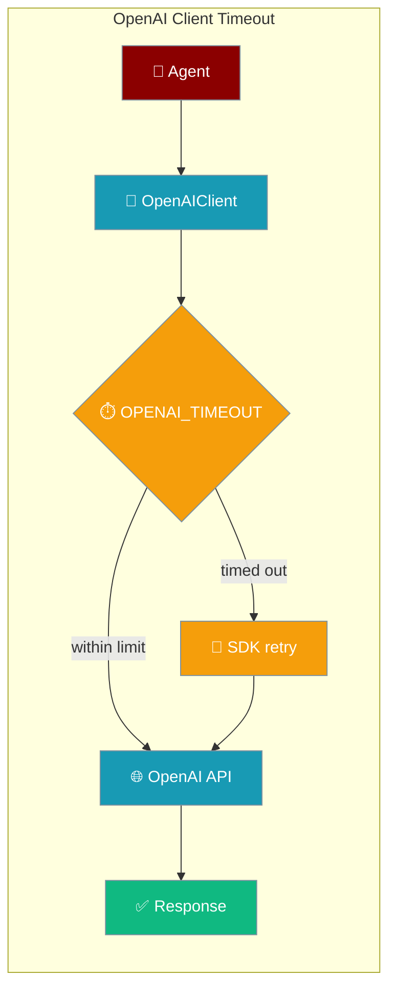
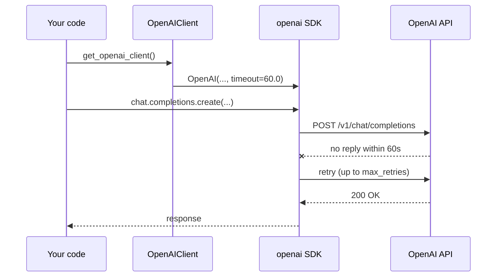
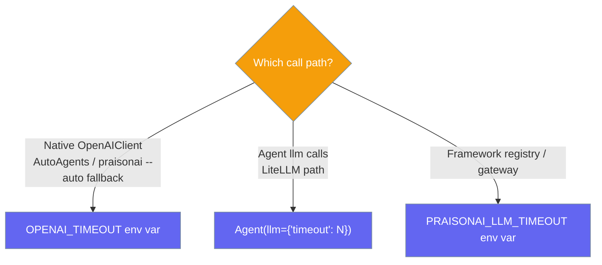

Set one env var, `OPENAI_TIMEOUT`, to cap how long each request on the native OpenAI client path may take.



## Quick Start

<Steps>
<Step title="Set the env var (zero code change)">
```python
# export OPENAI_TIMEOUT=60

from praisonaiagents import Agent

agent = Agent(
    name="Assistant",
    instructions="You are a helpful assistant.",
)
agent.start("Summarise today's news.")
# Native OpenAI client requests now give up after 60 seconds and retry.
```
</Step>

<Step title="Build a client — it reads the env var">
```python
import os
from praisonaiagents.llm import get_openai_client

os.environ["OPENAI_TIMEOUT"] = "60"
client = get_openai_client()  # sync and async clients use timeout=60.0
```

The value is part of the client cache key, so changing `OPENAI_TIMEOUT` mid-process rebuilds the cached SDK client on the next `get_openai_client()` call.
</Step>

<Step title="Pair it with OPENAI_MAX_RETRIES">
```python
# export OPENAI_TIMEOUT=60
# export OPENAI_MAX_RETRIES=3
```

The OpenAI SDK retries timed-out requests automatically, up to `max_retries`. See [OpenAI Client Retries](/features/openai-client-retries).
</Step>
</Steps>

---

## How It Works

`OpenAIClient` reads `OPENAI_TIMEOUT` when it is built and passes it to both the sync `OpenAI` and async `AsyncOpenAI` SDK clients.



| Behaviour | Detail |
|-----------|--------|
| Applies to | The native `OpenAIClient` / `get_openai_client` path — used by `AutoAgents`, the OpenAI fallback leg of `praisonai --auto`, and direct callers. |
| Unset | The SDK default of 600 seconds applies. |
| Invalid value | Non-numeric values (e.g. `"abc"`) are silently ignored; the SDK default applies — no crash. |
| Cache | Part of the `get_openai_client` cache key — a new value rebuilds the client. |

---

## Configuration Options

| Option | Type | Default | Description |
|--------|------|---------|-------------|
| `OPENAI_TIMEOUT` (env var) | `float` (string, seconds) | unset (SDK default `600`s) | Per-request timeout forwarded to the OpenAI SDK's sync and async clients on the native path. Non-numeric values silently fall back to the SDK default (no crash). |

Precedence: `OPENAI_TIMEOUT env var  >  SDK default (600s)`. There is no constructor argument for the timeout on `OpenAIClient` — the env var is the only lever.

---

## Which Approach to Use



See [LLM Timeouts](/features/llm-timeouts) for the agent-level and registry layers.

---

## Common Patterns

**Fail fast while learning** — a short bound surfaces a stuck provider quickly.

```python
# export OPENAI_TIMEOUT=60
from praisonaiagents import Agent

agent = Agent(instructions="Answer briefly")
agent.start("What is 2 + 2?")
```

**Leave it unset for reasoning models** — long non-streaming reasoning calls can legitimately run for minutes; the 600s SDK default covers them.

---

## Best Practices

<AccordionGroup>
<Accordion title="Start with 60–120 seconds">
Long enough for normal chat calls, short enough that a stuck request retries quickly.
</Accordion>

<Accordion title="Keep the 600s default for reasoning models">
Lowering the bound can cut off slow but healthy reasoning calls.
</Accordion>

<Accordion title="Don't double-stack timeouts">
`OPENAI_TIMEOUT` covers only the native client path. For agent `llm` calls use `Agent(llm={"timeout": N})` — set the one that matches your path.
</Accordion>

<Accordion title="Retry-on-timeout is automatic">
The SDK retries timed-out requests on its own. Combine with `OPENAI_MAX_RETRIES` to control how many times.
</Accordion>
</AccordionGroup>

---

## Related

<CardGroup cols={2}>
<Card title="OpenAI Client Retries" icon="rotate" href="/features/openai-client-retries">
Retry transient errors on the same client.
</Card>
<Card title="LLM Timeouts" icon="clock" href="/features/llm-timeouts">
Agent-level and registry timeout layers.
</Card>
<Card title="Agent Retry" icon="clock-rotate-left" href="/features/agent-retry">
Retry the agent loop with backoff.
</Card>
<Card title="OpenAI" icon="microchip" href="/models/openai">
Configure the OpenAI provider.
</Card>
</CardGroup>
