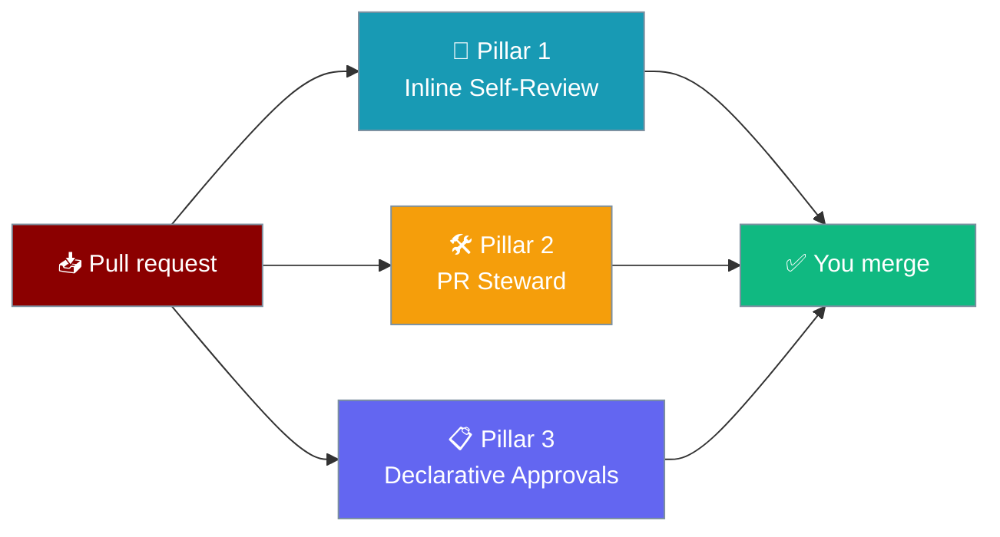
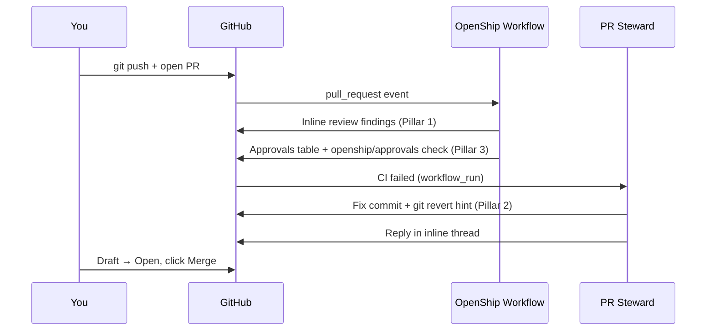
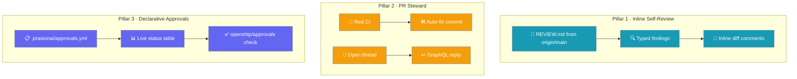

OpenShip turns every GitHub pull request into a self-reviewed, CI-green, policy-checked PR — on any LLM or local Ollama — while you keep the merge button.



## Quick Start

<Steps>
  <Step title="Install">
    ```bash
    pip install praisonai-code
    ```
  </Step>
  <Step title="Scaffold the workflow and sync your LLM secret">
    ```bash
    praisonai-code ship init --github
    ```
    This writes `.github/workflows/openship.yml`, `.praisonai/approvals.yml`, and `REVIEW.md`, then syncs your detected LLM API key and `OPENSHIP_MODEL` to GitHub.

    
  </Step>
  <Step title="Commit and push to main">
    ```bash
    git add .github/workflows/openship.yml .praisonai/approvals.yml
    if [ -f REVIEW.md ]; then git add REVIEW.md; fi   # skipped by init if .praisonai/REVIEW.md exists
    git commit -m "chore: enable OpenShip" && git push
    ```
  </Step>
</Steps>

Prefer Python? Ship the current branch as a self-reviewed draft PR in one call:

```python
from praisonai_code.ship import ship

result = ship(message="fix: handle an empty input list", review=True, post_review=True)
print(result.pr_url, result.severity, len(result.findings))
```

<Tip>
**Is GitHub Actions 100% automatic after these 3 commands?**
**Yes — zero GitHub Settings clicks, zero GitHub App install, zero webhooks, zero external servers.** As soon as `.github/workflows/openship.yml` is pushed to `main`, GitHub activates it in the **Actions** tab and runs all three pillars on every new or updated PR using the built-in `GITHUB_TOKEN`.
</Tip>

---

## Push → Full Merge

Everything below happens automatically the next time you push a feature branch and open a PR.

<Steps>
  <Step title="Push a feature branch — GitHub Actions auto-triggers">
    Your **Actions** tab runs your CI alongside **OpenShip (Review, Steward & Policy)**.

    
  </Step>
  <Step title="Pillar 1 inline review + Pillar 3 live approvals table">
    Pillar 1 reads `REVIEW.md` from `origin/main` and posts typed findings (`important`, `nit`, `pre_existing`) on the exact diff line. Pillar 3 evaluates `.praisonai/approvals.yml` and upserts one live status table plus the `openship/approvals` check.

    

    
  </Step>
  <Step title="Pillar 2 PR Steward auto-fixes red CI">
    When CI fails, PR Steward reads the failing logs, pushes a fix commit to your branch, and posts a one-line `git revert <sha>` so you stay in control.

    
  </Step>
  <Step title="PR Steward resolves inline review threads">
    PR Steward fixes the flagged code and replies directly inside the original inline thread.

    
  </Step>
  <Step title="You mark Ready and click Merge">
    OpenShip never merges or approves. Flip the PR from **Draft → Open** and click **Merge pull request**.

    

    
  </Step>
</Steps>



---

## Three Pillars at a Glance



| Pillar | Trigger | Output | Commit check |
|---|---|---|---|
| **1 · Inline Self-Review** | PR opened/updated, `@praisonai review` | Inline diff findings (`important` / `nit` / `pre_existing`) | `openship/review` |
| **2 · PR Steward** | Failed CI (`workflow_run`), conflicts, review threads, `@praisonai` directives | Fix commits, thread replies, `git revert` hint | — |
| **3 · Declarative Approvals** | PR opened/updated, reviews submitted | Live status table (`observe` / `enforce`) | `openship/approvals` |

---

## PR Comment Controls

Control OpenShip from any pull request comment, at any time.

| Comment on PR | What OpenShip does |
|---|---|
| `@praisonai review` | Re-runs Pillar 1 inline self-review on the latest diff |
| `@praisonai steward` | Triggers a fresh PR Steward pass (checks, conflicts, threads) |
| `@praisonai <instruction>` | Runs PR Steward to apply your requested change and push a commit |
| `@praisonai stop` *(or label `openship-stop`)* | Pauses automated OpenShip runs on that PR |
| `@praisonai resume` | Resumes PR Steward and clears circuit-breaker pause |

---

## Pick Your Surface

OpenShip ships inside `praisonai-code` and runs wherever you work.

```mermaid
graph TD
    Q{Where do you work?}
    Q -->|On GitHub, team repo| A[GitHub Actions — zero server]
    Q -->|Local terminal / any CI| B[Terminal & Headless CI]
    Q -->|Prefer a visual UI| C[Visual Web UI]
    A --> AC[praisonai-code ship init --github → git push]
    B --> BC[praisonai-code ship check && ship --dry-run]
    C --> CC[pip install 'praisonai-code[ui]' && ship ui]
    classDef q fill:#F59E0B,stroke:#7C90A0,color:#fff
    classDef opt fill:#189AB4,stroke:#7C90A0,color:#fff
    classDef cmd fill:#10B981,stroke:#7C90A0,color:#fff
    class Q q
    class A,B,C opt
    class AC,BC,CC cmd
```

| Surface | Setup | First command |
|---|---|---|
| **GitHub Actions** | `praisonai-code ship init --github` | `git commit && git push` |
| **Terminal & any CI** | `pip install praisonai-code` | `praisonai-code ship check && praisonai-code ship --dry-run` |
| **Visual Web UI** | `pip install "praisonai-code[ui]"` | `praisonai-code ship ui` (opens `http://127.0.0.1:8765`) |

---

## Optional Power-Ups

<AccordionGroup>
  <Accordion title="Auto-re-run CI after Steward pushes a fix">
    GitHub's built-in `GITHUB_TOKEN` cannot trigger another workflow. Add a repository secret named `OPENSHIP_GH_TOKEN` (a repo Personal Access Token) so your CI re-runs on Steward's fix commits.
  </Accordion>
  <Accordion title="Custom CI workflow names">
    OpenShip listens for failures from workflows named `CI`, `Tests`, or `Smoke`. Add your own names to `on.workflow_run.workflows` in `.github/workflows/openship.yml`.
  </Accordion>
  <Accordion title="Skip draft PRs">
    Set the repository variable `OPENSHIP_SKIP_DRAFTS=true` to wait until you click **Ready for review**.
  </Accordion>
  <Accordion title="Review effort tiers">
    `quick`, `standard`, and `deep` map to `low`, `medium`, and `high`. Canonical efforts `low`, `medium`, `high`, `xhigh`, and `max` also work. Set the default with the `OPENSHIP_EFFORT` repository variable (defaults to `high`) or pass `--effort` to `praisonai-code ship init --github`.
  </Accordion>
</AccordionGroup>

---

## Safety Guarantees

<AccordionGroup>
  <Accordion title="Hard before_tool guard">
    Blocks `gh pr merge` (including `--auto`), `gh pr review --approve`, `gh api` merge/approve calls, and `git push --force*` at the tool boundary. OpenShip never merges, approves, or force-pushes.
  </Accordion>
  <Accordion title="Draft by default">
    Every PR opens as a draft on your feature branch. Running `ship` on `main` (or a fork) is refused before any commit or push.
  </Accordion>
  <Accordion title="Secret-file refusal">
    Refuses to commit `.env` files, private keys, or other secret paths.
  </Accordion>
  <Accordion title="3-attempt circuit breaker">
    PR Steward caps retries per failing check, conflict, or review thread so an unfixable issue never loops.
  </Accordion>
  <Accordion title="Base-branch policy loading">
    `.praisonai/approvals.yml` and `REVIEW.md` are read from `origin/<base>`, so a PR cannot weaken its own rules.
  </Accordion>
  <Accordion title="Global kill switch">
    Set `PRAISONAI_DISABLE_SHIP=1` (or `[ship] enabled = false` in config) to disable `ship` and `steward` completely.
  </Accordion>
</AccordionGroup>

---

## Related

<CardGroup cols={2}>
  <Card title="Ship & Steward CLI" icon="rocket" href="/cli/ship">
    Local `ship` / `steward` CLI reference
  </Card>
  <Card title="Steward" icon="eye" href="/cli/steward">
    Python read-and-decide API for PR state
  </Card>
  <Card title="Never-Merge Guard" icon="shield" href="/features/ship-never-merge-guard">
    The `register_never_merge` hook
  </Card>
  <Card title="Interactive Code Review" icon="magnifying-glass" href="/features/interactive-code-review">
    In-session `/code-review`
  </Card>
</CardGroup>
