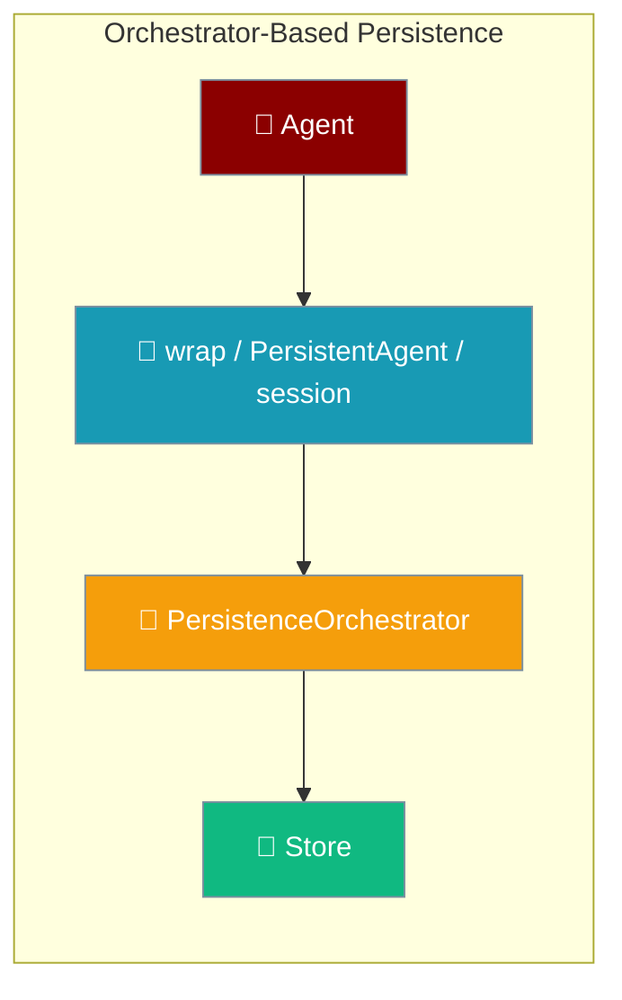
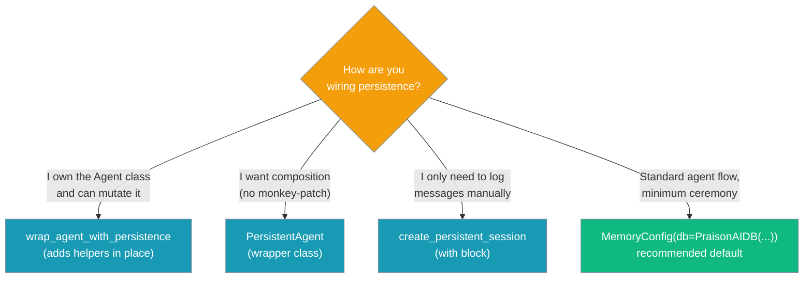
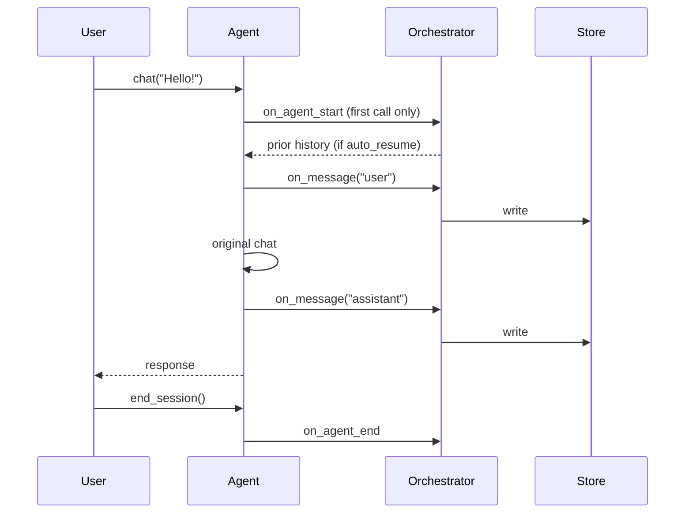

Wrap an existing agent so every chat is saved and can be resumed, without changing how you build the agent.



## Quick Start

<Steps>
<Step title="Simple Usage">

```python
from praisonaiagents import Agent
from praisonai.persistence import PersistenceOrchestrator, wrap_agent_with_persistence
from praisonai.persistence.conversation.sqlite import SQLiteConversationStore

store = SQLiteConversationStore(path="conv.db")
orchestrator = PersistenceOrchestrator(conversation_store=store)

agent = wrap_agent_with_persistence(
    Agent(name="Assistant", instructions="You are helpful."),
    orchestrator,
    session_id="my-session",
)

agent.chat("Hello!")           # user + assistant message both persisted
print(agent.get_messages())    # read back from the store
agent.end_session()
```

</Step>
<Step title="Resume on Next Run">

```python
# Later, in a fresh process — same session_id
resumed = wrap_agent_with_persistence(
    Agent(name="Assistant", instructions="You are helpful."),
    orchestrator,
    session_id="my-session",   # auto_resume=True by default
)

resumed.chat("What did I say earlier?")   # chat_history pre-populated before answering
```

</Step>
</Steps>

---

## Which Entry Point?

Pick the style that matches how much control you need.



---

## How It Works

Each entry point drives the same orchestrator lifecycle.



| Step | What happens |
|------|--------------|
| First `chat` / `achat` | Session starts; with `auto_resume=True`, prior messages are loaded into `agent.chat_history` before the agent answers |
| User message | Saved **before** the agent runs |
| Assistant reply | Saved after, only if the reply is non-empty |
| `end_session()` | Calls `orchestrator.on_agent_end` |

---

## Entry Points

### `wrap_agent_with_persistence`

Patches `chat` (and `achat`, if the agent has it) on the agent you pass in, and returns that same agent.

| Option | Type | Default | Description |
|--------|------|---------|-------------|
| `agent` | `Agent` | required | Agent to wrap |
| `orchestrator` | `PersistenceOrchestrator` | required | Where messages are stored |
| `session_id` | `str` | `None` | Auto-generated as `session-<8 hex chars>` when omitted |
| `user_id` | `str` | `None` | Falls back to `agent.user_id`, then `"default"` |
| `auto_resume` | `bool` | `True` | Load prior messages into `chat_history` on first chat |

Helpers added to the agent:

| Method | Returns |
|--------|---------|
| `agent.get_session()` | `ConversationSession` |
| `agent.get_messages(limit=None)` | `List[ConversationMessage]` |
| `agent.end_session()` / `await agent.aend_session()` | Ends the session |

### `PersistentAgent`

Wraps the agent without patching it. Same options and helpers as above, plus a `session_id` property. Other attributes pass through to the wrapped agent.

```python
from praisonaiagents import Agent
from praisonai.persistence import PersistentAgent

base = Agent(name="Assistant", instructions="You are helpful.")
agent = PersistentAgent(base, orchestrator, session_id="s3")

agent.name           # "Assistant" — attribute delegated to base
agent.session_id     # "s3"
agent.chat("hi")
```

`await agent.achat(...)` works even if the wrapped agent has no `achat` — it runs `chat` in a worker thread.

### `create_persistent_session`

A `with` block for logging messages by hand.

```python
from praisonai.persistence import create_persistent_session

with create_persistent_session(orchestrator, session_id="s4") as session:
    session.persist_message("user", "hi")
    session.persist_message("assistant", "hello")
# on_agent_end fires automatically on exit
```

| Method | Purpose |
|--------|---------|
| `persist_message(role, content)` | Write one message |
| `get_messages(limit=None)` | Read messages back |
| `get_session()` | Get the `ConversationSession` |
| `start(agent=None)` / `end(agent=None)` | Manual lifecycle (the `with` block calls these) |

<Note>
Sessions support the sync `with` statement only. There is no `async with`.
</Note>

---

## Common Patterns

<AccordionGroup>
<Accordion title="Start fresh every run">
```python
agent = wrap_agent_with_persistence(
    Agent(name="Assistant", instructions="You are helpful."),
    orchestrator,
    session_id="scratch",
    auto_resume=False,
)
```
</Accordion>
<Accordion title="One session per user">
```python
agent = PersistentAgent(
    Agent(name="Assistant", instructions="You are helpful."),
    orchestrator,
    session_id="chat-alice",
    user_id="alice",
)
```
</Accordion>
<Accordion title="Async chat">
```python
import asyncio

async def main():
    agent = PersistentAgent(
        Agent(name="Assistant", instructions="You are helpful."),
        orchestrator,
        session_id="async-1",
    )
    await agent.achat("Hello!")
    await agent.aend_session()

asyncio.run(main())
```
</Accordion>
</AccordionGroup>

---

## Best Practices

<AccordionGroup>
<Accordion title="Choose the entry point deliberately">
Use `MemoryConfig(db=PraisonAIDB(...))` unless you already have a `PersistenceOrchestrator`. Use `PersistentAgent` over `wrap_agent_with_persistence` when you'd rather not modify the agent object.
</Accordion>
<Accordion title="Use stable session IDs">
Resume only works when you reuse the same `session_id`. Derive it from your user or conversation ID. Omit it only for throwaway sessions.
</Accordion>
<Accordion title="End sessions and close resources">
Call `end_session()` when a conversation finishes, and close the agent when you're done. See [Agent Lifecycle Cleanup](/features/agent-lifecycle-cleanup).
</Accordion>
<Accordion title="Know what auto-resume replaces">
On the first chat, resumed history **replaces** `agent.chat_history`. Set `auto_resume=False` if the agent has history you want to keep.
</Accordion>
</AccordionGroup>

---

## Related

<CardGroup cols={2}>
<Card title="Persistence Overview" icon="hard-drive" href="/persistence/overview">
  Both entry points and who owns the store writes
</Card>
<Card title="Async DB Hooks" icon="webhook" href="/features/async-db-hooks">
  Sync and async store dispatch
</Card>
<Card title="Managed Agent Persistence" icon="database" href="/features/managed-agent-persistence">
  The recommended `MemoryConfig(db=PraisonAIDB(...))` path
</Card>
<Card title="Agent Lifecycle Cleanup" icon="broom" href="/features/agent-lifecycle-cleanup">
  Closing agents and their resources
</Card>
</CardGroup>
