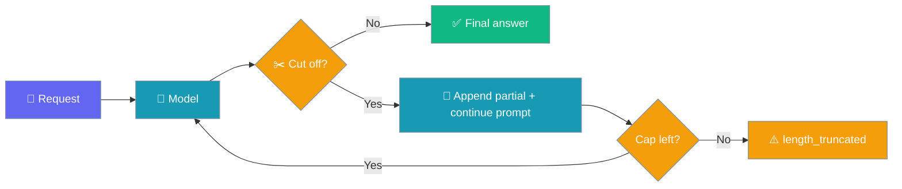
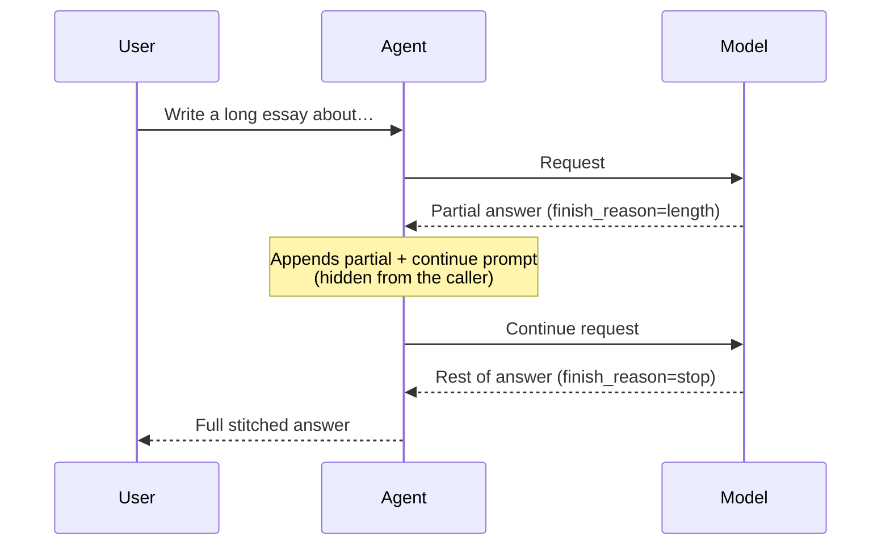
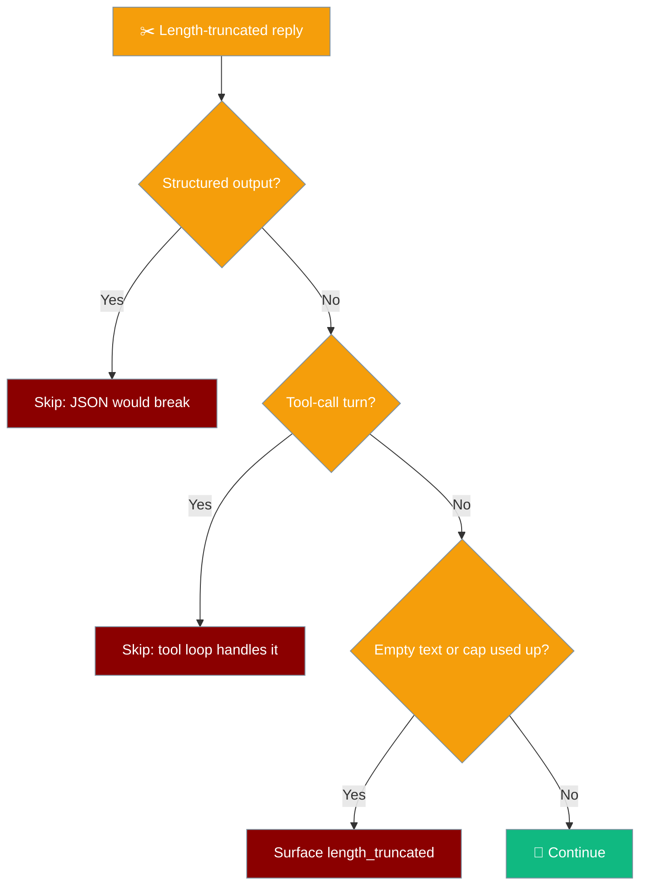

Output continuation lets an agent transparently finish a long answer the model cut off at its output-token limit.



## Quick Start

<Steps>
<Step title="On by default">
```python
from praisonaiagents import Agent

# Nothing to configure — the agent auto-continues up to 3 times
# when the output-token limit truncates its answer.
agent = Agent(
    name="Writer",
    instructions="You write long, detailed essays."
)

agent.start("Write a 3000-word essay about the history of the internet")
```
</Step>

<Step title="Raise the cap">
```python
from praisonaiagents import Agent, ExecutionConfig

agent = Agent(
    name="Writer",
    instructions="You write long, detailed essays.",
    execution=ExecutionConfig(output_continuation=5)
)

agent.start("Write a 3000-word essay about the history of the internet")
```
</Step>

<Step title="Turn it off">
```python
from praisonaiagents import Agent, ExecutionConfig

# A truncated answer surfaces `length_truncated` immediately.
agent = Agent(
    name="Writer",
    instructions="You write long, detailed essays.",
    execution=ExecutionConfig(output_continuation=False)
)

agent.start("Write a 3000-word essay about the history of the internet")
print(agent.last_stop_reason)
```
</Step>

<Step title="Pair with a low max_tokens">
```python
from praisonaiagents import Agent

agent = Agent(
    name="Writer",
    instructions="You write long, detailed essays.",
    llm={"model": "gpt-4o-mini", "max_tokens": 200}
)

print(agent.start("Write a detailed essay about the Roman Empire"))
print(agent.last_stop_reason)  # "completed" once the pieces are stitched
```
</Step>
</Steps>

---

## What the User Sees

The user gets one complete answer and never has to type "continue".



---

## How It Works

The agent keeps a per-turn counter and stitches each piece onto the accumulated text.

| Phase | What happens |
|---|---|
| 1. First response | The model stops with `finish_reason == "length"`. |
| 2. Classify | Only a length stop on a final answer triggers continuation. Content filters, refusals and normal stops never do. |
| 3. Re-prompt | The agent adds the partial assistant turn plus a fixed "continue exactly where you left off" user turn to a **local** copy of the conversation. |
| 4. Stitch | Each new piece is appended to the earlier text; the stitched text becomes the final answer. |
| 5. Cap | Up to 3 continuations by default. Past the cap, the agent returns the stitched text and `last_stop_reason == "length_truncated"`. |

---

## When Continuation Is Skipped



| Case | Why |
|---|---|
| `output_json=` / `output_pydantic=` | Stitching text onto a JSON schema would break parsing. |
| `response_format` other than `{"type": "text"}` | Same reason. `{"type": "text"}` still continues. |
| Tool-call turns | Only final answers continue. |
| Empty partial text | Nothing to continue from. |
| `output_continuation=False` or `0` | Explicitly disabled. |

---

## Value Shapes

`output_continuation` is a field on the existing `ExecutionConfig`, not a separate `Agent(...)` parameter.

| Value | Meaning |
|---|---|
| `True` *(default)* | Up to 3 continuations. |
| `None` | Same as `True`. |
| `False` or `0` | Disabled — `length_truncated` surfaces on the first truncation. |
| `int >= 1` | Custom cap, e.g. `output_continuation=10`. |

---

## Configuration Options

| Option | Type | Default | Description |
|---|---|---|---|
| `output_continuation` | `Union[bool, int]` | `True` | Auto-continue a final answer cut off by `finish_reason == "length"`. `True`/`None` = cap of 3, `False`/`0` = disabled, `int` = custom cap. Ignored for structured outputs. |

<Card title="ExecutionConfig API Reference" icon="code" href="/docs/sdk/reference/python/classes/ExecutionConfig">
  Full `ExecutionConfig` options
</Card>

---

## Common Patterns

<Tabs>
<Tab title="Long-form writer">
```python
from praisonaiagents import Agent

agent = Agent(
    name="Essayist",
    instructions="You write complete essays.",
    llm={"model": "gpt-4o-mini", "max_tokens": 300}
)

essay = agent.start("Write an essay on renewable energy")
```
</Tab>
<Tab title="Pin the old behaviour">
```python
from praisonaiagents import Agent, ExecutionConfig

agent = Agent(
    name="Reporter",
    instructions="Answer in detail.",
    execution=ExecutionConfig(output_continuation=False)
)

agent.start("Explain how vaccines work in depth")
if agent.last_stop_reason == "length_truncated":
    print("Partial answer — caller decides what to do")
```
</Tab>
<Tab title="Structured output">
```python
from pydantic import BaseModel
from praisonaiagents import Agent, Task, PraisonAIAgents

class Report(BaseModel):
    title: str
    summary: str

agent = Agent(name="Analyst", instructions="Write reports.")
task = Task(
    description="Write a report on solar power",
    agent=agent,
    output_pydantic=Report
)

# Continuation is skipped automatically — raise max_tokens instead.
PraisonAIAgents(agents=[agent], tasks=[task]).start()
```
</Tab>
</Tabs>

---

## Best Practices

<AccordionGroup>
<Accordion title="Leave it on by default">
The common failure is a half-finished answer the user has to re-prompt. The default cap of 3 covers it.
</Accordion>

<Accordion title="Lower the cap for cost-sensitive pipelines">
`output_continuation=1` keeps one safety net without large extra token spend.
</Accordion>

<Accordion title="Pair with max_steps for predictable budgets">
[`max_steps`](/features/max-steps) caps the tool-use loop; output continuation caps single-answer overflow. They are independent.
</Accordion>

<Accordion title="Raise max_tokens for structured output">
Continuation is skipped for JSON/schema outputs, so give those calls enough `max_tokens` up front.
</Accordion>

<Accordion title="Pin the terminal outcome in tests">
Set `output_continuation=False` to assert on `last_stop_reason == "length_truncated"` without extra model calls.
</Accordion>
</AccordionGroup>

---

## Related

<CardGroup cols={2}>
  <Card title="Execution Config" icon="play" href="/features/execution">
    All execution options
  </Card>
  <Card title="Run Outcome" icon="flag-checkered" href="/features/run-outcome">
    The `length_truncated` outcome
  </Card>
  <Card title="Agent Run Outcomes" icon="list-check" href="/features/agent-run-outcomes">
    `last_stop_reason` values
  </Card>
  <Card title="Turn Completion Notes" icon="message" href="/features/turn-completion-notes">
    Note shown when the cap is exhausted
  </Card>
</CardGroup>
