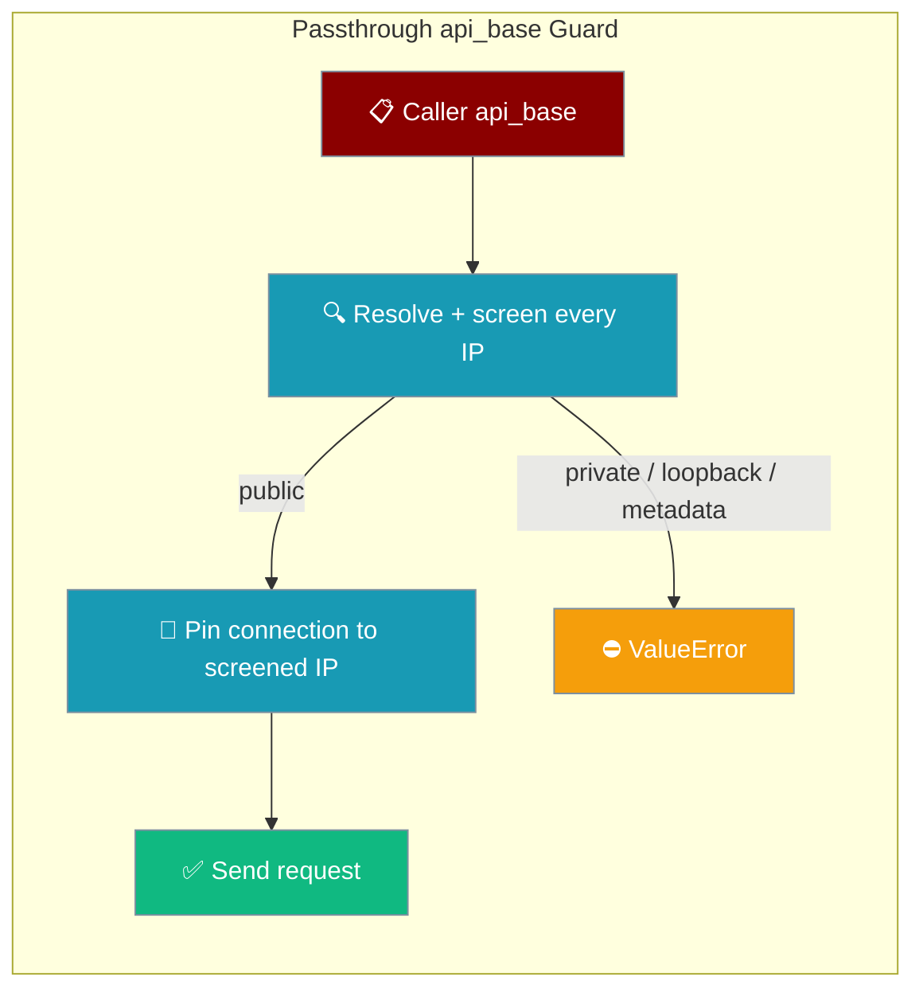

`passthrough` / `apassthrough` check `api_base` from start to finish, so a public hostname can't be pointed at an internal address when the connection is made.



<Note>
The guard runs on the direct HTTP path: when the installed `litellm` has no `llm_passthrough_route`, `passthrough` sends the request itself, and that path validates `api_base`. Other LLM and embedding calls are unaffected.
</Note>

## Quick Start

<Steps>
<Step title="Public endpoint — works">

```python
from praisonai.capabilities import passthrough

result = passthrough(
    endpoint="/v1/models",
    method="GET",
    api_base="https://api.openai.com",
    api_key="sk-proj-abc123",
)
print(result.status_code)
```
</Step>

<Step title="Localhost — rejected">

```python
from praisonai.capabilities import passthrough

try:
    passthrough(endpoint="/v1/models", method="GET", api_base="http://localhost:11434")
except ValueError as e:
    print(e)  # api_base URL cannot be a localhost address (direct HTTP path)
```
</Step>
</Steps>

## How it works

1. The `api_base` hostname is resolved, and **every** A/AAAA record is checked. A public A record cannot hide a private AAAA record.
2. If any address is in a restricted class, the call raises `ValueError` before anything is sent.
3. The connection is pinned to the checked IP. The `Host` header and TLS SNI keep the original hostname, so DNS rebinding at connect time is blocked.
4. In `apassthrough`, DNS resolution runs in a worker thread (`asyncio.to_thread`), so the event loop is not blocked.

## Rejected address classes

| Class | Example |
|---|---|
| Localhost names | `localhost`, `127.0.0.1`, `0.0.0.0`, `::1` |
| Loopback | `127.0.0.0/8`, `::1` |
| Private (RFC 1918) | `10.0.0.0/8`, `172.16.0.0/12`, `192.168.0.0/16` |
| Link-local / cloud metadata | `169.254.0.0/16` (e.g. `169.254.169.254`), `fe80::/10` |
| Multicast / Reserved / Unspecified | `224.0.0.0/4`, `240.0.0.0/4`, `0.0.0.0` |

Only `http` and `https` schemes are accepted.

## Error shape

Every error message starts with `api_base URL`, so you can filter logs for it:

| Message | Cause |
|---|---|
| `api_base URL must use http or https scheme` | Scheme is not `http`/`https` |
| `Invalid api_base URL` | No hostname in the URL |
| `api_base URL cannot be a localhost address` | Hostname is a localhost name |
| `api_base URL hostname could not be resolved` | DNS lookup failed |
| `api_base URL resolves to a private or restricted network address` | A resolved IP is in a rejected class |

<AccordionGroup>
<Accordion title="Can I point passthrough at a local Ollama or vLLM server?">
Not through this direct path. The block is intentional. Use the regular LLM integration for local model servers.
</Accordion>
<Accordion title="Is this the same check used for webhooks?">
Yes. It reuses the same resolve-and-screen helper as job webhook URLs (`praisonai.jobs.models`).
</Accordion>
</AccordionGroup>

## Related

<CardGroup cols={2}>
<Card title="Capabilities" icon="bolt" href="/capabilities/index">
All LiteLLM-backed capabilities, including `passthrough`.
</Card>
<Card title="Robustness" icon="shield" href="/features/robustness">
Connection pooling and other wrapper guarantees.
</Card>
</CardGroup>
