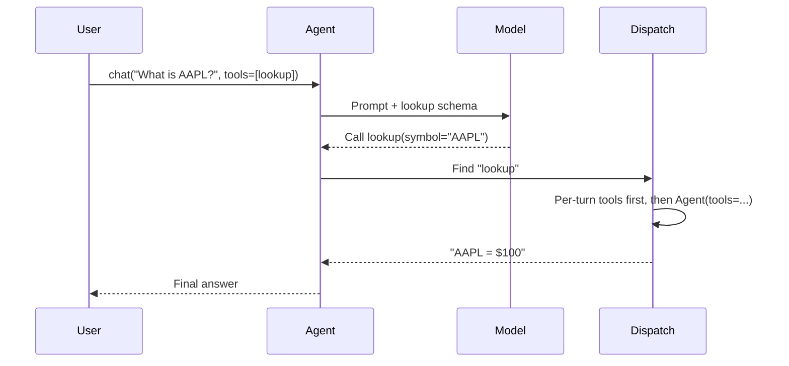

Hand a tool to a single task or a single chat call — the agent runs it for that turn and forgets it after.

```python
from praisonaiagents import Agent

def lookup(symbol: str) -> str:
    """Look up a stock symbol."""
    return f"{symbol} = $100"

agent = Agent(name="Trader", instructions="Help with quotes.")
agent.chat("What is AAPL?", tools=[lookup])
```

```mermaid
graph LR
    A[🤖 Agent] --> T[📋 Task / chat<br/>tools=[...]]
    T --> D[🔧 Dispatch finds<br/>the per-turn tool]
    D --> R[✅ Result]

    classDef agent fill:#8B0000,stroke:#7C90A0,color:#fff
    classDef config fill:#6366F1,stroke:#7C90A0,color:#fff
    classDef tool fill:#189AB4,stroke:#7C90A0,color:#fff
    classDef result fill:#10B981,stroke:#7C90A0,color:#fff

    class A agent
    class T config
    class D tool
    class R result
```

<Note>
**Since [PraisonAI PR #6632](https://github.com/MervinPraison/PraisonAI/pull/6632):** tools passed through `Task(tools=…)`, `agent.chat(tools=…)` and `agent.achat(tools=…)` actually run. Before, they were shown to the model but the call failed with `Tool '…' not found. Available tools: []` unless the same tool was also in `Agent(tools=…)`.
</Note>

## Quick Start

<Steps>
<Step title="One task in a team">
Give a tool to just one task with `Task(tools=…)`:

```python
from praisonaiagents import Agent, Task, AgentTeam

def get_weather(city: str) -> str:
    """Get the weather for a city."""
    return f"Sunny in {city}"

researcher = Agent(name="Researcher", instructions="Find weather info.")

task = Task(
    description="Weather in Paris",
    expected_output="A one-line forecast",
    agent=researcher,
    tools=[get_weather],   # only this task gets the tool
)

AgentTeam(agents=[researcher], tasks=[task]).start()
```
</Step>

<Step title="One chat call">
Pass `tools=` to `agent.chat()`:

```python
from praisonaiagents import Agent

def lookup(symbol: str) -> str:
    """Look up a stock symbol."""
    return f"{symbol} = $100"

agent = Agent(name="Trader", instructions="Help with quotes.")
print(agent.chat("What is AAPL?", tools=[lookup]))
```
</Step>

<Step title="Async">
`agent.achat()` works the same way:

```python
import asyncio
from praisonaiagents import Agent

def lookup(symbol: str) -> str:
    """Look up a stock symbol."""
    return f"{symbol} = $100"

async def main():
    agent = Agent(name="Trader", instructions="Help with quotes.")
    print(await agent.achat("What is AAPL?", tools=[lookup]))

asyncio.run(main())
```
</Step>
</Steps>

---

## How It Works



| Situation | What happens |
|---|---|
| Tool only in `Task(tools=…)` or `chat(tools=…)` | The per-turn tool runs |
| `Task(tools=…)` on an agent that has its own tools | The task's tools are added to the agent's tools for that task |
| `chat(tools=…)` / `achat(tools=…)` on an agent that has its own tools | Only the tools in the list are allowed that turn; other agent tools are refused with `Tool '…' is not available in this turn` |
| Same name in `Agent(tools=…)` and per-turn `tools=` | The per-turn tool wins |
| Same name on an `Agent(tools=MCP(...))` and a per-turn Python function | The per-turn function wins |
| Per-tool guardrails (`@tool(input_guardrails=…)`) | Taken from the per-turn tool, not a same-named tool elsewhere |

---

## Common Patterns

**Give one step of a pipeline an extra tool**

```python
from praisonaiagents import Agent, Task, AgentTeam

def fetch_prices(item: str) -> str:
    """Fetch current prices."""
    return f"{item}: $10"

analyst = Agent(name="Analyst", instructions="Analyse markets.")

gather = Task(description="Get prices for coffee", agent=analyst, tools=[fetch_prices])
report = Task(description="Write a short market note", agent=analyst)  # no extra tool

AgentTeam(agents=[analyst], tasks=[gather, report]).start()
```

**Override one MCP tool with a local function**

```python
from praisonaiagents import Agent
from praisonaiagents.mcp import MCP

def read_file(path: str) -> str:
    """Read a file from the local cache instead."""
    return "cached contents"

agent = Agent(
    name="Reader",
    instructions="Read files on request.",
    tools=MCP("npx -y @modelcontextprotocol/server-filesystem ."),
)

agent.chat("Show me notes.txt", tools=[read_file])  # local read_file wins this turn
```

**Guard a one-off tool** — attach guardrails to the tool itself and pass it per turn. See [Per-Tool Guardrails](/features/per-tool-guardrails).

---

## Best Practices

<AccordionGroup>
  <Accordion title="Pick the right scope">
    Use `Task(tools=…)` in team pipelines and `chat(tools=…)` for direct one-off calls. Keep tools every turn needs in `Agent(tools=…)`.
  </Accordion>
  <Accordion title="No need to repeat tools on the agent">
    A per-turn tool does not have to appear in `Agent(tools=…)` — it is always callable during its own turn.
  </Accordion>
  <Accordion title="chat(tools=...) is a limit, not an addition">
    When you pass `tools=` to `chat()` or `achat()`, list every tool the turn should be able to use — the agent's other tools are refused for that turn.
  </Accordion>
  <Accordion title="Safe with concurrent turns">
    The per-turn scope is tracked per task and per coroutine, so parallel calls on the same agent never see each other's tools.
  </Accordion>
</AccordionGroup>

---

## Related

<CardGroup cols={2}>
  <Card title="Task Configuration" icon="list-check" href="/features/task-configuration">
    Other ways to configure a Task
  </Card>
  <Card title="Per-Tool Guardrails" icon="shield" href="/features/per-tool-guardrails">
    Validate one tool's input or output
  </Card>
</CardGroup>
