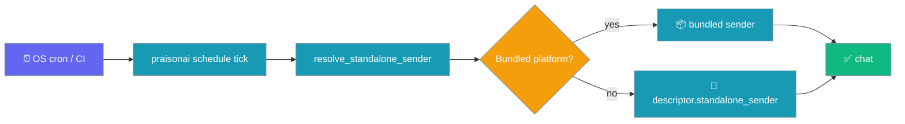
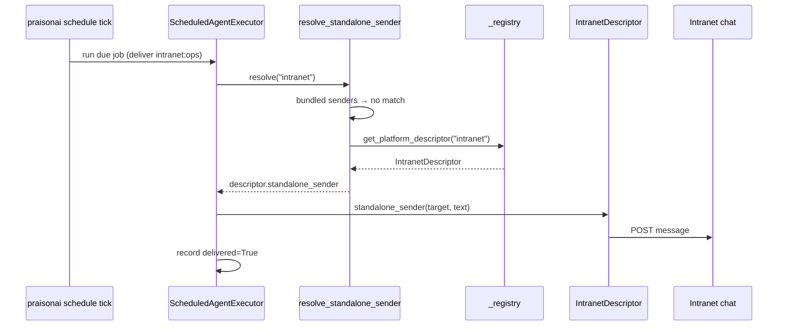

Declare a `standalone_sender` on your channel's descriptor and `praisonai schedule tick` delivers to it from OS cron, CI, or a scale-to-zero worker. You don't need a gateway running.



## Quick Start

<Steps>
<Step title="Schedule an agent to a custom channel">
Use the same `deliver` token you would for a built-in platform. Only the channel name changes.

```python
from praisonaiagents import Agent
from praisonaiagents.tools import schedule_add

agent = Agent(name="Brief", instructions="Summarise the morning news", tools=[schedule_add])

# Saves the job to the schedule store that `praisonai schedule tick` reads.
agent.start("Every hour, send me a morning brief. Deliver to intranet:ops.")
```

Then run the tick from OS cron with no gateway running:

```bash
0 * * * *  INTRANET_WEBHOOK_URL=... praisonai schedule tick
```
</Step>

<Step title="Add a standalone_sender to the plugin's descriptor">
Add one method to the descriptor your `praisonai.channels` plugin already ships:

```python
# my_pkg/intranet.py
import json
import os
import urllib.request

from praisonaiagents.bots import ChannelField


class IntranetDescriptor:
    config_fields = [
        ChannelField("webhook_url", required=True, secret=True, env="INTRANET_WEBHOOK_URL"),
    ]
    system_prompt_hint = "You are posting to the company intranet chat."

    # The scheduler finds this on the registered descriptor.
    def standalone_sender(self, target, text):
        body = json.dumps({"room": target.channel_id, "text": text}).encode()
        req = urllib.request.Request(
            os.environ["INTRANET_WEBHOOK_URL"],
            data=body,
            headers={"Content-Type": "application/json"},
        )
        urllib.request.urlopen(req, timeout=30)  # raises on HTTP errors


class IntranetBot:
    # Your existing live-gateway adapter. A class-level descriptor is found
    # even in a fresh `schedule tick` process.
    channel_descriptor = IntranetDescriptor()
    ...
```

```toml
# pyproject.toml
[project.entry-points."praisonai.channels"]
intranet = "my_pkg.intranet:IntranetBot"
```
</Step>
</Steps>

<Note>
`praisonai schedule tick` is a fresh process. A `register_platform(..., descriptor=...)` call in your own app code never runs there. Put the descriptor on the adapter class as `channel_descriptor` (an attribute or a callable), so the registry finds it when it loads your entry point.
</Note>

---

## How It Works



### Precedence

A live gateway always wins; on the standalone path, a bundled name always wins.

| Order | Source | Wins when |
|---|---|---|
| 0 | Live gateway `delivery_handler` | A gateway is resident. The standalone path is never consulted |
| 1 | Bundled sender | Channel is `telegram`, `slack`, `discord`, `whatsapp`, or `signal` |
| 2 | `standalone_sender` on the registered `ChannelDescriptor` | Channel is registered by a plugin and its descriptor declares a callable `standalone_sender` |
| 3 | None → executor records `delivery_error` | Channel is unknown, has no descriptor, or the descriptor has no `standalone_sender` |

If the descriptor lookup raises (a broken plugin, for example), the resolver logs at debug level and returns `None`. The run records `delivery_error` and the tick keeps going.

---

## Sync or Async

Either form works. The executor awaits the result only when it is awaitable.

<Tabs>
<Tab title="Async">
```python
class IntranetDescriptor:
    async def standalone_sender(self, target, text):
        await post_message(target.channel_id, text)  # raises on failure
```
</Tab>
<Tab title="Sync">
```python
class IntranetDescriptor:
    def standalone_sender(self, target, text):
        post_message_blocking(target.channel_id, text)  # raises on failure
```
</Tab>
</Tabs>

The sender receives the scheduler's `DeliveryTarget` (`target.channel`, `target.channel_id`, `target.thread_id`) and the text to post.

<Note>
**Failure contract.** Raise when the send fails: the run records `delivered=False` with `delivery_error=str(exc)`. If you return `False`, the run is also recorded as `delivered=False`. Any other return value, including `None`, counts as success. This matches the live `delivery_handler` contract in [Scheduler Delivery → Failure modes](/features/scheduler-delivery#failure-modes).
</Note>

<Note>
**Retries are up to you.** Each bundled sender has its own [bounded in-process retry](/features/scheduler-delivery#bounded-in-process-retry). A plugin sender doesn't have to retry. If it raises on the first failure, that is correct behaviour: the run records `delivery_error` and the tick moves on.
</Note>

---

## End-to-end: cron deployment

<Steps>
<Step title="Install the plugin and set its secret">
```bash
pip install my-intranet-channel
export INTRANET_WEBHOOK_URL=https://chat.example.internal/hooks/abc
```
</Step>

<Step title="Create a job with the custom-channel target">
```bash
praisonai schedule add "morning-brief" -s hourly -m "Morning brief" --deliver intranet:ops
```
</Step>

<Step title="Schedule the tick in OS cron">
```bash
# crontab -e
0 * * * *  INTRANET_WEBHOOK_URL=https://chat.example.internal/hooks/abc praisonai schedule tick
```
</Step>

<Step title="Gateway off, cron fires, message lands">
Cron fires, the job runs, the resolver falls through to your descriptor, and the brief arrives in `ops`. Run history shows `delivered=True`.
</Step>
</Steps>

---

## Best Practices

<AccordionGroup>
<Accordion title="Keep the sender stateless">
Don't keep open sockets or cached connections. Make one push per call so the short-lived tick process exits cleanly.
</Accordion>
<Accordion title="Read secrets from env vars">
The sender runs out of process, so the onboarding wizard never runs there. Every secret it needs should have an `env=` fallback on its `ChannelField`.
</Accordion>
<Accordion title="Let failures raise">
Don't catch and swallow errors inside the sender. When an error reaches the executor, it records `delivery_error`, and operators can see the real reason in run history.
</Accordion>
<Accordion title="Prefer async for network I/O">
Both forms work. The executor runs on asyncio, so a sync sender blocks the event loop for as long as its HTTP call takes.
</Accordion>
</AccordionGroup>

---

## Related

<CardGroup cols={2}>
<Card title="Channel Descriptor" icon="plug" href="/features/channel-descriptor">
  The full descriptor surface
</Card>
<Card title="Scheduler Delivery" icon="paper-plane" href="/features/scheduler-delivery">
  The scheduled delivery pipeline
</Card>
<Card title="Custom Gateway Channel" icon="code" href="/features/gateway-custom-channel">
  Zero-code channel registration
</Card>
<Card title="Bot Platform Plugins" icon="puzzle-piece" href="/features/bot-platform-plugins">
  Entry-point registration
</Card>
</CardGroup>

<Note>
**Availability.** Introduced in [PraisonAI PR #6100](https://github.com/MervinPraison/PraisonAI/pull/6100) (fixes [#6099](https://github.com/MervinPraison/PraisonAI/issues/6099)). Earlier versions needed a resident gateway for a custom channel to receive scheduled deliveries.
</Note>
