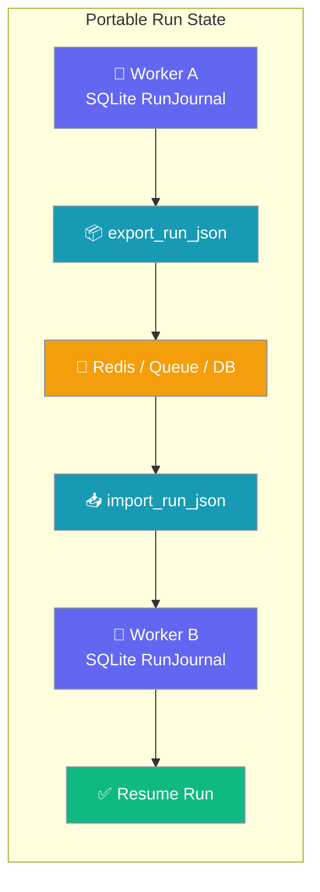
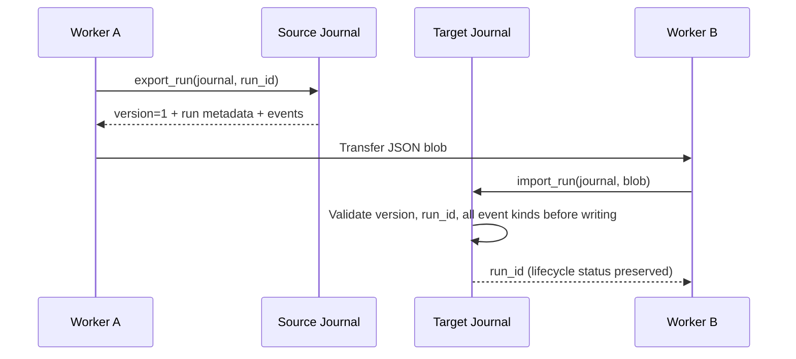

Move an in-progress durable run from one process or machine to another by exporting its journal as a JSON-safe blob (`export_run` / `export_run_json`) and importing it into a target journal (`import_run` / `import_run_json`).

```python
from praisonaiagents import Agent
from praisonaiagents.runtime import (
    RunJournal,
    export_run_json,
    import_run_json,
)

# Worker A: export a paused or interrupted durable run
blob_json = export_run_json(source_journal, run_id="run-42")

# Put blob_json in Redis, a queue, or a database row...

# Worker B (no shared disk): import and resume as usual
resumed_id = import_run_json(target_journal, blob_json)
agent = Agent(name="Worker", instructions="Continue the durable task.")
```



## Quick Start

<Steps>
<Step title="Export a run from a journal">
```python
from praisonaiagents.runtime import export_run, export_run_json

# As a JSON-safe Python dict
blob = export_run(journal, "run-42")

# Or directly as a JSON string for Redis / HTTP / queues
text = export_run_json(journal, "run-42")
```
</Step>

<Step title="Import into another journal">
```python
from praisonaiagents.runtime import import_run, import_run_json, PortableRunError

# Import under the original run_id (fails if it already exists)
run_id = import_run_json(other_journal, text)

# Import under a new run_id, or explicitly replace an existing copy
cloned_id = import_run(other_journal, blob, run_id="run-42-copy")
replaced_id = import_run(other_journal, blob, overwrite=True)
```
</Step>
</Steps>

---

## How It Works



Exporting uses the journal itself as the single source of truth — there is no second state format to keep in sync.

| Exported Symbol | Signature | Description |
|---|---|---|
| `PORTABLE_RUN_VERSION` | `int` (`1`) | Schema version embedded in every exported blob. Mismatched versions raise `PortableRunError`. |
| `PortableRunError` | `RuntimeError, PraisonAIError` | Raised when a run does not exist, JSON is invalid, version mismatches, events are malformed, or target `run_id` already exists without `overwrite=True`. |
| `export_run` | `(journal: RunJournal, run_id: str) -> Dict[str, Any]` | Exports `{"version", "run", "events"}` for `run_id`. Raises `PortableRunError` if `run_id` is absent. |
| `export_run_json` | `(journal: RunJournal, run_id: str) -> str` | Serialises `export_run(...)` with `json.dumps(..., default=str)`. |
| `import_run` | `(journal: RunJournal, blob: Dict[str, Any], *, run_id: Optional[str] = None, overwrite: bool = False) -> str` | Validates all events up front before writing, restores terminal status/outcome (so completed runs never resurrect as `running`), and returns the target `run_id`. |
| `import_run_json` | `(journal: RunJournal, text: str, *, run_id: Optional[str] = None, overwrite: bool = False) -> str` | Parses JSON and delegates to `import_run(...)`. |

---

## Best Practices

<AccordionGroup>
<Accordion title="Avoid overwrite=True unless replacing a known snapshot">
By default `import_run` refuses to import over an existing `run_id` so two runs' events are never mixed into one replay index. Pass a fresh `run_id=` to fork, or `overwrite=True` (which deletes the destination's prior events first) when intentionally replacing.
</Accordion>

<Accordion title="Keep producer and consumer on compatible PORTABLE_RUN_VERSION">
Every blob records `"version": PORTABLE_RUN_VERSION` (currently `1`). Incompatible versions fail fast with `PortableRunError` instead of half-importing.
</Accordion>

<Accordion title="Treat terminal runs as immutable">
If an exported run already had a terminal `outcome` or non-`running` `status` (`succeeded`, `failed`, `cancelled`), `import_run` closes the imported run with that same status so it is not mistakenly resumed as interrupted work.
</Accordion>
</AccordionGroup>

---

## Related

<CardGroup cols={2}>
  <Card title="Gateway Durable Runs" icon="shield-check" href="/features/gateway-durable-runs">
    Crash-safe durable execution with SQLite journaling
  </Card>
  <Card title="Gateway Session Portability" icon="arrows-rotate" href="/features/gateway-session-portability">
    Back up and migrate gateway sessions across hosts
  </Card>
</CardGroup>
