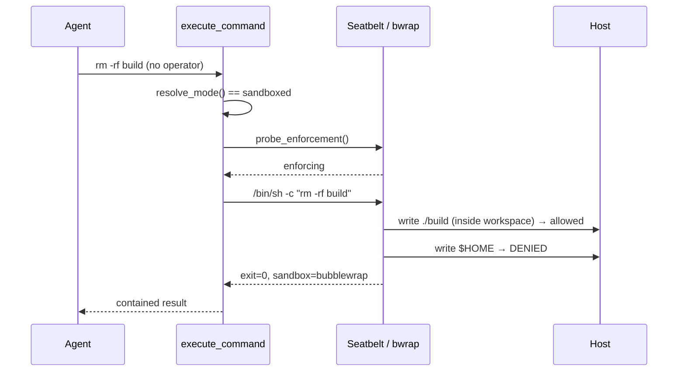

`PRAISON_SHELL` picks the containment posture for every `execute_command` call in `praisonai code`: refuse shell operators, run **every** command inside an OS sandbox, or run operators in an uncontained shell.

```mermaid
graph TB
    Cmd["🖥️ execute_command"] --> Mode{{"PRAISON_SHELL"}}
    Mode -->|unset / off (default)| Off["Plain command → plain executor<br/>Operator → refused with hint"]
    Mode -->|sandboxed| Jail{"🛡️ Probe enforcement"}
    Jail -->|enforcing| Contained["Every command runs as<br/>/bin/sh -c inside Seatbelt / bwrap<br/>workspace writable, secrets scrubbed"]
    Jail -->|not enforcing| Refuse["🚫 Refused — never degrade"]
    Mode -->|unsafe (opt-in only)| Unsafe["Plain command → plain executor<br/>Operator → real /bin/sh, NO containment"]

    classDef input fill:#189AB4,stroke:#7C90A0,color:#fff
    classDef decision fill:#6366F1,stroke:#7C90A0,color:#fff
    classDef safe fill:#10B981,stroke:#7C90A0,color:#fff
    classDef warn fill:#F59E0B,stroke:#7C90A0,color:#fff
    classDef danger fill:#8B0000,stroke:#7C90A0,color:#fff

    class Cmd input
    class Mode,Jail decision
    class Contained,Off safe
    class Refuse warn
    class Unsafe danger
```

## Quick Start

<Steps>
<Step title="Default — operators are refused">
Without `PRAISON_SHELL`, the coding agent runs plain commands as before, but a command with a shell operator fails loudly instead of silently dropping it.

```bash
praisonai code
```

```text
>>> run: echo written > out.txt
Refused: this command contains the shell operator '>', which this executor
does not interpret. Do one of these instead:
  - split it into separate execute_command calls;
  - for a redirect, run the program and write its output with write_file;
  - or ask the operator to set PRAISON_SHELL=sandboxed.
```
</Step>

<Step title="Contain every command">
Set `PRAISON_SHELL=sandboxed` to run every command — with or without operators — as a real `/bin/sh -c` inside OS-native containment (Seatbelt on macOS, `bwrap` on Linux).

```bash
PRAISON_SHELL=sandboxed praisonai code
```

```text
>>> run: echo written > out.txt
[approve: execute_command — critical risk?] y
exit=0 success=True sandbox=seatbelt
```
</Step>
</Steps>

---

## The Three Modes

`PRAISON_SHELL` selects one behaviour. It is an operator decision — the model cannot change it from a tool call.

| `PRAISON_SHELL` | Behaviour |
|---|---|
| unset / `off` (default) | Shell syntax is **refused** with an error naming the operator and listing alternatives. Plain commands run exactly as before. |
| `sandboxed` | A real `/bin/sh -c` inside OS-native containment runs **every** command (with or without shell operators). The writable set is `PRAISONAI_WORKSPACE` (or the process cwd) plus `$TMPDIR`; a `cwd` outside it is refused. Secret-looking env vars (`*KEY*`, `*TOKEN*`, `*SECRET*`, `*PASSW*`, `*CREDENTIAL*`, case-insensitive) are stripped from the child; `~/.ssh`, `~/.aws`, `~/.gnupg`, `~/.config/gcloud`, `~/.azure` are masked. Refuses to run if containment can't be proven — see [OS Sandbox](/features/os-sandbox). |
| `unsafe` | Operator commands run in a real `/bin/sh -c` with **no** containment; plain commands run as in `off`. Opt-in only, never a fallback. |

Aliases resolve to these three: `1`/`true`/`yes`/`sandbox`/`native` → `sandboxed`; `raw`/`host` → `unsafe`; empty/`0`/`false`/`no`/`none` → `off`.

---

## What `sandboxed` protects against

Containment is a property of the mode, not of the command's syntax. `rm -rf build`, `python x.py`, `pip install pkg` or `curl -o x.sh URL` have no operator, yet all run inside the jail.

```python
from praisonaiagents import Agent
import os

# Operator decision: contained execution for every shell command
os.environ["PRAISON_SHELL"] = "sandboxed"
os.environ["PRAISONAI_WORKSPACE"] = "/path/to/workspace"

agent = Agent(
    name="Builder",
    instructions="Build the project and run the tests.",
)

agent.start("Build and test the current workspace")
```



---

## Workspace, env, and secret masking

| What | Under `sandboxed` |
|---|---|
| Writable root | `PRAISONAI_WORKSPACE`, else the process cwd — plus `$TMPDIR`. Nothing else is writable. |
| `cwd=` argument | Must be inside the writable set; `cwd="/"` or your home directory is refused instead of becoming writable. |
| Environment | Any variable whose name matches `KEY\|TOKEN\|SECRET\|PASSW\|CREDENTIAL` (case-insensitive) is stripped, so `env \| grep KEY` shows nothing. |
| Explicit `env=` | Acts as the allow-list. Entries are applied **inside** the jail via `/usr/bin/env k=v …`, never on the launcher, so `LD_PRELOAD` cannot load code before containment starts. Names must match `^[A-Za-z_][A-Za-z0-9_]*$`. |
| Secret directories | `~/.ssh`, `~/.aws`, `~/.gnupg`, `~/.config/gcloud`, `~/.azure` are masked — `cat ~/.aws/credentials` returns nothing. The rest of the filesystem stays readable for toolchains. |
| Processes (Linux) | `bwrap --unshare-pid` gives the jail its own PID namespace, so `/proc/<host pid>/environ` cannot leak the scrubbed env or masked paths. |

---

## Guarantees against model misuse

The tool-facing `execute_command` drops `mode`, `writable_paths` and `network` from its arguments. A tool call cannot pick `mode="unsafe"`, `writable_paths=["/"]` or `network=True` — the mode and the jail are set by the operator through env vars.

<Note>
`run_in_background=True` is refused under `sandboxed`. The contained runner has no process registry, so a background request would block until the timeout killed the process the caller expected back. Run such commands in the foreground.
</Note>

**Cancellation.** A contained command stops when the agent is interrupted: the process tree is killed, output is capped, and the result reports `exit_code=130` with `error="Command interrupted by user"`.

**ACP in sandboxed mode.** Headless `praisonai code -p` exposes `acp_execute_command`. Under `sandboxed`, its approved plan steps run inside the same jail with the workspace as the writable root, without a second approval prompt. Under `off` and `unsafe`, the ACP path still refuses `;`, `&`, `|`, `$` and backticks.

---

## Why the default refuses

The plain executor runs `shlex.split` + `subprocess.Popen(shell=False)`, so an operator becomes a literal argument.

```python
execute_command("echo written > redir.txt")
# → exit_code=0, success=True, stdout='written > redir.txt\n'
#   and redir.txt was never created
```

The model is told a redirect it never performed succeeded — strictly worse than an error. Refusing names the operator and tells the agent what to do instead.

---

## Quote-Aware Detection

Detection looks for operators **outside** quotes, so ordinary strings are never refused.

| Command | Refused? | Why |
|---|---|---|
| `echo "a > b"` | No | `>` is inside double quotes |
| `git commit -m "fix: a > b"` | No | `>` is inside the message |
| `echo 'a $(id) b'` | No | single quotes suppress everything |
| `echo "$(id)"` | Yes (`$(`) | command substitution runs inside double quotes |
| `echo "`id`"` | Yes (backtick) | backticks run inside double quotes |
| `a && b` | Yes (`&&`) | active operator |

`$(...)` and backticks are detected even inside double quotes because POSIX shells evaluate them there — reporting them as inert would reintroduce the false-success bug.

---

## Approval

The real-shell path used by `execute_command` is wrapped in `require_approval(risk_level="critical")` under the tool name `execute_command`.

<Warning>
Both `sandboxed` and `unsafe` route through the same `critical`-risk approval as the plain executor — same tool identity, so existing allowlists and `path_overlap` serialisation still apply. Denying approval raises `PermissionError` and no file is written.
</Warning>

ACP plan steps under `sandboxed` reuse the plan-level approval and do not re-prompt per command.

The approval wrap fails closed: if the approval machinery can't be imported, the real shell does not run.

---

## When Your Agent Hits a Refusal

An agent that hits `PRAISON_SHELL=off` refusal has three honest paths.

```python
from praisonaiagents import Agent

agent = Agent(
    name="Builder",
    instructions=(
        "When execute_command refuses a shell operator, either split the "
        "command into separate steps, or write program output with write_file "
        "instead of a '>' redirect."
    ),
)

agent.start("Build the project and save the log to build.log")
```

The operator can instead launch the session with `PRAISON_SHELL=sandboxed` to allow real operators inside a jail.

Under `sandboxed`, a command can be refused even without an operator:

| Refusal | Fix |
|---|---|
| `cwd '…' is outside the sandbox workspace` | Run from inside `PRAISONAI_WORKSPACE`, or point `PRAISONAI_WORKSPACE` at the right project. |
| `run_in_background is not supported` | Run the command in the foreground. |
| `containment could not be proven on this machine` | Install the OS primitive (`bwrap` on Linux); set `PRAISON_SHELL=unsafe` only to accept an uncontained shell deliberately. |

---

## Best Practices

<AccordionGroup>
<Accordion title="Keep the default off in shared or untrusted contexts">
`off` never runs an uninterpreted operator and never claims false success. Reach for `sandboxed` only when a real shell is genuinely needed.
</Accordion>

<Accordion title="Prefer sandboxed over unsafe">
`sandboxed` gives a real `/bin/sh` while a kernel keeps writes inside the workspace. `unsafe` removes that boundary entirely — use it only when you accept an uncontained shell deliberately.
</Accordion>

<Accordion title="Split multi-step commands">
Two `execute_command` calls (one per `&&` step) work in every mode and keep each step's success signal honest.
</Accordion>

<Accordion title="Write output instead of redirecting">
Replace `cmd > file.txt` with a plain `cmd` call plus `write_file`. This works in `off` mode and keeps the file-creation step explicit.
</Accordion>
</AccordionGroup>

---

## Related

<CardGroup cols={2}>
<Card title="OS Sandbox" icon="shield-check" href="/features/os-sandbox">
  Seatbelt and bwrap containment that `sandboxed` mode runs inside.
</Card>
<Card title="Safe Tools by Default" icon="lock" href="/features/safe-tools-by-default">
  Why tools refuse rather than degrade.
</Card>
<Card title="Interactive Tools" icon="wrench" href="/cli/interactive-tools">
  The `execute_command` tool in the coding session.
</Card>
<Card title="Tool Approval" icon="shield" href="/cli/tool-approval">
  The critical-risk approval wrap on the real-shell path.
</Card>
</CardGroup>
