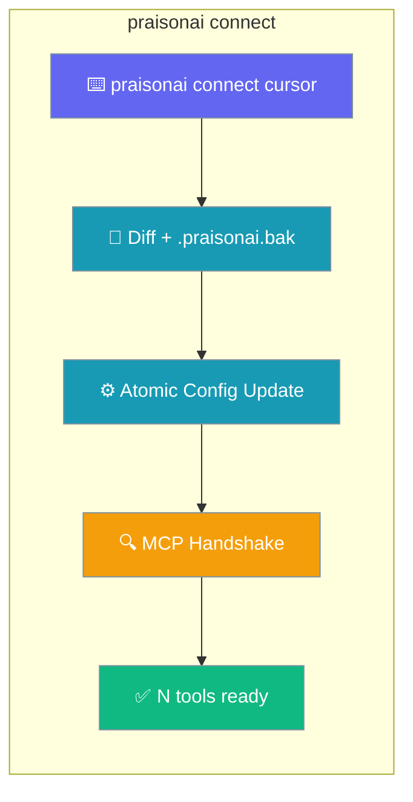
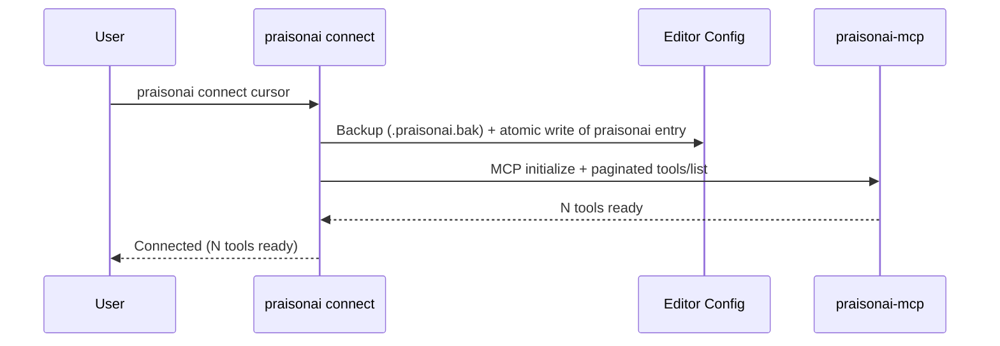

Connect your PraisonAI agents and tools to Cursor, VS Code, Claude Code, Claude Desktop, Codex, Gemini CLI, Windsurf, Zed, Antigravity, and 13 more MCP clients in one command — without hand-editing JSON or TOML configs.

```python
from praisonaiagents import Agent

agent = Agent(name="Assistant", instructions="Help answer questions from any connected editor.")
agent.start("Verify my project setup")
```

Run `praisonai connect <client>` and this agent is wired into your editor as an MCP server, verified with a real `initialize` + `tools/list` handshake.



## Quick Start

<Steps>
<Step title="Install praisonai-mcp">
```bash
pip install "praisonai[mcp]"
# or standalone:
pip install praisonai-mcp
```
</Step>

<Step title="Check detected clients">
```bash
praisonai connect
```
Shows a status table across all 22 supported clients: `installed`, `connected`, or `not installed`, plus **last active** from the local `connections.json` ledger (nothing leaves your machine).
</Step>

<Step title="Connect one or all editors">
```bash
praisonai connect cursor                                        # writes ~/.cursor/mcp.json + verifies tools
praisonai connect --all                                         # every installed client
praisonai connect codex --agents agents.yaml --tools 'ask_*'    # scope to specific agents/tools
praisonai connect cursor --print                                # print deep link, CLI command, and JSON (no write)
praisonai connect --remove                                      # remove the praisonai entry everywhere
```
</Step>
</Steps>

---

## How It Works



| Capability | Behaviour |
|---|---|
| **Idempotent & safe writes** | Keeps a `.praisonai.bak` backup, writes atomically, and edits only the `praisonai` entry (preserving TOML comments and other MCP servers). |
| **Zero secrets written** | API keys stay out of client configs; set keys are referenced in each client's native env syntax (`${env:OPENAI_API_KEY}`, `${OPENAI_API_KEY}`, Codex `env_vars`). |
| **Live handshake check** | After writing, runs a real MCP `initialize` + `tools/list` against the exact configured command and reports `"N tools ready"`. |
| **Consistent scoping** | `--tools 'ask_*,list_agents'` and `--agents agents.yaml` are baked into server arguments, so scoping holds across every client including one-click deep links. |
| **Remote servers** | Pass `--url https://agents.example.com/mcp` to connect to a remote HTTP-stream server (warns when a cloud-hosted client cannot reach `localhost`). |
| **UI catalog** | `praisonai_mcp.connect.export_catalog(spec)` exports the same client catalog as JSON for the **Connect** sidebar page in `praisonai dashboard` / `praisonai ui`. |

---

## Supported Clients (22 + Generic)

| Group | Clients |
|---|---|
| **Editors (12)** | `cursor`, `vscode`, `vscode-insiders`, `windsurf`, `claude-desktop`, `zed`, `kiro`, `antigravity`, `trae`, `junie`, `cline`, `continue` |
| **Terminal agents (6)** | `claude-code`, `codex`, `gemini-cli`, `copilot-cli`, `opencode`, `amp` |
| **Other (4)** | `goose`, `raycast`, `chatgpt`, `lm-studio` |
| **Generic** | `any` — prints a paste-ready snippet for any MCP-compatible client |

---

## Best Practices

<AccordionGroup>
<Accordion title="Preview with --print before editing shared configs">
Run `praisonai connect <client> --print` to inspect the one-click deep link, vendor CLI command, and JSON/TOML snippet without modifying files on disk.
</Accordion>

<Accordion title="Scope exposed tools in team environments">
Pass `--agents agents.yaml --tools 'ask_*,list_agents'` so connected editors see only the agents and tools you intend to expose.
</Accordion>

<Accordion title="Use OAuth 2.1 when connecting to a remote URL">
When passing `--url` to a remote `praisonai mcp serve --transport http-stream` server, pair it with [MCP Server OAuth 2.1](/features/mcp-server-oauth) so editors sign in automatically without sharing static API keys.
</Accordion>
</AccordionGroup>

---

## Related

<CardGroup cols={2}>
  <Card title="MCP Server OAuth 2.1" icon="key" href="/features/mcp-server-oauth">
    Built-in OAuth 2.1 sign-in for remote praisonai mcp serve
  </Card>
  <Card title="praisonai-mcp Package" icon="plug" href="/features/praisonai-mcp-package">
    Install extras, host commands, and three MCP layers
  </Card>
  <Card title="MCP from Config" icon="file-code" href="/features/mcp-from-config">
    Reuse editor mcpServers blocks inside Python agents
  </Card>
  <Card title="PraisonAI Dashboard" icon="layout-dashboard" href="/ui/claw">
    Built-in Connect sidebar page in the web dashboard
  </Card>
</CardGroup>
