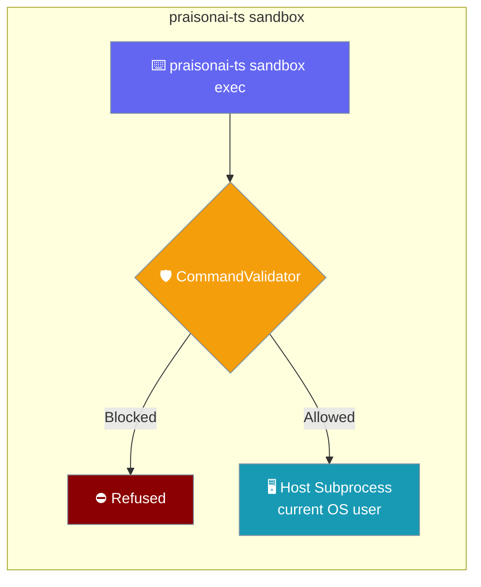

`praisonai-ts sandbox` checks shell commands against allow/deny lists and runs them on the **host** as the current user — it is a guard rail against accidents, **not** isolation and **not** a security boundary.

```typescript
import { Agent } from 'praisonai';

const agent = new Agent({
  name: 'Assistant',
  instructions: 'Help inspect the workspace safely.',
});
await agent.start('Check the current project files');
```

<Warning>
**Not a security boundary.** Every `praisonai-ts sandbox` mode (`basic`, `strict`, `network-isolated`, `disabled`) filters the command string and executes it directly on your host as your OS user. Mode names describe which commands are filtered, not container or OS isolation. For untrusted or model-generated code, run in an isolating sandbox (Docker, Sandlock on Linux, E2B, Modal, Daytona, or Novita). See [Threat Model](/features/threat-model).
</Warning>



## Quick Start

<Steps>
<Step title="Check whether a command is allowed">
```bash
praisonai-ts sandbox check "rm -rf /"
praisonai-ts sandbox check "ls -la" --json
```
Validates the command against the filter rules without running it.
</Step>

<Step title="Execute a filtered command">
```bash
praisonai-ts sandbox exec "echo hello" --mode basic --timeout 30000
praisonai-ts sandbox exec "ls -la" --mode strict
```
</Step>

<Step title="Inspect filter modes">
```bash
praisonai-ts sandbox mode
```
Prints the available filter modes and what each mode checks.
</Step>
</Steps>

---

## Subcommands and Modes

| Subcommand | Description |
|---|---|
| `praisonai-ts sandbox exec <command>` | Checks `<command>` against the selected filter mode (`--mode`, default `basic`; `--timeout`, default `30000` ms) and runs it on the host. |
| `praisonai-ts sandbox check <command>` | Runs `CommandValidator` on `<command>` without executing it. Supports `--json` / `--output json`. |
| `praisonai-ts sandbox mode` | Lists the supported filter modes. |

| Mode | What it checks (runs on host) |
|---|---|
| `disabled` | No command filtering. |
| `basic` | Refuses deny-listed destructive/privilege commands and dangerous patterns. |
| `strict` | Stricter command deny list including common network tools; runs in a temporary working directory on the host. |
| `network-isolated` | Refuses common network CLI tools on the command line (does **not** create a network namespace). |

---

## Best Practices

<AccordionGroup>
<Accordion title="Use praisonai-ts sandbox check in dry-run pipelines">
Validate generated commands with `praisonai-ts sandbox check --json` before deciding whether to run them.
</Accordion>

<Accordion title="Do not rely on command filters for untrusted code">
String-based command filters can be worded around. Always use an isolating backend (`docker`, `sandlock`, `e2b`, `modal`, `daytona`, `novita`) when executing untrusted code.
</Accordion>

<Accordion title="Keep mode names distinct from OS containment">
Mode names (`basic`, `strict`, `network-isolated`) are preserved for backward compatibility; they describe command filtering rules rather than kernel isolation.
</Accordion>
</AccordionGroup>

---

## Related

<CardGroup cols={2}>
  <Card title="Threat Model" icon="shield-halved" href="/features/threat-model">
    Trust boundaries and host-side guard rails
  </Card>
  <Card title="Python CLI Sandbox Execution" icon="terminal" href="/cli/sandbox-execution">
    Matching Python CLI SandboxExecutor command-filter docs
  </Card>
  <Card title="Sandbox Backends" icon="box" href="/features/sandbox-backends">
    Real isolating backends (Docker, Sandlock, E2B, Modal)
  </Card>
  <Card title="TypeScript CLI Reference" icon="code" href="/js/cli">
    All praisonai-ts CLI subcommands
  </Card>
</CardGroup>
