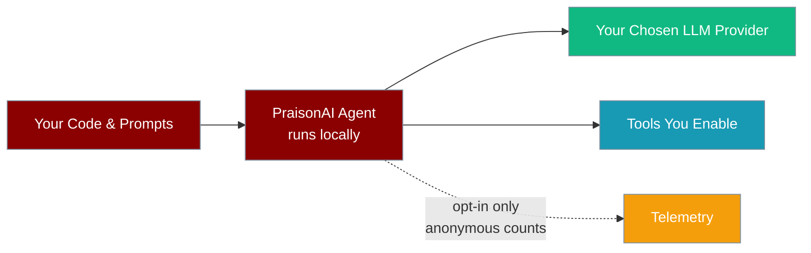
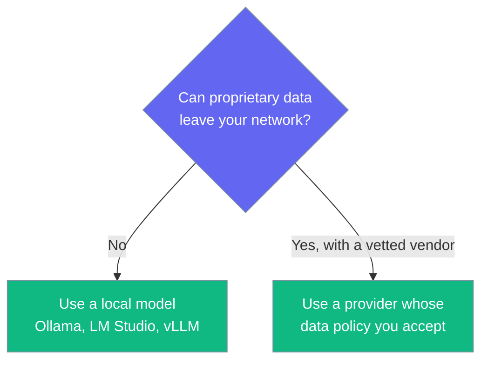

PraisonAI runs on your machine and sends your prompts and data only to the LLM provider and tools you configure — the project itself never receives them.



## Quick Start

<Steps>
<Step title="Keep data on your machine">
Point the agent at a local model — nothing leaves your network.

```python
from praisonaiagents import Agent

agent = Agent(
    instructions="Review this proprietary code.",
    llm="ollama/llama3.2",  # runs locally
)
agent.start("Explain what this function does: ...")
```
</Step>

<Step title="Guarantee telemetry is off">
Telemetry is already off by default. Set this to make the opt-out explicit and override any programmatic enable:

```bash
export DO_NOT_TRACK=true
```
</Step>
</Steps>

---

## Where Your Data Goes

| Data | Where it goes | Who controls it |
|------|---------------|-----------------|
| Prompts, instructions, responses | The LLM provider set in `llm=` | You — read that provider's data policy |
| Files, code, tool arguments | Only the tools you give the agent | You |
| Memory, sessions, knowledge | Local storage or the database you configure | You |
| Anonymous usage counts | PostHog (EU), **only if you opt in** | You |

PraisonAI is a pass-through library: it does not proxy, store, or inspect your content on any PraisonAI-operated server. The data policy that applies to your prompts is the policy of the LLM provider you choose.



---

## Telemetry

Telemetry is **disabled by default**. It only runs if you set `PRAISONAI_TELEMETRY_ENABLED=true` or call `enable_telemetry()`.

<AccordionGroup>
<Accordion title="What is sent when enabled">
- Event counts: agent runs, task completions, tool calls, errors, feature usage
- Tool names (no arguments), error types (no messages), success flags
- SDK version, Python version, OS type
- A random session ID regenerated each run

GeoIP lookup is disabled.
</Accordion>

<Accordion title="What is never sent">
- Prompts, instructions, or LLM responses
- Source code, files, or tool arguments and results
- API keys or credentials
- Personal data
</Accordion>

<Accordion title="How to force it off">
Any of these wins over every enable setting:

```bash
export DO_NOT_TRACK=true
export PRAISONAI_TELEMETRY_DISABLED=true
export PRAISONAI_DISABLE_TELEMETRY=true
```
</Accordion>
</AccordionGroup>

See [Telemetry](/features/telemetry) for details.

---

## Best Practices

<AccordionGroup>
<Accordion title="Review your LLM provider's data policy">
Your prompts go straight to the provider. Check its retention and training-use terms, or use an enterprise/zero-retention plan.
</Accordion>

<Accordion title="Use a local model for sensitive code">
Set `llm=` to an Ollama or other self-hosted model so content never leaves your infrastructure.
</Accordion>

<Accordion title="Only give agents the tools they need">
Web search, MCP servers, and API tools send their arguments to third parties. Leave them off for confidential work.
</Accordion>

<Accordion title="Set DO_NOT_TRACK in CI and shared environments">
It guarantees no telemetry even if a library or script calls `enable_telemetry()`.
</Accordion>
</AccordionGroup>

---

## Related

<CardGroup cols={2}>
<Card title="Telemetry" icon="chart-line" href="/features/telemetry">
What anonymous metrics are collected and how
</Card>
<Card title="Context Redaction" icon="eye-slash" href="/features/context-security-redaction">
Strip secrets from context before it reaches the LLM
</Card>
</CardGroup>
