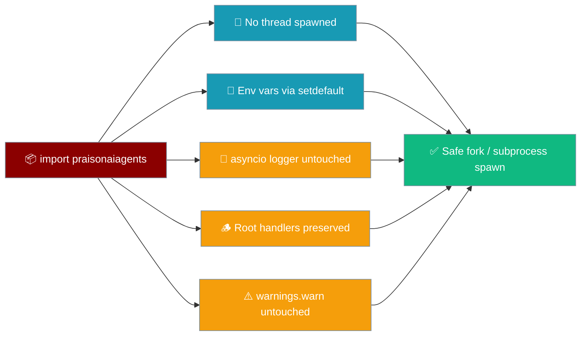

`import praisonaiagents` spawns no background thread, leaves host environment variables alone, preserves host logging handlers, and never replaces `warnings.warn` — so it is safe to import inside an existing app or at the parent of a pre-fork server before workers fork.

```python
from praisonaiagents import Agent

# Importing the package spawns nothing and overwrites nothing.
agent = Agent(instructions="You are a helpful assistant")
agent.start("Hello")
```

The user imports the SDK inside a gunicorn master or a `multiprocessing` parent; nothing starts a daemon thread or corrupts the environment before workers fork.



Reference: [PraisonAI PR #5219](https://github.com/MervinPraison/PraisonAI/pull/5219) (fixes [#5162](https://github.com/MervinPraison/PraisonAI/issues/5162)) and [PR #6135](https://github.com/MervinPraison/PraisonAI/pull/6135) (fixes [#6134](https://github.com/MervinPraison/PraisonAI/issues/6134)). This is the Python companion to [JS Import Safety & Runtimes](/features/js-import-safety).

## What's safe on import (after PR #5219)

Three import-time side effects that used to corrupt the host process are gone.

<Steps>
<Step title="Host environment variables are preserved">
`praisonaiagents._logging._configure_environment()` uses `os.environ.setdefault(key, value)`. A value the host exported before launch (`LITELLM_LOG`, `LITELLM_TELEMETRY`, `PYDANTIC_WARNINGS_ENABLED`, and the rest) is kept — and no longer leaks a different value into subprocesses spawned afterwards.

```python
import os
import praisonaiagents

# If the host exported LITELLM_LOG=DEBUG before launch, it survives import.
print(os.environ.get("LITELLM_LOG"))
```

See [Logging Configuration → Environment variables: setdefault, not overwrite](/features/logging-configuration#environment-variables-setdefault-not-overwrite) for the full variable list.
</Step>

<Step title="The asyncio logger is left alone">
`"asyncio"` was removed from the SDK's noisy-logger list. Import no longer forces `logging.getLogger("asyncio")` to `CRITICAL`, so host asyncio errors (`Task exception was never retrieved`, scheduling failures) continue to surface.
</Step>

<Step title="No cleanup thread is spawned at import">
The `runtime/resolve.py` cleanup daemon starts **lazily on the first cache write** — inside `resolve_runtime` under `_runtime_cache_lock` — not at module import. A bare `import praisonaiagents` or a touch of `runtime.SessionContext` spawns nothing, which is exactly the guarantee pre-fork server deployments need.

```python
import praisonaiagents
from praisonaiagents.runtime import SessionContext

# Neither line starts a background thread — the daemon waits for the
# first resolve_runtime() cache write.
ctx = SessionContext(session_id="parent")
```

See [Runtime Resolution → Background cleanup thread](/features/runtime-resolution#background-cleanup-thread-pr-5219).
</Step>
</Steps>

## Host logging, warnings, and env on import (PR #6135)

PR #6135 removed the last import-time changes to host process state.

<Steps>
<Step title="Root logger is left alone if the host configured it">
`logging.basicConfig(..., force=True)` is gone. If the root logger already has a handler, import leaves the root handler list and level unchanged. See [Logging Configuration → When the host has already configured logging](/features/logging-configuration#when-the-host-has-already-configured-logging).
</Step>

<Step title="Host httpx / openai / pydantic loggers are kept">
When the host has configured logging, import no longer clears handlers or `propagate` on `httpx`, `httpcore`, `openai.*`, `pydantic`, or `markdown_it` loggers.
</Step>

<Step title="warnings.warn is never replaced">
`warnings.warn` and `warnings.warn_explicit` are no longer monkey-patched. Noisy third-party warnings are silenced with scoped `warnings.filterwarnings(...)` entries only, so `warnings.warn` is the same object before and after import.
</Step>

<Step title="Env defaults wait for the LLM layer">
`LITELLM_*`, `HTTPX_*`, and `PYDANTIC_*` defaults are applied when `praisonaiagents.llm` is imported — not on `import praisonaiagents`. Subprocesses the host spawns before using the LLM path inherit an unchanged environment. Values are still applied with `setdefault`.
</Step>
</Steps>

Verify the invariant yourself:

```python
import logging, warnings

class H(logging.Handler):
    def emit(self, r): pass

h = H()
logging.getLogger().addHandler(h)
logging.getLogger().setLevel(logging.INFO)
warn_before = warnings.warn

import praisonaiagents  # noqa

assert logging.getLogger().handlers == [h]
assert logging.getLogger().level == logging.INFO
assert warnings.warn is warn_before
```

The full assertion set lives in [`tests/unit/test_import_side_effects.py`](https://github.com/MervinPraison/PraisonAI/blob/main/src/praisonai-agents/tests/unit/test_import_side_effects.py).

## Fork-safety guide

Import at the parent, then fork — as long as no `resolve_runtime` call happens before the fork, no daemon thread is cloned into a child in an undefined state.

<Tabs>
<Tab title="gunicorn (pre-fork)">
```bash
# --preload imports your app (and praisonaiagents) once in the master,
# then forks sync workers. Safe after PR #5219: no import-time daemon
# thread is cloned into each worker.
gunicorn --worker-class sync --workers 4 --preload myapp:app
```

```python
# myapp.py — imported once in the master before fork.
from praisonaiagents import Agent

agent = Agent(instructions="You are a helpful assistant")

def app(environ, start_response):
    # resolve_runtime (and the lazy cleanup thread) happens per-worker,
    # after fork — never in the master.
    reply = agent.start("Hello")
    start_response("200 OK", [("Content-Type", "text/plain")])
    return [reply.encode()]
```
</Tab>

<Tab title="multiprocessing.Process">
```python
import multiprocessing as mp
from praisonaiagents import Agent   # imported in the parent — safe

def worker(prompt):
    agent = Agent(instructions="You are a helpful assistant")
    return agent.start(prompt)

if __name__ == "__main__":
    procs = [mp.Process(target=worker, args=(f"Q{i}",)) for i in range(4)]
    for p in procs:
        p.start()
    for p in procs:
        p.join()
```
</Tab>

<Tab title="ProcessPoolExecutor">
```python
from concurrent.futures import ProcessPoolExecutor
from praisonaiagents import Agent   # imported in the parent — safe

def worker(prompt):
    agent = Agent(instructions="You are a helpful assistant")
    return agent.start(prompt)

if __name__ == "__main__":
    with ProcessPoolExecutor(max_workers=4) as pool:
        results = list(pool.map(worker, [f"Q{i}" for i in range(4)]))
```
</Tab>
</Tabs>

<Note>
Before PR #5219 the import-time cleanup thread was cloned into every child at `fork()` in an undefined state — a known cause of hangs and duplicate cache eviction under gunicorn pre-fork workers, `multiprocessing.Process`, and Celery prefork. After PR #5219, importing at the parent is safe as long as no `resolve_runtime` call happens before fork.
</Note>

## Best Practices

<AccordionGroup>
<Accordion title="Import at the parent, resolve in the child" icon="code-fork">
Under a pre-fork server, keep `import praisonaiagents` in the master and let the first `agent.start()` / `resolve_runtime` happen inside each worker. The lazy cleanup daemon then starts per-worker, never in the master.
</Accordion>

<Accordion title="Configure host logging before or after — both work" icon="scroll">
If your app installs root handlers before importing PraisonAI, the SDK leaves them alone. If it imports PraisonAI first, attach your handlers afterwards as usual.
</Accordion>

<Accordion title="Set env vars before launch to keep them" icon="terminal">
Export `LITELLM_LOG`, `LITELLM_TELEMETRY`, and friends in your shell / systemd / Docker before the process starts. `setdefault` preserves them and never leaks a different value into subprocesses.
</Accordion>

<Accordion title="Re-suppress asyncio yourself if you need it" icon="volume-xmark">
Import no longer silences the asyncio logger. If you want the old quiet behaviour, call `logging.getLogger("asyncio").setLevel(logging.CRITICAL)` in your own code.
</Accordion>
</AccordionGroup>

## Related

<CardGroup cols={2}>
  <Card title="Import Safety (JS)" icon="shield-check" href="/features/js-import-safety">
    JavaScript companion — no dotenv side effects on import
  </Card>
  <Card title="Logging Configuration" icon="scroll" href="/features/logging-configuration">
    Host-configured logging is preserved on import
  </Card>
  <Card title="Runtime Resolution" icon="rotate" href="/features/runtime-resolution">
    Lazy cleanup-thread start and fork safety
  </Card>
  <Card title="Thread Safety" icon="lock" href="/features/thread-safety">
    Output-singleton locks and concurrent agent guarantees
  </Card>
</CardGroup>
