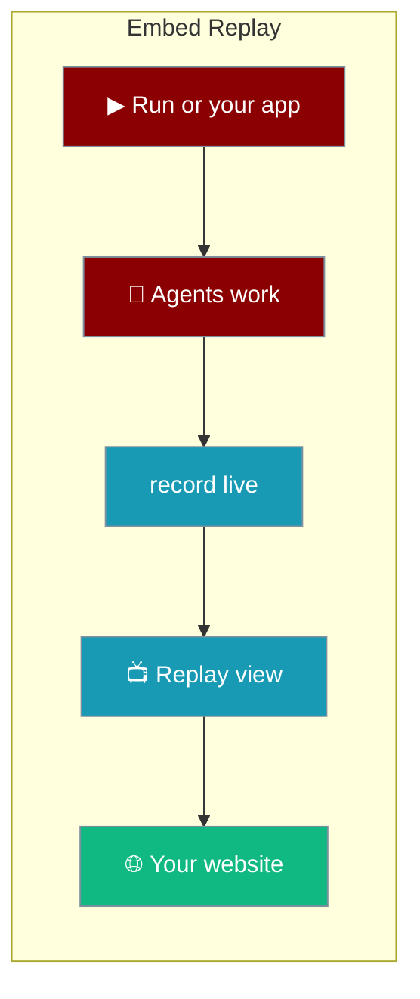
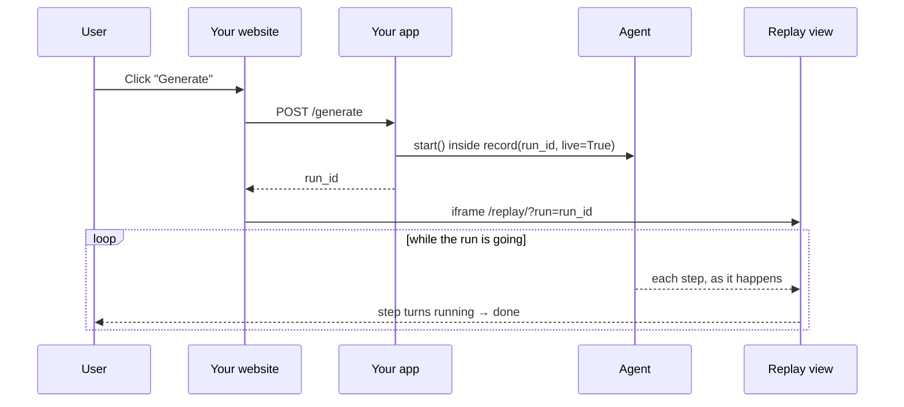

```python
from praisonaiagents import Agent
from praisonai.replay import watch

agent = Agent(name="Writer", instructions="Write one short paragraph.")
watch(agent, input="Solar sails")  # opens a page: press Run, watch each step
```

Replay draws a run as it happens. In a team or flow, each step and agent on the map turns from **not reached** to **running** to **done**; a single agent appears when it starts and turns **done** when it answers. You can open it on its own page, put it in your app, or put it in any website with one `<iframe>`.



<Note>
Install the UI extra: `pip install -U "praisonai[ui]"`. The app examples below also need FastAPI: `pip install fastapi`. You need PraisonAI **4.7.19** or later, which brings PraisonAI UI (aiui) **0.3.148** or later. With an older aiui, `watch()` and `replay_app()` stop with an upgrade message.
</Note>

## Quick Start

<Steps>
<Step title="Watch a run with a Run button">

```python
from praisonaiagents import Agent, AgentTeam, Task
from praisonai.replay import watch

researcher = Agent(name="Researcher", instructions="Give 3 short facts.")
writer = Agent(name="Writer", instructions="Write one paragraph from the facts.")
team = AgentTeam(
    agents=[researcher, writer],
    tasks=[
        Task(name="research", description="3 facts about solar sails", agent=researcher, expected_output="3 facts"),
        Task(name="write", description="One paragraph using the facts", agent=writer, expected_output="a paragraph"),
    ],
)

watch(team)  # http://127.0.0.1:8090/
```

Press **▶ Run**. The map shows who is working right now. When the run ends, **▶ Play** goes through it again one step at a time.

</Step>

<Step title="Show progress inside your own app">

```python
import threading, uuid
from fastapi import FastAPI
from praisonaiagents import Agent
from praisonai.replay import record, replay_app

agent = Agent(name="Writer", instructions="Write one short paragraph.")
app = FastAPI()
app.mount("/replay", replay_app())  # the progress view, served by your app


@app.post("/generate")
def generate():
    run_id = f"run-{uuid.uuid4().hex[:12]}"

    def job():
        with record(run_id, live=True):  # live: the view follows it as it runs
            agent.start("Write about solar sails")

    threading.Thread(target=job, daemon=True).start()
    return {"run_id": run_id}
```

Then show that run on any page:

```html
<iframe src="/replay/?run=RUN_ID" style="width:100%;height:640px;border:0"></iframe>
```

</Step>
</Steps>

---

## How It Works



| Piece | What it does |
|---|---|
| `record(run_id, live=True)` | Writes every step of the run to `~/.praison/traces/<run_id>.jsonl` (or `$PRAISONAI_TRACES_DIR`) as it happens |
| `replay_app()` | The Replay view and its data, ready to mount in FastAPI or Starlette |
| `/replay/?run=<id>` | Shows only that run and waits for it if it has not started yet |
| `watch()` | Serves `replay_app()` on localhost and opens your browser |

**What the map shows:**

| Look | Meaning |
|---|---|
| Dashed outline | Not reached yet |
| Blue, pulsing | Running now |
| Green | Done (`×2` when it ran twice) |
| Red | Failed |
| Bold outline | The step the cursor is on |

---

## Three Ways to Run It

<Tabs>
<Tab title="Python">

```python
from praisonaiagents import Agent
from praisonai.replay import watch

watch(Agent(name="Helper", instructions="Be brief."), input="Say hello")
```

</Tab>
<Tab title="CLI">

```bash
praisonai replay watch agents.yaml
```

The YAML runs as written, so the page has just a **Run** button and no input box.

</Tab>
<Tab title="YAML">

```python
from praisonai.replay import watch

watch("agents.yaml")
```

</Tab>
</Tabs>

---

## Embed on Any Website

The view is a normal web page, so any site can show it in an `<iframe>`, even when it is not built with Python.

<Tabs>
<Tab title="HTML">

```html
<button id="go">Generate</button>
<iframe id="progress" style="width:100%;height:640px;border:0"></iframe>
<script>
  const APP = "";  // "" when this page is served by your app; else its origin, e.g. "https://agents.example.com"
  go.onclick = async () => {
    const { run_id } = await (await fetch(APP + "/generate", { method: "POST" })).json();
    progress.src = APP + "/replay/?run=" + run_id;
  };
</script>
```

On a different domain, the `fetch` to `/generate` is cross-origin, so allow your site in your app's CORS settings (for FastAPI, `CORSMiddleware` with `allow_origins=["https://your-site.example"]`). The iframe itself needs no CORS.

</Tab>
<Tab title="React">

```jsx
export function RunProgress({ runId }) {
  if (!runId) return null;
  return (
    <iframe
      title="Agent progress"
      src={`/replay/?run=${runId}`}
      style={{ width: "100%", height: 640, border: 0 }}
    />
  );
}
```

</Tab>
<Tab title="Streamlit">

```python
import streamlit.components.v1 as components

# 127.0.0.1:8000 is local development; use your deployed app's origin when hosting
components.iframe("http://127.0.0.1:8000/replay/?run=RUN_ID", height=640)
```

</Tab>
<Tab title="Gradio">

```python
import gradio as gr

with gr.Blocks() as demo:
    # 127.0.0.1:8000 is local development; use your deployed app's origin when hosting
    gr.HTML('<iframe src="http://127.0.0.1:8000/replay/?run=RUN_ID" style="width:100%;height:640px;border:0"></iframe>')
demo.launch()
```

</Tab>
</Tabs>

| URL | Shows |
|---|---|
| `/replay/` | The list of recorded runs and the selected one |
| `/replay/?run=<id>` | Only that run, no list. Best for an iframe. |

---

## Common Patterns

### Put the Run button in your app

Pass your agent, team or flow to `replay_app()` and the mounted page gets an input box and a **Run** button:

```python
from fastapi import FastAPI
from praisonaiagents import Agent
from praisonai.replay import replay_app

agent = Agent(name="Writer", instructions="Write one short paragraph.")
app = FastAPI()
app.mount("/replay", replay_app(agent, input="Solar sails", placeholder="Topic"))
```

One run goes at a time. A team's tasks start afresh on each run; an `Agent` keeps its chat history between runs.

<Note>
An agent without a `name=` (`Agent(instructions=...)`) appears on the map as **Agent**. Give agents names when a lesson runs more than one, so each gets its own box.
</Note>

### Draw the view inside your own page

On a page served by the same app, load the view into any element instead of an iframe:

```html
<div id="progress"></div>
<script type="module">
  import { render } from "/replay/replay.js";
  render(document.getElementById("progress"), { base: "/replay", run: "RUN_ID", approve: false });
</script>
```

| Option | What it does |
|---|---|
| `base` | Where `replay_app()` is mounted, e.g. `"/replay"` |
| `run` | Show only this run |
| `runner` | `{input, placeholder}` shows a Run box |
| `approve` | `false` hides the Approve/Deny buttons |

<Tip>
For a site on a different domain, use the `<iframe>`. The `render()` call reads data from the same origin as the page.
</Tip>

### Teach how agents work together

`watch()` is a quick way to show a class or a team how a multi-agent run flows. Press **Run**, then **▶ Play** to go through it again. Use **← →** to step, **Timeline** to see who worked when, and **Why** to see what each agent was given.

---

## Best Practices

<AccordionGroup>

<Accordion title="Keep it private by default">

Anyone who can open the page can read the runs (prompts and outputs). With a Run button, they can also start new runs. `watch()` listens on `127.0.0.1` by default (it warns if you pass another `host=`). In your app, mount `replay_app()` behind your own login. Protect `/generate` the same way, with login and a rate limit: anyone who can call it can start agent runs over and over.

</Accordion>

<Accordion title="Use one run id per request">

Create the `run_id` yourself, pass it to `record()`, and return it to the page. The iframe can open `/replay/?run=<id>` straight away: it waits until the run starts.

</Accordion>

<Accordion title="Record with live=True">

`record(run_id, live=True)` writes each step as soon as it happens. Without it, the view only fills in at the end of the run.

</Accordion>

<Accordion title="Prefer the iframe for other sites">

The iframe works from any framework or domain. Use `render()` only on pages served by the same app.

</Accordion>

</AccordionGroup>

---

## Related

<CardGroup cols={2}>
<Card title="Replay" icon="rotate-left" href="/features/replay">
  Record runs and step through them from the CLI
</Card>
<Card title="Integrating PraisonAI UI" icon="window-restore" href="/guides/integrating-praisonaiui">
  Use PraisonAI UI as a full dashboard for your agents
</Card>
</CardGroup>
