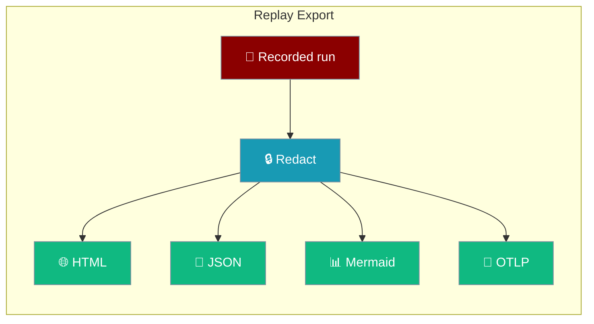

`praisonai replay export` turns a recorded run into a file you can share, diff, diagram, or send to any OpenTelemetry backend.

```python
from praisonaiagents import Agent
from praisonai.replay import record, export, load_events

with record() as rec:
    Agent(name="writer", instructions="Draft a short blog post").start("AI agents")

with open(f"{rec.run_id}.html", "w", encoding="utf-8") as f:
    f.write(export.to_html(load_events(rec.path)))
```



## Quick Start

<Steps>
<Step title="Export to HTML">

```bash
praisonai replay export run-1a2b3c4d5e6f
```

Writes `./run-1a2b3c4d5e6f.html` — open it in any browser, offline.

</Step>

<Step title="Pick another format">

<Tabs>
<Tab title="JSON">

```bash
praisonai replay export run-1a2b3c4d5e6f --format json -o run.json
```

</Tab>
<Tab title="Mermaid">

```bash
praisonai replay export run-1a2b3c4d5e6f --format mermaid -o run.mmd
```

</Tab>
<Tab title="OTLP">

```bash
praisonai replay export run-1a2b3c4d5e6f --format otel -o run.otlp.json
```

</Tab>
</Tabs>

</Step>
</Steps>

---

## Formats

| `--format` | Python | Output | Use it to |
|---|---|---|---|
| `html` (default) | `to_html(events, *, redact=True, graph=None, title=None)` | One self-contained HTML page | Share a run with anyone |
| `json` | `to_json(events, *, redact=True, indent=2)` | `{"schema": "praisonai.replay/1", "run_id", "graph", "events"}` | Diff runs or feed other tools |
| `mermaid` | `to_mermaid(events, *, redact=True)` | Mermaid `sequenceDiagram` | Paste a diagram into a README or PR |
| `otel` | `to_otlp_json(events, *, redact=True, service_name="praisonai")` | OTLP/JSON `ExportTraceServiceRequest` | Load into Jaeger, Tempo, Honeycomb, etc. |

## Options

| Option | Default | Description |
|---|---|---|
| `RUN` | — | Run id or path to a trace file |
| `--format`, `-f` | `html` | `html`, `json`, `mermaid`, or `otel` |
| `--output`, `-o` | stdout (`html`: `./<run>.html`) | Write to a file |
| `--no-redact` | off | Export as recorded, without removing secrets/PII |

---

## Redaction

Every export is redacted by default — secrets are found by key name and secret/PII patterns are scrubbed from free text.

| Data | Result |
|---|---|
| Values under secret-looking keys (`api_key`, `token`, …) | `[REDACTED]` |
| Numbers under those keys (`prompt_tokens`, `max_tokens`) | Kept — they are counters |
| Free text (prompts, outputs) | Secret and PII patterns scrubbed |

<Warning>
`--no-redact` exports the run exactly as recorded. Never commit or share a `--no-redact` file.
</Warning>

---

## Self-Contained HTML

The HTML file has zero external references — no CDN, nothing fetched when it opens — so it works air-gapped.

| You have | The page shows |
|---|---|
| `praisonai[ui]` installed | The full replay timeline, with its renderer inlined |
| No UI installed | A built-in table timeline |

---

## OpenTelemetry (OTLP)

`--format otel` writes an OTLP/JSON trace using the OpenTelemetry GenAI semantic conventions, with no OpenTelemetry dependency.

```bash
praisonai replay export run-1a2b3c4d5e6f --format otel -o run.otlp.json
curl -X POST http://localhost:4318/v1/traces \
  -H "Content-Type: application/json" \
  --data @run.otlp.json
```

| Span | Covers |
|---|---|
| `invoke_workflow` | The whole run |
| `invoke_agent` | One agent |
| `chat` | One LLM call |
| `execute_tool` | One tool call |
| task / step / approval | Workflow structure |

Attributes include `gen_ai.operation.name`, `gen_ai.agent.name`, `gen_ai.request.model`, and `gen_ai.usage.input_tokens`. Ids are deterministic, so exporting the same run twice gives the same trace.

<Note>
The OpenTelemetry GenAI conventions are still at *Development* stability, so attribute names may change upstream.
</Note>

---

## Python

```python
import json
from praisonai.replay import export, load_events

events = load_events("run-1a2b3c4d5e6f")

open("run.html", "w", encoding="utf-8").write(export.to_html(events))
open("run.json", "w", encoding="utf-8").write(export.to_json(events))
open("run.mmd", "w", encoding="utf-8").write(export.to_mermaid(events))
open("run.otlp.json", "w", encoding="utf-8").write(json.dumps(export.to_otlp_json(events)))
```

---

## Best Practices

<AccordionGroup>

<Accordion title="Share HTML, not the server">

Send the HTML file instead of exposing `replay view` on the network.

</Accordion>

<Accordion title="Use OTLP for long-term storage">

Your existing tracing backend already handles retention and search — send it `--format otel`.

</Accordion>

</AccordionGroup>

---

## Related

<CardGroup cols={2}>
<Card title="PraisonAI Replay" icon="rotate-left" href="/features/replay">
  Record, view, export, and re-run runs
</Card>
<Card title="Replay Rerun" icon="rotate" href="/features/replay-rerun">
  Re-run a recorded run from any step
</Card>
<Card title="Custom Tracing" icon="chart-line" href="/observability/custom-tracing">
  Send traces to your own backend
</Card>
<Card title="Replay View" icon="display" href="/features/replay-view">
  Watch a run in the browser
</Card>
</CardGroup>
