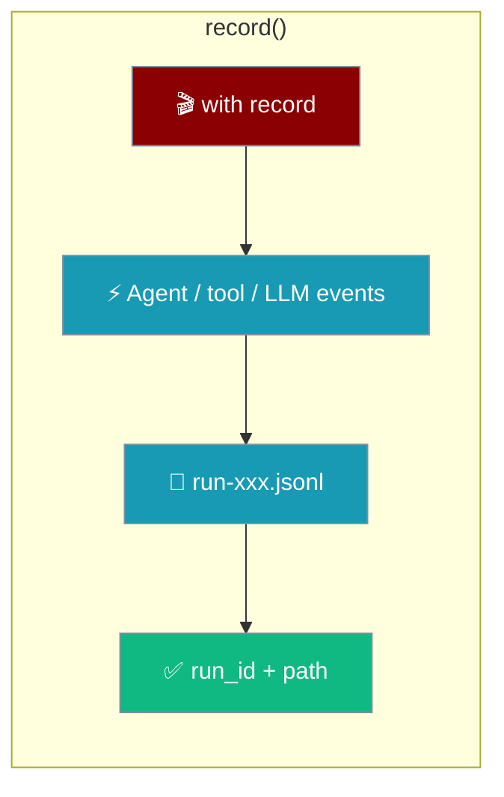
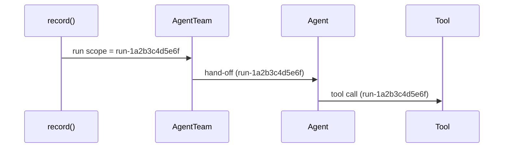

`record()` saves everything inside a `with` block to a local trace file and hands you back its run id and path.

```python
from praisonaiagents import Agent
from praisonai.replay import record

with record() as rec:
    Agent(name="writer", instructions="Draft a short blog post").start("AI agents")

print(rec.run_id, rec.path)
```



## Quick Start

<Steps>
<Step title="Record a run">

```python
from praisonaiagents import Agent
from praisonai.replay import record

with record() as rec:
    Agent(name="writer", instructions="Draft a short blog post").start("AI agents")
```

</Step>

<Step title="Watch it while it runs">

```python
from praisonaiagents import Agent
from praisonai.replay import record

with record(live=True) as rec:
    print(f"praisonai replay view {rec.run_id} --live")
    Agent(name="writer", instructions="Draft a short blog post").start("AI agents")
```

</Step>

<Step title="Or record from YAML">

```yaml
save_replay: true
roles:
  researcher:
    role: Researcher
    goal: Collect sources
    backstory: You find what matters.
    tasks:
      research:
        description: Research the topic
        expected_output: A summary
```

```bash
praisonai agents.yaml
```

</Step>
</Steps>

---

## `record()` Options

| Parameter | Type | Default | Description |
|---|---|---|---|
| `run_id` | `str` | `run-<12 hex>` | Trace id and file name |
| `live` | `bool` | `False` | Write every event to disk as it happens |
| `meta` | `dict` | `None` | Extra data on the `session_start` event (e.g. `{"yaml_path": ...}`, which `replay rerun` uses to find the definition) |
| `full_content` | `bool` | `False` | Keep tool results and LLM responses untruncated |

```python
from praisonaiagents import Agent
from praisonai.replay import record

with record("blog-post-v2", meta={"experiment": "shorter prompt"}) as rec:
    Agent(name="writer", instructions="Draft a short blog post").start("AI agents")
```

## `Recording` Fields

| Field | Type | Description |
|---|---|---|
| `run_id` | `str` | The run id |
| `path` | `Path` | Where the trace file is written |
| `live` | `bool` | Whether events are written immediately |
| `status` | `str \| None` | Set to `"failed"` to mark a run failed when you handle the error yourself |

```python
from praisonaiagents import Agent
from praisonai.replay import record

with record() as rec:
    try:
        Agent(name="writer", instructions="Draft a short blog post").start("AI agents")
    except Exception:
        rec.status = "failed"
```

An exception that escapes the block also marks the run `failed`.

---

## `save_replay: true`

Set `save_replay: true` at the top level of a YAML file to record every run — the same as passing `--save` each time.

| Command | Recorded when |
|---|---|
| `praisonai agents.yaml` | `save_replay: true` or `--save` |
| `praisonai workflow run workflow.yaml` | `save_replay: true` or `--save` |

YAML runs also record their file path, so `praisonai replay rerun` can find the definition without `--file`.

---

## Everything Carries the Run Id

`record()` enters the SDK's run scope, so every event — hand-offs, tool calls, LLM requests, and nested teams or flows — is tagged with the same run id automatically.



Everything recorded is redacted by default.

---

## `full_content=True`

By default long outputs are kept as previews to keep traces small; `full_content=True` keeps them whole.

```python
from praisonaiagents import Agent
from praisonai.replay import record

with record(full_content=True) as rec:
    Agent(name="writer", instructions="Draft a long blog post").start("AI agents")
```

Use it when you plan to [re-run from any step](/features/replay-rerun) — a step whose output was only kept as a truncated preview cannot be reused.

---

## Best Practices

<AccordionGroup>

<Accordion title="Prefer save_replay for YAML">

No code change and every run is recorded, ready to view or re-run.

</Accordion>

<Accordion title="Give experiments a readable run_id">

`record("blog-post-v2")` is easier to find in `praisonai replay list` than a random id.

</Accordion>

<Accordion title="Trade disk for completeness deliberately">

Turn on `full_content=True` only for runs you expect to fork.

</Accordion>

</AccordionGroup>

---

## Related

<CardGroup cols={2}>
<Card title="PraisonAI Replay" icon="rotate-left" href="/features/replay">
  Record, view, export, and re-run runs
</Card>
<Card title="Replay Rerun" icon="rotate" href="/features/replay-rerun">
  Re-run a recorded run from any step
</Card>
</CardGroup>
