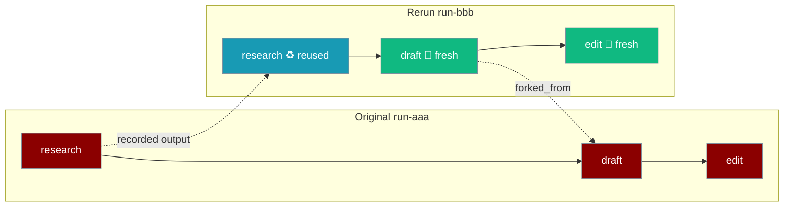
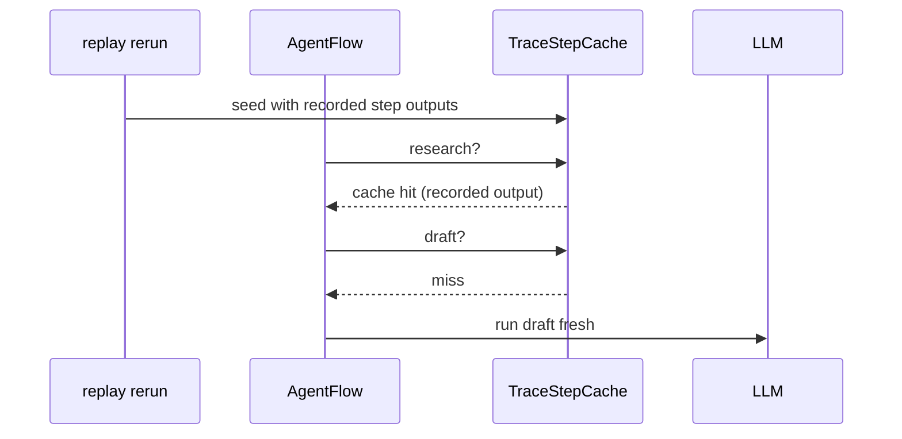
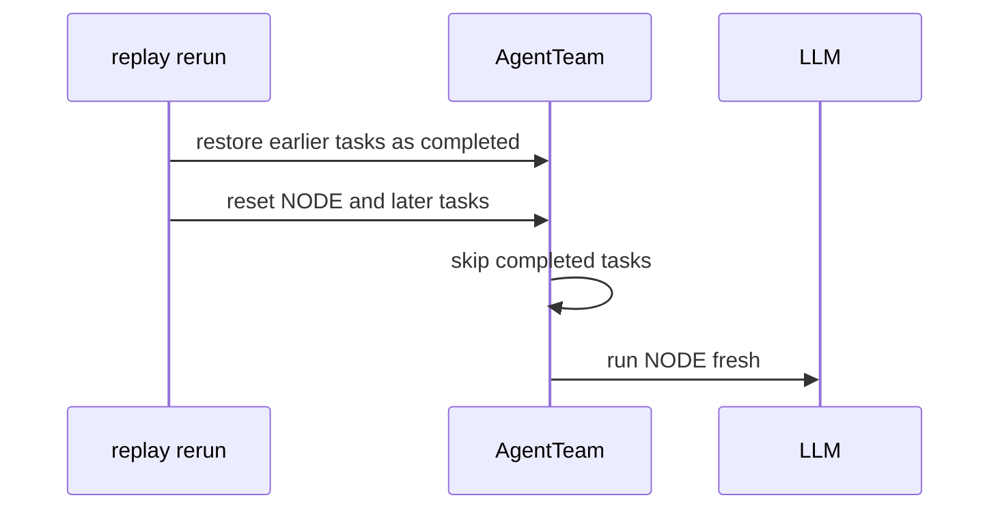

`praisonai replay rerun` re-runs a recorded run from the step you choose: steps before it reuse their recorded output, so you only pay for the part you changed.

```python
from praisonaiagents import Agent, AgentFlow
from praisonai.replay import record
from praisonai.replay.rerun import rerun

research = Agent(name="research", instructions="List three facts about the topic")
draft = Agent(name="draft", instructions="Write a short post from the facts")

with record(full_content=True) as first:
    AgentFlow(steps=[research, draft]).start("AI agents")

rec, result = rerun(AgentFlow(steps=[research, draft]), first.run_id, "step:draft", input="AI agents")
print(rec.run_id, result)
```



## Quick Start

<Steps>
<Step title="Record a run">

```bash
praisonai agents.yaml --save
```

</Step>

<Step title="Find the node to re-run from">

```bash
praisonai replay list
praisonai replay flow run-1a2b3c4d5e6f --format mermaid
```

</Step>

<Step title="Re-run from that node">

```bash
praisonai replay rerun run-1a2b3c4d5e6f --from step:draft
```

```
Re-running run-1a2b3c4d5e6f from step:draft as run-9f8e7d6c5b4a (reusing: step:research)
```

</Step>
</Steps>

---

## How It Works

<Tabs title="Framework">
<Tab title="AgentFlow">



Earlier steps go through the flow's normal cache-hit path, so variables and `{{previous_output}}` behave exactly as on a real cache hit — the same path the [Step-Result Cache](/features/workflow-step-cache) uses.

</Tab>
<Tab title="AgentTeam">



Earlier tasks come back `completed` with their recorded output; the task you chose and everything after it start again.

</Tab>
</Tabs>

---

## Node Ids

| Node id | Means |
|---|---|
| `task:write` | The `write` task of an AgentTeam |
| `step:draft` | The `draft` step of an AgentFlow |
| `step:draft#2` | The second run of a repeated `draft` step |

Only nodes that finished as `completed` or `cached` before your node started are reused.

## Options

| Option | Default | Description |
|---|---|---|
| `RUN` | — | Run id or path to the recorded trace |
| `--from` | required | Node id to re-run from |
| `--file` | the YAML recorded with the run | YAML definition to run instead |

---

## Fork Tracking

The new run records where it came from on its first `workflow_start` event:

```json
{"forked_from": {"run_id": "run-1a2b3c4d5e6f", "node_id": "step:draft"}}
```

See it with `praisonai replay show <new-run> --type workflow_start` or in an [HTML export](/features/replay-export).

---

## When It Fails

<Warning>
Rerun refuses to guess rather than feed the next step the wrong input:

- **No node ids** — traces recorded before schema 1.1 fail with *"This trace has no node ids (schema 1.0)… record it again."*
- **Truncated output** — if only a 500-character preview was recorded, re-record with `record(full_content=True)` or re-run from an earlier node.
- **Wrong YAML kind** — a `--file` that defines a team when the node is a flow step (or the reverse) exits with an error.
- **No recorded definition** — runs recorded from Python have no YAML path; pass `--file agents.yaml`.
</Warning>

---

## Python

```python
from praisonaiagents import Agent, AgentFlow
from praisonai.replay.rerun import rerun

research = Agent(name="research", instructions="List three facts about the topic")
draft = Agent(name="draft", instructions="Write a short post from the facts")
flow = AgentFlow(steps=[research, draft])

rec, result = rerun(flow, "run-1a2b3c4d5e6f", "step:draft", input="AI agents")
print(rec.run_id, rec.path)
```

| Parameter | Type | Default | Description |
|---|---|---|---|
| `target` | `AgentFlow` \| `AgentTeam` | — | What to run (must match the recorded kind) |
| `source` | `str` \| `list` | — | Run id, trace path, or loaded events |
| `node_id` | `str` | — | Node to re-run from |
| `input` | `Any` | `None` | Passed to `target.start()` |
| `run_id` | `str` | auto | Id for the new run |
| `live` | `bool` | `False` | Flush every event as it happens |
| `meta` | `dict` | `None` | Extra `session_start` data |

Returns `(recording, result)`.

---

## Best Practices

<AccordionGroup>

<Accordion title="Record with full_content=True">

Long step outputs are otherwise only kept as previews; `full_content=True` lets you re-run from any node.

</Accordion>

<Accordion title="Change one thing per rerun">

Edit the step you're tuning, rerun from it, and compare the two runs side by side in `replay view`.

</Accordion>

</AccordionGroup>

---

## Related

<CardGroup cols={2}>
<Card title="PraisonAI Replay" icon="rotate-left" href="/features/replay">
  Record, view, export, and re-run runs
</Card>
<Card title="Step-Result Cache" icon="database" href="/features/workflow-step-cache">
  The cache path rerun reuses for AgentFlow
</Card>
<Card title="Record API" icon="code" href="/features/replay-record-api">
  `full_content` and other record options
</Card>
<Card title="Replay Export" icon="download" href="/features/replay-export">
  See forked runs in an HTML export
</Card>
</CardGroup>
