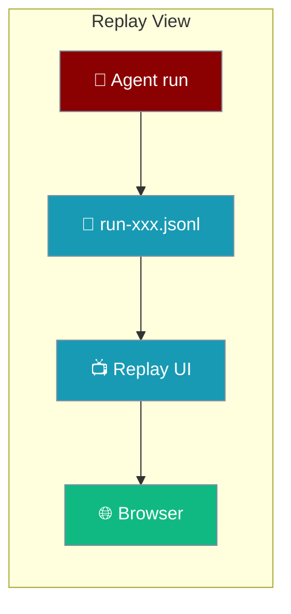
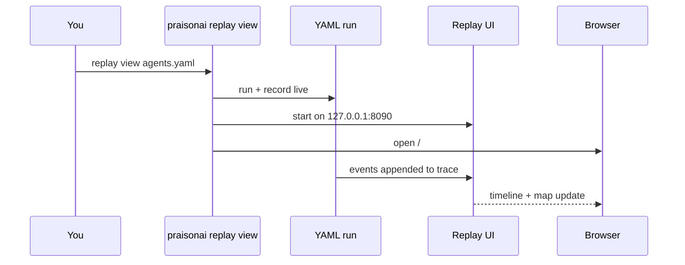

`praisonai replay view` opens a local browser page that follows your agents as they run, or replays a run you recorded earlier.

```python
from praisonaiagents import Agent
from praisonai.replay import record

with record(live=True) as rec:
    Agent(name="writer", instructions="Draft a short blog post").start("AI agents")

print(f"praisonai replay view {rec.run_id}")
```



## Quick Start

<Steps>
<Step title="Install the UI">

```bash
pip install "praisonai[ui]"
```

</Step>

<Step title="Run a YAML and watch it live">

```bash
praisonai replay view agents.yaml
```

The YAML runs in the background, is recorded, and the browser follows it as it happens.

</Step>

<Step title="Replay a finished run">

```bash
praisonai replay list
praisonai replay view run-1a2b3c4d5e6f
```

</Step>
</Steps>

---

## How It Works



| Target | What happens |
|---|---|
| *(none)* | Opens the list of recent runs |
| `run-1a2b3c4d5e6f` | Replays that run |
| `./traces/run-1a2b3c4d5e6f.jsonl` | Replays a trace file from any folder |
| `agents.yaml` | Runs it, records it, and follows it live |

---

## Options

| Option | Default | Description |
|---|---|---|
| `TARGET` | recent runs | Run id, trace `.jsonl` path, or a YAML file to run and watch |
| `--live` | `false` | Follow the run as it is written (implied for a YAML file) |
| `--port`, `-p` | `8090` | Port for the replay UI |
| `--host` | `127.0.0.1` | Host to bind to |

```bash
praisonai replay view run-1a2b3c4d5e6f --port 9000
praisonai replay view run-1a2b3c4d5e6f --live
```

<Warning>
The replay UI has no login. Binding `--host` to anything other than `127.0.0.1`, `localhost`, or `::1` makes your prompts, outputs, and tool arguments reachable from the network — the CLI prints a warning when you do.
</Warning>

<Note>
If the UI is not installed, the command exits and prints the fix: `pip install "praisonai[ui]"`.
</Note>

The viewer reads traces from the same place recording writes them — see [Where Traces Live](/features/replay#where-traces-live).

---

## Best Practices

<AccordionGroup>

<Accordion title="Record with live=True to follow from Python">

`record(live=True)` writes every event immediately, so `praisonai replay view RUN --live` shows it as it happens.

</Accordion>

<Accordion title="Keep the default host">

Stay on `127.0.0.1` and share a [self-contained HTML export](/features/replay-export) instead of exposing the server.

</Accordion>

</AccordionGroup>

---

## Related

<CardGroup cols={2}>
<Card title="PraisonAI Replay" icon="rotate-left" href="/features/replay">
  Record, view, export, and re-run runs
</Card>
<Card title="Replay Export" icon="download" href="/features/replay-export">
  Share a run as a single HTML file
</Card>
</CardGroup>
