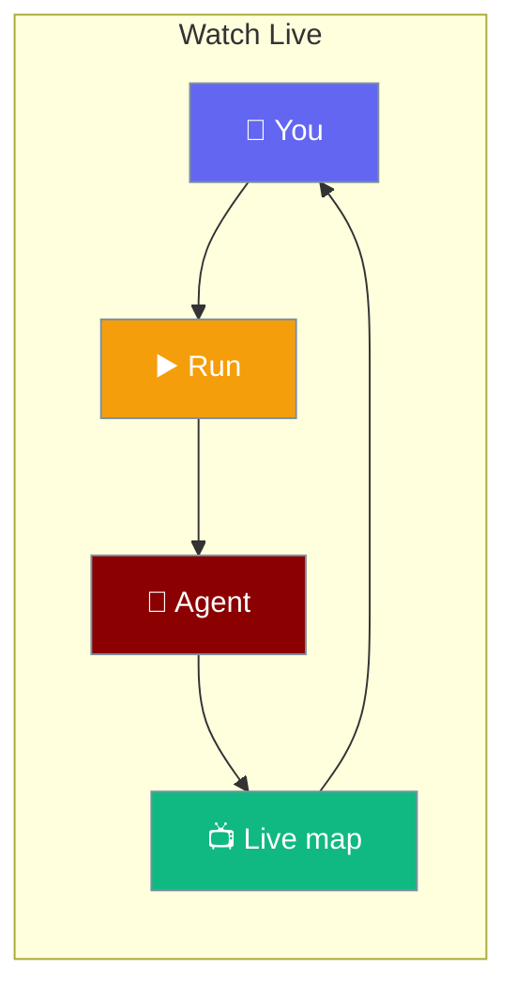
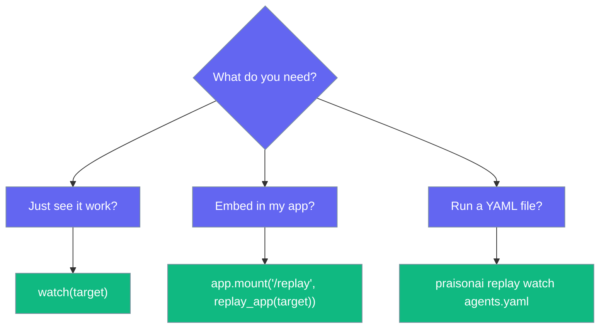
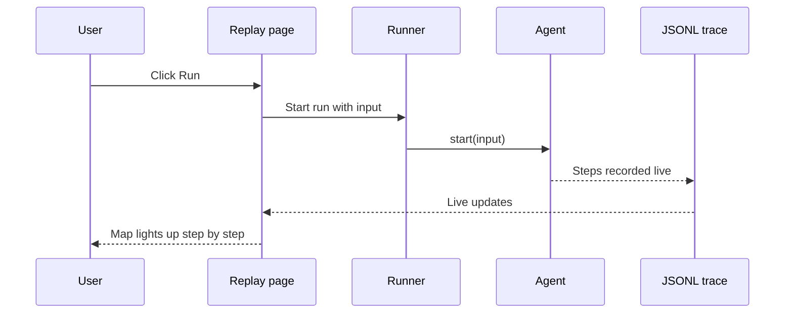

Click **Run** on a page and watch every step of your agent light up live, either standalone or inside your own app.

```python
from praisonaiagents import Agent
from praisonai.replay import watch

agent = Agent(name="writer", instructions="Write a short story.")
watch(agent)   # opens http://127.0.0.1:8090/, click Run
```



<Note>
Install the UI extras once: `pip install -U "praisonai[ui]"`.
</Note>

## Quick Start

<Steps>
<Step title="Standalone">

Open a page with a Run button. This flow uses plain Python steps, so no API key is needed.

```python
import time

from praisonaiagents import AgentFlow
from praisonaiagents.workflows import StepResult
from praisonai.replay import watch


def research(ctx):
    time.sleep(1.5)
    return StepResult(output=f"3 sources about {ctx.input}")


def draft(ctx):
    time.sleep(1.5)
    return StepResult(output="first draft")


flow = AgentFlow(name="Write an article", steps=[research, draft])
watch(flow, input="solar sails")   # opens http://127.0.0.1:8090/
```

On the map: dashed = not reached, blue = running now, green = done. After a run, press **Play** to step through it again.

</Step>

<Step title="Inside your app">

Mount the page in your own FastAPI or Starlette app.

```python
from fastapi import FastAPI
from praisonaiagents import Agent
from praisonai.replay import replay_app

agent = Agent(name="writer", instructions="Write a short story.")

app = FastAPI()
app.mount("/replay", replay_app(agent))   # open http://127.0.0.1:8000/replay/
```

```bash
uvicorn main:app --port 8000
```

</Step>

<Step title="From the CLI">

Run an `agents.yaml` from a page with a Run button.

```bash
praisonai replay watch agents.yaml
```

</Step>
</Steps>

---

## Which One Should I Use?



---

## What You Can Watch

Pass any of these as `target` to `watch()` or `replay_app()`.

| `target` | What the Run button does |
|---|---|
| `Agent` | Calls `agent.start(input)` and records it |
| `AgentTeam` | Resets task state, then calls `team.start(input)` and records it |
| `AgentFlow` | Calls `flow.start(input)` and records it |
| `str` / `Path` to a `.yaml` / `.yml` file | Runs the file as written. **No input box** on the page. |
| Any `callable(input)` (sync or async) | Called with the input text; async callables are awaited |
| `None` | Read-only view of recorded runs, no Run button |

Anything else raises `TypeError`. A file path that isn't YAML raises `ValueError("not a YAML file: ...")`.

---

## How It Works



Each Run is recorded under a new run id and the page follows it live. One run happens at a time.

---

## Each Run Starts Fresh

Clicking Run again on an `AgentTeam` really re-runs it — tasks reset before every Run.

```python
from praisonaiagents import Agent, AgentTeam, Task
from praisonai.replay import watch

researcher = Agent(name="Researcher", instructions="Give 3 short facts.", llm="gpt-4o-mini")
writer = Agent(name="Writer", instructions="Write one short paragraph from the facts.", llm="gpt-4o-mini")

team = AgentTeam(
    agents=[researcher, writer],
    tasks=[
        Task(name="research", description="3 facts about solar sails", agent=researcher, expected_output="3 facts"),
        Task(name="write", description="One paragraph using the facts", agent=writer, expected_output="a paragraph"),
    ],
)

watch(team)   # click Run, then Run again — both runs do the full work
```

<Note>
A team's tasks reset before each Run, and each task's original context is restored. An `Agent` keeps its chat history across Runs on purpose (same object).
</Note>

---

## Embedding Patterns

<Tabs>
<Tab title="Live progress panel">

Your app starts the run with `record()`; the mounted page draws it live in an `<iframe>`.

```python
import threading
import time
import uuid

from fastapi import FastAPI
from fastapi.responses import HTMLResponse
from praisonaiagents import AgentFlow
from praisonaiagents.workflows import StepResult
from praisonai.replay import record, replay_app


def research(ctx):
    time.sleep(1.2)
    return StepResult(output="notes")


def write(ctx):
    time.sleep(1.2)
    return StepResult(output="article")


flow = AgentFlow(name="Article", steps=[research, write])

app = FastAPI()
app.mount("/replay", replay_app())  # read-only view: /replay/?run=<id> shows one run


@app.post("/generate")
def generate():
    run_id = f"run-{uuid.uuid4().hex[:12]}"

    def job():
        with record(run_id, live=True):  # live: the view follows it as it is written
            flow.start("solar sails")

    threading.Thread(target=job, daemon=True).start()
    return {"run_id": run_id}


@app.get("/", response_class=HTMLResponse)
def home():
    return """<!doctype html><title>My app</title>
<button id="go">Generate article</button>
<iframe id="progress" style="width:100%;height:640px"></iframe>
<script>
  go.onclick = async () => {
    const { run_id } = await (await fetch('/generate', { method: 'POST' })).json();
    progress.src = '/replay/?run=' + run_id;
  };
</script>"""
```

```bash
pip install "praisonai[ui]" fastapi uvicorn
uvicorn main:app --port 8000      # open http://127.0.0.1:8000/
```

</Tab>
<Tab title="Starlette">

The same page mounts in Starlette with `Mount`.

```python
from starlette.applications import Starlette
from starlette.routing import Mount
from praisonaiagents import Agent
from praisonai.replay import replay_app

agent = Agent(name="writer", instructions="Write a short story.")

app = Starlette(routes=[Mount("/replay", app=replay_app(agent))])
```

</Tab>
<Tab title="Read-only iframe">

Without a `target`, the page only shows recorded runs.

```python
from fastapi import FastAPI
from praisonai.replay import replay_app

app = FastAPI()
app.mount("/replay", replay_app())
```

```html
<iframe src="/replay/?run=my-run-id" style="width:100%;height:640px"></iframe>
```

</Tab>
</Tabs>

| URL | Shows |
|---|---|
| `<mount>/` | The run list, plus a Run button if `target` is set |
| `<mount>/?run=<run_id>` | One run — handy inside an `<iframe>` |

---

<Warning>
Keep the page on `localhost` or behind your app's login — anyone who can reach it can read the runs, and with a Run button, start one.
</Warning>

---

## CLI Options

```bash
praisonai replay watch [yaml_file]
```

| Flag | Default | What it does |
|---|---|---|
| `yaml_file` (positional) | none | `agents.yaml` to run from the page. Omit for a read-only view of recorded runs. |
| `--port`, `-p` | `8090` | Port to serve on |
| `--host` | `127.0.0.1` | Host to bind to. A non-loopback host prints a warning (the page has no auth). |
| `--no-browser` | off | Do not open the browser |

```bash
praisonai replay watch                                    # recorded runs only
praisonai replay watch agents.yaml --port 8123 --no-browser
```

If `praisonai[ui]` is missing, the command exits with code `1` and an install hint. A file that isn't YAML exits with code `2`.

---

## Python Options

<Tabs>
<Tab title="watch()">

Serves the page, opens the browser, and blocks until Ctrl+C.

```python
watch(
    target=None,
    *,
    input="",
    placeholder="",
    title=None,
    host="127.0.0.1",
    port=8090,
    open_browser=True,
)
```

| Option | Type | Default | Description |
|---|---|---|---|
| `target` | `Any` | `None` | What the Run button runs (see table above) |
| `input` | `str` | `""` | Text the input box starts with |
| `placeholder` | `str` | `""` | Placeholder for the input box |
| `title` | `str \| None` | `None` | Page title (default: from the target's name) |
| `host` | `str` | `"127.0.0.1"` | Host to bind to; non-loopback prints a warning |
| `port` | `int` | `8090` | Port to serve on |
| `open_browser` | `bool` | `True` | Open the page in the browser |

</Tab>
<Tab title="replay_app()">

Returns the page as an ASGI app to mount in your own app.

```python
replay_app(
    target=None,
    *,
    input="",
    placeholder="",
    title=None,
)
```

| Option | Type | Default | Description |
|---|---|---|---|
| `target` | `Any` | `None` | What the Run button runs; `None` gives a read-only view |
| `input` | `str` | `""` | Text the input box starts with |
| `placeholder` | `str` | `""` | Placeholder for the input box |
| `title` | `str \| None` | `None` | Page title (default: from the target's name) |

</Tab>
</Tabs>

---

## Best Practices

<AccordionGroup>

<Accordion title="Keep it on 127.0.0.1">

The page has no auth of its own. Only bind to another host if you've put a login in front of it.

</Accordion>

<Accordion title="Record runs yourself for embedded panels">

Wrap your run in `record(run_id, live=True)` and point the iframe at `/replay/?run=<run_id>`.

</Accordion>

<Accordion title="Pick team or agent on purpose">

`AgentTeam` tasks reset each Run; an `Agent` keeps its chat history between Runs.

</Accordion>

<Accordion title="Install the UI extras once">

Run `pip install -U "praisonai[ui]"` — it brings everything the page needs.

</Accordion>

</AccordionGroup>

---

## Related

<CardGroup cols={2}>
<Card title="Context Replay" icon="clock-rotate-left" href="/features/replay">
  Save traces and step through past runs
</Card>
<Card title="Replay-Safe Retries" icon="shield-check" href="/features/replay-safe-retries">
  How PraisonAI avoids silently retrying mid-response failures
</Card>
</CardGroup>
