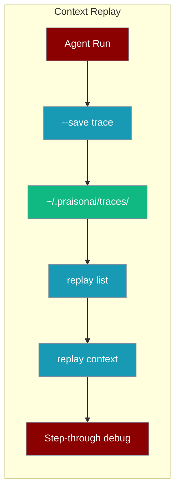
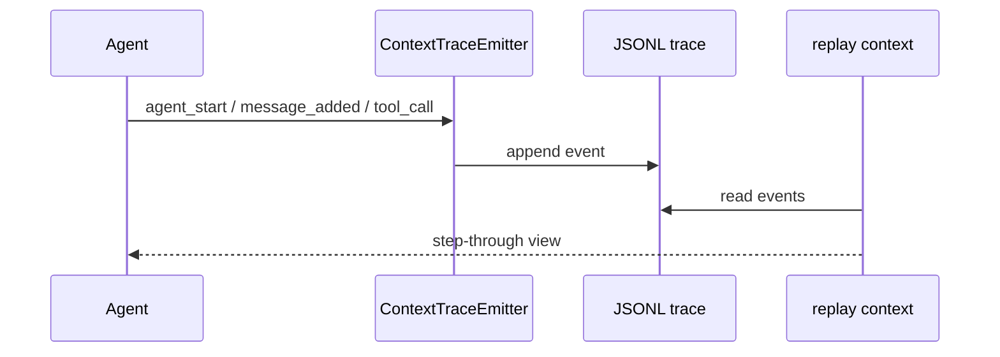

```python
from praisonaiagents import Agent

agent = Agent(name="replay-agent", instructions="Replay recorded agent sessions for debugging.")
agent.start("Replay the session from yesterday to reproduce the bug.")
```

<Note>
**Different feature from the [Run-State Journal](/features/run-state-journal).** This page is about *context replay* — recording a run's trace and stepping through it in a debugger. The **run-state journal** is about *resumable execution* — persisting the per-event cursor so a crashed run continues without re-executing tools. Pick the run-state journal for crash-safe production runs; pick context replay to inspect a completed run for debugging.
</Note>

<Note>
**Trace schema 1.1.** Every event can now carry `run_id`, `parent_seq` and `node_id`. Teams and flows record `workflow_*`, `task_*` and `step_*` events, approvals record `approval_*` events, `agent_handoff` fires on real hand-offs, and LiteLLM-path calls record `llm_request` / `llm_response` with tokens, cost, duration and model. 1.0 trace files still load unchanged.
</Note>

The user saves a trace during a run, then steps through recorded context events to debug handoffs and tools.

<Tip>
To watch a run live in the browser, or show its progress inside your own website, see [Embed Replay](/features/replay-embed).
</Tip>


Record agent context events during a run, then step through them interactively to debug handoffs, tool calls, and token growth.

```bash
praisonai recipe run my-recipe --save
praisonai replay list
praisonai replay context <session_id>
```



## Quick Start

<Steps>
<Step title="Simple Usage">

Save a trace during a recipe or workflow run:

```bash
# Recipe run with trace saving
praisonai recipe run my-recipe --save

# agents.yaml or workflow
praisonai agents.yaml --save
praisonai workflow run my-workflow --save

# List and replay
praisonai replay list
praisonai replay context <session_id>
```

</Step>

<Step title="With Configuration">

Emit traces from Python and persist to disk:

```python
from praisonai.replay import ContextTraceWriter
from praisonaiagents import ContextTraceEmitter

writer = ContextTraceWriter(session_id="my-session")
emitter = ContextTraceEmitter(sink=writer, session_id="my-session", redact=True)

emitter.session_start()
emitter.agent_start("researcher")
emitter.message_added("researcher", "user", "Find info about AI", 1, 100)
emitter.agent_end("researcher")
emitter.session_end()
writer.close()
```

</Step>
</Steps>

---

## How It Works



| Event type | Status / data | Description |
|------------|---------------|-------------|
| `session_start` / `session_end` | — | Session boundaries |
| `workflow_start` / `workflow_end` | status, graph | Team or flow run boundaries |
| `task_start` / `task_end` | `completed` / `failed` / `skipped` | Team-level task |
| `step_start` / `step_end` | `completed` / `failed` / `skipped` / `cached`, chosen route | AgentFlow step (sync, async, nested) |
| `agent_start` / `agent_end` | — | Agent lifecycle |
| `agent_handoff` | `kind`: `handoff` or `delegate` | Agent hand-off, or a hierarchical manager delegating a task |
| `message_added` | — | Context message appended |
| `tool_call_start` / `tool_call_end` | — | Tool execution |
| `llm_request` / `llm_response` | tokens, cost, duration, model | LLM calls, including the LiteLLM path (Chat Completions + Responses API, sync and async) |
| `approval_requested` / `approval_decided` | approved, reason | A person approves a tool call or task output; instant decisions stay silent |
| `context_snapshot` | — | Full context state captured |

Traces are stored as JSONL in `~/.praisonai/traces/`.

### Node ids on events

Events can carry a `node_id` that matches a node from [Graph Export](/features/graph-export), such as `task:write`, `step:draft` or `agent:Researcher`.

```python
from praisonai.replay import ContextTraceReader

for event in ContextTraceReader("my-session"):
    if event.node_id:
        print(event.node_id, event.event_type.value)
```

### Run id inheritance

Every event in a team or flow run carries the same `run_id`, and nested teams and flows inherit the outer run's id automatically.

### What's fixed

- Concurrent `Parallel` / `Loop` branches now keep their own `branch_id` and sequence numbers.
- Unknown event types are preserved when loading a trace instead of becoming `context_snapshot`.

---

## CLI Commands

| Command | Purpose |
|---------|---------|
| `praisonai replay list` | List available traces |
| `praisonai replay context <id>` | Interactive step-through |
| `praisonai replay flow <id>` | Agent flow visualisation |
| `praisonai replay show <id>` | Dump events (non-interactive) |
| `praisonai replay delete <id>` | Delete a trace |
| `praisonai replay cleanup` | Remove old traces |

### Interactive navigation

In `replay context`: `Enter`/`n` next, `p` previous, `g <N>` go to event, `q` quit.

### Filters

```bash
praisonai replay show my-session --agent researcher
praisonai replay show my-session --type agent_start
praisonai replay show my-session --json
```

---

## Common Patterns

### In-memory trace during tests

```python
from praisonaiagents import ContextTraceEmitter, ContextListSink

sink = ContextListSink()
emitter = ContextTraceEmitter(sink=sink, session_id="test-session")

emitter.session_start()
# ... agent execution ...
emitter.session_end()

for event in sink.get_events():
    print(f"{event.event_type}: {event.agent_name}")
```

### Read traces programmatically

```python
from praisonai.replay import ContextTraceReader, ReplayPlayer

reader = ContextTraceReader("my-session")
if reader.exists:
    player = ReplayPlayer(reader, use_rich=True)
    player.run()
```

### Cleanup old traces

```bash
praisonai replay cleanup --max-age 7
praisonai replay cleanup --max-size 200 --dry-run
```

---

## Best Practices

<AccordionGroup>

<Accordion title="Use meaningful session IDs">

Include a timestamp or task identifier so traces are easy to find in `replay list`.

</Accordion>

<Accordion title="Keep redaction enabled">

`redact=True` (default) strips sensitive data from persisted traces.

</Accordion>

<Accordion title="Use snapshots sparingly">

Full `CONTEXT_SNAPSHOT` events can be large — prefer message and tool events for routine debugging.

</Accordion>

<Accordion title="Run cleanup periodically">

Use `replay cleanup --max-age 7` so trace storage does not grow unbounded on developer machines.

</Accordion>

</AccordionGroup>

---

## Related

<CardGroup cols={2}>
<Card title="Run History" icon="clock-rotate-left" href="/features/run-history">
  Inspect past agent runs and session metadata
</Card>
<Card title="Observability Hooks" icon="chart-line" href="/features/observability-hooks">
  Emit structured events for external observability tools
</Card>
<Card title="Graph Export" icon="diagram-project" href="/features/graph-export">
  Draw a team or flow; its node ids match event `node_id`
</Card>
</CardGroup>
