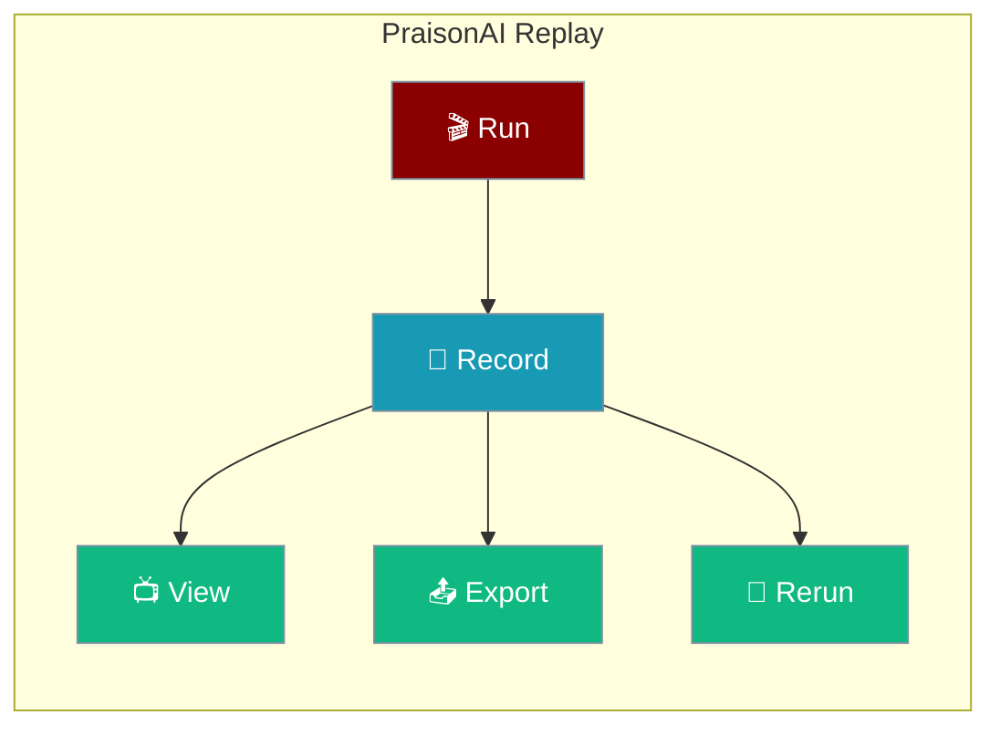
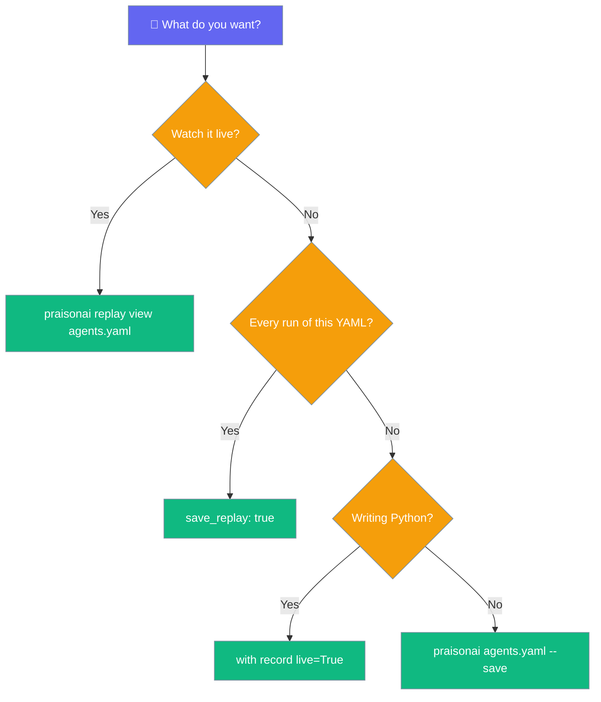
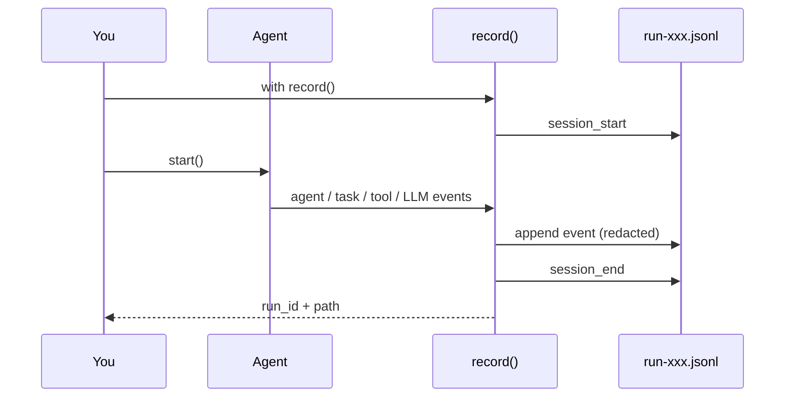

PraisonAI Replay records everything your agents do to a local file, so you can watch the run, share it, or re-run it from any step — no cloud service, no account.

```python
from praisonaiagents import Agent
from praisonai.replay import record

with record() as rec:
    Agent(name="writer", instructions="Draft a short blog post").start("AI agents")

print(rec.run_id, rec.path)
```



<Note>
**Different feature from the [Run-State Journal](/features/run-state-journal).** Replay records a run so you can inspect, share, or fork it. The run-state journal persists a cursor so a crashed run resumes without re-executing tools.
</Note>

## Quick Start

<Steps>
<Step title="Record from Python">

Wrap any agent, team, or flow in `record()`:

```python
from praisonaiagents import Agent
from praisonai.replay import record

with record(live=True) as rec:
    Agent(name="writer", instructions="Draft a short blog post").start("AI agents")

print(f"Saved {rec.run_id} to {rec.path}")
```

</Step>

<Step title="Record every run of a YAML file">

Add `save_replay: true` at the top of `agents.yaml`:

```yaml
save_replay: true
roles:
  researcher:
    role: Researcher
    goal: Collect sources
    backstory: You find what matters.
    tasks:
      research:
        description: Research the topic
        expected_output: A summary
```

```bash
praisonai agents.yaml
```

</Step>

<Step title="Record a one-off run">

Pass `--save` instead of editing the YAML:

```bash
praisonai agents.yaml --save
praisonai workflow run my-workflow --save
praisonai recipe run my-recipe --save
```

</Step>

<Step title="Look at the run">

```bash
praisonai replay list
praisonai replay view run-1a2b3c4d5e6f
```

</Step>
</Steps>

---

## Choose Your Path



| You want to… | Use |
|---|---|
| Watch a run live in the browser | `praisonai replay view agents.yaml` |
| Record every run of an `agents.yaml` | `save_replay: true` |
| Record one run from the CLI | `praisonai agents.yaml --save` |
| Full control from Python | `with record(live=True):` |

---

## How It Works



Every event is redacted before it is written, and every event carries the run id — including events from nested teams and flows.

---

## CLI Commands

| Command | Purpose |
|---------|---------|
| `praisonai replay list` | List recorded runs |
| `praisonai replay view [RUN \| agents.yaml]` | Open the browser timeline — [Replay View](/features/replay-view) |
| `praisonai replay export RUN` | HTML, JSON, Mermaid, or OTLP — [Replay Export](/features/replay-export) |
| `praisonai replay rerun RUN --from NODE` | Re-run from a step — [Replay Rerun](/features/replay-rerun) |
| `praisonai replay flow RUN \| agents.yaml` | Flow graph (`--format ascii\|json\|mermaid`) |
| `praisonai replay context RUN` | Interactive step-through in the terminal |
| `praisonai replay show RUN` | Dump events (non-interactive) |
| `praisonai replay delete RUN` | Delete a trace |
| `praisonai replay cleanup` | Remove old traces |

### Flow graph before a run

Pass a YAML file to `replay flow` to see its graph without any LLM call:

```bash
praisonai replay flow agents.yaml --format mermaid
```

A team YAML's static graph uses the same node ids its run will emit.

### Terminal step-through

In `replay context`: `Enter`/`n` next, `p` previous, `g <N>` go to event, `q` quit.

```bash
praisonai replay show run-1a2b3c4d5e6f --agent researcher
praisonai replay show run-1a2b3c4d5e6f --type agent_start
praisonai replay show run-1a2b3c4d5e6f --json
```

---

## Where Traces Live

Traces are JSONL files, one per run, found in this order:

| Priority | Location |
|---|---|
| 1 | `$PRAISONAI_TRACES_DIR` |
| 2 | `$PRAISON_HOME/traces` |
| 3 | `~/.praison/traces` (default) |

```bash
export PRAISONAI_TRACES_DIR=./traces
praisonai agents.yaml --save
```

---

## Best Practices

<AccordionGroup>

<Accordion title="Use save_replay for YAML you iterate on">

`save_replay: true` records every run, so you always have the last run to view or re-run.

</Accordion>

<Accordion title="Use live=True when watching">

`live=True` writes every event as it happens, so `praisonai replay view --live` follows the run without delay.

</Accordion>

<Accordion title="Keep exports redacted">

Recordings and exports are redacted by default — only use `--no-redact` for files that stay on your machine.

</Accordion>

<Accordion title="Run cleanup periodically">

`praisonai replay cleanup --max-age 7` keeps trace storage from growing unbounded.

</Accordion>

</AccordionGroup>

---

## Related

<CardGroup cols={2}>
<Card title="Replay View" icon="display" href="/features/replay-view">
  Watch a run live or replay it in the browser
</Card>
<Card title="Replay Export" icon="download" href="/features/replay-export">
  Self-contained HTML, JSON, Mermaid, or OTLP
</Card>
<Card title="Replay Rerun" icon="rotate" href="/features/replay-rerun">
  Re-run a recorded run from any step
</Card>
<Card title="Record API" icon="code" href="/features/replay-record-api">
  `record()` and `save_replay: true` in detail
</Card>
<Card title="Replay-Safe Retries" icon="rotate-right" href="/features/replay-safe-retries">
  Safe streaming fallback retries
</Card>
<Card title="Evaluation" icon="chart-simple" href="/concepts/evaluation">
  Score agent runs
</Card>
</CardGroup>
