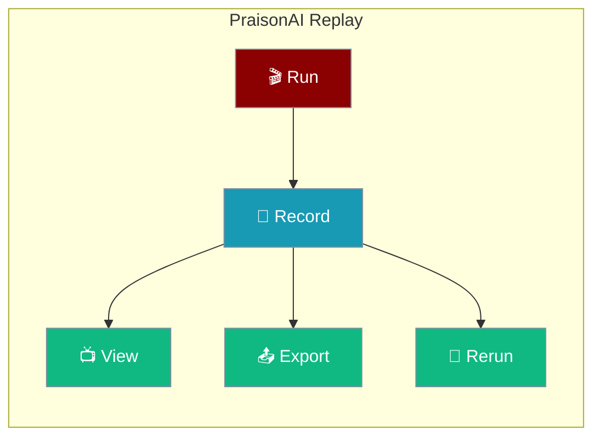
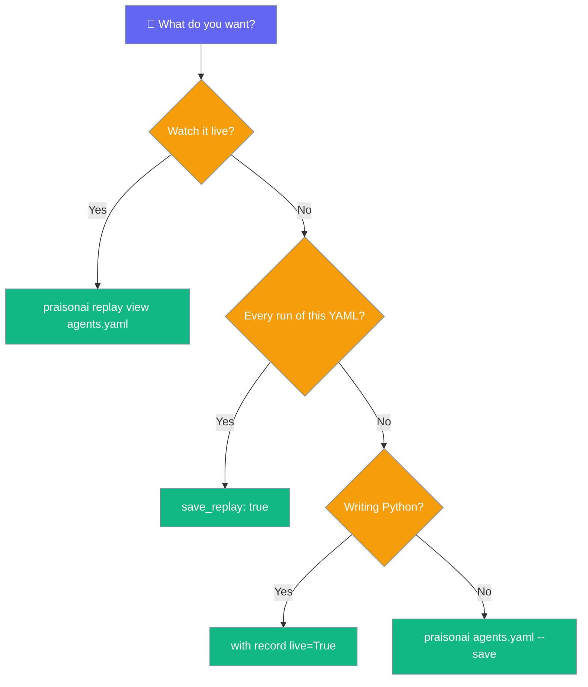
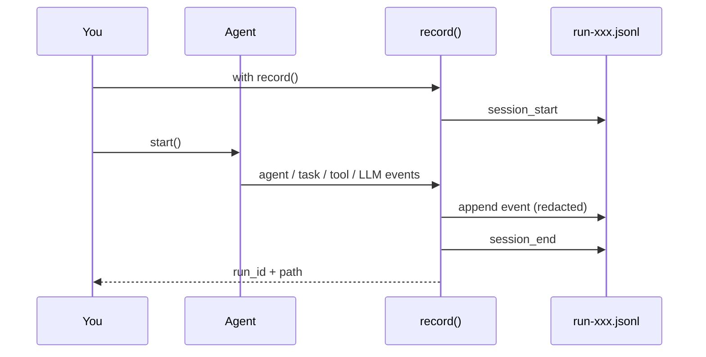

PraisonAI Replay records everything your agents do to a local file, so you can watch the run, share it, or re-run it from any step — no cloud service, no account.

```python
from praisonaiagents import Agent
from praisonai.replay import record

with record() as rec:
    Agent(name="writer", instructions="Draft a short blog post").start("AI agents")

print(rec.run_id, rec.path)
```



<Note>
**Different feature from the [Run-State Journal](/features/run-state-journal).** Replay records a run so you can inspect, share, or fork it. The run-state journal persists a cursor so a crashed run resumes without re-executing tools.
</Note>

<Note>
**Trace schema 1.1.** Every event can now carry `run_id`, `parent_seq` and `node_id`. Teams and flows record `workflow_*`, `task_*` and `step_*` events, approvals record `approval_*` events, `agent_handoff` fires on real hand-offs, and LiteLLM-path calls record `llm_request` / `llm_response` with tokens, cost, duration and model. 1.0 trace files still load unchanged.
</Note>

<Tip>
To watch a run live in the browser, or show its progress inside your own website, see [Embed Replay](/features/replay-embed).
</Tip>

## Quick Start

<Steps>
<Step title="Record from Python">

Wrap any agent, team, or flow in `record()`:

```python
from praisonaiagents import Agent
from praisonai.replay import record

with record(live=True) as rec:
    Agent(name="writer", instructions="Draft a short blog post").start("AI agents")

print(f"Saved {rec.run_id} to {rec.path}")
```

</Step>

<Step title="Record every run of a YAML file">

Add `save_replay: true` at the top of `agents.yaml`:

```yaml
save_replay: true
roles:
  researcher:
    role: Researcher
    goal: Collect sources
    backstory: You find what matters.
    tasks:
      research:
        description: Research the topic
        expected_output: A summary
```

```bash
praisonai agents.yaml
```

</Step>

<Step title="Record a one-off run">

Pass `--save` instead of editing the YAML:

```bash
praisonai agents.yaml --save
praisonai workflow run my-workflow.yaml --save
praisonai recipe run my-recipe --save
```

</Step>

<Step title="Look at the run">

```bash
praisonai replay list
praisonai replay view run-1a2b3c4d5e6f
```

</Step>
</Steps>

---

## Choose Your Path



| You want to… | Use |
|---|---|
| Watch a run live in the browser | `praisonai replay view agents.yaml` |
| Record every run of an `agents.yaml` | `save_replay: true` |
| Record one run from the CLI | `praisonai agents.yaml --save` |
| Full control from Python | `with record(live=True):` |

If your handlers set variables (`StepResult(variables={...})`), the recording captures them, and `replay rerun` restores them when it reuses earlier steps.

---

## How It Works



| Event type | Status / data | Description |
|------------|---------------|-------------|
| `session_start` / `session_end` | — | Session boundaries |
| `workflow_start` / `workflow_end` | status, graph | Team or flow run boundaries |
| `task_start` / `task_end` | `completed` / `failed` / `skipped` | Team-level task |
| `step_start` / `step_end` | `completed` / `failed` / `skipped` / `cached`, chosen route | AgentFlow step (sync, async, nested) |
| `agent_start` / `agent_end` | — | Agent lifecycle |
| `agent_handoff` | `kind`: `handoff` or `delegate` | Agent hand-off, or a hierarchical manager delegating a task |
| `message_added` | — | Context message appended |
| `tool_call_start` / `tool_call_end` | — | Tool execution |
| `llm_request` / `llm_response` | tokens, cost, duration, model | LLM calls, including the LiteLLM path (Chat Completions + Responses API, sync and async) |
| `approval_requested` / `approval_decided` | approved, reason | A person approves a tool call or task output; instant decisions stay silent |
| `context_snapshot` | — | Full context state captured |

`AGENT_END` carries `data["status"]`: `"completed"`, `"failed"` (the agent raised), or `"cancelled"`. An unnamed agent (`Agent(instructions=...)`) uses `node_id="agent:Agent"`, matching its id in `to_graph(agent)`. Both sync (`start`/`chat`) and async (`astart`/`achat`) runs record `LLM_REQUEST` / `LLM_RESPONSE`.

Streamed turns (`agent.start(..., stream=True)`) record `AGENT_START` / `AGENT_END` like `chat()`, with `agent_end` status `cancelled` when the reader stops the stream early ([PR #6087](https://github.com/MervinPraison/PraisonAI/pull/6087)).

Every event is redacted before it is written, and every event carries the run id — including events from nested teams and flows.

| Field | When | What |
|---|---|---|
| `step_end.data.variables` | A step's handler returned `StepResult(variables={...})` | The variables the step set, with secret-keyed values redacted. [Replay Rerun](/features/replay-rerun#variables-are-preserved) uses them to restore those variables. |

### Node ids on events

Events can carry a `node_id` that matches a node from [Graph Export](/features/graph-export), such as `task:write`, `step:draft` or `agent:Researcher`.

```python
from praisonai.replay import ContextTraceReader

for event in ContextTraceReader("my-session"):
    if event.node_id:
        print(event.node_id, event.event_type.value)
```

### Run id inheritance

Every event in a team or flow run carries the same `run_id`, and nested teams and flows inherit the outer run's id automatically.

### What's fixed

- Concurrent `Parallel` / `Loop` branches now keep their own `branch_id` and sequence numbers.
- Unknown event types are preserved when loading a trace instead of becoming `context_snapshot`.

---

## Node IDs & Reused Steps

Every step gets a stable `node_id` built from its name and position, so one handler reused at two positions shows up as two separate nodes.


```python
from praisonaiagents import AgentFlow

def review(ctx):
    return "ok"

def draft(ctx):
    return "drafted"

flow = AgentFlow(steps=[review, draft, review])
flow.run("go")
# step_start / step_end node_ids:
#   step:review   step:draft   step:review#2
```

| Scenario | `node_id` behaviour |
|----------|---------------------|
| Same handler at two sequential positions | Each position gets its own id (`step:review`, `step:review#2`) |
| Same handler in both `then` and `else` of `If` | Each branch gets its own id |
| Same handler in two slots of a `Loop` body | Each slot gets its own id |
| Same handler across loop **iterations** | Same id on every pass — the `#N` suffix is positional, not a run counter |
| Same pattern object (`If`, `Loop`, `Parallel`) at two positions | Each occurrence gets its own id (`step:if`, `step:if#2`) |
| `Repeat` members | Keep one id per object across repeats |

<Note>
`node_id` values never contain a UUID — they are identical across processes and runs, so they are safe to use as external identifiers in dashboards, alerts, or rerun targets.
</Note>

<Tip>
Look up a position's `node_id` without running the flow:

```python
flow.to_graph()    # node ids in graph["nodes"], e.g. step:review#2
```
</Tip>

---

## CLI Commands

| Command | Purpose |
|---------|---------|
| `praisonai replay list` | List recorded runs |
| `praisonai replay view [RUN \| agents.yaml]` | Open the browser timeline — [Replay View](/features/replay-view) |
| `praisonai replay export RUN` | HTML, JSON, Mermaid, or OTLP — [Replay Export](/features/replay-export) |
| `praisonai replay rerun RUN --from NODE` | Re-run from a step — [Replay Rerun](/features/replay-rerun) |
| `praisonai replay flow RUN \| agents.yaml` | Flow graph (`--format ascii\|json\|mermaid`) |
| `praisonai replay context RUN` | Interactive step-through in the terminal |
| `praisonai replay show RUN` | Dump events (non-interactive) |
| `praisonai replay delete RUN` | Delete a trace |
| `praisonai replay cleanup` | Remove old traces |
| `praisonai replay watch [agents.yaml]` | Open a live page with a Run button ([Embed Replay](/features/replay-embed)) |

### Flow graph before a run

Pass a YAML file to `replay flow` to see its graph without any LLM call:

```bash
praisonai replay flow agents.yaml --format mermaid
```

A team YAML's static graph uses the same node ids its run will emit.

### Terminal step-through

In `replay context`: `Enter`/`n` next, `p` previous, `g <N>` go to event, `q` quit.

```bash
praisonai replay show run-1a2b3c4d5e6f --agent researcher
praisonai replay show run-1a2b3c4d5e6f --type agent_start
praisonai replay show run-1a2b3c4d5e6f --json
```

---

## Where Traces Live

Traces are JSONL files, one per run, found in this order:

| Priority | Location |
|---|---|
| 1 | `$PRAISONAI_TRACES_DIR` |
| 2 | `$PRAISON_HOME/traces` |
| 3 | `~/.praison/traces` (default) |

```bash
export PRAISONAI_TRACES_DIR=./traces
praisonai agents.yaml --save
```

---

## Best Practices

<AccordionGroup>

<Accordion title="Use save_replay for YAML you iterate on">

`save_replay: true` records every run, so you always have the last run to view or re-run.

</Accordion>

<Accordion title="Use live=True when watching">

`live=True` writes every event as it happens, so `praisonai replay view --live` follows the run without delay.

</Accordion>

<Accordion title="Keep exports redacted">

Recordings and exports are redacted by default — only use `--no-redact` for files that stay on your machine.

</Accordion>

<Accordion title="Run cleanup periodically">

`praisonai replay cleanup --max-age 7` keeps trace storage from growing unbounded.

</Accordion>

</AccordionGroup>

---

## Related

<CardGroup cols={2}>
<Card title="Replay View" icon="display" href="/features/replay-view">
  Watch a run live or replay it in the browser
</Card>
<Card title="Replay Export" icon="download" href="/features/replay-export">
  Self-contained HTML, JSON, Mermaid, or OTLP
</Card>
<Card title="Replay Rerun" icon="rotate" href="/features/replay-rerun">
  Re-run a recorded run from any step
</Card>
<Card title="Record API" icon="code" href="/features/replay-record-api">
  `record()` and `save_replay: true` in detail
</Card>
<Card title="Replay-Safe Retries" icon="rotate-right" href="/features/replay-safe-retries">
  Safe streaming fallback retries
</Card>
<Card title="Evaluation" icon="chart-simple" href="/concepts/evaluation">
  Score agent runs
</Card>
<Card title="Graph Export" icon="diagram-project" href="/features/graph-export">
  Draw a team or flow; its node ids match event `node_id`
</Card>
</CardGroup>
