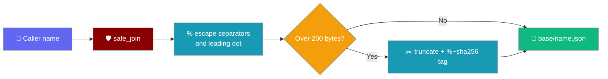

Any plan, todo list, or PRP name you pass in — even one an LLM made up — is written **inside** its storage directory. `../../x` can never escape, and ordinary names keep the exact filename they always had.



## Quick Start

<Steps>
<Step title="Let an agent name what it saves">

```python
from praisonaiagents import Agent
from praisonaiagents.planning.storage import PlanStorage
from praisonaiagents.planning.todo import TodoList

store = PlanStorage(base_path="./my_store")

def save_todo_list(name: str, tasks: list[str]) -> str:
    """Save a todo list under the given name."""
    todo = TodoList()
    for task in tasks:
        todo.add(task)
    return store.save_todo(todo, name=name)  # always inside ./my_store/todos/

agent = Agent(
    name="Planner",
    instructions="Plan tasks and save them with save_todo_list.",
    tools=[save_todo_list],
)
agent.start("Plan an auth migration and save it as 'auth/login migration'.")
```

</Step>

<Step title="Any name is confined">

```python
from praisonaiagents.planning.storage import PlanStorage
from praisonaiagents.planning.todo import TodoList

store = PlanStorage(base_path="./my_store")

store.save_todo(TodoList(), name="current")        # ./my_store/todos/current.json
store.save_todo(TodoList(), name="../../escaped")  # ./my_store/todos/%2E.%2F..%2Fescaped.json
store.save_todo(TodoList(), name="我的任务")       # ./my_store/todos/我的任务.json

# Listed names round-trip through load/delete.
for name in store.list_todos():
    assert store.load_todo(name) is not None
```

</Step>
</Steps>

---

## How It Works

Only characters that could change the path are percent-encoded: `%`, `/`, `\`, `:`, `*`, `?`, `"`, `<`, `>`, `|`, control characters, and a leading `.`. Everything else — including spaces and non-ASCII — is kept as-is.

| Input name | Resulting filename | Why |
|---|---|---|
| `current` | `current.json` | Nothing to escape — unchanged |
| `my tasks` | `my tasks.json` | Spaces and non-ASCII are kept |
| `../../x` | `%2E.%2F..%2Fx.json` | Separators and leading `.` escaped |
| `.hidden` | `%2Ehidden.json` | Leading `.` escaped |
| `a:b` | `a%3Ab.json` | Windows-reserved character escaped |
| *name over 200 UTF-8 bytes* | `<truncated>%~<sha256[:16]>.json` | Hash tag keeps it under filesystem limits and unique |

`list_todos()` decodes filenames back to the original names, so whatever it returns works with `load_todo()` and `delete_todo()`.

### Which APIs use it

| Site | Parameter | Methods |
|---|---|---|
| `PlanStorage` | `name` | `save_todo`, `load_todo`, `delete_todo` (and `list_todos` decodes) |
| `PlanStorage` | `filename` | `save_plan` (the `.md` suffix is kept) |
| `ContextAgent` | `feature_request` | `generate_feature_prp` — saved under `PRPs/`, which is now created automatically |

You can use the same helper for your own storage:

```python
from praisonaiagents.utils.atomic_io import safe_join

path = safe_join("./reports", "Q3/summary", ".md")  # ./reports/Q3%2Fsummary.md
```

<Note>
**Legacy compatibility:** todo files written before PraisonAI PR [#6239](https://github.com/MervinPraison/PraisonAI/pull/6239) with plain names are still found by `load_todo` and `delete_todo` — no migration needed.
</Note>

---

## Common Patterns

<AccordionGroup>
<Accordion title="Safe LLM-named plans" icon="robot">

```python
from praisonaiagents.planning.plan import Plan
from praisonaiagents.planning.storage import PlanStorage

store = PlanStorage()
llm_suggested_name = "../release/plan v2.md"
path = store.save_plan(Plan(name="Release"), filename=llm_suggested_name)
# -> <plans_dir>/%2E.%2Frelease%2Fplan v2.md — always under store.plans_dir
```

</Accordion>
<Accordion title="Non-ASCII todo lists" icon="language">

```python
from praisonaiagents.planning.storage import PlanStorage
from praisonaiagents.planning.todo import TodoList

store = PlanStorage()
store.save_todo(TodoList(), name="我的任务")
print(store.list_todos())   # [..., '我的任务']
store.delete_todo("我的任务")
```

</Accordion>
</AccordionGroup>

---

## Best Practices

<AccordionGroup>
<Accordion title="Pass names through unchanged" icon="check">
Don't pre-sanitise names yourself — `PlanStorage` already confines them, and extra mangling breaks the round-trip from `list_todos()`.
</Accordion>
<Accordion title="Use list_todos() for names" icon="list">
Always use names returned by `list_todos()` rather than reading filenames from disk; the listed form is the one `load_todo()` and `delete_todo()` expect.
</Accordion>
<Accordion title="Use safe_join for your own files" icon="shield-check">
When your own tool writes a file named by an LLM or user, build the path with `safe_join(base, name, suffix)` instead of `os.path.join`.
</Accordion>
</AccordionGroup>

---

## Related

<CardGroup cols={2}>
  <Card title="Planning" icon="list-check" href="/features/planning">
    Plan-then-execute agents
  </Card>
  <Card title="Todo Planning" icon="list-ol" href="/features/todo-planning">
    Agents that track todo lists
  </Card>
  <Card title="Session Store" icon="database" href="/features/session-store">
    Collision-safe session filenames
  </Card>
  <Card title="Async Bridge" icon="bridge" href="/features/async-bridge">
    Shared sync↔async bridge
  </Card>
</CardGroup>
