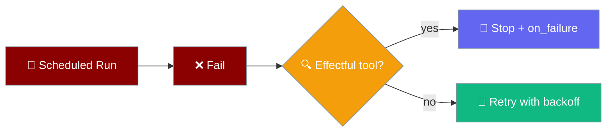
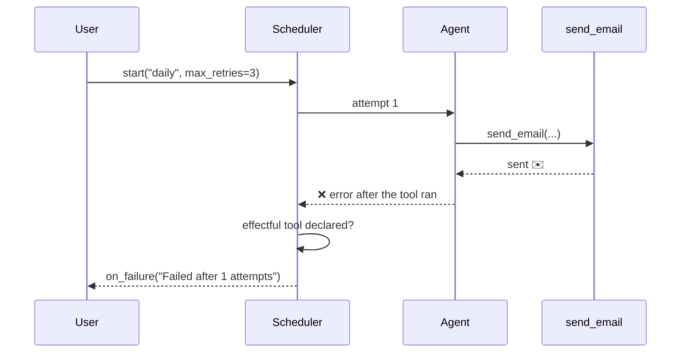
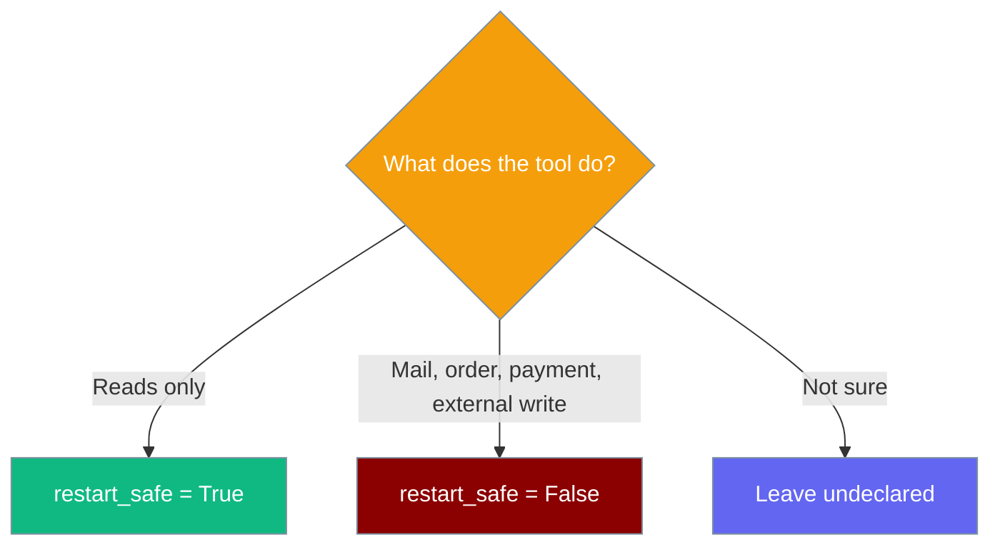

The scheduler will not re-run a failed task that may already have called an effectful tool, so one transient hiccup can never duplicate an email or double-charge a card.



## Quick Start

<Steps>
<Step title="Mark your effectful tool">
One attribute on the tool is all it takes.

```python
from praisonaiagents import Agent

def send_email(to: str, subject: str, body: str) -> str:
    """Send mail — must not be retried."""
    return f"Sent '{subject}' to {to}"

send_email.restart_safe = False  # one line is enough

agent = Agent(name="Notifier", instructions="Send the daily brief.", tools=[send_email])
```

`@tool(restart_safe=False)` from `praisonaiagents` works the same way.
</Step>

<Step title="Schedule it as usual">
No new scheduler params.

```python
from praisonai.scheduler import AgentScheduler

scheduler = AgentScheduler(agent, task="Send Alice her 9am brief", on_failure=print)
scheduler.start("daily", max_retries=3)
# A failed run is recorded and on_failure fires — the task is NOT re-run.
```
</Step>

<Step title="Keep idempotent tools retryable">
Read-only tools keep the normal retry behaviour.

```python
def fetch_report(url: str) -> str:
    """Read-only — safe to retry."""
    return f"Report from {url}"

fetch_report.restart_safe = True  # explicit opt-in to retry
```
</Step>
</Steps>

## How It Works

A scheduler retry re-runs the **whole task**, so the gate checks the agent's reachable tools before every re-run.



| Step | What happens |
|------|--------------|
| Attempt fails | The error is logged and counted |
| Gate check | Scheduler scans the agent's tools for `restart_safe=False` / `idempotent=False` |
| Unsafe | Retry loop stops; failure is recorded, state persisted, `on_failure` fires |
| Safe or undeclared | Retry with backoff, up to `max_retries` |

The gate applies to both `AgentScheduler` and `AsyncAgentScheduler`, including the async timeout path. It does not know *when* the run failed, so a declared-effectful agent is never re-run, even if the tool had not been called yet.

## What the Gate Checks

| Source of tool | Checked by the gate? |
|----------------|----------------------|
| `Agent(tools=[...])` | ✅ |
| `PraisonAIAgents(agents=[...])` — team member tools | ✅ every member's `tools` |
| `Task(tools=[...])` on a team | ✅ every task's `tools` |
| `ToolConfig(allow_global_tools=True)` — registry tools | ✅ registry scanned when the flag is set on any member |
| Undeclared tool (no `restart_safe` / `idempotent`) | ⏭️ Treated as safe to retry (backward-compatible) |

Per tool, `idempotent` is checked first, then `restart_safe`; the first boolean wins.

## What You See on a Blocked Retry

```
ERROR praisonai.scheduler: Agent execution failed on attempt 1: <error>
ERROR praisonai.scheduler: Not retrying: the agent has an effectful tool (restart_safe=False) that may already have run
ERROR praisonai.scheduler: Agent execution failed after 1 attempts
```

`on_failure` receives `"Failed after 1 attempts"`. The count reflects **actual** attempts, not `max_retries`.

## Which Flag Should I Set?



Leaving a tool undeclared keeps the old retry behaviour — a transient error after the side effect may duplicate it, so `restart_safe = False` is the safer choice for anything effectful.

## Best Practices

<AccordionGroup>
<Accordion title="Declare restart_safe on anything that touches the outside world">
Email, payments, orders, and external writes should all carry `restart_safe = False`. Undeclared tools are retried.
</Accordion>
<Accordion title="Expect actual attempt counts">
The failure message reports attempts actually made (`"Failed after 1 attempts"`), not the configured `max_retries`.
</Accordion>
<Accordion title="Team, task, and registry tools all count">
One effectful tool anywhere in the agent's reachable toolset blocks the whole-task retry.
</Accordion>
<Accordion title="Pair with the per-turn gate">
[Replay-Safe Retries](/features/replay-safe-retries) protects a single turn's provider call; this gate protects the scheduler's whole-task retry.
</Accordion>
</AccordionGroup>

## Related

<CardGroup cols={2}>
<Card title="Replay-Safe Retries" icon="shield-check" href="/features/replay-safe-retries">
  Per-turn provider-call gate
</Card>
<Card title="Tool Retry & Backoff" icon="rotate" href="/features/tool-retry-backoff">
  Per-tool retry inside a single turn
</Card>
<Card title="Async Agent Scheduler" icon="clock" href="/features/async-agent-scheduler">
  Async-native scheduled agents
</Card>
<Card title="Tools" icon="wrench" href="/features/tools">
  Create and attach tools to agents
</Card>
</CardGroup>
