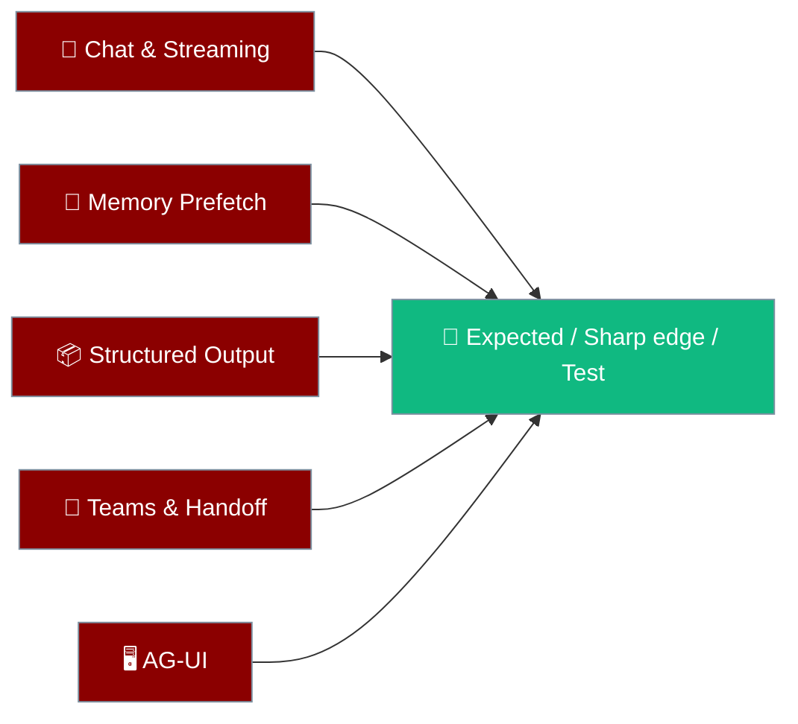

The SDK Behavior Matrix lists what each popular knob does, where it surprises people, and which test proves it.



<Info>
Scope: `praisonaiagents` Python API, `main` branch. Test paths are relative to `src/praisonai-agents/`. Source of truth is the code plus the listed tests — if a docstring disagrees with this page, trust the test, then fix whichever is stale.
</Info>

<Note>
If your app disagrees with a row, check the **Sharp edge** column and reproduce on the real call path before filing a bug.
</Note>

## Quick Start

<Tabs>
<Tab title="Streaming">
```python
from praisonaiagents import Agent, OutputConfig

agent = Agent(
    name="Writer",
    instructions="Write a short story.",
    output=OutputConfig(stream=True),
)

for chunk in agent.start("Write a one-paragraph story about a lantern."):
    print(chunk, end="")
```
</Tab>
<Tab title="Memory Prefetch">
```python
from praisonaiagents import Agent, MemoryConfig

agent = Agent(
    name="Assistant",
    instructions="Help the user.",
    memory=MemoryConfig(prefetch=True, user_id="alice"),
)

agent.chat("Remind me what we decided about the launch date.")
```
</Tab>
<Tab title="Structured Output">
```python
from pydantic import BaseModel
from praisonaiagents import Agent

class Topic(BaseModel):
    title: str
    summary: str

agent = Agent(name="Topics", instructions="Return one topic.")
topic = agent.chat("Suggest an AI research topic.", output_pydantic=Topic)
print(topic.title)
```
</Tab>
<Tab title="Teams & Handoff">
```python
from praisonaiagents import Agent, Task, AgentTeam

researcher = Agent(name="Researcher", instructions="Find facts.")
writer = Agent(name="Writer", instructions="Summarise findings.", handoffs=[researcher])

team = AgentTeam(
    agents=[researcher, writer],
    tasks=[Task(description="Write a one-paragraph brief on fusion.", agent=writer)],
)
team.start()
```
</Tab>
<Tab title="AG-UI">
```python
from fastapi import FastAPI
from praisonaiagents import Agent
from praisonaiagents.ui import AGUI

agent = Agent(name="Helper", instructions="Help the user.")

app = FastAPI()
app.include_router(AGUI(agent=agent).get_router())
# run with: uvicorn file:app --port 8080
```
</Tab>
</Tabs>

---

## How to Use This Page

<Steps>
<Step title="Find the knob">
Locate the API in the matching section below.
</Step>
<Step title="Run the listed test">
From the SDK's `src/praisonai-agents/` directory: `PYTHONPATH=. python -m pytest <test> -q`
</Step>
<Step title="Read the result">
Test fails: likely an SDK defect, open a bug. Test passes but behavior differs: it is a sharp edge or a new bug.
</Step>
</Steps>

---

## 1. Chat & Streaming

Streaming is configured through `output=`, not a constructor kwarg. `Agent(stream=True)` raises `TypeError` with the hint *"streaming moved into output=; use output=OutputConfig(stream=True)."* `agent.stream` is `False` unless `output="stream"` or `OutputConfig(stream=True)` is used.

| API / knob | Expected behavior | Sharp edge | Test |
| --- | --- | --- | --- |
| `chat(prompt, stream=None)` | Inherits `agent.stream`. Returns the final `str` (or model, see §3). | Never a generator. | `tests/unit/agent/test_execution_api.py` |
| `chat(stream=True)` | Tokens go to `agent.stream_emitter`; the call still returns the full `str`. If the adapter cannot stream (`"Streaming is not supported"`) or the stream attempt fails transiently, it falls back to a non-streaming call. | `None` is **not** a valid "streaming succeeded" result (#5737). `LLMError`, `ToolExecutionError`, other `ValueError`s and post-dispatch tool-turn failures are **not retried** by the fallback. Of these, only `ToolExecutionError` reaches the caller; the rest roll back history and `chat()` returns `None` (see below). | `tests/test_chat_explicit_stream_fallback.py`, `tests/test_streaming_fallback_kwargs.py` |
| `chat(stream=False)` | Single non-streaming completion; no stream events. | — | `tests/unit/test_stream_preset.py` |
| `start(prompt)` | Stream priority: explicit kwarg > `agent.stream` > TTY. When streaming, returns a **generator** of chunks; otherwise a `str`. | Because `agent.stream` is always a bool, the TTY fallback only applies if `agent.stream` is set to `None`. Output guardrails are not applied to streamed chunks. | `tests/unit/agent/test_execution_api.py` |
| `run(prompt)` | Never streams unless `stream=True` is passed; returns `str`. | Ignores TTY. | `tests/unit/agent/test_execution_api.py::TestAgentRunMethod::test_run_ignores_tty_detection` |
| `iter_stream(prompt)` | Always a generator of chunks. Runs `rate_limiter.acquire()` and `BEFORE_AGENT` hooks before the first chunk. | — | `tests/unit/agent/test_execution_api.py::TestAgentIterStreamMethod::test_iter_stream_always_streams` |
| `achat()` / `astart()` | Same `stream` resolution as `chat()`; awaits and returns the final `str`. | Unlike `start()`, `astart()` never returns an (async) generator. | `tests/unit/agent/test_achat_unified_dispatch.py`, `tests/unit/agent/test_execution_api.py::TestAsyncMethods::test_astart_streams_in_tty` |

<Warning>
**When `chat()` / `achat()` return `None`:** input guardrail or `BEFORE_AGENT` hook blocked the run, or the LLM call failed with anything other than `ToolExecutionError` (history is rolled back and the error is displayed/logged, not raised). Check for `None` rather than relying on `try/except` around `chat()`. An **output** guardrail rejection returns a fixed refusal string, not `None`; see `agent.last_guardrail_error`.
</Warning>

---

## 2. Memory Prefetch & Scope

Prefetch recalls relevant long-term memories into the prompt before each turn.

| API / knob | Expected behavior | Sharp edge | Test |
| --- | --- | --- | --- |
| `MemoryConfig(prefetch=True)` — sync (`_prefetch_memory`) | Before each turn, searches long-term memory with up to 5 terms (verbatim prompt → significant words → salient single words), stopping at the first non-empty hit. Results are injected into the **system prompt** under `## Recalled memories`, capped by `prefetch_limit` (5) and `prefetch_token_budget` (512, truncated with `…`). | Off by default. Errors are swallowed (debug log) and inject nothing. | `tests/unit/memory/test_prefetch.py` |
| Same — async (`_aprefetch_memory`) | Same terms, stop rule, scope and formatting via `asearch_memory`. | Backends with only `.search()` (no `search_long_term`) are searched by the sync path but not the async path. | `tests/unit/memory/test_prefetch.py::test_async_prefetch_falls_back_to_significant_tokens` |
| `MemoryConfig(user_id=...)` | Agents sharing a `user_id` share a store and recall each other's turns. Search is scoped by `user_id` + `session_id`, not `agent_id`. | Without `user_id`, each Agent gets a random `agent-<uuid>` id (warning logged) — memory is **isolated per instance**. There is no `Agent(user_id=...)` kwarg. | `tests/test_memory_cross_session.py` |

---

## 3. Structured Output

`output_pydantic` / `output_json` are per-call `chat()` / `achat()` kwargs (forwarded by `start()` / `run()`) and `Task` fields — not `Agent` constructor params. There is no `output_json_schema`. Native `response_format` is used when the model supports structured outputs; otherwise the schema is appended to the prompt as text.

| API / knob | Expected behavior | Sharp edge | Test |
| --- | --- | --- | --- |
| `chat(..., output_pydantic=Model)` | Returns a `Model` **instance** (tries strict JSON, fenced \`\`\`json, then first `{...}` in prose). | On parse failure, logs a warning and returns the **raw string** — no exception, no retry. Check `isinstance`. | `tests/unit/agents/test_chat_output_pydantic_coercion.py` |
| `chat(..., output_json=Model)` | Returns a JSON **string**. | Never a `dict` — call `json.loads` yourself. | `tests/unit/agents/test_chat_output_pydantic_coercion.py::test_chat_output_json_stays_string` |
| `Task(output_pydantic=Model)` in a team | `TaskOutput.pydantic` holds the instance; `output_format="Pydantic"`. | Fails closed: invalid output is a failed task (`Structured output validation failed ...`), which drives the retry loop. Setting both `output_json` and `output_pydantic` raises `ValueError`. | `tests/unit/agents/test_output_pydantic_policy.py` |
| `Task(output_json=Model)` in a team | `TaskOutput.json_dict` holds the parsed `dict`; `output_format="JSON"`. | Same fail-closed rule. | `tests/unit/agents/test_output_pydantic_policy.py::test_output_json_prose_is_not_success` |
| Native vs text schema | `response_format` (strict) for capable models; prompt injection otherwise. | Provider-dependent. | `tests/test_native_structured_outputs.py` |

---

## 4. Teams & Handoff

Teams run tasks in order; handoffs let one agent delegate to another.

| API / knob | Expected behavior | Sharp edge | Test |
| --- | --- | --- | --- |
| `AgentTeam(agents, tasks=[Task, ...])` | Accepts a list/tuple of `Task`. Sequential tasks are chained. `start()` returns the last task's `.raw` string (`return_dict=True` → `{"task_status", "task_results"}`). | `tasks="..."` → `TypeError: AgentTeam.tasks must be a list of Task instances, not str. ...`; `tasks=[]` → `ValueError: If tasks are provided, at least one task must be present`; non-`Task` item → `TypeError: tasks[i] must be a Task instance, got <type>`. | `tests/unit/agents/test_agentteam_task_validation.py` |
| `AgentTeam(agents)` (no tasks) | One task auto-generated per agent. | Empty `agents` fails at `start()`, not construction. | `tests/unit/agents/test_agentteam_task_validation.py::test_tasks_none_auto_generates` |
| `Agent(handoffs=[other])` | Adds a `transfer_to_<name>` tool; the model decides whether to call it. Tool returns `"Handoff successful. <name> response: ..."`. | The model may not call the tool — that is a prompt issue, not a crash. Cycles/depth (`max_depth=10`) return an `"Error: ..."` string to the model rather than raising. Timeout (300 s) applies to async handoffs only. | `tests/test_handoff_compatibility.py`, `tests/unit/test_handoff_unified.py` |

---

## 5. AG-UI

AG-UI exposes an agent as a FastAPI router that streams events over SSE.

| API / knob | Expected behavior | Sharp edge | Test |
| --- | --- | --- | --- |
| `AGUI(agent=...).get_router()` | Returns a FastAPI `APIRouter`; mount it with `app.include_router(...)`. `POST {prefix}/agui` → SSE (`text/event-stream`); `GET {prefix}/status` → `{"status": "available"}`. | AGUI has no built-in server or default port — you run uvicorn and own startup/shutdown. `AGUI()` with no agent raises `ValueError`. | `tests/agui/test_agui.py`, `tests/agui/test_router.py` |
| SSE events | `RUN_STARTED` → `TEXT_MESSAGE_*` / `TOOL_CALL_*` → `RUN_FINISHED`; exceptions become `RUN_ERROR`. | Multi-agent (`agents=`) sends the whole result as one text message, not token stream. Event order and `RUN_ERROR` emission over the endpoint are **not pinned** by a test; the router test only checks that a failing agent still yields HTTP 200. | `tests/agui/test_streaming.py::TestRunLifecycleEvents` (event construction), `tests/agui/test_router.py::TestAGUIEndpointErrorHandling::test_agui_endpoint_handles_agent_error` (HTTP only) |

---

## Best Practices

<AccordionGroup>
<Accordion title="Check for None after chat()">
`chat()` returns `None` on blocked runs and most LLM failures instead of raising.
</Accordion>
<Accordion title="Verify structured output with isinstance">
`chat(output_pydantic=...)` returns the raw string on parse failure, so confirm the type before use.
</Accordion>
<Accordion title="Set user_id for shared memory">
Without `MemoryConfig(user_id=...)`, each agent instance has its own isolated memory.
</Accordion>
<Accordion title="Run the pinned test first">
A passing test with differing behavior points to a sharp edge, not an SDK defect.
</Accordion>
</AccordionGroup>

---

## Keeping This Page in Sync

Any PR that changes the behavior of a listed API should update the matching row (and its test) here and in the upstream copy at `src/praisonai-agents/docs/sdk-behavior-matrix.md`.

---

## Related

<CardGroup cols={2}>
<Card title="Streaming" icon="wave-square" href="/features/streaming">
Stream tokens as they arrive
</Card>
<Card title="Memory Prefetch" icon="brain" href="/features/memory-prefetch">
Recall memories before each turn
</Card>
<Card title="Structured Output" icon="code" href="/features/structured">
Get typed results from agents
</Card>
<Card title="Multi-Agent Output" icon="users" href="/features/multi-agent-output">
Control team output
</Card>
<Card title="AG-UI Server" icon="display" href="/deploy/servers/agui">
Serve agents over AG-UI
</Card>
<Card title="Handoff" icon="right-left" href="/sdk/praisonaiagents/handoff/handoff">
Delegate between agents
</Card>
</CardGroup>
