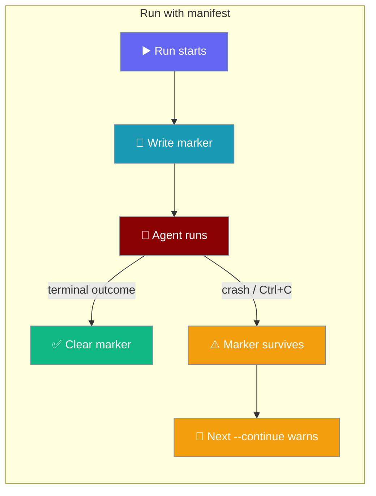

Session manifests let `praisonai run` tell you when a previous run on the same session was interrupted.

```bash
praisonai run "ship the auth fix" --session feat-auth
# ... crash or Ctrl+C mid-turn ...

praisonai run "ship the auth fix" --continue
# ⚠ The previous run in this session was interrupted (attempt 1); re-issue it to retry.
```



## Quick Start

<Steps>
<Step title="Nothing to enable">
Every `praisonai run` on a session already writes the marker — no setup required.

```bash
praisonai run "ship the auth fix" --session feat-auth
```

Auto-saved runs (no `--session`) are tracked too. Only `--no-save` runs without a session skip the manifest.
</Step>

<Step title="See an interrupted run surface">
If the run dies before finishing, the next launch on that session warns you:

```bash
praisonai run "ship the auth fix" --continue
# ⚠ The previous run in this session was interrupted (attempt 1); re-issue it to retry.
# ... the retry crashes too ...

praisonai run "ship the auth fix" --continue
# ⚠ The previous run in this session was interrupted (attempt 2); re-issue it to retry.
```

After 3 interrupted attempts at the same task, the stale run is abandoned and the counter restarts at 1.
</Step>
</Steps>

---

## How It Works

`praisonai run` writes a "run in flight" marker before the agent starts and clears it in its `finally` block.

```mermaid
sequenceDiagram
    participant User
    participant CLI as praisonai run
    participant Manifest as FileSessionManifest
    participant FS as disk

    User->>CLI: praisonai run "fix bug" --session feat-x
    CLI->>Manifest: begin_run(session, run_id, run_input)
    Manifest->>FS: atomic write (temp + fsync + os.replace)
    CLI->>CLI: agent runs
    Note over CLI: process crashes before finally
    User->>CLI: praisonai run "fix bug" --continue
    CLI->>Manifest: interrupted(session)
    Manifest-->>CLI: ManifestEntry(attempt=1)
    CLI-->>User: "previous run was interrupted (attempt 1); re-issue it to retry"
```

| Aspect | Behaviour |
|--------|-----------|
| File location | `<sessions-dir>/projects/<project-id>/manifests/<session_id>.json` (scoped per project) |
| What's stored | Run id, status, attempt count, timestamp, and a SHA-256 digest of the prompt — **never the prompt text** |
| Cleared on | Success (`"completed"`) or an error that ends the run (`"ended"`) |
| Kept on | Hard crash, OOM, or Ctrl+C — so the next launch reports it |
| `--output json` | Warning is suppressed so stdout stays valid JSON |
| Failures | Manifest errors are swallowed and never block a run |
| No manifest | Missing directory, unreadable file, or old session store behaves exactly as before |

---

## Configuration

The manifest has no settings to turn on; advanced users can drive it directly from `praisonaiagents.session`.

### `FileSessionManifest`

```python
from praisonaiagents.session import FileSessionManifest

manifest = FileSessionManifest()  # defaults to ~/.praisonai/sessions/manifests/
```

| Option | Type | Default | Description |
|--------|------|---------|-------------|
| `directory` | `Optional[str]` | `None` | Where manifest files live. `None` uses `<sessions-dir>/manifests`. Pass a scoped directory if your session store is scoped (the CLI uses `get_project_sessions_dir() / "manifests"`). |

| Method | Signature | Purpose |
|--------|-----------|---------|
| `get` | `(session_id: str) -> Optional[ManifestEntry]` | Read the last recorded entry, or `None`. |
| `begin_run` | `(session_id: str, run_id: str, run_input: Optional[str] = None, max_attempts: int = 3) -> ManifestEntry` | Commit the write-ahead in-flight marker. |
| `end_run` | `(session_id: str, status: str, run_id: Optional[str] = None) -> Optional[ManifestEntry]` | Release the marker with a terminal status. With `run_id`, only that run's own marker is released. |
| `interrupted` | `(session_id: str) -> Optional[ManifestEntry]` | Return the entry if the last run never reached a terminal outcome, else `None`. |

`SessionManifestProtocol` is the runtime-checkable protocol these methods define. `DEFAULT_MAX_ATTEMPTS = 3`.

### `ManifestEntry`

| Field | Type | Default | Description |
|-------|------|---------|-------------|
| `session_id` | `str` | — | The session this entry belongs to. |
| `run_id` | `Optional[str]` | `None` | Id of the most recent run. |
| `run_status` | `Optional[str]` | `None` | `"running"` while in flight; the terminal status (e.g. `"completed"`, `"ended"`) once released. |
| `run_in_flight` | `bool` | `False` | `True` while a run holds the marker. |
| `run_digest` | `Optional[str]` | `None` | SHA-256 of `run_input` (never the plaintext). |
| `attempt` | `int` | `0` | Current attempt count of the in-flight task. |
| `updated_at` | `float` | `0.0` | Unix timestamp of the last write. |

---

## Common Patterns

### Retry an interrupted run

Re-issue the same prompt — the matching digest counts it as the next attempt.

```bash
praisonai run "ship the auth fix" --continue
```

### Start a different task on the same session

A different prompt is a new task, so `attempt` restarts at 1.

```bash
praisonai run "write release notes" --session feat-auth
```

### Use `FileSessionManifest` from a custom runner

```python
import uuid
from praisonaiagents import Agent
from praisonaiagents.session import FileSessionManifest

agent = Agent(name="Assistant", instructions="You are a helpful assistant")
manifest = FileSessionManifest()
session_id, prompt = "my-session", "fix the bug"

stale = manifest.interrupted(session_id)
if stale:
    print(f"Previous run was interrupted (attempt {stale.attempt})")

run_id = uuid.uuid4().hex[:12]
manifest.begin_run(session_id, run_id, run_input=prompt)
try:
    agent.start(prompt)
    manifest.end_run(session_id, "completed", run_id=run_id)
except Exception:
    manifest.end_run(session_id, "ended", run_id=run_id)
    raise
```

A crash or Ctrl+C skips both `end_run` calls, so the marker survives for the next launch.

---

## Best Practices

<AccordionGroup>
<Accordion title="Treat the warning as a hint, not a hard block">
Re-issuing is always safe; the run just counts up `attempt`.
</Accordion>
<Accordion title="Don't put secrets in the session id">
The session id becomes part of the manifest filename (sanitised, but visible).
</Accordion>
<Accordion title="The manifest never stores prompt text">
The manifest file keeps only a SHA-256 digest of the prompt. Conversation history saved by the session store is separate and still contains your messages.
</Accordion>
<Accordion title="Three strikes, then reset">
After `max_attempts` (default 3), the stale run is abandoned and the attempt counter restarts. Change the budget per call via `FileSessionManifest.begin_run(..., max_attempts=N)`.
</Accordion>
</AccordionGroup>

---

## Related

<CardGroup cols={2}>
<Card title="Session Resume" icon="rotate" href="/persistence/session-resume">
  Continue conversation history across sessions.
</Card>
<Card title="Persistence Overview" icon="database" href="/persistence/overview">
  How PraisonAI stores conversation, state, and knowledge.
</Card>
</CardGroup>
