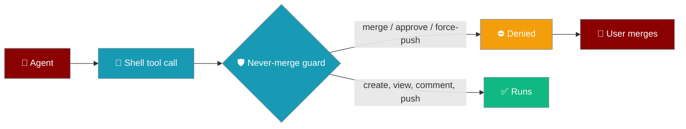
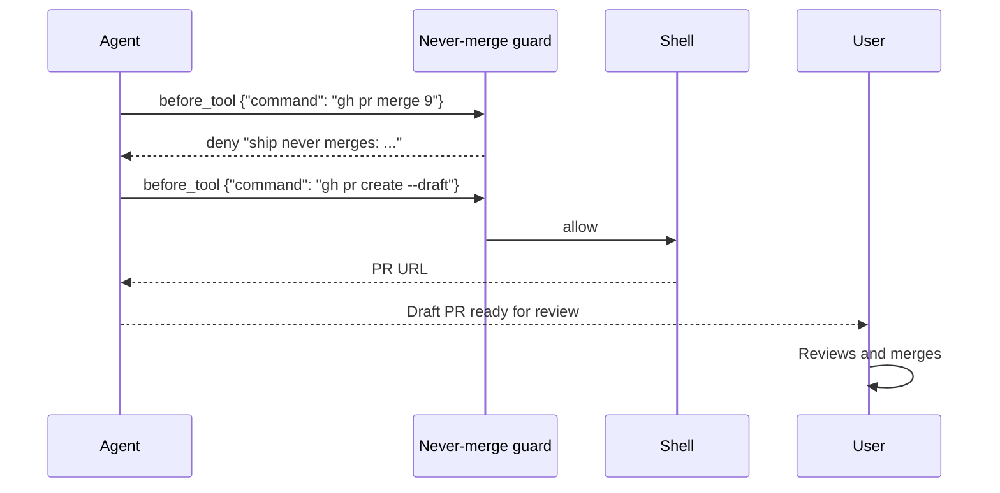
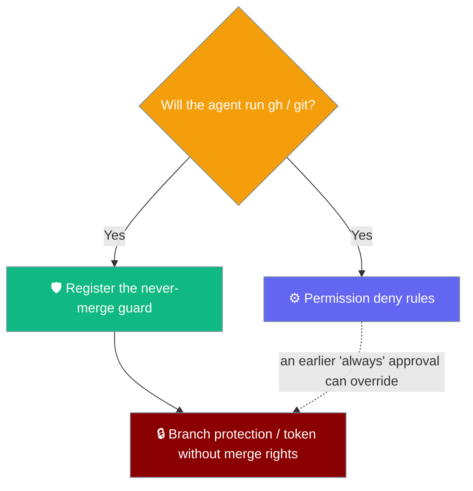

The never-merge guard stops an agent from merging a PR, approving one, enabling auto-merge, or force-pushing — the user does those.



## Quick Start

<Steps>
<Step title="Register the guard on an agent">

```bash
pip install praisonai-code
```

```python
from praisonaiagents import Agent
from praisonaiagents.hooks import HookRegistry
from praisonaiagents.tools import execute_command
from praisonai_code.ship.guard import register_never_merge

hooks = HookRegistry()
register_never_merge(hooks)

agent = Agent(
    name="ship",
    instructions="Commit my changes, open a draft PR and watch its checks.",
    tools=[execute_command],
    hooks=hooks,
)
agent.start("Ship my changes")
```

Any shell call such as `gh pr merge 9 --auto` is blocked before it runs; `gh pr create --draft` runs normally.

</Step>
<Step title="Check a command without an agent">

```python
from praisonai_code.ship.guard import forbidden_reason

forbidden_reason("gh pr merge 12")   # "merging a pull request is left to the user"
forbidden_reason("git push -f")      # "force-pushing is left to the user"
forbidden_reason("gh pr view 12")    # None
```

</Step>
</Steps>

---

## How It Works



The hook reads the `command`, `cmd` or `script` value of any tool call, splits it with the same parser used by [command-aware permissions](/features/command-aware-permissions), and refuses it if any part falls into one of these categories:

| Category | Refused because |
|----------|-----------------|
| Merge | `gh pr merge`, or a `gh api` call to `.../merge`, `.../merges`, or the `mergePullRequest` mutation |
| Approve | `gh pr review --approve` / `-a`, or an API review with `event=APPROVE` |
| Auto-merge | the `enablePullRequestAutoMerge` GraphQL mutation |
| Force-push | `git push` with `-f`, `--force`, `--force-with-lease`, `--force-if-includes`, `--mirror`, or a `+` refspec |

Because the command is parsed, wrapping it does not help: `cd repo && gh pr merge 5`, `echo ok; git push -f`, `bash -c 'gh pr merge 5'` and `/usr/bin/gh pr merge 5` are all refused.

| API | What it does |
|-----|--------------|
| `forbidden_reason(command)` | Returns the reason a shell command is refused, or `None` if it may run |
| `never_merge_hook(data)` | `before_tool` hook — returns `HookResult.deny(...)` or `HookResult.allow()` |
| `register_never_merge(registry)` | Adds the hook as `"ship_never_merge"` with `sequential=True`, `priority=0`; returns the hook id |

---

## Choosing a Protection



| Option | Use it for |
|--------|-----------|
| Never-merge guard | Safe default for any agent that touches PRs |
| [Permission rules](/features/declarative-permissions) | General allow/deny — persistent "always" approvals are checked first, so not recommended for merges |
| Branch protection / scoped token | The real backstop — enforced by GitHub, not by a string filter |

---

## Refused vs Allowed

These lists match the SDK test suite.

**Refused**

| Category | Commands |
|----------|----------|
| PR merge | `gh pr merge 12`, `gh pr merge --auto --squash`, `gh -R owner/repo pr merge 3` |
| API merge | `gh api -X PUT repos/o/r/pulls/1/merge`, `gh api repos/o/r/pulls/1/merge?x=1 -X PUT`, `gh api repos/o/r/merges -f base=main -f head=feat` |
| PR approval | `gh pr review 12 --approve`, `gh pr review -a`, `gh pr review 12 --approve=true`, `gh pr review 12 -ab 'lgtm'` |
| API approval | `gh api repos/o/r/pulls/1/reviews -f event=APPROVE` |
| GraphQL mutations | `mergePullRequest`, `enablePullRequestAutoMerge`, `addPullRequestReview` with `event:APPROVE` |
| Body from file | `gh api graphql --input merge.json`, `gh api graphql -F query=@merge.graphql`, `gh api repos/o/r/pulls/1/reviews --input review.json` |
| Force-push | `git push --force`, `git push -f origin feat`, `git push -uf origin feat`, `git push --force-with-lease origin feat`, `git push origin +HEAD:main`, `git -C /tmp/x push origin +feat` |
| Indirection | `cd repo && gh pr merge 5`, `echo ok; git push -f`, `bash -c 'gh pr merge 5'`, `/usr/bin/gh pr merge 5` |

**Allowed**

| Category | Commands |
|----------|----------|
| PR create / read | `gh pr create --draft --fill`, `gh pr view 12 --json statusCheckRollup`, `gh pr checks 12` |
| Comment-only reviews | `gh pr review 12 --comment -b 'looks fine'`, `gh pr review 12 -c -bapproved`, `gh api repos/o/r/pulls/1/reviews -f event=COMMENT -f body=done` |
| API reads | `gh api repos/o/r/pulls/1/comments`, `gh api repos/o/r/pulls/1/reviews`, `gh api repos/o/r/pulls/1/merge-queue-status`, `gh api graphql -f query='{viewer{login}}'` |
| Thread resolution | `gh api graphql -f query='mutation{resolveReviewThread(...){thread{id}}}'` |
| Normal git | `git push origin feat`, `git push -u origin feat`, `git merge origin/main`, `git commit -m 'merge base in'` |

---

## Common Patterns

**Ship agent: commit, draft PR, watch checks**

```python
from praisonaiagents import Agent
from praisonaiagents.hooks import HookRegistry
from praisonaiagents.tools import execute_command
from praisonai_code.ship.guard import register_never_merge

hooks = HookRegistry()
register_never_merge(hooks)

agent = Agent(
    name="ship",
    instructions=(
        "Commit staged work, push the branch, open a draft PR with "
        "`gh pr create --draft --fill`, then poll `gh pr checks`. Never merge."
    ),
    tools=[execute_command],
    hooks=hooks,
)
agent.start("Ship the current branch")
```

**Review agent: comment, never approve**

```python
agent = Agent(
    name="reviewer",
    instructions="Review PR 12 and post findings with `gh pr review 12 --comment -b ...`.",
    tools=[execute_command],
    hooks=hooks,  # --approve / -a is refused, --comment runs
)
agent.start("Review PR 12")
```

**Alongside permission rules** — keep your [declarative permissions](/features/declarative-permissions) for everyday allow/deny, and register the guard on the same agent so merges stay blocked even after an "always" approval.

---

## Best Practices

<AccordionGroup>
<Accordion title="Always combine with branch protection">
The guard is a rail, not a wall: a string filter cannot see every form, for example `python -c "os.system('gh pr merge 1')"`. Pair it with a branch-protection rule that requires a human approval, or a token without merge rights.
</Accordion>
<Accordion title="Prefer the hook over a permission rule for merges">
Hooks run before the permission store, so an earlier "always" approval of `bash:gh pr *` cannot let a merge through.
</Accordion>
<Accordion title="Keep it first in the chain">
`register_never_merge` registers at `priority=0` with `sequential=True`, so it runs first and stops the chain on deny. If you wire `never_merge_hook` yourself, keep those settings.
</Accordion>
<Accordion title="Do not work around --input refusals">
A GraphQL query or review body read from a file or stdin (`--input`, `-F x=@file`) cannot be inspected, so the guard refuses it. Pass the body inline instead.
</Accordion>
</AccordionGroup>

---

## Related

<CardGroup cols={2}>
  <Card title="Hooks" icon="webhook" href="/features/hooks">
    Hook system overview
  </Card>
  <Card title="Hook Events" icon="list" href="/features/hook-events">
    The before_tool event and its input
  </Card>
  <Card title="Command-Aware Permissions" icon="shield-halved" href="/features/command-aware-permissions">
    The command parser the guard reuses
  </Card>
  <Card title="Declarative Permissions" icon="shield" href="/features/declarative-permissions">
    When a permission rule is the better fit
  </Card>
</CardGroup>
