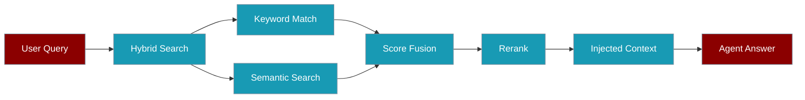
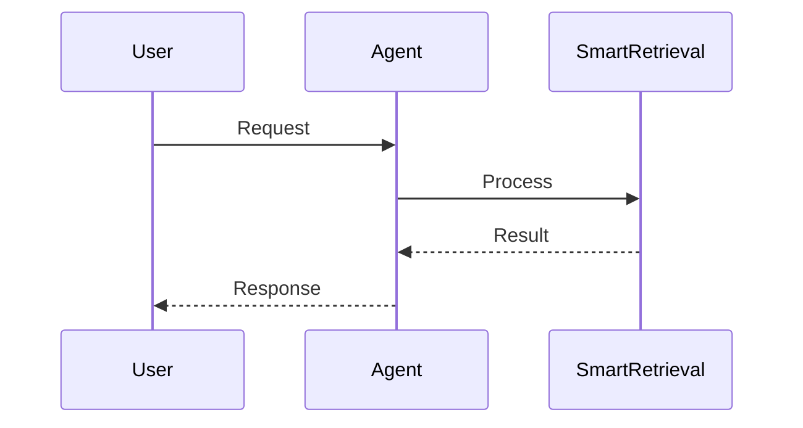
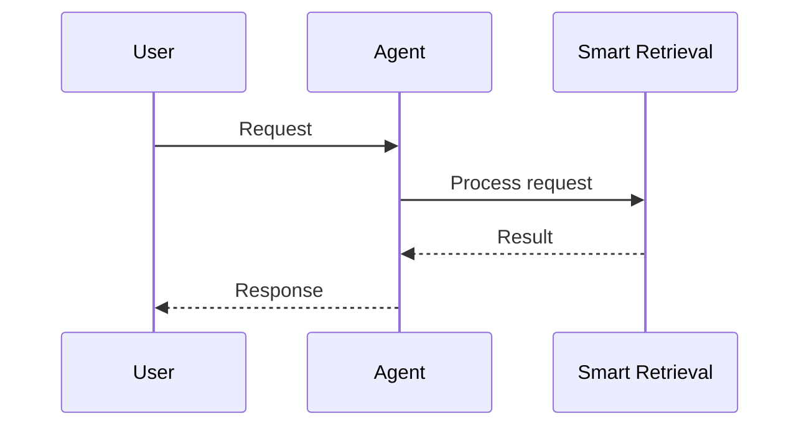
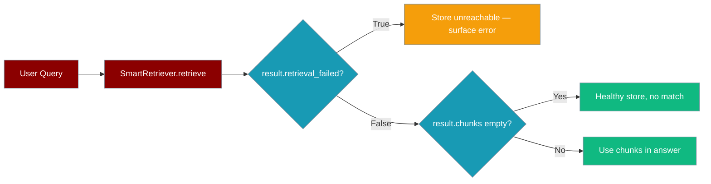

Give agents sharper answers from large knowledge bases by combining keyword matching, semantic search, and reranking.

```python
from praisonaiagents import Agent

agent = Agent(
    name="Research Agent",
    instructions="Answer from the knowledge base.",
    knowledge={"sources": ["docs/"], "retrieval_k": 10, "rerank": True},
)
response = agent.start("How does API authentication work?")
```

The user asks a question; hybrid retrieval and reranking surface the best knowledge snippets.



## How It Works




## Quick Start

<Steps>
<Step title="Simple Usage">

Enable reranking on the agent's knowledge config:

```python
from praisonaiagents import Agent

agent = Agent(
    name="Research Agent",
    instructions="Answer from the knowledge base.",
    knowledge={"sources": ["docs/"], "retrieval_k": 10, "rerank": True},
)
response = agent.start("How does API authentication work?")
```

</Step>

<Step title="With Configuration">

Use `KnowledgeConfig` for chunking, vector store, and rerank model:

```python
from praisonaiagents import Agent, KnowledgeConfig

agent = Agent(
    name="Research Agent",
    instructions="Answer from the knowledge base.",
    knowledge=KnowledgeConfig(
        sources=["docs/"],
        retrieval_k=10,
        rerank=True,
        rerank_model="cohere/rerank-english-v3.0",
    ),
)
response = agent.start("How does API authentication work?")
```

</Step>
</Steps>

---

## How It Works




| Stage | What it does |
|-------|--------------|
| **Keyword search** | Fast lexical matching (BM25-style) |
| **Semantic search** | Embedding similarity over chunks |
| **Score fusion** | Combines keyword and semantic scores |
| **Reranking** | Re-scores top candidates for relevance |

Strategy selection scales with corpus size — see [Retrieval Strategies](/features/retrieval-strategies).

---

## Advanced: SmartRetriever

For direct control over retrieval strategy and filters, use `SmartRetriever` with a `Knowledge` instance:

```python
from praisonaiagents import Knowledge
from praisonaiagents.rag import SmartRetriever

knowledge = Knowledge(sources=["docs/"])
retriever = SmartRetriever(knowledge=knowledge)

result = retriever.retrieve(
    query="API authentication method",
    strategy="reranked",
    top_k=5,
)

for chunk in result.chunks:
    print(chunk.get("text", "")[:100])
```

When any of `include_glob`, `exclude_glob`, `path_filter`, or `metadata_filters` is set, SmartRetriever pulls `max(fetch_k, top_k * 10)` chunks from the store before filtering. A document that matches the filter is not dropped just because its unfiltered score sat below `top_k`.

```python
result = retriever.retrieve(
    "API authentication method",
    top_k=5,
    include_glob=["*.md"],
)
# Even if only a few *.md files score high in the store,
# SmartRetriever over-fetches so it can return five *.md matches.
```

### Invalid filter regex raises `ValueError`

An invalid `path_filter` regex fails closed instead of quietly returning unfiltered data.

```python
try:
    retriever.retrieve("q", path_filter="([unclosed")
except ValueError as e:
    # Fails closed on an invalid regex instead of silently
    # returning every chunk while still reporting a filtered result.
    print(e)
```

### Multi-hop queries with SubQuestionEngine

`SubQuestionEngine` splits a question into sub-questions and retrieves context for each one with your `SmartRetriever`.

```python
from praisonaiagents import Knowledge
from praisonaiagents.rag import SmartRetriever
from praisonaiagents.knowledge.query_engine import SubQuestionEngine

retriever = SmartRetriever(knowledge=Knowledge(sources=["docs/"]))
result = SubQuestionEngine().query(
    "How does API auth differ between v1 and v2?",
    retriever=retriever,
)
print(result.sources)
```

`SubQuestionEngine` accepts any retriever that returns either a list of chunks or a `RetrievalResult` with a `.chunks` attribute, so `SmartRetriever` and `Knowledge`-style retrievers are interchangeable.

---

## Detect Retrieval Failures

An empty result can mean two very different things: the store is healthy but nothing matched, or the store is unreachable and the agent is about to answer from memory alone.

```python
from praisonaiagents import Knowledge
from praisonaiagents.rag import SmartRetriever

retriever = SmartRetriever(knowledge=Knowledge(sources=["docs/"]))
result = retriever.retrieve("refund policy", top_k=5)

if result.retrieval_failed:
    # The vector store is unreachable, misconfigured or refusing auth.
    # The agent is about to answer without its knowledge base.
    print(f"Knowledge retrieval failed: {result.error}")
elif not result.chunks:
    # Store is healthy, just no match for this query.
    print("No matching documents.")
else:
    for chunk in result.chunks:
        print(chunk.get("text", "")[:100])
```

`RetrievalResult` carries two fields that make the difference visible:

| Field | Type | Meaning |
|-------|------|---------|
| `retrieval_failed` | `bool` | `True` when the store raised — unreachable, misconfigured, or refusing auth |
| `error` | `str \| None` | The store's error message (also mirrored on `metadata["retrieval_error"]`) |

`chunks` stays `[]` on failure, so nothing downstream breaks — these two fields are the only way to tell "nothing matched" from "the store is down".

<Note>
The retriever logs at `ERROR` on `praisonaiagents.rag.retriever` the first time a store call fails, so operators see it in application logs even when the caller only reads `chunks`. Store errors are per-call: concurrent `retrieve()` calls on the same `SmartRetriever` cannot see each other's error state.
</Note>



---

## CLI Usage

```bash
praisonai knowledge search "API authentication" --rerank --top-k 10
```

---

## Best Practices

<AccordionGroup>
<Accordion title="Enable rerank for large corpora">
Reranking adds latency but improves relevance once you have hundreds of chunks. Start with `rerank=True` when answers feel noisy.
</Accordion>

<Accordion title="Tune retrieval_k before reranking">
Fetch more candidates (`retrieval_k=10–20`) so the reranker has enough to choose from, then let the agent inject the top results.
</Accordion>

<Accordion title="Use hybrid strategies at scale">
For technical docs with exact terms, rely on automatic strategy selection — hybrid and reranked modes combine keyword and semantic signals.
</Accordion>

<Accordion title="Scope by user or agent">
Pass `user_id` or `agent_id` to `SmartRetriever.retrieve()` when isolating knowledge per tenant or sub-agent.
</Accordion>

<Accordion title="Handle retrieval failure explicitly">
Check `result.retrieval_failed` before answering. When it's `True`, tell the user the answer is not grounded in the knowledge base — or refuse — because a confidently wrong answer with no signal is exactly the failure this guards against.
</Accordion>
</AccordionGroup>

---

## Related

<CardGroup cols={2}>
<Card title="Retrieval Strategies" icon="route" href="/features/retrieval-strategies">
  Automatic strategy selection by corpus size
</Card>
<Card title="Retrieval Configuration" icon="magnifying-glass" href="/features/retrieval">
  Configure retrieval behaviour on agents
</Card>
</CardGroup>
