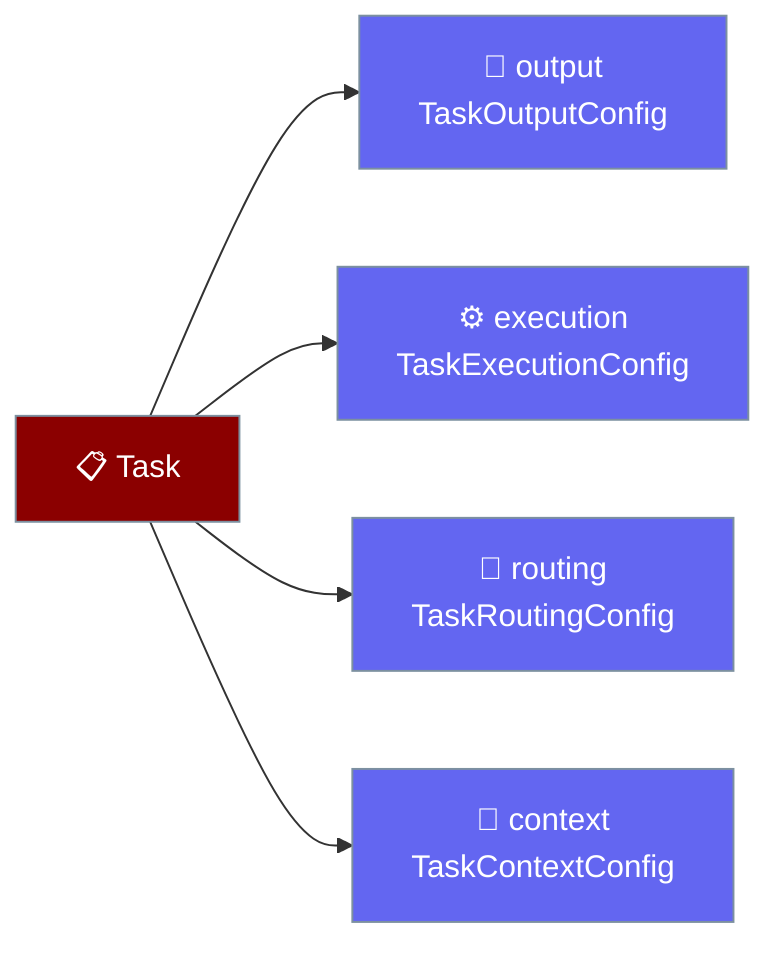
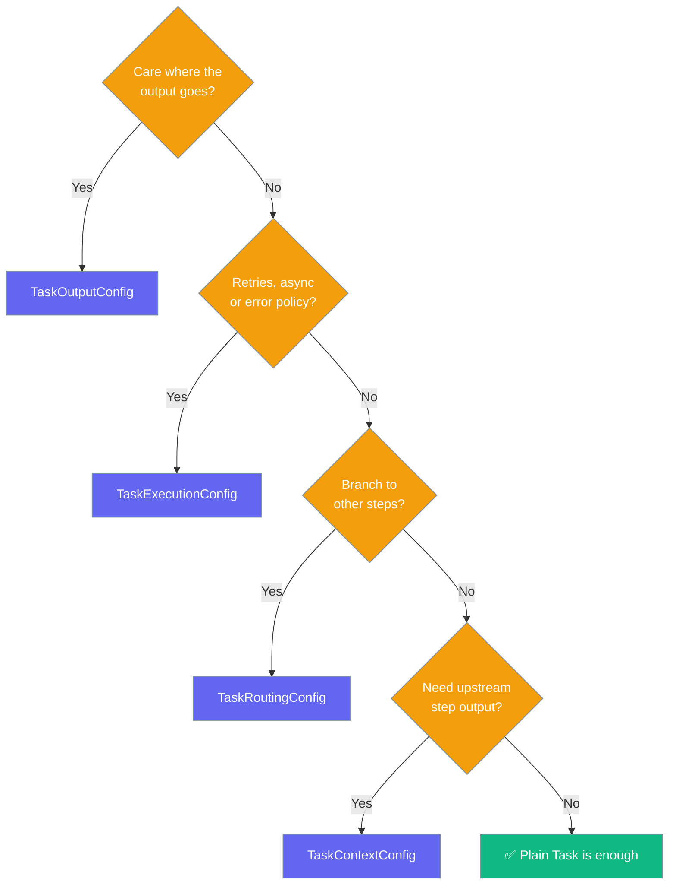

Four small config objects keep a `Task` tidy. Each one groups a few settings you could otherwise pass as separate arguments.

```python
from praisonaiagents import Agent, Task
from praisonaiagents.workflows import TaskOutputConfig

analyst = Agent(name="Analyst", instructions="Summarise reports clearly.")

task = Task(
    description="Summarise the quarterly report",
    agent=analyst,
    output=TaskOutputConfig(file="summary.md", variable="summary"),
)
```



The flat arguments (`output_file=`, `max_retries=`, …) keep working. Use whichever reads better.

## Quick Start

<Steps>
<Step title="Plain arguments">
```python
from praisonaiagents import Agent, Task

analyst = Agent(name="Analyst", instructions="Summarise reports clearly.")

task = Task(
    description="Summarise the quarterly report",
    agent=analyst,
    output_file="summary.md",
)
```
</Step>

<Step title="One config object">
```python
from praisonaiagents import Agent, Task
from praisonaiagents.workflows import TaskOutputConfig

analyst = Agent(name="Analyst", instructions="Summarise reports clearly.")

task = Task(
    description="Summarise the quarterly report",
    agent=analyst,
    output=TaskOutputConfig(file="summary.md"),
)
```
</Step>

<Step title="All four">
```python
from praisonaiagents import Agent, Task
from praisonaiagents.workflows import (
    TaskOutputConfig,
    TaskExecutionConfig,
    TaskRoutingConfig,
    TaskContextConfig,
)

analyst = Agent(name="Analyst", instructions="Summarise reports clearly.")

task = Task(
    name="summarise",
    description="Summarise the quarterly report",
    agent=analyst,
    output=TaskOutputConfig(file="summary.md", variable="summary"),
    execution=TaskExecutionConfig(max_retries=2, on_error="stop"),
    routing=TaskRoutingConfig(next_steps=["review"]),
    context=TaskContextConfig(from_steps=["ingest"], retain_full=False),
)
```
</Step>
</Steps>

---

## Configuration Options

All four live in `praisonaiagents.workflows`.

### `TaskOutputConfig` → `output=`

| Option | Type | Default | Description |
|---|---|---|---|
| `file` | `Optional[str]` | `None` | Save the result to this file |
| `json_model` | `Optional[Any]` | `None` | Pydantic model for JSON output |
| `pydantic_model` | `Optional[Any]` | `None` | Pydantic model for a typed result |
| `variable` | `Optional[str]` | `None` | Store the result as a workflow variable |

### `TaskExecutionConfig` → `execution=`

| Option | Type | Default | Description |
|---|---|---|---|
| `async_exec` | `bool` | `False` | Run the task asynchronously |
| `quality_check` | `bool` | `True` | Check the output quality |
| `rerun` | `bool` | `True` | Allow the task to run again |
| `max_retries` | `int` | `3` | Retry attempts on failure |
| `on_error` | `str` | `"stop"` | `"stop"`, `"continue"` or `"retry"` |

<Note>
`TaskExecutionConfig.rerun` defaults to `True`, while the flat `Task(rerun=...)` defaults to `False`. Passing a `TaskExecutionConfig` applies its `rerun` value unless you also set `rerun=True` directly.
</Note>

### `TaskRoutingConfig` → `routing=`

| Option | Type | Default | Description |
|---|---|---|---|
| `next_steps` | `Optional[List[str]]` | `None` | Steps to run next |
| `branches` | `Optional[Dict[str, List[str]]]` | `None` | Map a decision to the steps it leads to |

### `TaskContextConfig` → `context=`

| Option | Type | Default | Description |
|---|---|---|---|
| `from_steps` | `Optional[List[str]]` | `None` | Steps whose output this task receives |
| `retain_full` | `bool` | `True` | Pass all prior task outputs, not just the previous one |

### Runtime state — do not set

`status`, `result`, `id`, `retry_count` and `loop_state` are filled in by the framework while the task runs. They are accepted for backward compatibility; leave them at their defaults.

---

## Which one do I need?



---

## Best Practices

<AccordionGroup>
<Accordion title="Start with plain arguments">
A `Task` with just `description` and `agent` covers most cases. Reach for a config object only when you set two or more related options.
</Accordion>

<Accordion title="Don't mix flat and grouped for the same setting">
Setting both `output_file=` and `output=TaskOutputConfig(file=...)` makes it unclear which wins. Pick one style per setting.
</Accordion>

<Accordion title="Name tasks you route to">
`next_steps`, `branches` and `from_steps` refer to tasks by `name`, so give those tasks a `name=`.
</Accordion>
</AccordionGroup>

---

## Related

<CardGroup cols={2}>
  <Card title="Task Context Control" icon="link" href="/features/task-context-control">
    Control what upstream output a task sees
  </Card>
  <Card title="Task Retry Policy" icon="rotate" href="/features/task-retry-policy">
    Retries and error handling for tasks
  </Card>
  <Card title="Task Output Variables" icon="brackets-curly" href="/features/task-output-variables">
    Pass results between tasks as variables
  </Card>
  <Card title="Tool Error Handling" icon="shield-check" href="/features/tool-error-handling">
    How raised tool errors reach the agent
  </Card>
</CardGroup>
