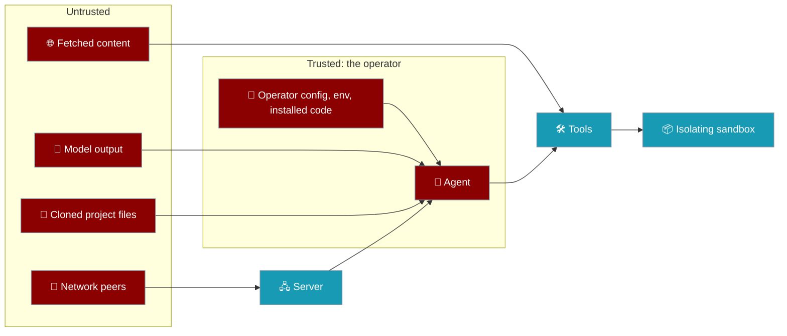

PraisonAI trusts you, the operator, and treats everything the model reads or writes as untrusted. This page shows where that line sits, so you know which settings protect you and which only prevent accidents.



## Trust boundaries

<CardGroup cols={2}>
  <Card title="Trusted" icon="user-check">
    The operator, their user-level config and environment variables, and code they install or register: packages, plugins, tools, hooks.
  </Card>
  <Card title="Untrusted" icon="triangle-exclamation">
    Model output, tool results, fetched web content, project files in a repository you did not write, and anyone who connects to a PraisonAI server.
  </Card>
</CardGroup>

A vulnerability is untrusted input crossing to the trusted side without your consent: running code, reading or writing files you did not allow, reaching secrets, or acting through a server without authorisation.

## Not a security boundary

<Warning>
These features reduce accidents. They do **not** contain hostile code. Do not rely on them to run code you would not run yourself.
</Warning>

| Feature | Why it is not a boundary |
|---------|--------------------------|
| Python code execution: `ExecutionConfig(code_mode=...)` set to `"safe"`, `"unsafe"` or `"isolated"`, `PythonTools`, and inline Python steps in job workflows (`praisonai-code`) | Runs on your machine as your OS user, in the agent process or a local subprocess. Restricted builtins, import filters and resource limits are guard rails, not isolation. |
| TypeScript `codeMode` tool | Runs in a Node.js `vm` context, which is not a sandbox. |
| String-based shell command filters, including CLI `SandboxExecutor` in `praisonai-code` and the TypeScript SDK | Allow or deny patterns over a command line can be worded around. Every `SandboxExecutor` mode (`basic`, `strict`, `network_isolated`) checks the command text and runs it on the host — mode names describe filtering, not isolation. |

A way around these is a hardening bug. Report it as a normal public issue, not a security advisory.

## Run untrusted code in an isolating sandbox

When the model writes code, or the code comes from someone else, run it in a backend from `praisonai-sandbox` that isolates it from your machine.

```bash
pip install "praisonai-sandbox[docker]"
```

| Backend | Where code runs |
|---------|-----------------|
| `docker` | A local container |
| `sandlock` | A Landlock and seccomp sandbox (Linux) |
| `e2b`, `modal`, `daytona`, `novita` | A remote cloud sandbox |
| `ssh` | A remote machine you control |
| `subprocess` / `local` (`LocalCompute`) | Your machine, as your user: **not isolation** |

## Network servers

Agents can be served over HTTP, MCP, A2A and AG-UI. Bind addresses differ between entry points, and some default to all interfaces, so set the host yourself.

<Steps>
  <Step title="Bind to loopback">
    Use `host="127.0.0.1"` unless other machines must reach the server.
  </Step>
  <Step title="Put a token in front of anything exposed">
    Use the server's token option, or an authenticating reverse proxy.
  </Step>
</Steps>

```python
from praisonaiagents import Agent

agent = Agent(instructions="Answer questions")
agent.launch(port=8000)  # HTTP, binds to 127.0.0.1 by default
```

`Agent.launch()` over HTTP binds to `127.0.0.1` by default. On any other address it requires a bearer token: set `PRAISONAI_LAUNCH_AUTH_TOKEN`, or one is generated and printed at start-up.

## Reporting a vulnerability

<Note>
Report privately at [github.com/MervinPraison/PraisonAI/security/advisories/new](https://github.com/MervinPraison/PraisonAI/security/advisories/new). The full policy is in [SECURITY.md](https://github.com/MervinPraison/PraisonAI/blob/main/SECURITY.md).
</Note>

<AccordionGroup>
  <Accordion title="What a report needs" icon="clipboard-check">
    - A working proof of concept against the latest release, in its default configuration.
    - One report per root cause.
    - A way around an earlier fix goes on the original advisory, not a new report.
    - Scanner or AI-tool output without a tested proof of concept is closed.
  </Accordion>
  <Accordion title="Response targets" icon="clock">
| Step | Target |
|------|--------|
| Acknowledge | 2 working days |
| Decision | 14 days |
| Fix for a confirmed high or critical issue | 30 days |

    Maintainers assign severity with CVSS 3.1, scored against the default configuration.
  </Accordion>
  <Accordion title="Other repositories" icon="code-branch">
    `praisonai-platform` and PraisonAI UI (`aiui`) take reports in their own repositories: [praisonai-platform](https://github.com/MervinPraison/praisonai-platform) and [PraisonAIUI](https://github.com/MervinPraison/PraisonAIUI).
  </Accordion>
</AccordionGroup>

## Related

<CardGroup cols={2}>
  <Card title="Security" icon="shield-check" href="/security">
    Security policy, hardening and best practices
  </Card>
  <Card title="Security Environment Variables" icon="key" href="/features/security-environment-variables">
    Opt-in switches for risky features
  </Card>
</CardGroup>
