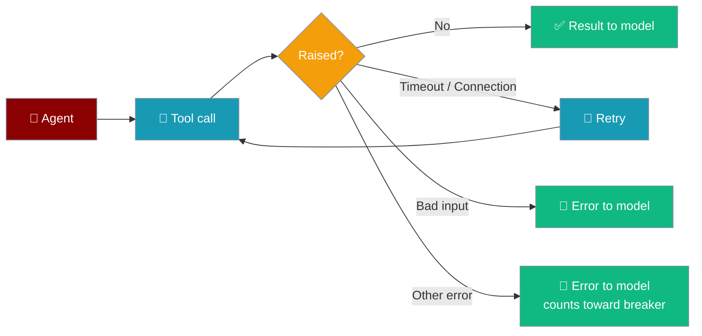
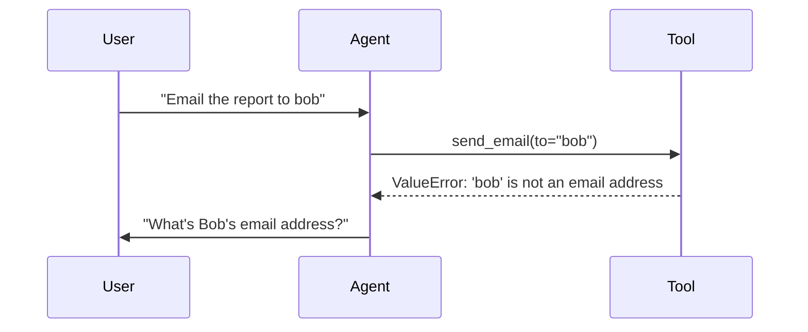

When a tool raises an exception, the error goes back to the model as the tool result. The agent can then fix its arguments, try another tool, or explain the problem.

```python
from praisonaiagents import Agent

def fetch_price(ticker: str) -> float:
    """Get the latest price for a stock ticker."""
    if not ticker:
        raise ValueError("ticker must be non-empty")  # the model sees this
    return 189.5

agent = Agent(
    name="Trader",
    instructions="Look up prices and summarise.",
    tools=[fetch_price],
)

agent.start("What's AAPL at?")
```



## Quick Start

<Steps>
<Step title="Just raise">
Raise a normal Python exception from your tool. No wrapper needed.

```python
from praisonaiagents import Agent

def send_email(to: str) -> str:
    """Send an email to a recipient."""
    if "@" not in to:
        raise ValueError(f"'{to}' is not an email address")
    return f"sent to {to}"

agent = Agent(name="Mailer", tools=[send_email])
agent.start("Email the report to bob")
```

The model gets the `ValueError` text and can ask for a real address instead of the turn ending.
</Step>

<Step title="Tune transient retries">
Timeouts and connection errors retry with backoff. Change the policy with `ToolConfig`:

```python
from praisonaiagents import Agent
from praisonaiagents.config import ToolConfig
from praisonaiagents.tools import RetryPolicy

agent = Agent(
    name="Fetcher",
    tools=[fetch_price],
    tool_config=ToolConfig(retry_policy=RetryPolicy(max_attempts=5)),
)
```
</Step>
</Steps>

---

## How It Works

Every raised exception is sorted into one of three buckets:

| Bucket | Exceptions | Retried? | Counts toward circuit breaker? |
|---|---|---|---|
| **Transient** | `TimeoutError`, `ConnectionError`, or any class with `Timeout` / `Connection` in its name (covers `requests`, `httpx`, `aiohttp`) | Yes, then reported to the model | Yes |
| **Bad input** | `ValueError`, `TypeError`, `AttributeError`, `LookupError`, `FileNotFoundError`, `FileExistsError`, `IsADirectoryError`, `NotADirectoryError`, `PermissionError` | No — runs once | No |
| **Other** | Anything else | No — runs once | Yes |

In every bucket the error ends up as the tool result the model sees. A raising tool does not end the turn.



### Wrong arguments

If the model calls a tool with bad arguments, it sees the error and can call again with fixed arguments. This works the same on every provider route.

### Text-based retry

`RetryPolicy.retry_on` still matches error text. An error like `"429 too many requests"` is classed as `rate_limit` and retried by default. A tool whose *raised* message only looks like a rate limit is not mistaken for a model error.

### Sync and async

`chat()`, `achat()`, `start()` and `astart()` behave the same way.

### Durable runs

The error is recorded as the tool's result and the run carries on — it is not finalized `failed` because a tool raised. See [Durable Tool Runs](/features/durable-tool-runs).

---

## Configuration Options

Retries are controlled by `RetryPolicy` (from `praisonaiagents.tools`), passed via `ToolConfig(retry_policy=...)`.

| Option | Type | Default | Description |
|---|---|---|---|
| `max_attempts` | `int` | `3` | Total tries for a transient error |
| `backoff_factor` | `float` | `2.0` | Delay multiplier per attempt |
| `initial_delay_ms` | `int` | `1000` | First retry delay |
| `max_delay_ms` | `int` | `30000` | Delay ceiling |
| `retry_on` | `Set[str]` | `{"timeout", "rate_limit", "connection_error"}` | Error types that retry |
| `jitter` | `bool` | `False` | Randomise delays |
| `jitter_factor` | `float` | `0.25` | Jitter range (±25%) |

---

## Migrating

Before, a raising tool often ended the turn with `ToolExecutionError`, and the model never saw what went wrong. Now the model sees it.

- If you caught `ToolExecutionError` around `agent.start()` to detect tool failures, check the agent's answer or the tool's own result instead.
- If a tool must stop the whole run, return a clear answer from the tool or use a [guardrail](/features/guardrails) rather than relying on an exception to abort.

---

## Best Practices

<AccordionGroup>
<Accordion title="Write helpful error messages">
The model reads your exception text. Say what was wrong and what a valid value looks like: `"ticker must be a symbol like AAPL"`.
</Accordion>

<Accordion title="Raise ValueError for bad input">
Bad-input errors run once and don't trip the circuit breaker, so one wrong call never blocks the tool for others.
</Accordion>

<Accordion title="Let network errors raise">
Don't swallow `TimeoutError` or `requests` / `httpx` connection errors. Letting them raise gives you free retries with backoff.
</Accordion>

<Accordion title="Mark side-effect tools restart_safe=False">
A tool that charges money or sends messages should be declared non-idempotent so even a transient error never runs it twice. See [Durable Tool Runs](/features/durable-tool-runs).
</Accordion>
</AccordionGroup>

---

## Related

<CardGroup cols={2}>
  <Card title="Tool Retry Policy" icon="rotate" href="/features/tool-retry-policy">
    Configure retry attempts and backoff
  </Card>
  <Card title="Tool Circuit Breaker" icon="plug-circle-xmark" href="/features/tool-circuit-breaker">
    Stop calling a failing tool
  </Card>
  <Card title="Durable Tool Runs" icon="database" href="/features/durable-tool-runs">
    Resumable runs and side-effect safety
  </Card>
  <Card title="Tool Retry & Backoff" icon="clock" href="/features/tool-retry-backoff">
    How backoff delays are computed
  </Card>
</CardGroup>
