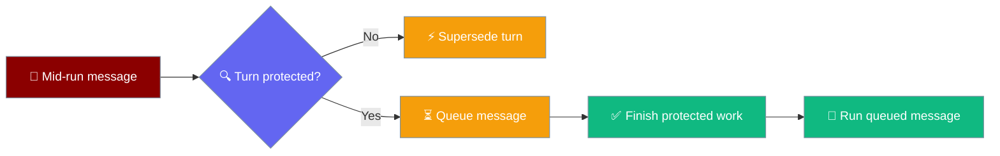
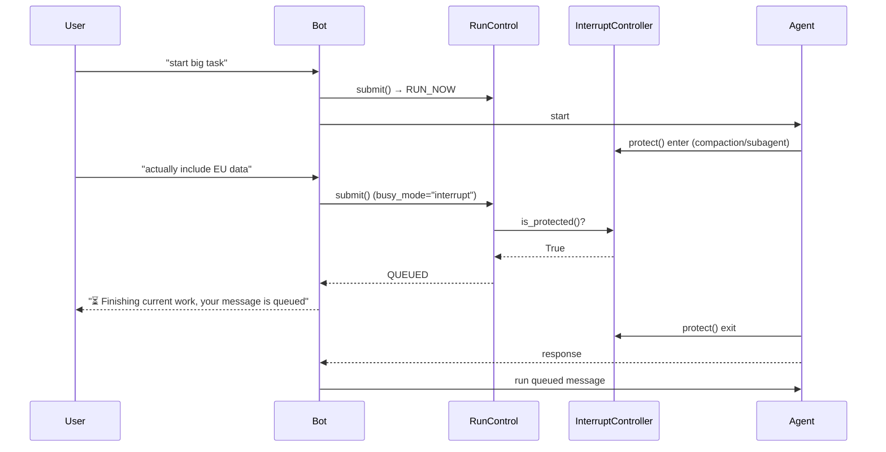

A turn-protection window tells the bot gateway to queue new user messages instead of cancelling the running turn, while critical in-flight work — a foreground subagent or context compaction — finishes.



## Quick Start

<Steps>
<Step title="Nothing to configure">
Foreground subagents and context compaction open the window automatically. Use `busy_mode="interrupt"` on your bot as before:

```python
from praisonaiagents import Agent
from praisonai.bots import TelegramBot

agent = Agent(name="Assistant", instructions="You are a helpful assistant")
bot = TelegramBot(token="YOUR_TOKEN", agent=agent, busy_mode="interrupt")
```

Messages that land while a subagent or compaction is running are queued with "⏳ Finishing current work, your message is queued".
</Step>
<Step title="Protect your own code (advanced)">
```python
from praisonaiagents.agent.interrupt import protect_turn

with protect_turn(getattr(agent, "interrupt_controller", None)):
    do_critical_work()
```

`protect_turn(None)` is a safe no-op, so the same call works whether or not the agent has an interrupt controller.
</Step>
</Steps>

---

## How It Works



Once a message is queued, further messages **merge** into it (`MERGED`) until it runs, so a later message never drops the queued one. After the queue drains and no window is open, the next mid-run message interrupts as before (`INTERRUPTED`).

### When the window is open

| Phase | Opened by |
|-------|-----------|
| Foreground subagent (`spawn_subagent`, `background=False`) | [Subagent Tool](/features/subagent-tool) — protects the parent turn's controller |
| Proactive compaction (sync + async) | [Context Compaction](/features/context-compaction) |
| Reactive context compaction (sync + async) | [Context Compaction](/features/context-compaction) |

Background subagents (`background=True`) do **not** block the parent turn and are **not** protected.

---

## API

| Symbol | Kind | Purpose |
|--------|------|---------|
| `InterruptController.protect()` | Context manager (nestable) | Open a window; `is_protected()` is `True` while open |
| `InterruptController.is_protected()` | Method → `bool` | `True` while any window is open |
| `protect_turn(controller)` | Function | Returns `controller.protect()` if available, else a no-op |

```python
from praisonaiagents.agent.interrupt import InterruptController, protect_turn

ctrl = InterruptController()

with ctrl.protect():
    with ctrl.protect():          # nests fine
        assert ctrl.is_protected()
    assert ctrl.is_protected()
assert not ctrl.is_protected()
```

---

## `/stop` still works inside the window

`protect()` only affects **implicit** interrupts — new user messages under `busy_mode="interrupt"`. An explicit `/stop`, or any call to `controller.request(...)`, still fires immediately:

```python
from praisonaiagents.agent.interrupt import InterruptController

ctrl = InterruptController()

with ctrl.protect():
    ctrl.request("user_stop_command")
    assert ctrl.is_set()   # cancellation is never blocked
```

Protection preserves work when the user is adding information; a stop means the user is withdrawing it.

---

## Best Practices

<AccordionGroup>
<Accordion title="Prefer protect_turn(controller) over controller.protect()">
`protect_turn` is a safe no-op for `None` and for custom controllers that do not implement `protect()`, so code that may run with or without a controller stays simple.
</Accordion>
<Accordion title="Keep windows short">
The window delays interrupts. Open it around the specific operation (a subagent run, a compaction) rather than wrapping an entire turn.
</Accordion>
<Accordion title="Don't use it to defer /stop">
`request()` is not blocked. A stop sent inside the window still fires immediately.
</Accordion>
</AccordionGroup>

---

## Related

<CardGroup cols={2}>
  <Card title="Bot Run Control" icon="octagon-pause" href="/features/bot-run-control">
    `busy_mode="interrupt"` is the main consumer of the window
  </Card>
  <Card title="Subagent Tool" icon="sitemap" href="/features/subagent-tool">
    Foreground subagents open the window automatically
  </Card>
  <Card title="Context Compaction" icon="compress" href="/features/context-compaction">
    Compaction opens the window automatically
  </Card>
  <Card title="Cooperative Tool Cancellation" icon="hand" href="/features/cooperative-tool-cancellation">
    How `interrupt_controller` and `/stop` work end-to-end
  </Card>
</CardGroup>
