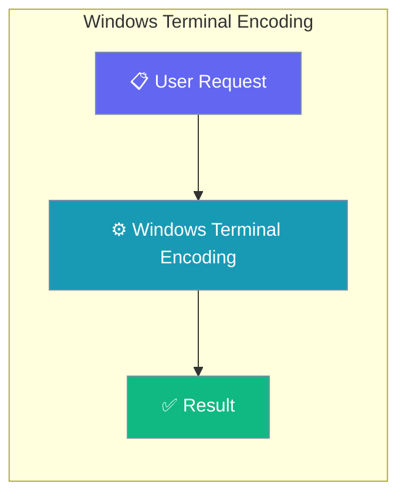
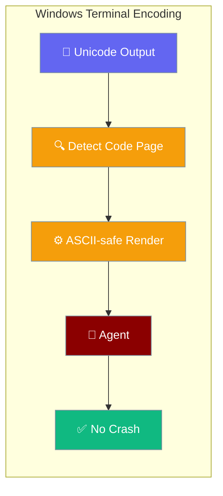
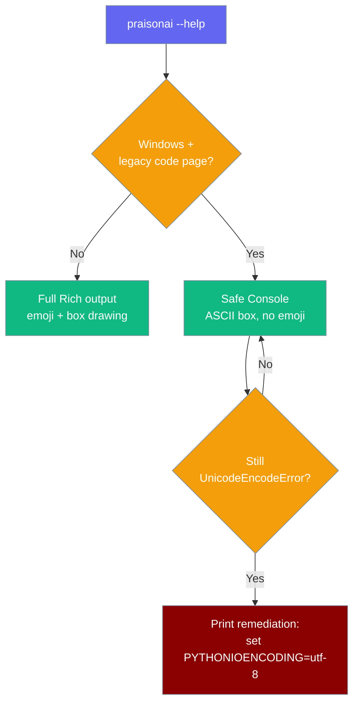
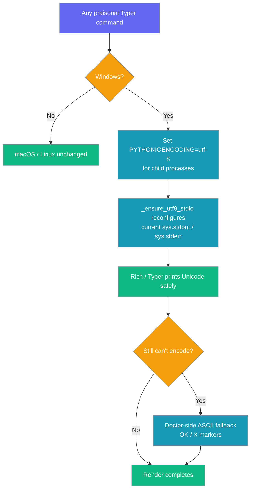
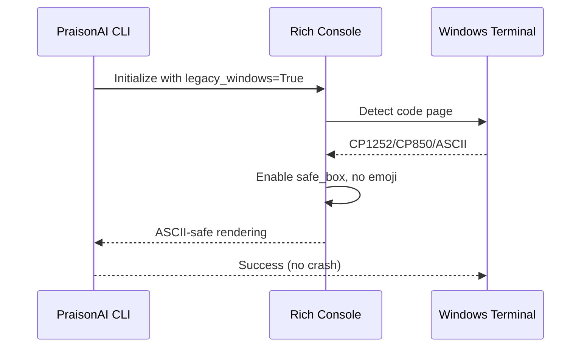

On Windows, PraisonAI automatically reconfigures `sys.stdout` / `sys.stderr` of the Typer process to UTF-8 before any command runs, and falls back to ASCII glyphs for any output path that still needs it — Rich-heavy commands like `praisonai browser doctor` work without `$env:PYTHONIOENCODING='utf-8'`.




```python
from praisonaiagents import Agent

agent = Agent(name="windows-agent", instructions="Handle Unicode output on Windows terminals.")
agent.start("Display this response with proper Unicode encoding on Windows.")
```

The user sends Unicode text; PraisonAI renders safely without crashing legacy Windows consoles.



### Detection Flow



## Two-Layer Mitigation

Every Typer command passes through two layers on Windows, so Unicode output never crashes the CLI.



### What Runs on Every Typer Invocation

| Step | Function | Scope | Effect |
|------|----------|-------|--------|
| 1 | `os.environ['PYTHONIOENCODING'] = 'utf-8'` | Child processes | Subprocesses PraisonAI spawns inherit UTF-8 stdio (only set when a legacy code page is detected and the variable is not already set). |
| 2 | `_ensure_utf8_stdio()` | **Current process** | Reconfigures `sys.stdout` / `sys.stderr` to `utf-8` with `errors="replace"`. |

`_ensure_utf8_stdio()` behaviour:

| Situation | Result |
|-----------|--------|
| Stream already `utf-8` or `cp65001` | Left untouched |
| Stream has no `reconfigure` method (redirected files, custom wrappers) | Skipped silently |
| Character that cannot be encoded | Written as `?` instead of raising |
| macOS / Linux | Never called |

| Code page | Windows name | Before | After |
|-----------|--------------|--------|-------|
| 1252 | Western European | Fail | Pass |
| 437 | OEM US | Fail | Pass |
| 28591 | ISO Latin-1 | Fail | Pass |
| 65001 | UTF-8 | Pass | Pass |

---

## Quick Start

<Steps>
<Step title="Automatic Handling">
PraisonAI reconfigures stdout/stderr to UTF-8 on Windows and renders Unicode output without crashes:

```bash
praisonai browser doctor
```

No configuration needed — no `PYTHONIOENCODING` workaround required.
</Step>

<Step title="Legacy Workaround (Older Releases)">
Releases older than [PraisonAI PR #5857](https://github.com/MervinPraison/PraisonAI/pull/5857) only set `PYTHONIOENCODING` for child processes. On those versions, enable UTF-8 manually (or run `pip install --upgrade praisonai`):

<CodeGroup>
```powershell PowerShell
$env:PYTHONIOENCODING='utf-8'
chcp 65001
praisonai --help
```

```cmd CMD
set PYTHONIOENCODING=utf-8
chcp 65001
praisonai --help
```
</CodeGroup>
</Step>
</Steps>

---

## How It Works



| Component | Behavior | Fallback |
|-----------|----------|----------|
| **Rich Console** | Detects legacy code page | Uses ASCII boxes, no emoji |
| **PYTHONIOENCODING** | Set to utf-8 for subprocess safety | Prevents child process crashes |
| **`_ensure_utf8_stdio()`** | Reconfigures current `sys.stdout` / `sys.stderr` to UTF-8 | `errors="replace"` writes `?` for unencodable characters |
| **Error Handling** | Catches UnicodeEncodeError | Shows remediation hint |

---

## Configuration Options

The automatic encoding detection requires no configuration. However, you can override behavior:

| Method | Scope | When to Use |
|--------|-------|-------------|
| `PYTHONIOENCODING=utf-8` | Current session | Temporary fix for full Unicode |
| `chcp 65001` | Current session | Enable UTF-8 code page |
| System Environment Variables | Permanent | Set `PYTHONIOENCODING` globally |
| Windows Terminal | Best experience | Use modern terminal instead of CMD |

<Warning>
**Lazily-loaded subcommands must honour the same contract.** `praisonai --help` walks the whole command tree, including subcommands lazily registered from optional packages (`praisonai-bot`'s `claw`, `praisonai-mcp`'s `mcp-server`, etc.). A Typer `help=` string from any optional package that contains a non-cp1252 character crashes `praisonai --help` on Windows the moment that package is installed — while CI (which does not install the optional package) stays green. See [CLI Help Panels](/features/cli-help-panels), [PraisonAI PR #2699](https://github.com/MervinPraison/PraisonAI/pull/2699) for the original policy, and [PR #4997](https://github.com/MervinPraison/PraisonAI/pull/4997) for the `claw`-help regression that motivated re-stating it. Rich runtime banners (dashboard splash, ASCII art) are separate — they run through the encoding-aware writer and may include emoji.
</Warning>

---

## Common Patterns

### Problem: UnicodeEncodeError in Older Versions

**Symptom:**
```
UnicodeEncodeError: 'charmap' codec can't encode character '\u2500' in position 0
```

**Solution:**
```bash
# Temporary fix
set PYTHONIOENCODING=utf-8
praisonai --help

# Or upgrade to latest version
pip install --upgrade praisonai
```

### Pattern: Permanent UTF-8 Setup

**For PowerShell users:**
```powershell
# Add to PowerShell profile
Add-Content $PROFILE '$env:PYTHONIOENCODING="utf-8"'
```

**For CMD users:**
```cmd
# Set system environment variable
setx PYTHONIOENCODING utf-8
```

### Pattern: Windows Terminal Integration

**Use Windows Terminal instead of legacy CMD:**
```json
// Windows Terminal settings.json
{
  "profiles": {
    "defaults": {
      "font": {
        "face": "Cascadia Code"
      }
    }
  }
}
```

### Pattern: Training summary on cp1252

`praisonai-train agents` handles cp1252/ASCII automatically — the summary table swaps emoji for ASCII (`PASSED` / `*`) and falls back to plain-text rows if Rich itself can't encode. See [praisonai-train Package → Windows & non-UTF-8 Consoles](/docs/features/praisonai-train-package#windows--non-utf-8-consoles) for the full flow.

---

## Best Practices

<AccordionGroup>
<Accordion title="Use Windows Terminal for Best Experience">
Windows Terminal provides full UTF-8 support and modern terminal features. Download from the Microsoft Store or install via `winget install Microsoft.WindowsTerminal`.
</Accordion>

<Accordion title="Set Environment Variables Permanently">
Instead of setting `PYTHONIOENCODING` in each session, add it to your system environment variables through System Properties → Environment Variables.
</Accordion>

<Accordion title="Consider WSL for Unix-like Experience">
Windows Subsystem for Linux (WSL) provides a full Unix terminal experience without encoding issues. Install with `wsl --install`.
</Accordion>

<Accordion title="Diagnostics: praisonai browser doctor on Windows cp1252">
`praisonai browser doctor` runs on default PowerShell / cmd with no env-var workaround. If you still see `Error: Unable to display help due to terminal encoding limitations.`, your release pre-dates [PR #5857](https://github.com/MervinPraison/PraisonAI/pull/5857) — upgrade with `pip install --upgrade praisonai`.
</Accordion>

<Accordion title="Upgrade to Latest PraisonAI Version">
The automatic encoding detection was added in recent versions. Ensure you're running the latest version with `pip install --upgrade praisonai`.
</Accordion>
</AccordionGroup>

---

## Related

<CardGroup cols={2}>
<Card title="CLI Reference" icon="terminal" href="/cli/cli-reference">
  Complete CLI command reference
</Card>
<Card title="Installation Guide" icon="download" href="/installation">
  Getting started with PraisonAI
</Card>
<Card title="praisonai-train Package" icon="graduation-cap" href="/features/praisonai-train-package">
  ASCII-safe training summaries on non-UTF-8 consoles.
</Card>
</CardGroup>