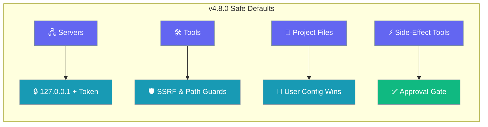

PraisonAI v4.8.0 makes servers, tools, project configs, approvals, and sandboxes safe by default — servers bind `127.0.0.1` unless given a token, tools stay inside clear bounds, and cloned project files cannot grant capabilities.

```python
from praisonaiagents import Agent

# v4.8.0: sending/scheduling tools ask for approval by default.
# Pass approval=True (or approval="full") for unattended agents:
agent = Agent(
    name="Reporter",
    instructions="Email the weekly summary",
    tools=["send_email"],
    approval=True,
)
agent.start("Email the weekly summary to the team")
```



## Quick Start

<Steps>
<Step title="Upgrade packages">
```bash
pip install -U praisonai          # installs praisonai 4.8.0, praisonaiagents 1.8.0, and 0.2.0 companion packages
npm install praisonai@latest      # TypeScript SDK 1.8.0
```
</Step>

<Step title="Configure only what your deployment exposes">
Most local workflows need zero changes. If a server binds publicly, fetches local URLs, or runs unattended tools, set the corresponding token or opt-in from the table below.

```bash
export PRAISONAI_LAUNCH_AUTH_TOKEN="your-secret-token"
export PRAISONAI_SHELL_ENV_ALLOWLIST="MY_CUSTOM_VAR"
```
</Step>
</Steps>

---

## Migration Reference

Find the symptom you see and the setting that adjusts it.

| You notice | What to do |
|---|---|
| A server refuses to start on `0.0.0.0` | Set its token: `ServerConfig(auth_token=...)` (`AgentServer`), `PRAISONAI_JOBS_API_KEY` (Jobs API), `--api-key` or `PRAISONAI_SERVE_API_KEY` (`praisonai serve agents`), `--api-key` (`serve openai`, `rag serve`), `--token` or `--read-only` (`registry serve`), `auth: api-key` or `jwt` (`recipe serve`), `AgentOSConfig(api_key=...)` / `PRAISONAI_AGENTOS_API_KEY` (AgentOS), `PRAISONAI_BROWSER_TOKEN` (`praisonai-browser`), `A2U_AUTH_TOKEN` (`serve a2u`) |
| `praisonai call --public` refuses | Set `CALL_SERVER_TOKEN` |
| TypeScript MCP server or AgentOS refuses a public host | Set `authToken` / `PRAISONAI_MCP_AUTH_TOKEN` (MCP), `apiKey` / `PRAISONAI_AGENTOS_API_KEY` (AgentOS), `{ token }` (N8N listener) |
| `A2A.serve()`, MCP SSE, or `Agent.launch()` prints a token | Set your own: `A2A(auth_token=...)` or `PRAISONAI_LAUNCH_AUTH_TOKEN`; `MCP_SSE_AUTH_TOKEN` for MCP SSE |
| A2A on loopback asks for a token | Unset `PRAISONAI_LAUNCH_AUTH_TOKEN`, or send it as a bearer token |
| Webhook receiver stays on loopback | Set its signing secret (`TELEGRAM_WEBHOOK_SECRET`, `WHATSAPP_APP_SECRET`, `LINEAR_WEBHOOK_SECRET`, `AGENTMAIL_WEBHOOK_SECRET`, or `verify: {hmac: {secret: ...}}`); `PRAISONAI_WEBHOOK_HOST=127.0.0.1` keeps keyless dev local |
| `HTTPApproval(host="0.0.0.0")` refuses | Pass `allowed_approvers=[...]` or set `HTTP_APPROVERS` |
| Jobs API (`--factory`) answers only `/health` | Set `PRAISONAI_JOBS_API_KEY`, or `PRAISONAI_JOBS_BIND_HOST=127.0.0.1` for local use |
| Local server returns `403` behind a reverse proxy or browser page | Keep `Host: localhost` in the proxy, or set the server's token |
| Gateway refuses a browser page from another origin | Add the origin to `GATEWAY_ALLOWED_ORIGINS` |
| `413` on a large request | Raise `PRAISONAI_MAX_BODY_BYTES` (MCP HTTP stream default 10 MB; gateway uses the larger of this and 25 MB) |
| Gateway session not found after 1000 live sessions | Oldest idle session was closed to cap memory; resume it from the session store |
| Gateway `403` on `/v1/*`, `/mcp`, or `/api/pairing/pending` | Give the token the `write` or `pairing` scope |
| Email or AgentMail bot ignores unknown senders | Set `allowed_users`, or `unknown_user_policy: allow` for an open inbox |
| A bot command (`/undo`, `/blueprint`, `/automations`) is admin-only | Add the user to `admin_users` |
| Bot attachment refused | Move the file into the workspace, or add its folder to `allow_roots` |
| Fetch of a private or loopback URL is refused | Set `ALLOW_LOCAL_CRAWL=true` (development only) |
| JIRA tool refuses a URL | Set `JIRA_URL` to your JIRA site |
| `OpenAPIToolset` raises about another origin | Pass `base_url=` explicitly |
| File tool refuses a path outside the current directory | Pass `workspace_root=` (FastContext, `multiedit`), or start in the target folder |
| `grep_search` or `glob_files` refuses a path | Set `PRAISONAI_WORKSPACE` to the root folder you want searched |
| `SandboxExecutor` refuses a path | Add the folder to `allowed_paths` |
| A project's MCP server does not start | List its exact command line under `mcp.trusted_servers` in `~/.praisonai/config.yaml` (`PRAISONAI_MCP_TRUST` still works) |
| Project file endpoint, API key, plugin, or shell setting is ignored | Set it in `~/.praisonai/config.yaml` or env (`OPENAI_BASE_URL`, provider key, `PRAISONAI_ALLOW_PROJECT_PLUGINS=true`, `PRAISONAI_ALLOW_SHELL=true`) |
| Included recipe `tools.py` does not load | Set `PRAISONAI_ALLOW_TEMPLATE_TOOLS=true` |
| Old project "always allow" choices are ignored | Approve again once; choices are now stored under `$PRAISONAI_HOME/permissions/projects/<id>` |
| `send_email`, `send_message`, `schedule_*`, or `execute_code_with_tools` asks for approval | Approve when prompted; pass `approval=True` / `approval="full"` for unattended agents, or `auto_approve_tools` for bots |
| Unmatched resource denied by `PolicyEngine` | Add an `allow` rule, or pass `default_action="allow"` |
| A recipe tool is denied | Add it to `tools.allow` in the recipe |
| `UnenforceablePolicyError` from `SubprocessSandbox` | Use the `docker` or `sandlock` backend, or set `allow_network=True` / `allow_file_write=True` |
| `execute(language="bash")` or subprocess refused in sandbox | Set `allow_subprocess=True` in the sandbox policy |
| Sandlock has no network | Set `allow_network=True` |
| `SandboxExecutor` raises on `allowed_hosts` | Remove `allowed_hosts`; use `network_isolated` or an isolating sandbox backend |
| Shell command or code run is missing an env var | Add its name to `PRAISONAI_SHELL_ENV_ALLOWLIST` (comma-separated) or pass `env=` |
| TypeScript `NLPostgresClient.executeSQL` refuses a statement | Send one statement per call and add the table to the configured list |

---

## Best Practices

<AccordionGroup>
<Accordion title="Keep servers on loopback until you add a token">
Bind to `127.0.0.1` in development and only pass `0.0.0.0` alongside a strong token or an authenticating reverse proxy.
</Accordion>

<Accordion title="Use isolating sandboxes for untrusted code">
Use `praisonai-sandbox` with `docker`, `sandlock`, `e2b`, `modal`, `daytona`, or `novita` whenever running model-generated or untrusted code. Host subprocess runners are guard rails, not isolation.
</Accordion>

<Accordion title="Put trust decisions in user config, not cloned repos">
Store `mcp.trusted_servers`, API keys, and base URLs in `~/.praisonai/config.yaml` or environment variables so untrusted repositories cannot escalate privileges.
</Accordion>
</AccordionGroup>

---

## Related

<CardGroup cols={2}>
  <Card title="Security Policy" icon="shield-check" href="/security">
    Supported packages, advisories, and reporting policy
  </Card>
  <Card title="Threat Model" icon="shield-halved" href="/features/threat-model">
    Trust boundaries and host-side guard rails
  </Card>
  <Card title="Security Environment Variables" icon="key" href="/features/security-environment-variables">
    Opt-in security switches and defaults
  </Card>
  <Card title="Sandbox Execution" icon="terminal" href="/cli/sandbox-execution">
    CLI SandboxExecutor command filters vs OS isolation
  </Card>
</CardGroup>
