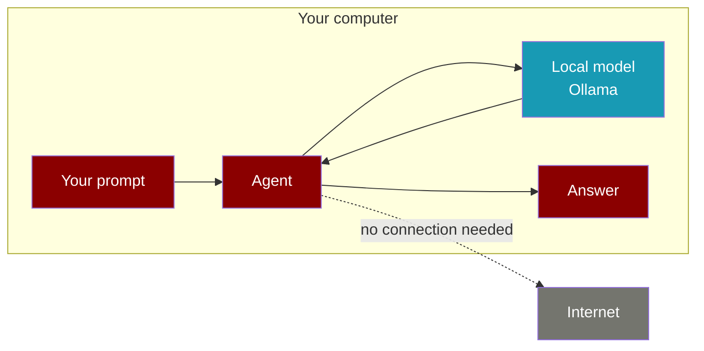

Run an agent on a model that lives on your own computer. No internet connection, no cloud API key, and your data stays on the machine.

```python
from praisonaiagents import Agent

agent = Agent(instructions="You are a helpful assistant", model="ollama/llama3.2")
print(agent.start("Summarise this note in one sentence: ..."))
```



The agent sends your prompt to the model on the same computer, and the answer comes back the same way. Nothing goes over the internet.

## Quick Start

<Steps>
  <Step title="Install Ollama and download a model">
    Do this once, while you are still online. Get Ollama from [ollama.com](https://ollama.com), then download a model:

    ```bash
    ollama pull llama3.2
    ```

    The model is saved on your computer. After this, Ollama does not need the internet.
  </Step>

  <Step title="Install PraisonAI">
    ```bash
    pip install "praisonaiagents[llm]"
    ```

    The `[llm]` extra adds the connector PraisonAI uses to talk to Ollama.
  </Step>

  <Step title="Create the agent">
    Save this as `agent.py`:

    ```python
    from praisonaiagents import Agent

    agent = Agent(instructions="You are a helpful assistant", model="ollama/llama3.2")
    print(agent.start("In one sentence, why might a hospital keep patient data on its own computers?"))
    ```
  </Step>

  <Step title="Run it">
    ```bash
    python agent.py
    ```

    ```text
    A hospital might keep patient data on its own computers to maintain control over access, security, and confidentiality of sensitive patient information.
    ```

    No `OPENAI_API_KEY` is needed. The `ollama/` prefix tells PraisonAI to use the local model.
  </Step>
</Steps>

<Note>
Run the script from your own project folder. If the current folder has an `AGENTS.md` or `CLAUDE.md` file, the agent adds it to its instructions, which can change how it answers. Pass `rules=False` to `Agent(...)` to turn this off.
</Note>

---

## Ollama on another computer

If Ollama runs on a different machine in your network, or on a port other than `11434`, tell the agent where it is.

<Tabs>
  <Tab title="In code">
    ```python
    from praisonaiagents import Agent

    agent = Agent(
        instructions="You are a helpful assistant",
        model="ollama/llama3.2",
        base_url="http://192.168.1.10:11434",
    )
    print(agent.start("Reply with the single word: ready"))
    ```
  </Tab>
  <Tab title="Environment variable">
    ```bash
    export OLLAMA_API_BASE="http://192.168.1.10:11434"
    python agent.py
    ```

    The agent code stays the same: `model="ollama/llama3.2"`, no `base_url`.
  </Tab>
</Tabs>

<Warning>
Use `base_url=` or `OLLAMA_API_BASE`. Setting `OLLAMA_HOST` changes where the Ollama server itself listens, but the agent with `model="ollama/..."` does not use it to find the server.
</Warning>

---

## Check it is really offline

The simplest test: turn off Wi-Fi or unplug the network cable, then run `python agent.py` again. If you get an answer, the agent did not need the internet.

<AccordionGroup>
  <Accordion title="Block the network for one command (macOS)">
    This blocks every outgoing connection except to Ollama on `localhost:11434`, without turning off your network.

    ```bash
    cat > nonet.sb <<'EOF'
    (version 1)
    (allow default)
    (deny network-outbound)
    (allow network-outbound (remote ip "localhost:11434"))
    EOF

    # Should fail: the internet is blocked
    sandbox-exec -f nonet.sb curl -s -m 5 https://pypi.org || echo "internet blocked"

    # Should answer: only the local model is reachable
    sandbox-exec -f nonet.sb python agent.py
    ```
  </Accordion>

  <Accordion title="Install on a machine that has never been online">
    Download the packages on a connected machine, copy them across, and install from the folder. See [Offline & CI Install](/features/offline-and-ci-install) for what PraisonAI does and does not fetch at install time.
  </Accordion>
</AccordionGroup>

---

## Turn off telemetry

Telemetry is off by default in `praisonaiagents`. It only turns on if someone sets `PRAISONAI_TELEMETRY_ENABLED=true`. To make sure it stays off on a machine, set:

```bash
export PRAISONAI_TELEMETRY_DISABLED=true
```

This wins over `PRAISONAI_TELEMETRY_ENABLED=true` and over `enable_telemetry()` in code. `DO_NOT_TRACK=true` and `PRAISONAI_DISABLE_TELEMETRY=true` work too. Each accepts `true`, `1` or `yes`.

The model connector also checks online for an updated model price list when it starts. If it cannot connect it uses the copy it ships with. To skip the check entirely:

```bash
export LITELLM_LOCAL_MODEL_COST_MAP=True
```

---

## Other local model servers

Ollama is the simplest start. PraisonAI also works with LM Studio, llama.cpp and vLLM running on your own hardware. These pages cover them:

<CardGroup cols={3}>
  <Card title="Local Models" icon="microchip" href="/features/local-models">
    Ollama, LM Studio, llama.cpp and vLLM
  </Card>
  <Card title="Local Model Resolver" icon="server" href="/features/local-model-resolver">
    Find a running local server for you
  </Card>
  <Card title="Ollama" icon="terminal" href="/models/ollama">
    More Ollama options
  </Card>
</CardGroup>

---

## Best Practices

<AccordionGroup>
  <Accordion title="Download models before you go offline">
    `ollama pull` needs the internet. Pull every model you plan to use while connected, then check with `ollama list`.
  </Accordion>
  <Accordion title="Name the model every time">
    Always pass `model="ollama/<name>"`. Without it, PraisonAI falls back to a cloud default and asks for an API key.
  </Accordion>
  <Accordion title="Start small, then test on your own tasks">
    A small model such as `llama3.2` runs on most laptops. Try your real tasks on it before moving to a larger model.
  </Accordion>
</AccordionGroup>

## Related

<CardGroup cols={2}>
  <Card title="Task handover (early access)" icon="right-left" href="/guides/task-handover-early-access">
    Move tasks to your own AI only after they pass a test
  </Card>
  <Card title="Single Agent Guide" icon="user" href="/guides/single-agent">
    Build out your first agent
  </Card>
</CardGroup>
