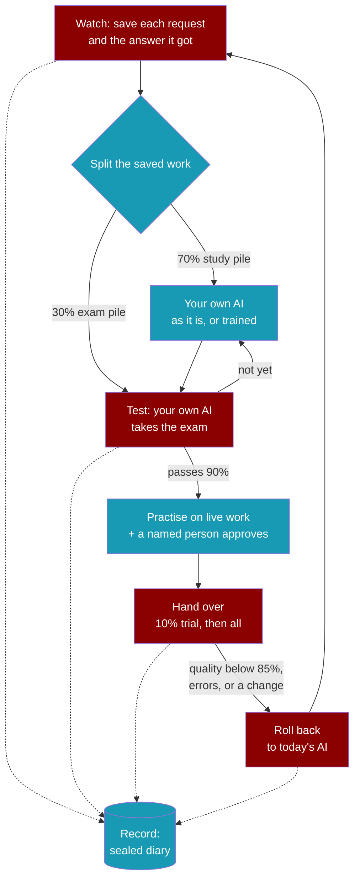

<Note>
The open-source framework is live today. The handover is in early access, and we are taking on our first design partners. [Talk to us about early access](https://praison.ai/enterprise/).
</Note>

Each task moves to your own AI only after it passes a test. If quality slips, it moves back automatically, and every step is recorded for regulators.

## How it works

1. **Watch:** records how each task is done today.
2. **Test:** your own AI takes an exam made from real past work it never studied. The work is split first: 70% to study, 30% kept back as the exam, never mixed.
3. **Hand over:** after 50 practice answers and a named person's approval, a 10% trial with every answer checked, then all of it.
4. **Roll back:** if the checked answers drop below 85%, errors pile up, or anything changes, the task moves back automatically.
5. **Record:** every step goes into a sealed diary with no customer text, which your regulator can check.

The numbers are the handover's default rules; each team can set its own.

## Where your own AI comes from

Your own AI is an open model, such as Llama, Qwen or Gemma, running on your own computers. There are two ways to get one:

<CardGroup cols={2}>
  <Card title="Use an open model as it is" icon="box" href="/features/local-models">
    Serve it with Ollama, LM Studio, llama.cpp or vLLM. Available today.
  </Card>
  <Card title="Train one on your own past work" icon="graduation-cap" href="/features/praisonai-train-package">
    PraisonAI Train fine-tunes a small open model on your own NVIDIA GPU servers. Turning watched work into training data is part of early access.
  </Card>
</CardGroup>

Either way, the model is only a candidate. It takes over a task only after it passes the exam: real past work it never studied, scored against the answers your business already accepted. Your team starts each training run; nothing trains automatically.

<Warning>
Answers written by another AI provider's model can be covered by that provider's terms of use, which may forbid training another model on them. Having your reviewers check those answers does not remove the terms. Check your provider's terms before you train. The safer source is answers your own people wrote or your own open models produced.
</Warning>

## Who it is for

Banks, insurers and hospitals that want AI agents but cannot send private data to outside AI services. Keep your data inside, own your AI, and get proof for your regulators.

---

## What it builds on today

The handover is not part of the open-source packages. It is built on parts that are already in the open-source framework, which you can use now:

<CardGroup cols={2}>
  <Card title="Tracing" icon="chart-line" href="/observability/overview">
    Record what an agent did, step by step
  </Card>
  <Card title="Evaluation with run_trials" icon="dice" href="/features/trials-engine">
    Run each test case many times and get a pass rate
  </Card>
  <Card title="Fine-tuning with praisonai-train" icon="graduation-cap" href="/features/praisonai-train-package">
    Train a model of your own on your own data
  </Card>
  <Card title="Local models" icon="lock" href="/guides/run-fully-offline">
    Run agents fully offline on your own computers
  </Card>
  <Card title="Model router" icon="route" href="/features/model-router">
    Choose which model handles each task
  </Card>
  <Card title="Local model servers" icon="microchip" href="/features/local-models">
    Ollama, LM Studio, llama.cpp and vLLM
  </Card>
</CardGroup>

---

## Early access

We are taking on our first design partners. If you run a highly regulated team, such as a bank, insurer or hospital, and want to try the handover, [get in touch](https://praison.ai/enterprise/).

<AccordionGroup>
  <Accordion title="Is the handover available to install?">
    No. It is in early access and is not part of `pip install praisonai`. Everything else on this site is open source and available today.
  </Accordion>
  <Accordion title="Does PraisonAI train a model automatically?">
    No. Training is optional, and your team chooses when to run it. You can also use an open model as it is.
  </Accordion>
  <Accordion title="Can I build something like this myself?">
    Yes. Tracing, evaluation, fine-tuning and local models are all in the open-source framework. The cards above link to each one.
  </Accordion>
  <Accordion title="Does this change the open-source framework?">
    No. PraisonAI is still a general-purpose agent framework, and every feature works as before. See the [Introduction](/introduction).
  </Accordion>
</AccordionGroup>
