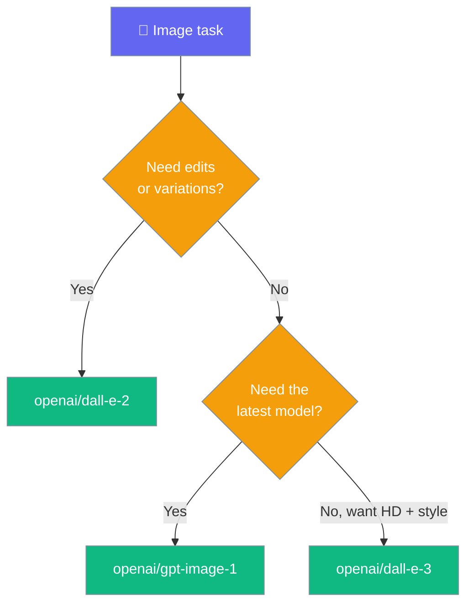

Generate images with OpenAI's image models — DALL-E 2, DALL-E 3, and GPT-Image.

## Generate

```python
from praisonaiagents import ImageAgent

agent = ImageAgent(llm="openai/dall-e-3")
result = agent.generate("A sunset over mountains")
print(result.data[0].url)
```

## GPT-Image

`gpt-image-1` always returns the image as base64.

```python
from praisonaiagents import ImageAgent

agent = ImageAgent(llm="openai/gpt-image-1")
result = agent.generate("A sunset over mountains")
print(result.data[0].b64_json[:40], "...")
```

## With Options

```python
from praisonaiagents import ImageAgent

agent = ImageAgent(llm="openai/dall-e-3")
result = agent.generate(
    "A futuristic city",
    size="1792x1024",
    quality="hd",
    style="vivid"
)
print(result.data[0].url)
```

<Note>
`style` is only supported by `dall-e-3` (values: `"natural"`, `"vivid"`). `ImageAgent` only sends `style` when you set it explicitly — there is no `"natural"` default, so newer OpenAI endpoints that reject the parameter outright (`400 unknown_parameter: style`) also work. On `dall-e-2` or `gpt-image-1`, `ImageAgent` still drops `style` automatically.
</Note>

Reference: [PR #6077](https://github.com/MervinPraison/PraisonAI/pull/6077), [PR #6097](https://github.com/MervinPraison/PraisonAI/pull/6097). Fixes [#6076](https://github.com/MervinPraison/PraisonAI/issues/6076), [#6096](https://github.com/MervinPraison/PraisonAI/issues/6096).

## Response Format

Default is `url`. Set `b64_json` to receive the image inline as base64.

```python
from praisonaiagents import ImageAgent

agent = ImageAgent(llm="openai/dall-e-3", response_format="b64_json")
result = agent.generate("A red circle icon")
print(result.data[0].b64_json[:40], "...")
```

<Note>
The default `response_format="url"` is not sent to OpenAI, so models that reject the parameter, such as `gpt-image-1`, work without extra configuration.
</Note>

## Models



| Model | Generate | Edit | Variation |
|-------|----------|------|-----------|
| `openai/gpt-image-1` | ✅ | ❌ | ❌ |
| `openai/dall-e-3` | ✅ | ❌ | ❌ |
| `openai/dall-e-2` | ✅ | ✅ | ✅ |
