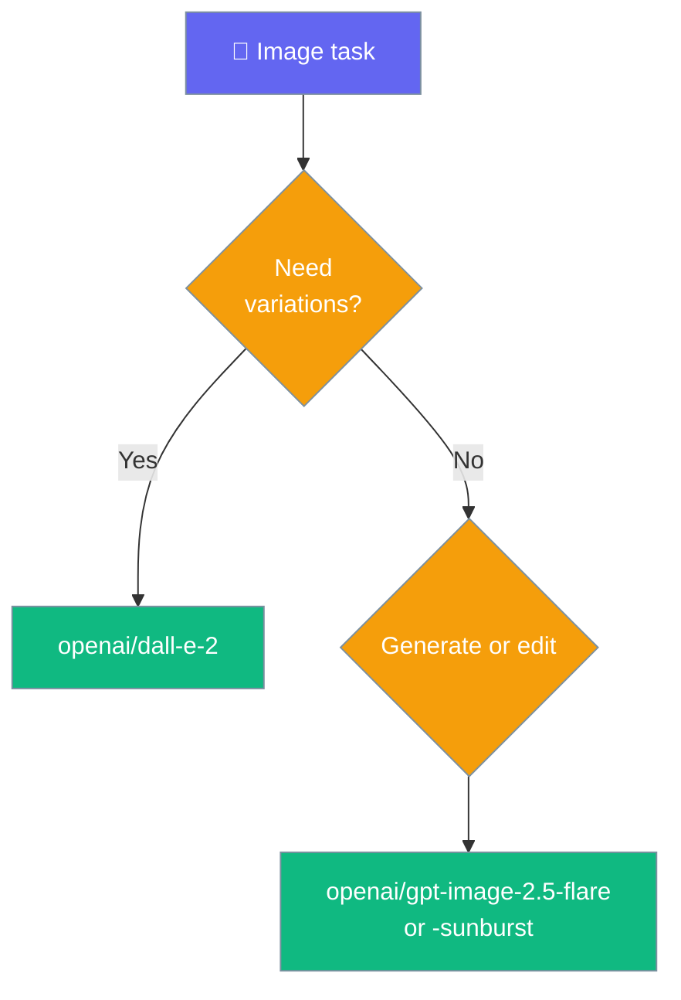

Generate and edit images with OpenAI's GPT image models — `gpt-image-2.5-flare` (the default) and `gpt-image-2.5-sunburst`. `gpt-image-2.6-flare` and `gpt-image-2.6-sunburst` are launching but may not be available on every project yet (`403 model_not_found`).

## Generate

```python
from praisonaiagents import ImageAgent

agent = ImageAgent()  # defaults to gpt-image-2.5-flare
result = agent.generate("A sunset over mountains")
print(result.data[0].b64_json[:40], "...")
```

GPT image models always return the image as base64.

## With Options

```python
from praisonaiagents import ImageAgent

agent = ImageAgent(llm="openai/gpt-image-2.5-flare")
result = agent.generate(
    "A futuristic city",
    size="1536x1024",
    quality="high",
)
print(result.data[0].b64_json[:40], "...")
```

`quality` is sent whenever you set it, for any model. GPT image accepts `"low"`, `"medium"`, `"high"`, `"xhigh"`, `"max"`, `"auto"`. Images 2.5/2.6 params such as `frame_count`, `frame_duration_ms`, `complexity`, and `output_format` pass through unchanged.

<Note>
`style` is only supported by the retired `dall-e-3`. `ImageAgent` only sends `style` when you set it explicitly, and drops it automatically on GPT image models — put style cues in the prompt instead.
</Note>

Reference: [PR #6262](https://github.com/MervinPraison/PraisonAI/pull/6262), fixes [#6259](https://github.com/MervinPraison/PraisonAI/issues/6259). Earlier: [PR #6077](https://github.com/MervinPraison/PraisonAI/pull/6077), [PR #6097](https://github.com/MervinPraison/PraisonAI/pull/6097).

## Edit

```python
from praisonaiagents import ImageAgent

agent = ImageAgent()
result = agent.edit("photo.png", "Make the cup blue", mask="mask.png")
```

<Warning>
`ImageAgent.edit(..., markup=...)` raises `ValueError` — LiteLLM does not upload `markup` as a file, so it would be silently ignored. Use `mask=` instead, or call the OpenAI SDK's `images.edit` directly.
</Warning>

## Response Format

Default is `url`. Set `b64_json` to request base64 explicitly.

```python
from praisonaiagents import ImageAgent

agent = ImageAgent(llm="openai/gpt-image-2.5-flare", response_format="b64_json")
result = agent.generate("A red circle icon")
print(result.data[0].b64_json[:40], "...")
```

<Note>
The default `response_format="url"` is not sent to OpenAI, so GPT image models, which reject the parameter, work without extra configuration.
</Note>

## Models



| Model | Generate | Edit | Variation |
|-------|----------|------|-----------|
| `openai/gpt-image-2.5-flare` (default) | ✅ | ✅ (`mask=`, not `markup=`) | ❌ |
| `openai/gpt-image-2.5-sunburst` | ✅ | ✅ (`mask=`, not `markup=`) | ❌ |
| `openai/gpt-image-2.6-flare` / `-sunburst` | ✅ (rolling out) | ✅ (rolling out) | ❌ |
| `openai/dall-e-2` | — | — | ✅ (only variations endpoint) |

OpenAI retired `dall-e-2`/`dall-e-3` on 2026-05-12 and `gpt-image-1` on 2026-10-23. `dall-e-2` is kept only for `variation()`.
