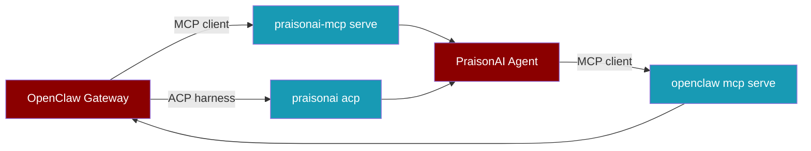

OpenClaw is an MIT-licensed, self-hosted assistant gateway ([source](https://github.com/openclaw/openclaw)). It runs isolated agents, sub-agents and Swarm, and speaks MCP and ACP in both directions, so PraisonAI connects to it through standard protocols.



## Quick Start

<Steps>
<Step title="Let a PraisonAI agent use OpenClaw">
```python
from praisonaiagents import Agent
from praisonaiagents.mcp import MCP

agent = Agent(
    instructions="You are a helpful assistant.",
    tools=MCP("openclaw mcp serve"),
)
agent.start("List my OpenClaw conversations")  # Prints the conversations OpenClaw exposes
```
</Step>
<Step title="Let OpenClaw call PraisonAI">
```bash
pip install praisonai-mcp
openclaw mcp add praisonai --command praisonai-mcp --arg serve --arg --transport --arg stdio
```
</Step>
</Steps>

---

## Integration Paths

<Tabs>
<Tab title="OpenClaw → PraisonAI (MCP)">
Run PraisonAI as an MCP server. Transports are `stdio` and `http-stream`.

```bash
pip install praisonai-mcp
openclaw mcp add praisonai --command praisonai-mcp --arg serve --arg --transport --arg stdio
```

See [PraisonAI MCP Package](/features/praisonai-mcp-package). OpenClaw reference: [openclaw mcp](https://docs.openclaw.ai/cli/mcp).
</Tab>
<Tab title="PraisonAI → OpenClaw (MCP)">
`openclaw mcp serve` exposes OpenClaw conversations to any MCP client.

```python
from praisonaiagents import Agent
from praisonaiagents.mcp import MCP

agent = Agent(instructions="Summarise my chats", tools=MCP("openclaw mcp serve"))
agent.start("Summarise my latest conversation")  # Prints a short summary
```

OpenClaw reference: [openclaw mcp](https://docs.openclaw.ai/cli/mcp).
</Tab>
<Tab title="ACP">
`praisonai acp` is an ACP server. OpenClaw runs external ACP harnesses through `acpx` and accepts custom agents with `--agent <command>`.

<Warning>
This path has not been tested end to end.
</Warning>

See [ACP](/acp). OpenClaw references: [openclaw acp](https://docs.openclaw.ai/cli/acp), [ACP agents setup](https://docs.openclaw.ai/tools/acp-agents-setup).
</Tab>
<Tab title="Skills">
Both sides use `SKILL.md` with YAML frontmatter. PraisonAI parses `metadata.openclaw` into `SkillRequirements.openclaw_hints`.

See [Hermes & OpenClaw Skills Import](/features/hermes-openclaw-skills-import). OpenClaw reference: [skill format](https://docs.openclaw.ai/clawhub/skill-format).
</Tab>
</Tabs>

---

## Capabilities at a Glance

| Capability | PraisonAI | OpenClaw |
|------------|-----------|----------|
| MCP server | `praisonai-mcp serve` | [`openclaw mcp serve`](https://docs.openclaw.ai/cli/mcp) |
| MCP client | `MCP(...)` tool | [`openclaw mcp add`](https://docs.openclaw.ai/cli/mcp) (stdio, streamable-http) |
| ACP | `praisonai acp` | [`openclaw acp`](https://docs.openclaw.ai/cli/acp) and `/acp spawn` |
| Multi-agent | Multi-agent workflows | [Isolated agents in one Gateway](https://docs.openclaw.ai/concepts/multi-agent) |
| Sub-agents | Agent handoffs | [`sessions_spawn`](https://docs.openclaw.ai/tools/subagents), [Swarm](https://docs.openclaw.ai/tools/swarm) |
| Skills format | `SKILL.md` | [`SKILL.md`](https://docs.openclaw.ai/clawhub/skill-format) |
| Channels | [Bot Gateway](/features/bot-gateway) | Gateway channels ([docs](https://docs.openclaw.ai)) |

---

## Best Practices

<AccordionGroup>
<Accordion title="Bind MCP to localhost">
Use `stdio`, or bind `http-stream` to `127.0.0.1`, so only local clients reach your tools.
</Accordion>
<Accordion title="One virtualenv per side">
Install PraisonAI and OpenClaw in separate environments to avoid dependency clashes.
</Accordion>
<Accordion title="Pin versions">
Pin `praisonai-mcp` and the OpenClaw release so protocol changes do not break the link.
</Accordion>
</AccordionGroup>

---

## Related

<CardGroup cols={2}>
<Card title="PraisonAI MCP Package" icon="plug" href="/features/praisonai-mcp-package">
  Serve agents and tools over MCP
</Card>
<Card title="ACP" icon="terminal" href="/acp">
  Agent Client Protocol server
</Card>
<Card title="Skills Import" icon="puzzle-piece" href="/features/hermes-openclaw-skills-import">
  Reuse OpenClaw and Hermes skills
</Card>
<Card title="Bot Gateway" icon="tower-broadcast" href="/features/bot-gateway">
  Run agents on messaging channels
</Card>
</CardGroup>
