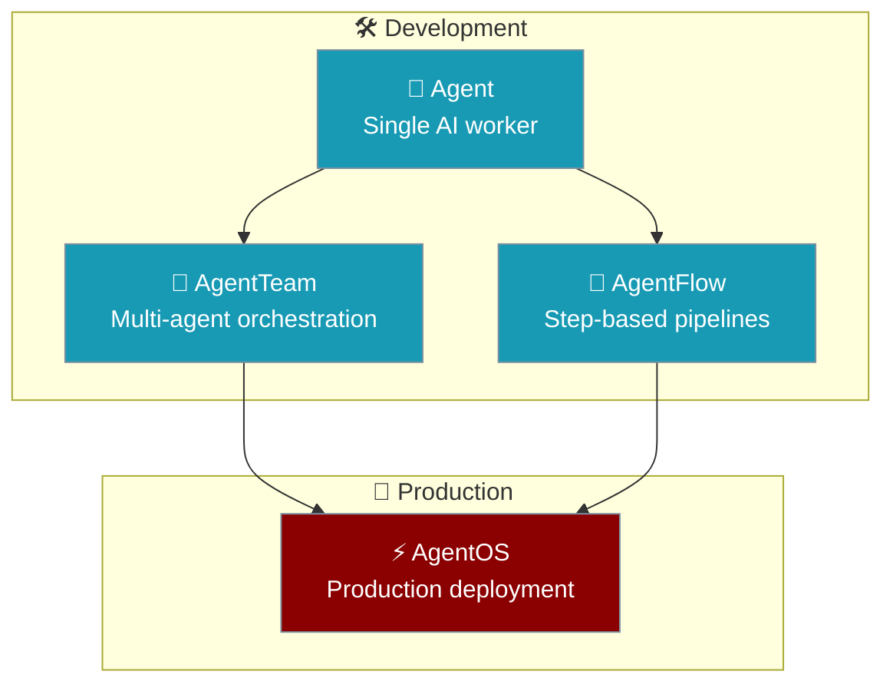
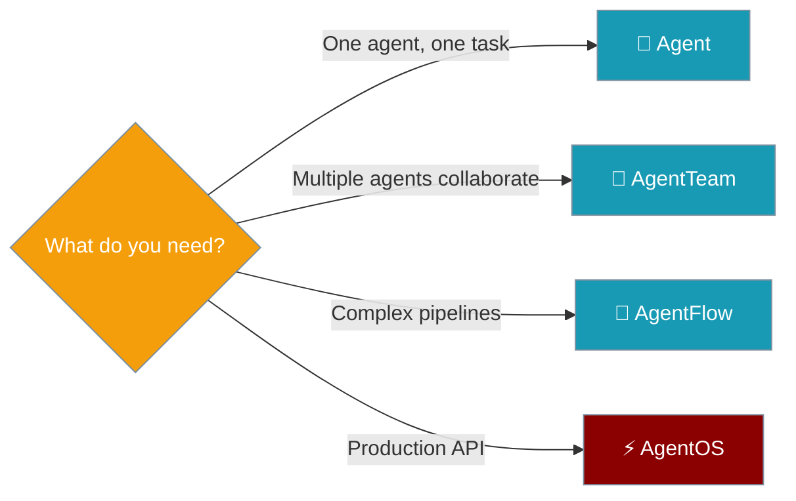
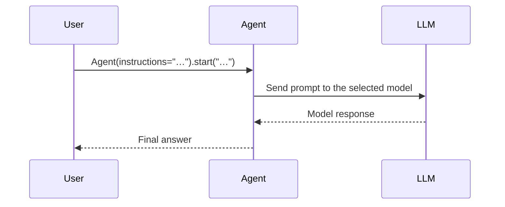

PraisonAI runs AI agents on your own computers, even fully offline, so private data never has to leave the building. It is built for highly regulated teams, and free and open source for everyone.

**Private AI that earns trust one task at a time.**

```python
from praisonaiagents import Agent

agent = Agent(instructions="You are a helpful assistant")
agent.start("Write a haiku about AI")
```

## What is PraisonAI?

PraisonAI is an open-source Python framework for building AI agents. It is still a general-purpose framework: build any kind of agent, with any model, in the cloud or on your own computers. Our company focus is private AI for regulated teams, and this framework is the foundation for that work.

## Building something else?

Everything works as before. Nothing has been removed, and every feature page is where it was.

<CardGroup cols={3}>
  <Card title="Agents" icon="robot" href="/concepts/agents">
    One agent with instructions and tools
  </Card>
  <Card title="Multi-agent teams" icon="users" href="/guides/multi-agent">
    Several agents working together
  </Card>
  <Card title="AgentFlow" icon="diagram-project" href="/concepts/agentflow">
    Step-based pipelines: route, parallel, loop
  </Card>
  <Card title="Memory" icon="brain" href="/concepts/memory">
    Agents that remember across sessions
  </Card>
  <Card title="Knowledge" icon="book" href="/concepts/knowledge">
    Give agents your documents
  </Card>
  <Card title="RAG" icon="magnifying-glass" href="/concepts/rag">
    Retrieve before you answer
  </Card>
  <Card title="Tools" icon="wrench" href="/concepts/tools">
    Let agents call your functions
  </Card>
  <Card title="MCP" icon="plug" href="/concepts/mcp">
    Connect Model Context Protocol servers
  </Card>
  <Card title="Messaging bots" icon="comments" href="/features/messaging-bots">
    Telegram, Discord, Slack, WhatsApp
  </Card>
  <Card title="CLI" icon="terminal" href="/cli/cli">
    Run agents from the command line
  </Card>
  <Card title="Training" icon="graduation-cap" href="/features/praisonai-train-package">
    Train agents and fine-tune models
  </Card>
  <Card title="Browser automation" icon="globe" href="/features/praisonai-browser-package">
    Agents that use a web browser
  </Card>
  <Card title="Sandbox" icon="box" href="/features/praisonai-sandbox-package">
    Run agent code in isolation
  </Card>
  <Card title="Deploy" icon="rocket" href="/deploy/index">
    Docker, cloud and local servers
  </Card>
  <Card title="UI" icon="display" href="/ui/ui">
    Chat interfaces for your agents
  </Card>
  <Card title="YAML" icon="file-code" href="/features/yaml-configuration-reference">
    Define agents without Python
  </Card>
  <Card title="JavaScript SDK" icon="js" href="/js/js">
    The same agents in TypeScript and JavaScript
  </Card>
</CardGroup>

## Run fully offline

Agents can run on a model on your own computer, with no internet connection and no cloud API key.

<Card title="Run fully offline" icon="lock" href="/guides/run-fully-offline">
  Install, pull a local model, and run an agent with the network turned off.
</Card>

## Early access: task handover

We are building a way to move each task to your own AI only after it passes a test, and move it back if quality slips. It is in early access with design partners.

<Card title="Task handover (early access)" icon="right-left" href="/guides/task-handover-early-access">
  The five steps, and the parts of the open-source framework it builds on.
</Card>

---

# Core Components



<CardGroup cols={2}>
  <Card title="🤖 Agent" icon="robot">
    **Single AI worker** with tools and instructions
  </Card>
  <Card title="👥 AgentTeam" icon="users">
    **Multi-agent orchestration** with sequential/hierarchical process
  </Card>
  <Card title="🔄 AgentFlow" icon="diagram-project">
    **Step-based pipelines** with route, parallel, loop patterns
  </Card>
  <Card title="⚡ AgentOS" icon="server">
    **Production deployment** with API, webhooks, scheduler
  </Card>
</CardGroup>

---

## When to Use What



| Scenario | Use This |
|----------|----------|
| Chat with one AI | `Agent` |
| Research → Analyze → Write | `AgentTeam` or `AgentFlow` |
| Route to specialists | `AgentFlow` + `route()` |
| Parallel processing | `AgentFlow` + `parallel()` |
| Production API | `AgentOS` |

---

## Use Cases

<CardGroup cols={2}>
  <Card title="Customer Service" icon="headset">
    Build intelligent support agents that can handle customer inquiries and resolve issues autonomously.
  </Card>
  <Card title="Data Analysis" icon="chart-line">
    Create agents that can process, analyze, and derive insights from complex datasets.
  </Card>
  <Card title="Content Creation" icon="pen-nib">
    Deploy agents that can generate, edit, and optimize content across various formats.
  </Card>
  <Card title="Process Automation" icon="gears">
    Automate complex workflows with intelligent agents that can coordinate and execute tasks.
  </Card>
</CardGroup>

---

## Getting Started

<Tabs>
  <Tab title="Python">
    <Steps>
      <Step title="Install">
        ```bash
        pip install praisonaiagents
        ```
      </Step>

      <Step title="Set API Key">
        ```bash
        export OPENAI_API_KEY="${OPENAI_API_KEY:?Set OPENAI_API_KEY in your shell}"
        ```
      </Step>

      <Step title="Create Agent">
<CodeGroup>
```python Single Agent
from praisonaiagents import Agent

agent = Agent(instructions="You are a helpful assistant")
agent.start("Write a haiku about AI")
```

```python Multi-Agent Team
from praisonaiagents import Agent, AgentTeam

researcher = Agent(instructions="Research topics")
writer = Agent(instructions="Write content")

team = AgentTeam(agents=[researcher, writer])
team.start()
```

```python AgentFlow Pipeline
from praisonaiagents import Agent, AgentFlow

researcher = Agent(instructions="Research topics")
writer = Agent(instructions="Write content")

flow = AgentFlow(steps=[researcher, writer])
flow.start("Research AI trends")
```
</CodeGroup>
      </Step>
    </Steps>
  </Tab>
  
  <Tab title="TypeScript">
    <Steps>
      <Step title="Install">
        ```bash
        npm install praisonai
        ```
      </Step>

      <Step title="Set API Key">
        ```bash
        export OPENAI_API_KEY="${OPENAI_API_KEY:?Set OPENAI_API_KEY in your shell}"
        ```
      </Step>

      <Step title="Create Agent">
<CodeGroup>
```typescript Single Agent
import { Agent } from 'praisonai';

const agent = new Agent({ instructions: 'You are a helpful assistant' });
agent.start('Write a haiku about AI');
```

```typescript Multi-Agent Team
import { Agent, AgentTeam } from 'praisonai';

const researcher = new Agent({ instructions: 'Research topics' });
const writer = new Agent({ instructions: 'Write content' });

const team = new AgentTeam({ agents: [researcher, writer] });
team.start();
```
</CodeGroup>
      </Step>
    </Steps>
  </Tab>
  
  <Tab title="No Code (YAML)">
    <Steps>
      <Step title="Install">
        ```bash
        pip install praisonai
        ```
      </Step>

      <Step title="Create agents.yaml">
```yaml
agents:
  researcher:
    instructions: Research AI trends
  writer:
    instructions: Write content based on research
```
      </Step>

      <Step title="Run">
        ```bash
        praisonai agents.yaml
        ```
      </Step>
    </Steps>
  </Tab>
</Tabs>

---

## Key Features

<CardGroup cols={3}>
  <Card title="Autonomous, Self-Improving Agents" icon="robot">
    - Understand natural language
    - Make decisions
    - Execute tasks
    - Learn and persist new skills
  </Card>

  <Card title="Flexible Architecture" icon="cubes">
    - Modular components
    - Extensible tools
    - Custom workflows
  </Card>

  <Card title="Advanced Capabilities" icon="wand-sparkles">
    - Multi-agent collaboration
    - Memory management
    - Tool integration
  </Card>
</CardGroup>

---

## Why PraisonAI?

<CardGroup cols={2}>
  <Card title="Developer First" icon="code">
    Modern SDK designed to be intuitive and powerful
  </Card>
  <Card title="Production Ready" icon="shield">
    Enterprise-grade with built-in security and scale
  </Card>
  <Card title="Open Source" icon="github">
    Available on [GitHub](https://github.com/MervinPraison/PraisonAI)
  </Card>
  <Card title="Low Code Friendly" icon="wand-magic">
    Easy for non-technical users
  </Card>
</CardGroup>

---

## How It Works

An Agent receives your instructions, calls the LLM, and returns a result — teams and flows chain multiple agents on top of that.



## Best Practices

<AccordionGroup>
<Accordion title="Pick the right building block">
Use `Agent` for one task, `AgentTeam` when agents collaborate, and `AgentFlow` for step-based pipelines with routing, parallel, or loop patterns.
</Accordion>

<Accordion title="Keep the first example tiny">
Start with `Agent(instructions="…").start("…")`. Add `name`, `role`, `tools`, and `Task` only as your needs grow.
</Accordion>

<Accordion title="Set provider keys in the environment">
Export `OPENAI_API_KEY` (or another provider's key) in your shell. PraisonAI auto-selects a matching default model.
</Accordion>

<Accordion title="Move to AgentOS for production">
Wrap agents in `AgentOS` when you need an API, webhooks, or a scheduler for production deployment.
</Accordion>
</AccordionGroup>

## Related

<CardGroup cols={2}>
  <Card title="Quick Start" icon="play" href="/quickstart">
    Build your first AI agent in minutes.
  </Card>
  <Card title="Workflows" icon="diagram-project" href="/features/workflows">
    Learn workflow patterns for multi-step pipelines.
  </Card>
</CardGroup>

<Tip>
  Join our community on [Discord](https://discord.gg/nNZu5gGT59) to connect with other developers and get help!
</Tip>