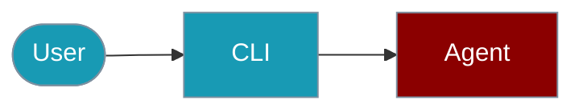

The `praisonai-ts` CLI provides a comprehensive interface for interacting with AI agents.



## Quick Start

<Steps>

<Step title="Simple Usage">
```bash
npm install -g praisonai
praisonai-ts chat "Hello"
```
</Step>

<Step title="With Configuration">
```bash
export OPENAI_API_KEY=your-key
praisonai-ts chat "Explain AI" --model openai/gpt-4o-mini
```
</Step>

</Steps>

---

---

## All Commands

There is no `serve` or `gateway` command in the TypeScript CLI — the TS CLI is the single `praisonai-ts` executable. Run `praisonai-ts help` for the full list.

| Category | Commands |
|----------|----------|
| Agent | `chat`, `run`, `agent`, `auto`, `research`, `interactive` |
| Multi-Agent | `agents run`, `workflow`, `flow`, `handoff`, `router` |
| Tools | `tools list`, `tools info`, `skills list`, `skills discover` |
| Memory | `memory list`, `memory add`, `memory search`, `memory clear`, `session`, `knowledge` |
| MCP | `mcp list`, `mcp add`, `mcp remove`, `mcp start`, `mcp stop` |
| Quality | `eval accuracy`, `eval performance`, `eval reliability`, `guardrail check`, `benchmark` |
| Models | `providers`, `llm providers`, `llm test`, `llm validate`, `embed`, `image` |
| Other | `query-rewrite`, `prompt-expand`, `context`, `planning`, `telemetry`, `vector`, `observability`, `voice`, `db`, `cache`, `version`, `help` |

```bash
praisonai-ts chat "Hello"
praisonai-ts agents run "Research and summarise AI news"
praisonai-ts help
```

## Core Commands

### Chat

```bash
praisonai-ts chat "Your prompt here"
praisonai-ts chat "Write a poem" --stream
praisonai-ts chat "Explain AI" --model anthropic/claude-sonnet-4-20250514
```

### Providers

```bash
praisonai-ts providers
praisonai-ts providers --json
```

## Global Options

| Option | Description |
|--------|-------------|
| `-v, --verbose` | Enable verbose output |
| `-c, --config` | Path to config file |
| `-o, --output` | Output format (pretty, json, text) |
| `--json` | Shorthand for `--output json` |

## Environment Variables

```bash
export OPENAI_API_KEY=your-key
export ANTHROPIC_API_KEY=your-key
export GOOGLE_API_KEY=your-key
export PRAISONAI_MODEL=openai/gpt-4o-mini
```

### Loading a `.env` file

`praisonai-ts` no longer calls `dotenv.config()` for you (as of v-next, PR #4416). If you keep credentials in a `.env` file, load it yourself at the top of your entrypoint. Shell exports above keep working with no code changes.

```ts
// If you keep credentials in a .env file, load it yourself.
import 'dotenv/config';       // or: import dotenv from 'dotenv'; dotenv.config();
import { Agent } from 'praisonai';

const agent = new Agent({ instructions: 'You are a helpful assistant' });
await agent.start('Hello');
```

Prefer no `dotenv` at all? See [JS Import Safety & Runtimes](/features/js-import-safety) for per-agent credentials in browsers and webviews.

## Related


<CardGroup cols={2}>
  <Card title="Tools CLI" icon="terminal" href="/js/tools-cli">
    Command reference
  </Card>
  <Card title="Providers CLI" icon="terminal" href="/js/providers-cli">
    Command reference
  </Card>
  <Card title="Sessions CLI" icon="terminal" href="/js/sessions-cli">
    Command reference
  </Card>
  <Card title="Memory CLI" icon="terminal" href="/js/memory-cli">
    Command reference
  </Card>
  <Card title="Knowledge Base CLI" icon="terminal" href="/js/knowledge-base-cli">
    Command reference
  </Card>
  <Card title="Skills CLI" icon="terminal" href="/js/skills-cli">
    Command reference
  </Card>
  <Card title="Guardrails CLI" icon="terminal" href="/js/guardrails-cli">
    Command reference
  </Card>
  <Card title="Evaluation CLI" icon="terminal" href="/js/evaluation-cli">
    Command reference
  </Card>
</CardGroup>
