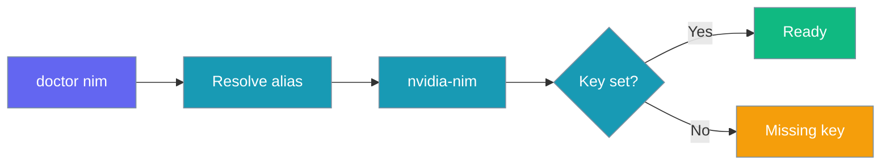

`providers doctor` resolves the provider name the same way the Agent does and reports whether its API key is set.



## Quick Start

<Steps>
<Step title="Set Your Key">
```bash
export NVIDIA_API_KEY=nvapi-...
```
</Step>
<Step title="Run the Doctor">
```bash
praisonai-ts providers doctor nvidia-nim
praisonai-ts providers doctor nvidia-nim --json
```
</Step>
</Steps>

## Aliases

```bash
praisonai-ts providers doctor nim
praisonai-ts providers doctor nvidia
```

## What the Doctor Reports

- The provider package and description.
- The environment variable it checks and whether it is set (masked preview).
- `ready` or `missing_key` status (`--json` returns the same fields).
- Supported modalities (chat, embeddings, image, audio, speech, tools).

<Note>
The doctor checks a single key variable. For `NVIDIA_NIM_API_KEY`, `NVIDIA_NIM_API_BASE` and the full resolution order, see the [Code page](/js/providers/nvidia-nim-code#environment-variables).
</Note>

## Related

<CardGroup cols={2}>
  <Card title="NVIDIA NIM Code Usage" icon="book" href="/js/providers/nvidia-nim-code">
    Models, reasoning mode and local NIM
  </Card>
  <Card title="Providers CLI" icon="terminal" href="/js/providers-cli">
    All provider CLI commands
  </Card>
</CardGroup>
