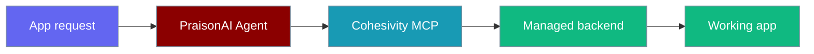

Connect a PraisonAI agent to [Cohesivity](https://cohesivity.ai/docs?ref=gh-praisonaidocs) to discover and provision databases, storage, hosting, authentication, email, and AI APIs.



## Quick Start

<Steps>
  <Step title="Install MCP support">
    Install PraisonAI Agents with the MCP dependency:

    ```bash
    pip install "praisonaiagents[mcp]"
    ```
  </Step>

  <Step title="Connect an agent">
    Create `cohesivity_agent.py`:

    ```python
    from praisonaiagents import Agent
    from praisonaiagents.mcp import MCP

    agent = Agent(
        instructions="Use Cohesivity tools when the task needs backend infrastructure.",
        model="gpt-4o-mini",
        tools=MCP("https://cohesivity.ai/mcp"),
    )

    agent.start(
        "Call get_cohesivity_documentation with document=\"offerings\". "
        "List the backend services for a photo-sharing app without changing anything."
    )
    ```
  </Step>

  <Step title="Run the agent">
    Run the file after configuring your model provider:

    ```bash
    python cohesivity_agent.py
    ```

    The agent connects through Streamable HTTP and receives the Cohesivity tools directly.
  </Step>
</Steps>

<Note>
  Cohesivity needs no account or API key to start. Your selected LLM provider may still require its own credentials.
</Note>

## Project Configuration

Add Cohesivity to `.praisonai/config.yaml` when every PraisonAI run in a project should receive its tools:

```yaml
mcp:
  servers:
    cohesivity:
      type: remote
      url: https://cohesivity.ai/mcp
      enabled: true
```

PraisonAI automatically uses Streamable HTTP for the HTTPS endpoint.

## Available Tools

The hosted server exposes documentation plus project-management tools:

| Tool | Purpose |
|---|---|
| `get_cohesivity_documentation` | Read current documentation and service details |
| `create_tenant` | Create a temporary project or an owned project after sign-in |
| `provision_resource` | Add one or more backend resources |
| `tenant_status` | Inspect lifecycle, limits, and provisioned resources |
| `claim_tenant` | Generate the approval link that keeps a temporary project |
| `give_feedback` | Send product feedback from an existing project |

Creating a project, claiming it, and provisioning resources require explicit user confirmation. A public project starts as a temporary 72-hour tenant unless the user chooses account sign-in.

## Best Practices

<AccordionGroup>
  <Accordion title="Ask before changing infrastructure">
    Get explicit approval for the exact project or resources before the agent passes `confirmed: true` to a mutating tool.
  </Accordion>

  <Accordion title="Protect project credentials">
    Save returned project credentials as `.cohesivity`, restrict the file to the current user, add it to `.gitignore`, and never print or commit it.
  </Accordion>

  <Accordion title="Read service details when needed">
    Use `get_cohesivity_documentation` before provisioning instead of copying limits or resource options into the agent prompt.
  </Accordion>
</AccordionGroup>

## Related

<CardGroup cols={2}>
  <Card title="Remote MCP Servers" icon="globe" href="/mcp/mcp-remote">
    Connect PraisonAI agents to hosted MCP servers.
  </Card>

  <Card title="MCP Transports" icon="arrows-left-right" href="/mcp/transports">
    Compare Streamable HTTP, SSE, WebSocket, and stdio transports.
  </Card>

  <Card title="Cohesivity" icon="server" href="https://cohesivity.ai/offerings?ref=gh-praisonaidocs">
    Browse the current backend services available through Cohesivity.
  </Card>
</CardGroup>
