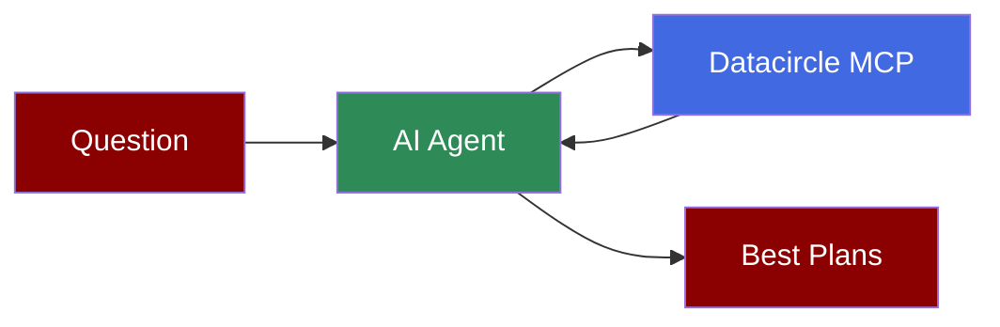

## Add GTM API Plans to AI Agent



[Datacircle](https://datacircle.dev): find the best GTM APIs. We benchmark all the GTM APIs and we put the results on our website. Our MCP server is open to anyone, with no key: `https://api.datacircle.dev/mcp` (Streamable HTTP).

## Quick Start

<Steps>
    <Step title="Install Dependencies">
        Install PraisonAI with MCP support:
        ```bash
        pip install "praisonaiagents[mcp]"
        ```
    </Step>
    <Step title="Set Your Model's Key">
        Datacircle needs no key. Set your model's API key:
        ```bash
        export OPENAI_API_KEY=your_openai_api_key_here
        ```
    </Step>
    <Step title="Create a file">
        Create `datacircle_agent.py` with this code:
        ```python
        from praisonaiagents import Agent, MCP

        datacircle_tools = MCP("https://api.datacircle.dev/mcp")

        api_agent = Agent(
            instructions="""You help people pick a GTM API.
            Use list_apis for the APIs on Datacircle's sheet,
            and search_plans for their plans, best first.""",
            model="gpt-4o-mini",
            tools=datacircle_tools,
        )

        api_agent.start(
            "Which 3 Employee email API plans score highest on Datacircle? "
            "Give each one's provider, score and price per 1,000."
        )
        ```
    </Step>
    <Step title="Run the Agent">
        Run the script:
        ```bash
        python datacircle_agent.py
        ```
        The agent calls `search_plans` and answers with the 3 best Employee email plans.
    </Step>
</Steps>

## Tools

| Tool | What the tool does |
| --- | --- |
| `list_apis` | Lists the GTM APIs on Datacircle, with the number of plans and providers for each API |
| `search_plans` | Finds the plans of one API or of every API. You can search by provider or plan name. You can sort by score or by price |

Each plan comes with a score out of 100, a price per 1,000 and a page on datacircle.dev. Both tools are read-only. We explain each key of a plan at [datacircle.dev/fields](https://datacircle.dev/fields).

<Note>
  **Requirements**
  - Python 3.10 or higher
  - `praisonaiagents` 1.7.22 or later, with the `mcp` extra
  - An OpenAI API key (for the agent's LLM)
</Note>
